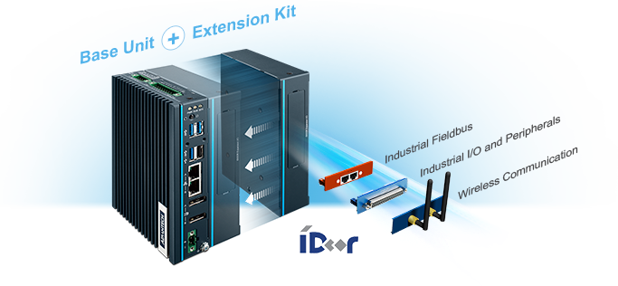
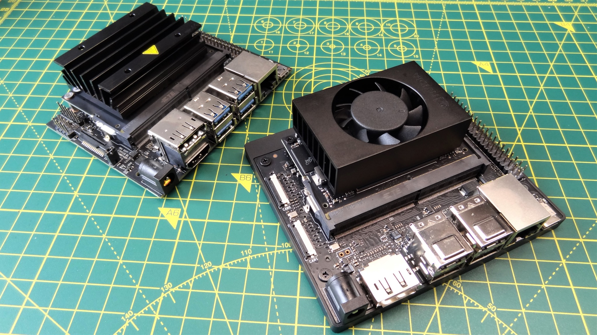
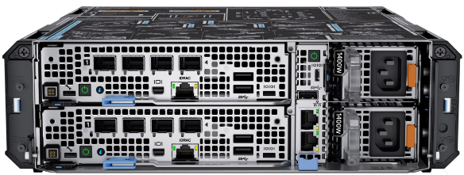
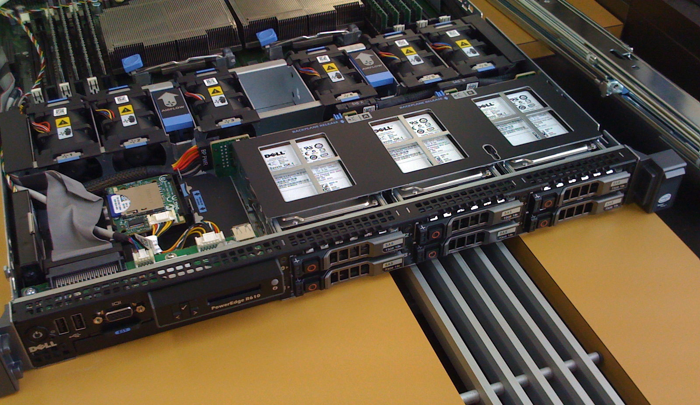
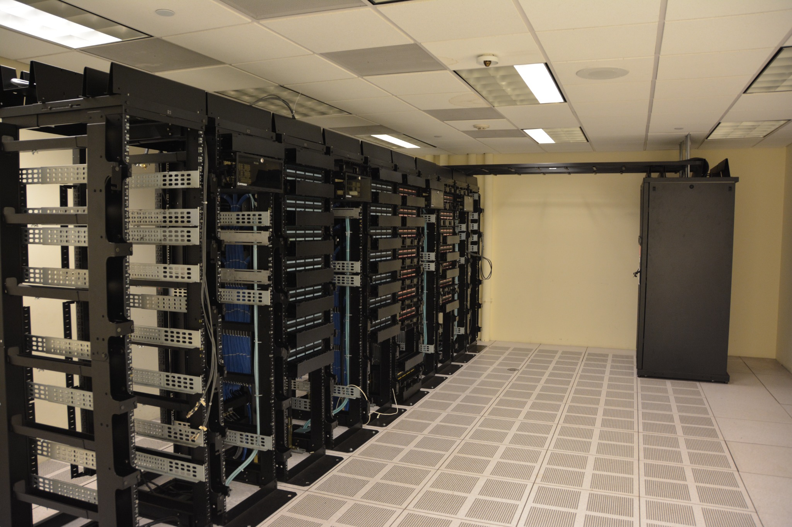
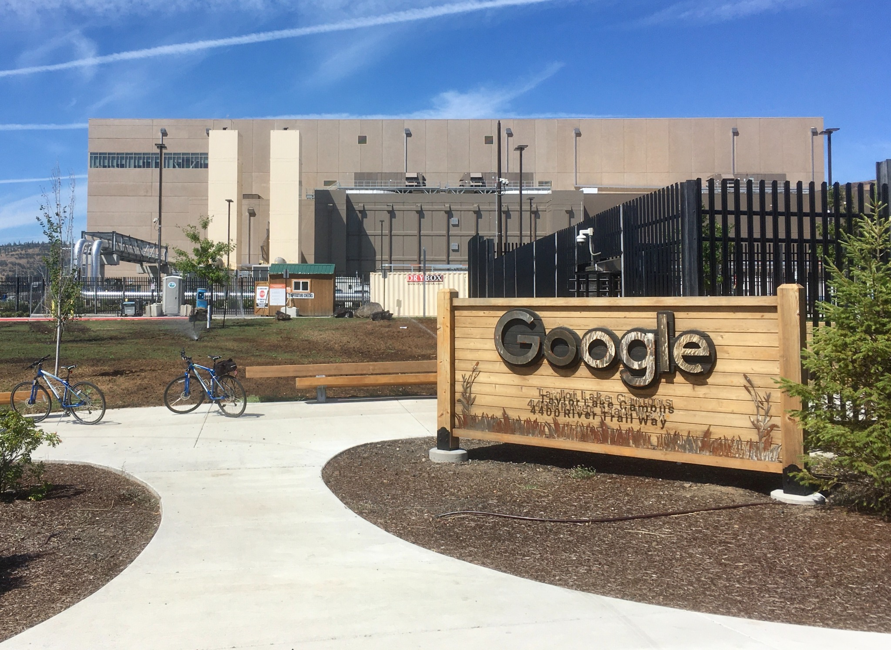
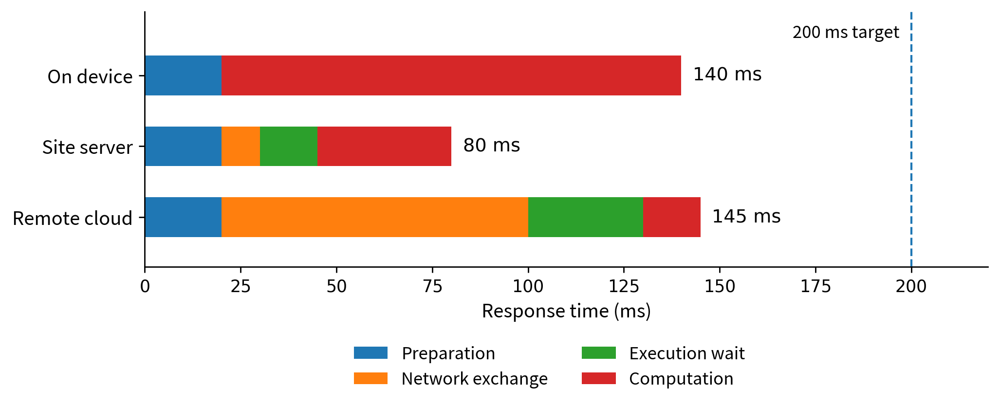

(chapter-1)=

# Chapter 1. Introduction to Edge Computing

(section-1-1)=

## 1.1 From Connected Devices to Edge Computing

A camera records a busy entrance. A wearable measures a person’s motion. A machine reports its temperature and vibration. Collecting these observations is only the first step. An application must turn them into something useful: a count of arriving customers, an activity record, or an indication that equipment needs attention. Where should that processing happen?

One familiar arrangement is to send the data to a remote service. The service stores it, runs the application, and returns a result to a phone or display. Many devices can use the same service, and developers can update the application in one place. Now consider an alternative: a computer beside the camera counts people locally and sends only the count to the remote service. The user still benefits from cloud storage and reporting, but an important part of the application has moved closer to the source of the data.

**Edge computing places selected computation and storage on devices or on computing resources close to the people, machines, and data sources that an application serves.** Its central idea is not to abandon the cloud. It is to choose which work should be done nearby and how that work should cooperate with more remote services. Decentralizing processing between connected devices and cloud systems is also central to NIST’s fog-computing model. [{ref}`1 <ref-1>`, {ref}`2 <ref-2>`]

(fig-1-1)=

<br>
Figure 1.1. Two ways to process the same camera input. In the upper design, frames travel to a remote application before a result is available. In the lower design, nearby computation produces the immediate result and sends selected information onward. The figure shows application work, not every router on the network path.

(section-1-1-1)=

### 1.1.1 Three ideas that belong together

The **Internet of Things (IoT)** connects physical objects to information systems through sensing, communication, and sometimes actuation. A sensor measures a physical quantity; an actuator changes something in the physical world, such as a valve position or motor speed. A connected device combines some of these capabilities with computing. An IoT system can use the cloud, the edge, or both. IoT describes the connection to physical things; it does not by itself determine where application processing occurs.

**Cloud computing** provides access to shared computing resources as services. A developer can request a virtual machine, store objects, or call a managed application without personally installing the underlying server. NIST emphasizes on-demand access, resource pooling, and the ability to provision and release resources. For the initial comparisons in this chapter, “the cloud” means a remote cloud service. Cloud computing more generally is a service model, however, not a rule that all cloud infrastructure must be geographically distant. [{ref}`1 <ref-1>`]

**Edge computing** emphasizes the placement of work relative to devices and users. A smart camera may process its own images; a shop may share one local computer among several cameras; a network provider may host an application near a population of mobile users. These are different ways to bring computing closer. An ordinary program that filters measurements is just as relevant as an AI model. Edge computing is not restricted to AI, and an AI application is not necessarily an edge application. [{ref}`2 <ref-2>`, {ref}`70 <ref-70>`]

(section-1-1-2)=

### 1.1.2 The same function, different execution sites

A useful first description of a system names its **input, task, result, and execution site**. For the entrance-camera application, the input is an image, the task is counting people, and the result is a count associated with an observation time. The execution site might be the camera itself, a computer in the same building, or a remote cloud server. The first three items describe the work; the fourth identifies where that work happens.

This distinction helps separate an application’s requirements from its implementation. A **functional requirement** states what the system must do. For example, the application must process camera images and provide time-stamped people counts to a display. That requirement does not, by itself, specify which computer must perform the counting.

A **non-functional requirement** specifies a quality the system must achieve or a constraint under which it must operate. Examples include how quickly a result must appear, which information may leave the site, how much energy the device may consume, and which functions must remain available when the Internet connection is lost. These requirements describe more than speed: privacy, availability, and resource limits can determine whether a design is acceptable at all. [{ref}`194 <ref-194>`, {ref}`195 <ref-195>`]

Consider three designs for the same camera application. In the first, the camera runs the counting program. In the second, it sends images to a nearby server. In the third, it sends images to a cloud service. All three may provide the required count, provided that the chosen implementation meets the application’s counting-quality requirement. Yet they need not provide the result equally quickly, transmit the same amount of data, or continue working under the same failures.

For an illustrative design exercise, suppose the result should appear within 200 ms of image capture, raw images must remain inside the building, and local counting should continue during an Internet outage. These are requirements against which the candidate designs can be evaluated. A measured response time is evidence about a design; it is not the requirement itself.

To evaluate a design, follow the actual processing rather than judging it from the location of its equipment. Two computers may stand in the same shop, while one forwards images to a cloud model and the other runs the model locally. Only the second performs the counting task at the site. Conversely, a program installed and updated by a cloud service may execute entirely on the local computer. Execution location and management responsibility are different questions.

The inputs need not be camera images. Periodic measurements, continuous audio, phone requests, and robot observations create different **workloads**: different input sizes, arrival patterns, and processing demands. The next section examines why these differences—and the requirements attached to them—make execution placement important.

(section-1-2)=

## 1.2 Why Edge Computing?

Once an application’s function is clear, we can ask which deployment will provide that function with the required quality and within the available constraints. A remote service may produce a correct answer but return it too late. A device may run the program locally but lack enough memory or battery capacity. A shared server may reduce the work performed by individual devices but become a bottleneck when many requests arrive.

Edge computing adds execution and storage options near data sources and users. Its value comes from using those options to meet application requirements—not from assuming that nearby execution is always faster, cheaper, or more reliable. The following sections examine five reasons to consider an edge deployment and the trade-offs that accompany them. [{ref}`2 <ref-2>`, {ref}`70 <ref-70>`]

(section-1-2-1)=

### 1.2.1 Response time: how soon must the result be available?

**Latency** is the time between a defined starting event and a defined outcome. In the camera application, we might measure from image capture to displaying the count. In a phone application, we might measure from submitting a request to receiving a usable response. These boundaries matter because the user experiences the complete operation, not just the time spent inside one model.

With remote execution, the input must reach the server, wait if the service is busy, be processed, and return a result. Moving the task to a nearby server can shorten the communication path. Running it on the originating device can avoid the application-level network exchange altogether. A warehouse robot or interactive camera application may therefore benefit from nearby computation even when the remote processor executes the model more quickly.

However, shorter communication does not guarantee a shorter response. A nearby computer may have a slower processor or a longer queue. A local task that takes 500 ms does not meet a 200 ms deadline simply because no Internet connection is involved. Likewise, a low average delay may hide occasional responses that arrive too late.

The design question is therefore: **which placement meets the response-time requirement under the expected workload?** {ref}`Section 1.6 <section-1-6>` develops a numerical example that separates preparation, communication, waiting, and computation.

(section-1-2-2)=

### 1.2.2 Communication: what information needs to cross the network?

**Bandwidth** describes a link’s capacity to carry data per unit time; **traffic volume** is the amount actually transmitted. A site may have enough local network capacity to connect several cameras while lacking the uplink capacity to send all their video to a remote service. A faster cloud processor does not remove that communication bottleneck.

The placement of processing changes what must travel. If a cloud service performs the counting, images must reach that service. If the camera or a site server performs it, the cloud may need only counts and timestamps for a daily report. Similarly, a vibration monitor can calculate features locally and upload a short raw segment only when an unusual event occurs. Filtering, aggregation, compression, and caching can reduce communication without requiring an AI model.

The appropriate reduction depends on the function. A count may be sufficient for an occupancy report but insufficient for reviewing a particular incident. An average may hide a brief spike. Local processing can therefore be combined with local retention of selected raw data, rather than treating every reduction in bytes as an improvement.

The question is not simply “Can we send less?” It is **“What information must cross each link for the application to provide the required result?”** {ref}`Section 1.6 <section-1-6>` compares small sensor records with continuous video to show why absolute traffic volume matters as well as percentage reduction.

(section-1-2-3)=

### 1.2.3 Availability: what must still work without the cloud?

An Internet outage does not necessarily stop the devices, local network, or power supply at a site. However, it can stop an application whose essential processing depends on a remote service. The cameras may continue collecting images while the display can no longer obtain a current count.

An edge deployment can keep selected functions available by retaining their required programs and information locally. A shop could continue counting people and displaying recent results while postponing cross-store reporting. A field station could keep recording measurements while its regional dashboard is unavailable.

This requires more than installing one program on a local host. The operation must also have access to its necessary data and dependencies. A locally running application that must contact a remote service before every request is not independent of that service.

A useful requirement therefore identifies both the function and the condition: **“Continue producing and displaying local counts while the Internet connection is unavailable.”** It need not require every cloud-supported feature to remain available. The local network and power supply may still be essential, and synchronization after reconnection is a separate part of the design.

(section-1-2-4)=

### 1.2.4 Privacy and data handling: what is allowed to leave?

Some applications place restrictions on the information that may leave a device or site. A camera may capture identifiable people, a microphone may record private conversations, and a phone may collect a detailed activity history. A design that sends these observations to a remote service may be unacceptable even when it provides excellent response time.

Local processing creates an opportunity to share a different representation. A camera application can release occupancy counts instead of images. A wearable can release an activity summary instead of a complete motion trace. Recent raw data can remain at the site under an explicit access and retention policy.

These choices can reduce disclosure, but they do not automatically guarantee privacy. A detailed summary may still reveal sensitive behavior, and an inadequately protected local computer may expose the records it stores. Privacy depends on the complete data path, including access, logs, retention, and transmission.

The architectural question is therefore: **which information may be processed at each location, and which information may cross each boundary?** This constraint can rule out a placement before speed or cost is compared. {ref}`Chapter 13 <chapter-13>` develops the associated protection mechanisms.

(fig-1-2)=

<br>
Figure 1.2. Local placement can address different needs; each panel states the operation and condition under which the benefit is expected.

(section-1-2-5)=

### 1.2.5 Resource use and cost: what should be shared, and where?

Executing everything on the originating device is not always practical. A small sensor may lack the memory needed by an application, while equipping every camera with a powerful processor may be unnecessarily expensive. A nearby server provides a middle option: several devices can share computation, storage, or an accelerator.

For example, multiple cameras could use one site-level inference service instead of each hosting a separate model. The same server could combine their results and maintain a local history. Sharing can make a larger resource available to small devices, but it also creates competition. Adding another camera may increase the waiting time of cameras already using the service.

An edge server also needs power, cooling, updates, and maintenance. Its installation is not justified merely because it reduces cloud traffic. Conversely, cloud execution still requires communication and some local equipment. A meaningful cost comparison includes the components and operational effort needed by each complete design.

The cloud remains useful for larger resource demands, long-term storage, and cross-site analysis. Devices remain useful for immediate interaction with their own inputs and outputs. The goal is to choose an appropriate division of work: **enough resources to meet the requirements, without adding unnecessary equipment, communication, or operational complexity.**

(chapter-1-from-motivations-to-design-choices)=

#### From motivations to design choices

These considerations do not produce a universal ranking of device, edge, and cloud execution. They help explain why a placement is suitable for a particular application. We must next understand the resources available at each location, the ways they can be deployed, and how they can cooperate.

(section-1-3)=

## 1.3 Devices, Edge Servers, and Cloud Resources

The word “computer” covers a wide range of machines. A battery-powered sensor board, a phone, and a rack-mounted server can all execute programs, but the size and character of those programs differ. Before selecting an execution site, it helps to recognize the machines and understand a few resource measurements.

(section-1-3-1)=

### 1.3.1 Read a resource description

The **CPU** executes general program instructions. A core is a processing unit within a CPU; multiple cores can make progress on different work at the same time when software permits. Clock frequency, expressed in MHz or GHz, is only one characteristic. Two processors with the same frequency can execute a particular program at different speeds because their designs, memory systems, and software differ.

**RAM** is the working space used while a program runs. **Storage**, such as flash memory, a microSD card, or an SSD, retains program files and data across power cycles. A computer can have a large storage device but too little RAM to run a particular application. Installing a 20 GB model file on a 1 TB drive does not create the working memory needed to execute it. Some systems can move data between storage and RAM during execution, but that movement has a cost.

A **GPU** or another accelerator can speed up suitable operations, such as the repeated numerical work in some image and language models. It is not a universal replacement for a CPU. The application also needs supported software and enough memory. A resource description should therefore include CPU, memory, storage, acceleration, communication interfaces, and power, rather than reduce a device to one headline performance number.

Finally, distinguish **power** from **energy**. Power, measured in watts (W), is the rate of energy use; energy accumulates over time. Under an invented constant-load assumption, a 10 W computer running for 8 hours uses 80 Wh. A battery’s capacity, the radio, attached sensors, and power-conversion losses also matter. A power-supply rating is not a measurement of the application’s actual consumption.

(fig-1-3)=

<br>
Figure 1.3. A resource card supports different feasibility questions; storage capacity is not a substitute for working memory.

(section-1-3-2)=

### 1.3.2 Small devices: microcontrollers and single-board computers

A **microcontroller** integrates a processor, a relatively small memory, and interfaces for interacting with hardware. It is useful when a task is narrow: read a sensor, maintain a short buffer, check a threshold, or produce an output signal. The Arduino UNO R3 is a familiar example with a 16 MHz ATmega328P, 2 KB of SRAM, and 32 KB of flash. The Raspberry Pi Pico 2 illustrates a different scale within the same broad category: a dual-core 150 MHz processor configuration, 520 KB of SRAM, and 4 MB of onboard flash. [{ref}`71 <ref-71>`, {ref}`72 <ref-72>`]

These are examples, not boundaries that define every microcontroller. The Pico 2 offers a choice of two Arm Cortex-M33 cores or two Hazard3 RISC-V cores; its wireless sibling is the Pico 2 W. A small board may run a dedicated program or a lightweight operating system, rather than a general-purpose desktop environment. Whether it can run a particular inference model depends on that model’s operations and memory needs, not on the word “AI” on a product page. [{ref}`72 <ref-72>`]

(fig-1-4)=

![Figure 1.4. Two real boards, with very different resource budgets: (a) Arduino UNO R3; (b) Raspberry Pi 5. Notice the hardware headers on both, and the Pi’s Ethernet, USB, and display connections. The photos are not to scale and do not identify the Pi’s installed RAM variant. Photo sources: P1–P2; specifications: \[71, 73\].](../images/asset-2ddf3d9fef2ec5e4.png)<br>
Figure 1.4. Two real boards, with very different resource budgets: (a) Arduino UNO R3; (b) Raspberry Pi 5. Notice the hardware headers on both, and the Pi’s Ethernet, USB, and display connections. The photos are not to scale and do not identify the Pi’s installed RAM variant. Photo sources: P1–P2; specifications: [{ref}`71 <ref-71>`, {ref}`73 <ref-73>`].

A **single-board computer** places the main parts of a general-purpose computer on one board. The Raspberry Pi 5, for example, has a quad-core 2.4 GHz Arm Cortex-A76 CPU and RAM variants from 1 GB to 16 GB. It supports a Linux-based environment and has interfaces for networking, storage, cameras, and other peripherals. A board of this kind can host a small web service, collect data from multiple sensors, or act as a gateway while other programs run alongside it. [{ref}`73 <ref-73>`]

A **gateway** is a role, not a unique hardware shape. It connects devices or networks and may translate messages, aggregate readings, or forward data to a service. A single-board computer can fill this role; so can an industrial computer or a phone. A gateway becomes an execution site for an application task when it actually performs that task, rather than merely carrying the task’s input elsewhere. {ref}`Figure 1.5 <fig-1-5>` shows an industrial computer with modular interfaces that can support this kind of role.



(fig-1-5)=

**Figure 1.5.** An industrial computer as a possible gateway platform. Advantech’s UNO-137 product illustration shows a base unit, an extension kit, and optional industrial I/O, fieldbus, and wireless modules. The artwork illustrates hardware options, not an operating deployment; the software determines whether the host forwards data or processes it locally. Image source: P7.

(section-1-3-3)=

### 1.3.3 Phones and accelerated embedded computers

A phone combines computing with sensors, wireless interfaces, a battery, and a user interface. It can be both a data source and a nearby processor for another device, such as a wearable. Android, for example, exposes motion, environmental, and position-related sensors, with availability depending on the device. [{ref}`49 <ref-49>`] For a concrete classroom resource budget, we might assume a phone with 8 GB RAM and 128 GB storage; that is an explicit teaching configuration, not a specification shared by all phones.

The application cannot treat all of that memory, processor time, or battery as its own. The operating system and the user’s other applications also need resources. A phone may be a useful place to summarize motion data or run a bounded local model, yet a poor place to host an always-available service for many unrelated users. Availability, permission, and energy can matter as much as peak computation speed.

An **accelerated embedded computer** adds hardware aimed at demanding local computation. The NVIDIA Jetson Orin Nano Super developer kit, for example, combines a six-core Arm CPU, an NVIDIA GPU, and 8 GB memory; the vendor lists power modes in the 7–25 W range. [{ref}`74 <ref-74>`] This makes it a relevant platform to investigate for vision, robotics, or a small language-model service. It does not establish an application frame rate or response time: those require a particular model, input, runtime, and measurement.

```{list-table}
:header-rows: 1
:class: book-table

 * - (a) Smartphone
   - (b) Embedded development kits
 * - 
   - 
```

(fig-1-6)=

**Figure 1.6.** Different forms of edge-capable hardware: (a) a Google Pixel smartphone; (b) a Jetson Nano kit at upper left and a Jetson Orin Nano kit at lower right. These photos show physical design, cooling, and interfaces, not measured application performance. The phone’s resource budget above is hypothetical, and the 2023 Jetson photo does not establish the later Super configuration described in the text. Photo sources: P8–P9.

**A first memory estimate**

Suppose a model has 1 billion stored parameters and each parameter occupies 2 bytes. Its parameter values alone require about 2 GB in decimal units: 1,000,000,000 × 2. The running application also needs working data, intermediate results, and software memory. This is not an estimate of every model’s footprint; it is a way to see why “the file fits on the drive” and “the application fits in RAM” are different statements.

(section-1-3-4)=

### 1.3.4 Edge servers and physical installations

An **edge server** provides computing or storage services near the devices or users it serves. It might be a compact industrial computer in a cabinet, a workstation in a building, or a rack-mounted machine in a small equipment room. A group of such machines forms an edge cluster. The word “edge” identifies the server’s architectural role; it does not prescribe a processor brand, a fixed memory size, or a special case design.

To picture a modest shared site server, assume 16 CPU cores, 64 GB RAM, and a 1 TB SSD, perhaps with a separate accelerator. This is an illustrative configuration, not a minimum or a product specification. It offers a different budget from a sensor board, but it must divide that budget among applications and connected devices. Installing a new camera can therefore affect the waiting time of cameras already using the same inference service.



(fig-1-7)=

**Figure 1.7.** A compact commercial edge-server form factor: Dell PowerEdge XR4000z. The manufacturer’s product image makes the chassis, connection ports, and power interfaces visible. The illustrative 16-core, 64-GB resource budget in the text is not a specification of this pictured configuration. Image source: P10.

The installation is part of the system. The processor needs power and cooling; cameras need network paths; storage needs replacement and backup plans; and someone must be able to update or repair the host. A rugged enclosure addresses a different problem from a faster processor. The compact chassis in {ref}`Figure 1.7 <fig-1-7>` is one possible physical form; keeping it usable still requires suitable installation and maintenance.

(section-1-3-5)=

### 1.3.5 A cloud server is not the whole cloud

Cloud services also run on physical computers. Servers are installed in racks, with network equipment, power distribution, and cooling around them. A data center contains infrastructure for many such resources. {ref}`Figure 1.8 <fig-1-8>` makes these three scales visible through separate photographs of a server, equipment racks, and a data-center building. Google’s public data-center gallery provides further views of actual server aisles and facility equipment. [{ref}`75 <ref-75>`] The cloud-shaped symbol in an architecture drawing hides these physical arrangements.

What an application receives is usually a particular allocation or service, not unrestricted use of the entire facility. A **virtual machine (VM)** presents an isolated computer-like execution environment; a cloud **instance** is one provisioned unit of such a service. For example, AWS documents an EC2 m7i.large instance with 2 virtual CPUs and 8 GiB memory. [{ref}`76 <ref-76>`] The meaning of a vCPU depends on the instance architecture; it should not automatically be equated with one full physical core.

Consequently, a local workstation can have more memory than one small cloud instance. The cloud’s distinctive advantage is access to a larger managed pool and the option to request different services or allocations, subject to availability, quotas, and cost. When comparing performance, compare the resources actually assigned to the application. “Edge versus cloud” is not a comparison between a small computer and infinite resources.

```{list-table}
:header-rows: 1
:class: book-table

 * - (a) One physical server
   - (b) Equipment racks
 * - 
   - 
 * - (c) A data-center facility
   - 
 * - 
   - 
```

(fig-1-8)=

**Figure 1.8.** Three scales of physical infrastructure: (a) a Dell PowerEdge R610 server, (b) racks inside a data center, and (c) a Google data-center building in The Dalles, Oregon. These are separate sources, not views of one installation; (a) and (b) are not identified as Google equipment. The older server is shown for structure, not as a current performance example. Photo sources: P11–P13.

(table-1-1)=

Table 1.1. Representative resource budgets and possible roles

```{list-table}
:header-rows: 1
:class: book-table

 * - **Resource**
   - **Concrete resource example**
   - **Tasks to investigate**
 * - Microcontroller board
   - UNO R3: 16 MHz; 2 KB SRAM; 32 KB flash [{ref}`71 <ref-71>`]
   - Sensor acquisition, small buffers, simple local decisions
 * - Newer microcontroller example
   - Pico 2: dual-core 150 MHz configuration; 520 KB SRAM; 4 MB flash [{ref}`72 <ref-72>`]
   - Richer sensing logic and small embedded workloads
 * - Single-board computer
   - Pi 5: 4 CPU cores at 2.4 GHz; 1–16 GB RAM variants [{ref}`73 <ref-73>`]
   - Gateway, local database, web application, light processing
 * - Accelerated embedded kit
   - Orin Nano Super: 6-core CPU, GPU, 8 GB RAM [{ref}`74 <ref-74>`]
   - Vision or language inference that fits the hardware and runtime
 * - Site server (assumed)
   - 16 CPU cores; 64 GB RAM; 1 TB SSD
   - Shared inference, site data, several services
 * - Cloud instance example
   - EC2 m7i.large: 2 vCPUs; 8 GiB RAM [{ref}`76 <ref-76>`]
   - A specifically sized remote service; not the whole cloud
```

{ref}`Table 1.1 <table-1-1>` is a scale comparison, not a benchmark or purchasing guide. KB, MB, and GB follow the quoted manufacturer’s labels for specifications; GiB denotes $2^{30}$ bytes. In the worked traffic examples below, MB and GB are decimal units. Task suitability still depends on memory use, software support, arrival rate, and the required response—not just the hardware category.

(section-1-4)=

## 1.4 Where Is the Edge? Common Deployments

“Near the data source” can mean several places. For one application it means inside the phone; for another, a server in the same factory; for a third, a facility operated by a network provider. The following classification starts with **where application work executes**. It does not mix location with whether the host is mobile, who manufactured it, or whether the application uses AI.

(fig-1-9)=

<br>
Figure 1.9. Four alternative placements for an application task. On-device, on-site, provider-edge, and remote-cloud execution are options, not mandatory stages. A physical deployment can combine several of these arrangements. Ordinary network forwarding devices are omitted.

(section-1-4-1)=

### 1.4.1 On-device computing

In **on-device computing**, the originating device performs an application task itself. A wearable can process its own motion measurements; a camera can detect an event from its images; a phone can transcribe a short recording. The immediate task does not require an application request to another computer. The device may still upload selected results, download software, or use remote services for other tasks.

This is the closest execution site to the data, but it has the device’s resource and power limits. The design must also respect the device’s primary role: a phone belongs to its user, and a sensor must still acquire observations while its processor performs additional work. A capable endpoint can eliminate the need for a separate edge server for some tasks.

(section-1-4-2)=

### 1.4.2 On-site or enterprise edge

An **on-site edge** places shared computation within the relevant premises: a shop, campus, hospital building, factory, farm, or similar site. Devices reach it through a local network. The server can combine multiple inputs and offer services that a tiny endpoint cannot host. In a proposed factory design, several cameras might share one inference service while a local database records the resulting inspections.

“On-site” does not necessarily mean that the site’s owner manages every layer. A vendor can manage a machine installed on the customer’s premises. AWS Outposts is an example of a managed infrastructure offering deployed at customer sites and connected to an AWS Region. [{ref}`77 <ref-77>`] Physical location and management responsibility are two attributes of the design; neither can be inferred entirely from the other.

(fig-1-10)=

<br>
Figure 1.10. Computing begins in real environments, not cloud-shaped icons. (a) A solar-powered outdoor air-monitoring installation. (b) A camera-and-lighting installation above retail shelves. The photos show the power, mounting, and sensing context; the placement of the applications processing their data must be established separately. Photo sources: P5–P6.

{ref}`Figure 1.10 <fig-1-10>` illustrates why “deploy the program” is not the whole installation problem. An outdoor node needs an appropriate mounting and power arrangement; a retail installation needs cameras, cabling, and access for maintenance. Clarity’s Node-S documentation provides a concrete example of solar-powered air sensing with cellular communication. [{ref}`78 <ref-78>`] The particular local processing and remote services of a product should be checked rather than inferred from its enclosure.

(section-1-4-3)=

### 1.4.3 Provider and network edge

A **provider edge** serves applications from infrastructure near a group of users or network access points, rather than from a computer owned by each user. A mobile application could reach a provider-operated server through its access network. The application developer obtains a managed execution site, while the provider is responsible for the underlying facility and connectivity.

**Multi-access edge computing (MEC)** is a related standardization effort associated with an application environment at the network edge. ETSI develops specifications for MEC platforms and interoperability. [{ref}`79 <ref-79>`] The application server may be placed at an access site, an aggregation facility, or another suitable network location. A diagram of a base station beside a server is an architectural possibility, not a statement that every antenna tower contains a general-purpose application server.

A **content delivery network (CDN)** offers another related example: it can serve cached content from locations closer to users, reducing repeated trips to the origin. CloudFront documents this edge-location model. [{ref}`80 <ref-80>`] Caching a popular video and interpreting a newly captured image are different tasks, even if the same provider offers both kinds of service. Network attachment, application execution, and content caching should not be treated as interchangeable concepts.

(section-1-4-4)=

### 1.4.4 Mobility and cooperation are additional dimensions

A vehicle’s onboard computer is on-device computing even though the whole device moves. A roadside server is an infrastructure resource that may serve a changing set of vehicles. **Mobility** changes which resources can be reached and for how long; it does not require a separate hardware species called a “mobile edge.” Similarly, two phones or two site servers can exchange selected information. This **peer cooperation** describes a relationship between resources, not another location on a distance scale.

The term **fog computing** often emphasizes the distributed resources between things and cloud systems, while **cloudlet** commonly refers to a small nearby computing facility. NIST discusses these related concepts in its conceptual model. [{ref}`2 <ref-2>`] Terminology overlaps across communities. A useful architecture drawing therefore shows the actual machines, their tasks, and their connections instead of relying on a label to convey the whole design.

(section-1-5)=

## 1.5 The Edge–Cloud Continuum

So far, we have compared different locations for one task. A complete application often needs something more: different tasks and different kinds of data placed at different locations.

Return to the camera application. A camera acquires images. A site server counts people, stores recent results, and updates a local display. A cloud service combines summaries from several sites and distributes new versions of the application. These components contribute to one application even though they do not run on one computer.

The **edge–cloud continuum** is the connected set of device, edge, and cloud resources across which an application can organize its computation and data. “Continuum” emphasizes the opportunity to use these resources together rather than making one permanent choice between “edge” and “cloud.” It does not mean that every application uses every tier or that the connected computers automatically behave like one large machine. [{ref}`2 <ref-2>`, {ref}`70 <ref-70>`]

The same pattern applies to the multi-site visual-inspection example in {ref}`Figure 1.11 <fig-1-11>`: cameras acquire and select images, site servers inspect them and store results, and cloud services analyze selected history and distribute model updates.

(fig-1-11)=

<br>
Figure 1.11. Cooperation across the continuum in an illustrative multi-site application. Local inference, cross-site analysis, and model distribution are distinct tasks. Peer sharing between site servers is optional and should carry only information that the application needs and is allowed to exchange.

(section-1-5-1)=

### 1.5.1 Resources provide capacity; applications determine the work

Each execution site provides a particular resource budget: processor time, working memory, storage, networking, and possibly an accelerator. Application components consume those resources when they execute.

A camera may have enough capacity to capture and encode images but not enough to run the desired counting model. A site server may support that model for several cameras. A cloud service may offer additional capacity for processing permitted historical data from many sites. The architecture assigns work according to both the available resources and the requirements introduced in Section 1.1.

This is not simply a progression from “small” to “large.” The application receives a specific allocation at each site. A small cloud instance may have less memory than a local workstation, and a powerful edge server may still be overloaded by concurrent requests. The relevant question is which resources are available **to this application**, at this location, under the workload being considered.

(section-1-5-2)=

### 1.5.2 What can be placed, transferred, or changed?

Several different decisions are often compressed into the phrase “move work across the continuum.” It is useful to distinguish them. **Placement** chooses where a task, service, or data set resides; {ref}`Table 1.2 <table-1-2>` separates this decision from the transfers and resource changes it may require.

(table-1-2)=

Table 1.2. What can change across the edge–cloud continuum

```{list-table}
:header-rows: 1
:class: book-table

 * - **Object**
   - **What the system can change**
   - **Example**
 * - Data
   - Where it is stored and which copies or representations are transmitted
   - Keep images at the site; send counts to the cloud
 * - Computation
   - Where a task or service executes, or how its stages are divided
   - Run counting on a site server rather than on the camera
 * - Software and execution state
   - Where code and models are installed; what state must be transferred when execution changes location
   - Deploy a model to another server; preserve necessary state before switching an ongoing service
 * - Resource allocations
   - How much capacity a component receives at a site
   - Assign more processor time or memory to a service, or start another worker where capacity is available
```

Moving **data** means transmitting or copying information. The program may remain where it is. For example, a site server can upload a summary while continuing to perform all immediate counting locally.

Moving **computation** means changing the execution location. This does not always require moving a running program. If another server already hosts the required service, the application can send a new request and its input to that server. This is a form of **offloading**. Alternatively, a developer can divide a pipeline so that preprocessing occurs on the device and inference occurs on the server; this is **partitioning**.

Changing an ongoing service’s location can require more work. The destination may need compatible software, the correct model, access to data, and any state required to continue the operation. Copying a model file is therefore not the same as transferring a running service.

Changing **resource allocations** is different again. A service may receive a larger memory allocation on its current host, or another worker may be started on a different host. The physical hardware normally remains at its location. Access to a remote server’s memory does not automatically increase the local memory available to an edge process; the application must explicitly use remote execution, storage, or another supported distributed mechanism.

The central distinction is this: **resources provide capacity; computation uses that capacity; and data must reach the computation that needs it.** Choosing where one belongs affects the choices available for the others.

(section-1-5-3)=

### 1.5.3 Follow computation, data, and management separately

We can understand one deployment through three complementary views.

The **computation view** identifies the tasks and their execution sites. In the camera example, acquisition runs on the camera, counting runs on the site server, and cross-site reporting runs in the cloud.

The **data view** identifies what is stored and transmitted. Images travel from cameras to the site server, counts travel to the local display, and approved summaries travel to the cloud. The cloud does not need to receive every image merely because it participates in the application.

The **management view** identifies how components are installed, configured, monitored, and updated. A cloud management service may distribute a new counting model to site servers. That transfer supports future local execution; it need not place the cloud on the path of every counting request. AWS IoT Greengrass provides an example of this separation between device-side execution and cloud-supported deployment and management. [{ref}`14 <ref-14>`]

(fig-1-12)=

<br>
Figure 1.12. The data path and the management path can differ. A remotely managed application can execute locally. Dashed arrows represent configuration or update traffic; solid arrows represent the local application’s input and result. Loss of the wide-area link does not, by itself, break the depicted local path.

These views explain why two arrows connecting the same computers can have different meanings. Uploading an image for immediate processing, uploading a daily summary, and downloading a software update are not interchangeable operations.

They also clarify failures. Losing the cloud link may interrupt reporting and updates without interrupting local counting. Whether that is actually true depends on the dependencies of the counting operation—not on whether the architecture diagram includes an edge-server box.

(section-1-5-4)=

### 1.5.4 Cooperate across locations, and adapt when necessary

**Vertical cooperation** divides responsibilities across device, edge, and cloud resources. **Horizontal cooperation** connects resources at comparable levels, such as two site servers exchanging approved summaries or sharing work. An application can use either relationship without requiring every request to pass through every tier.

Consider an illustrative change in the camera application. A new camera increases the demand on the site server, and response time begins to exceed its target. The system could investigate several responses: allocate more local capacity, start another local worker, send permitted requests to a second server, or change the division of processing. Uploading images to the cloud is not an acceptable solution if the application prohibits that transfer.

These alternatives change different things: resource allocations, service placement, request routing, or task partitioning. Each may also introduce data-transfer, startup, or coordination costs. **Orchestration** coordinates components and their resources over time. {ref}`Chapter 6 <chapter-6>` develops scaling and orchestration, {ref}`Chapter 7 <chapter-7>` examines offloading and collaboration, {ref}`Chapter 8 <chapter-8>` studies selection policies, and {ref}`Chapter 9 <chapter-9>` maps these mechanisms to commercial platforms.

An application does not have to change its deployment dynamically to belong to the continuum. A fixed division of work can be entirely appropriate. The important idea is that devices, edge servers, and cloud services are cooperating resources whose roles are chosen to satisfy the application’s requirements.

A task graph and a network map remain different: the graph identifies dependencies among tasks, while the map identifies which resources can communicate. For a language-model application, for example, a local model can propose data queries, local tools can execute them, and an optional remote model can assist with permitted requests. The model is one software component within this arrangement, not the entire system.

(section-1-6)=

## 1.6 From Application Needs to Architecture

We can now bring the chapter’s ideas together. Begin with the required function and the quality attributes and constraints introduced in Section 1.1. Then identify candidate resources, choose where tasks and data could be placed, and compare the resulting communication and resource demands.

A proposed architecture is a hypothesis about how the application will meet its requirements. Simple calculations can eliminate clearly unsuitable designs and identify what needs measurement. The following examples compare response time and traffic volume without assuming that device, edge, or cloud execution is always the best choice.

(section-1-6-1)=

### 1.6.1 A response-time example

Suppose a teaching application classifies a captured image and should display the result within 200 ms. Assume that image preparation takes 20 ms in each design. We compare three placements for exactly the same classification task and assume comparable output quality. All values in {ref}`Table 1.3 <table-1-3>` are invented teaching assumptions, not measurements of a product or requirements for a real production line.

(table-1-3)=

Table 1.3. An assumed end-to-end response-time budget

```{list-table}
:header-rows: 1
:class: book-table

 * - **Time component**
   - **On device**
   - **Site server**
   - **Remote cloud**
 * - Image preparation
   - 20 ms
   - 20 ms
   - 20 ms
 * - Network exchange, excluding queueing
   - 0 ms
   - 10 ms
   - 80 ms
 * - Waiting for execution
   - 0 ms
   - 15 ms
   - 30 ms
 * - Classification
   - 120 ms
   - 35 ms
   - 15 ms
 * - Total
   - 140 ms
   - 80 ms
   - 145 ms
```

T\_response = T\_prepare + T\_network + T\_wait + T\_compute (1.1)

Here T\_network includes the request and result transfers and their path delay. Any network queueing included in that measurement must not be counted again in T\_wait; in this example T\_wait means waiting for execution at the selected host.

(fig-1-13)=

<br>
Figure 1.13. The three assumed response-time budgets from Table 1.3. The cloud has the shortest classification time, but the site server has the shortest total. These stacked intervals illustrate arithmetic, not measured speedups.

All three designs meet the assumed 200 ms target, and the site server has the shortest total in this example. It would still be premature to conclude that it is the best overall design. The on-device option needs no local application server; the remote option may simplify site maintenance; the shared site server may become busy when more cameras arrive. If its waiting time increases from 15 ms to 150 ms, its total rises to 215 ms and misses the target.

The next step is an experiment under the workload that matters: measure the complete response, vary the arrival rate, and record missed targets as well as successful responses. If raw images are not allowed to leave the premises, the remote design in the table may also be unacceptable regardless of its speed. Requirements help identify both feasibility and performance; they should not be replaced by one average latency number.

(section-1-6-2)=

### 1.6.2 A traffic example: small measurements and continuous video

Suppose twelve sensors each produce a 240-byte application record every ten seconds. Ignoring protocol headers and other overhead, the combined payload rate is 12 × 240 / 10 = 288 bytes/s. One day contains 86,400 seconds, so the daily payload is 24,883,200 bytes, or about 24.9 MB. This rate is small enough that bandwidth reduction alone may not justify adding a separate server.

Now assume each sensor is represented in cloud reporting by one 300-byte summary per minute. The payload falls to 12 × 300 / 60 = 60 bytes/s, or 5.184 MB/day. That is a 79.2% reduction but only about 19.7 MB saved per day. The same gateway could still be valuable for local availability or data control; the point is that its traffic benefit must be interpreted at the right scale.

Contrast this with an assumed compressed video stream of 2 Mbit/s. Converting bits to bytes and multiplying by one day gives 2,000,000 / 8 × 86,400 = 21.6 GB/day. Four such streams produce 86.4 GB/day of payload. Here local selection of frames or events can change the feasibility of using a constrained uplink. These figures do not describe every camera: resolution, compression, motion, and recording policy change the rate.

A useful comparison therefore reports both the percentage reduction and the absolute amount, and checks that the selected data still supports the task. Counting customers, investigating a particular incident, and producing a daily occupancy report may need different retained information. An architecture should be selected for a stated application, not for “IoT data” treated as one uniform workload.

(section-1-6-3)=

### 1.6.3 Change the application, and reconsider the design

For a farm that reports a few readings each hour, battery life and coverage may dominate. For an interactive phone application, response time and available device resources may dominate. For multi-camera inspection, shared compute capacity and deadlines may dominate. These examples need not receive the same architecture, even if all use sensors and models. The purpose of requirements analysis is to make those differences explicit before committing to a platform.

The initial design is a hypothesis to test. It should explain which work stays local, which information leaves, and why the proposed resources are sufficient. Measurements may show that the design is unnecessarily complex, that a supposedly small data stream is not small, or that a shared server becomes a bottleneck. Revising the architecture in response is part of systems engineering, not evidence that the first choice of technology was a failure.

(section-1-7)=

## 1.7 History and Rapid Development of Edge Computing

Edge computing did not begin with a single product, paper, or invention. Content delivery, mobile computing, IoT, telecommunications, and AI approached a shared question from different directions: which work benefits from being performed near its users or data? This section follows selected milestones, then uses dated numerical evidence to explain the field’s development. These developments overlap; newer approaches did not simply replace older ones. [{ref}`196 <ref-196>`–{ref}`206 <ref-206>`]

(section-1-7-1)=

### 1.7.1 Early foundations: bring content and computation closer

A content delivery network (CDN) reduces repeated trips to an origin by storing or serving content from distributed locations. Akamai launched its commercial service in April 1999. By the end of 2000, the company reported more than 8,000 servers inside 473 networks in 55 countries. This is an early example of proximity implemented at substantial scale, long before today’s edge-AI systems. The figures describe one provider’s content-delivery network, not the size of a general-purpose edge-computing market. [{ref}`80 <ref-80>`, {ref}`196 <ref-196>`, {ref}`211 <ref-211>`]

Mobile computing raised a different question: where can a resource-limited device obtain additional computation without incurring the delay and variability of a distant cloud? The 2009 paper “The Case for VM-Based Cloudlets in Mobile Computing” proposed nearby infrastructure accessed over a wireless local-area network. Virtual-machine synthesis helped customize the nearby execution environment for resource-intensive mobile applications. [{ref}`197 <ref-197>`]

The distinction matters. A nearby cache can deliver a previously stored object; a nearby execution service can compute a new result from a new input. Serving a popular video and recognizing an object in a newly captured image both benefit from thinking about location, but they do not perform the same work. [{ref}`80 <ref-80>`, {ref}`197 <ref-197>`]

(section-1-7-2)=

### 1.7.2 IoT, fog computing, and network-edge standardization

IoT applications directed attention toward streams of physical observations and timely responses near machines, people, and infrastructure. In 2012, Bonomi and colleagues described fog computing as extending cloud services toward distributed resources near devices. Connected vehicles, smart grids, and sensor-and-actuator networks illustrated why local processing and broader cloud analytics could have complementary roles. [{ref}`198 <ref-198>`]

ETSI’s Mobile-edge Computing Industry Specification Group began work in December 2014 on an open application environment near mobile subscribers. In March 2017, it announced the name Multi-access Edge Computing, retaining MEC while expanding its scope beyond cellular access to include fixed and Wi-Fi networks. These are standardization milestones, not the invention of local processing. They also show that edge computing neither began with nor requires 5G. [{ref}`199 <ref-199>`, {ref}`200 <ref-200>`]

Shi and colleagues’ 2016 paper “Edge Computing: Vision and Challenges” connected IoT processing, cloud offloading, and collaborative applications with a broader systems agenda: programmability, service management, privacy, and security. NIST’s 2018 fog-computing model organized related concepts and architectural characteristics. The questions were becoming wider than where to run one program: how should distributed services, resources, and data operate together? [{ref}`2 <ref-2>`, {ref}`206 <ref-206>`]

(section-1-7-3)=

### 1.7.3 From research ideas to deployable platforms

A nearby computer is useful only when applications can be installed, connected to devices, updated, and maintained. AWS Greengrass became generally available on June 7, 2017, with local computation, messaging, and data and state synchronization for connected devices, including operation during Internet disconnection. Cloud services continued to support management, analytics, and durable storage. This date refers to the original service, not the later Greengrass V2 release. [{ref}`201 <ref-201>`]

Provider networks offered another model. Cloudflare announced Workers in September 2017 and made it generally available in March 2018, enabling developers to execute JavaScript in its edge network. Rather than only selecting caching features, developers could supply application logic. Installing software on a factory gateway and invoking a provider-hosted function were now distinct practical forms of edge execution. [{ref}`202 <ref-202>`]

These platforms lowered some barriers to deployment without eliminating engineering responsibilities. A site still needs power and maintenance; a provider-hosted service still has network, access, and resource constraints. Commercial development expanded the available implementation choices rather than making every application automatically suitable for the edge. [{ref}`201 <ref-201>`, {ref}`202 <ref-202>`]

(section-1-7-4)=

### 1.7.4 From local prediction to on-device language models

AI added demanding workloads, while efficient models made more of them practical on constrained hardware. In their 2017 ImageNet comparison, the MobileNets authors reported 4.2 million parameters and 569 million multiply-add operations for MobileNet, versus 138 million parameters and 15,300 million multiply-adds for VGG-16. Reported classification accuracy was 70.6% versus 71.5%. Calculated from those values, MobileNet used about 1/33 as many parameters and 1/27 as many multiply-adds, with a 0.9-percentage-point accuracy reduction. Operation counts are not measured device latency, but they explain why resource-aware model design mattered. [{ref}`136 <ref-136>`, Table 8]

Language models extended the range of local tasks. Microsoft’s April 2024 Phi-3 report described a 3.8-billion-parameter model, a roughly 1.8 GB footprint after 4-bit quantization, and an offline demonstration generating more than 12 tokens per second on an A16 Bionic iPhone. These are author-reported results for a particular configuration, not a full application-memory budget or a guarantee for every phone and prompt. They nevertheless provide concrete evidence that useful language generation need not require a remote call. [{ref}`210 <ref-210>`, Section 2]

Apple’s 2024 and 2025 reports described approximately three-billion-parameter on-device models alongside server-based models. The 2025 report added developer-facing support for structured generation and tool calling. Its June 2026 announcement described a family of five models—two on-device and three server-based—including an on-device sparse model with 20 billion total parameters but 1–4 billion active for a request. Here “active” means only a subset participates in the selected computation; it is not the total model-storage size. [{ref}`203 <ref-203>`–{ref}`205 <ref-205>`]

The historical shift is from delivering stored content, through executing local analytics, to interpreting new requests and coordinating tools near their data. That wider capability does not make a complete application local or reliable by itself. Model serving, tool execution, and data access remain separate systems responsibilities, developed in Chapters 2 and 10–12. [{ref}`204 <ref-204>`, {ref}`205 <ref-205>`]

(table-1-4)=

Table 1.4. Selected milestones in the development of edge computing

```{list-table}
:header-rows: 1
:class: book-table

 * - **Date**
   - **Development**
   - **What changed**
 * - 1999–2000
   - Content-delivery networks
   - Akamai launches commercial service; by end-2000 it reports over 8,000 servers across 55 countries. Bring content closer. [{ref}`196 <ref-196>`, {ref}`211 <ref-211>`]
 * - 2009
   - VM-based cloudlets
   - Nearby infrastructure supports resource-intensive mobile applications without a distant-cloud path. [{ref}`197 <ref-197>`]
 * - 2012
   - Fog computing for IoT
   - Distributed resources complement cloud services for physical-world applications. [{ref}`198 <ref-198>`]
 * - 2014 / 2017
   - MEC standardization
   - ETSI starts Mobile-edge Computing work, then broadens it to Multi-access Edge Computing. [{ref}`199 <ref-199>`, {ref}`200 <ref-200>`]
 * - 2016 / 2018
   - A broader systems agenda
   - The edge vision paper and NIST’s model organize deployment, service-management, and trust questions. [{ref}`2 <ref-2>`, {ref}`206 <ref-206>`]
 * - 2017–2018
   - Platforms and efficient AI
   - Greengrass, Workers, and MobileNets expand deployable execution and resource-aware inference. [{ref}`136 <ref-136>`, {ref}`201 <ref-201>`, {ref}`202 <ref-202>`]
 * - 2024–2026
   - Local language applications
   - Phi-3 and Apple model reports demonstrate or describe on-device language capabilities alongside server options. [{ref}`203 <ref-203>`–{ref}`205 <ref-205>`, {ref}`210 <ref-210>`]
```

The dates identify selected publications, standardization steps, and product announcements. They are not exclusive birth dates or evidence that one approach replaced all earlier approaches.

(section-1-7-5)=

### 1.7.5 Quantitative evidence of rapid development

Rapid development has several meanings: a growing application base, more investment in deployment, more capable local equipment, and workloads that require fewer resources. {ref}`Table 1.5 <table-1-5>` keeps these dimensions separate. A device count, a market forecast, and a model benchmark answer different questions; they must not be combined into one growth rate.

(table-1-5)=

Table 1.5. Numerical indicators: scale, investment, and technical capability

```{list-table}
:header-rows: 1
:class: book-table

 * - **Indicator**
   - **Dated numbers**
   - **Evidence and scope**
 * - IoT connections<br> Demand indicator
   - 18.5B in 2024; 21.1B for 2025; about 14% growth.
   - 2024 estimate; 2025 forecast published Oct. 2025. Not a count of edge-computing deployments. [{ref}`207 <ref-207>`]
 * - Edge spending<br> Investment indicator
   - US\$265B in 2025; about US\$450B in 2029.
   - 2025 estimate; 2029 forecast published Feb. 2026. Multiple technology and service categories. [{ref}`208 <ref-208>`]
 * - Vision inference<br> 2017 paper comparison
   - MobileNet / VGG-16: 4.2M / 138M parameters; 569M / 15,300M multiply-adds; 70.6% / 71.5% accuracy.
   - Same paper’s ImageNet comparison. Counts show resource reduction; they are not hardware timing results. [{ref}`136 <ref-136>`, Table 8]
 * - Embedded platform<br> Dec. 2024 announcement
   - Orin Nano previous / Super: 40 / 67 sparse INT8 TOPS; 68 / 102 GB/s; US\$499 / US\$249 listed kit prices.
   - Vendor specifications and historical prices. A software/configuration upgrade, not a universal 1.7× application speedup. [{ref}`209 <ref-209>`]
 * - Phone language model<br> 2024 demonstration
   - Phi-3-mini: 3.8B parameters; 4-bit model ≈1.8 GB; \>12 generated tokens/s on an A16 Bionic iPhone.
   - Author-reported offline demonstration. Context, runtime state, and other software still require resources. [{ref}`210 <ref-210>`]
 * - Sparse on-device model<br> June 2026 announcement
   - Apple AFM 3 Core Advanced: 20B total parameters; 1–4B active per request.
   - Vendor-described architecture, not a task-quality score. Supported hardware and total storage still matter. [{ref}`205 <ref-205>`]
```

Source dates and evidence types are part of each claim. Forecasts are not realized results; vendor specifications and author demonstrations are not independent benchmarks of this course’s applications. Values are rounded as in the sources. B = billion; M = million; TOPS = trillion operations per second.

**A larger demand base.** IoT Analytics’ October 2025 report estimated 18.5 billion connected IoT devices for 2024 and forecast 21.1 billion for the end of 2025. The latter remains a forecast from that publication even when read after 2025. Its count covers active connected nodes or gateways, excludes phones and PCs, and does not count every sensor behind a gateway separately. The figures describe potential sources of local data and work—not devices proven to perform edge computation. [{ref}`207 <ref-207>`]

**A growing deployment ecosystem.** IDC’s February 2026 release estimated worldwide edge-computing spending at US\$265 billion in 2025 and forecast approximately US\$450 billion by 2029. The endpoints imply about a 70% increase, calculated as (450 − 265) / 265. The forecast covers multiple kinds of edge hardware, software, and services; it is neither spending on edge AI alone nor a forecast that 70% more tasks will execute locally. [{ref}`208 <ref-208>`]

**More usable capability per local platform.** NVIDIA’s December 2024 announcement compared 40 with 67 sparse INT8 TOPS and 68 with 102 GB/s memory bandwidth for the previous and Super configurations of the Orin Nano kit, while reducing the listed kit price from US\$499 to US\$249. Existing-kit software upgrades were part of the announcement. Software and configuration can therefore change usable capacity as well as new hardware. These are dated vendor figures, not current prices or measured speedups for every model. [{ref}`209 <ref-209>`]

Taken together, these indicators support different conclusions: connected devices create application opportunities; spending indicates investment in an ecosystem; efficient models and local accelerators change what can fit and run. None alone proves that edge execution will meet a particular latency, quality, privacy, or availability requirement. That claim still needs the application-level comparison introduced in Section 1.6.

(section-1-7-6)=

### 1.7.6 What the history means for system design

The progression can be understood as reinforcing changes in demand and feasibility. Interactive and data-intensive applications make communication and remote dependencies important; efficient models and local hardware make additional placements feasible; reusable platforms make those placements easier to deploy and maintain. The growing usefulness of local data and context gives developers further reasons to evaluate them. This is a systems interpretation of the evidence, not a claim that every sector develops at the same speed. [{ref}`136 <ref-136>`, {ref}`197 <ref-197>`, {ref}`201 <ref-201>`, {ref}`202 <ref-202>`, {ref}`207 <ref-207>`–{ref}`210 <ref-210>`]

There is no final victory of edge over cloud. A better local model can make a device useful for a new task, while a still larger task can benefit from a server. The enduring question remains: where should each part of the work execute so that the complete application meets its requirements? Historical progress expands the designs worth testing. {ref}`Section 1.8 <section-1-8>` turns to the challenges that remain.

(section-1-8)=

## 1.8 Challenges and the Road Ahead

Distributing an application gives us choices, but also introduces problems that a single-machine program can hide. Devices differ in hardware and operating conditions. Messages can be delayed or repeated. A server can restart while a device keeps sending observations. Several applications can compete for one accelerator. A software update can change what an entire site does. Edge computing therefore needs foundations in networking, operating systems, distributed systems, and careful evaluation—not only an API call to an AI service.

(table-1-6)=

Table 1.6. The questions developed through the rest of the book

```{list-table}
:header-rows: 1
:class: book-table

 * - **Technical question**
   - **Where it is developed**
 * - How do we turn observations into a useful first application?
   - {ref}`Chapter 2 <chapter-2>`: an agentic IoT application
 * - What can devices sense, and how do they communicate?
   - Chapters 3–4: devices, sensing, communication
 * - How do programs run and serve increasing demand?
   - Chapters 5–6: local deployment, scaling, and elasticity
 * - How do resources cooperate, retain useful state, and improve performance?
   - Chapters 7–8: offloading, consistency, scheduling, and optimization
 * - How do we deploy and operate applications on existing platforms?
   - {ref}`Chapter 9 <chapter-9>`: commercial platforms
 * - How do we run, optimize, and coordinate AI at the edge?
   - Chapters 10–12: edge inference, model collaboration, and agents
 * - How do systems protect users and establish trust across organizations?
   - Chapters 13–14: security, privacy, safety, and distributed trust
```

The next chapter introduces an application that uses an existing language model to organize local data analysis. It shows the system’s behavior and architecture without first requiring model training or implementation details. Later chapters expand beyond that application: phone sensing, cameras, field devices, vehicles, commercial edge platforms, and multi-device services expose different constraints. The common thread is the relationship between application behavior, resources, communication, and deployment.

The aim is to be able to look at an unfamiliar application and draw a defensible first design: identify its inputs and tasks, recognize plausible execution sites, estimate the important costs, and decide what must be measured. The architecture can then become more sophisticated where the evidence and requirements justify it. Simplicity remains a legitimate outcome.

(chapter-1-chapter-summary)=

## Chapter summary

A functional requirement describes what an application must do; non-functional requirements describe qualities and constraints under which it must operate. Different placements can provide the same function while producing different response times, communication volumes, availability, and data-handling behavior. Edge computing creates additional choices for meeting these requirements. A microcontroller, phone, site server, and cloud instance offer different resource budgets, while deployment location and management responsibility remain separate properties.

The edge–cloud continuum allows an application to divide its work across cooperating resources. Data can be stored or transferred, computation can be placed or partitioned, software and state can be deployed or transferred, and resource allocations can change. These are related but distinct operations. Understanding a design requires following its computation, data, and management paths. Requirements and quantitative estimates help select plausible architectures; experiments determine how well they actually behave.

Edge computing developed through overlapping work on content delivery, mobile offloading, IoT, programmable platforms, and resource-efficient AI. Dated device estimates, spending forecasts, hardware specifications, and model results provide different kinds of evidence about its development. They expand the architectures available to a designer but do not establish that local execution always outperforms or replaces the cloud.

Key terms: IoT; sensor; actuator; workload; functional requirement; non-functional requirement; edge computing; cloud computing; latency; bandwidth; traffic volume; microcontroller; gateway; edge server; virtual machine; instance; on-device computing; on-site edge; provider edge; edge–cloud continuum; placement; offloading; partitioning; orchestration; resource allocation; vertical cooperation; horizontal cooperation; content delivery network (CDN); cloudlet; fog computing; multi-access edge computing (MEC); edge AI.

(chapter-1-exercises)=

## Exercises

**1.1 Identify the work.** Choose a wearable, camera, or phone application. Name one input, one processing task, and one result. Draw an on-device design and a remote-cloud design. State what must cross the network in each. State one functional requirement and two non-functional requirements shared by the candidate designs.

**1.2 Explain the hardware.** Why can a computer store a model file but still lack enough memory to run it? Use the hypothetical 1-billion-parameter, 2-byte-per-parameter model from Section 1.3. Explain why its 2 GB parameter size is not a complete running-memory estimate.

**1.3 Separate execution from management.** A cloud service installs a classifier on a shop server. The classifier answers local requests without calling the cloud, while software updates require a cloud connection. Which work executes locally? Which function stops during a cloud-link outage? Name one further dependency you would check before claiming full offline operation.

**1.4 Recalculate the budget.** In {ref}`Table 1.3 <table-1-3>`, increase site-server waiting time to 150 ms. Calculate the new total. Then double only the cloud network-exchange time. Which designs meet the assumed 200 ms target? Explain why these arithmetic results do not establish real-world performance.

**1.5 Compare absolute traffic.** Reproduce the sensor and video calculations in Section 1.6. A design cuts each workload’s payload by 50%. How many decimal MB per day does it save for the original sensor workload, and how many decimal GB per day for one video stream? Give one reason not to choose a design solely from those savings.

**1.6 Read a deployment photograph.** Use a photograph in this chapter or an attributed photograph from a public source. Identify visible equipment and its possible role. Separate what the image establishes from what it does not establish—for example, processing capacity, application placement, ownership, or network routing. Draw a clearly labeled possible architecture rather than presenting your inference as a verified deployment.

**1.7 Choose for contrasting needs.** Compare an hourly environmental report with an interactive image-classification service. State two important requirements for each. Propose an initial deployment and one experiment that could cause you to revise it. The two applications need not use different architectures if your reasoning supports the same one.

**1.8 Draw the continuum.** Design a read-only application that uses local sensor data and a language model. Draw the computation, data, and management paths. Choose one operation that should continue during a cloud-link outage and explain what must be present locally for it to work. Identify one data transfer, one computation-placement decision, and one resource-allocation decision; explain why they are not the same operation.

**1.9 Connect history to a requirement.** Choose two milestones in Table 1.4. For each, identify the work performed near users or devices, the limitation it addressed, and one important requirement that the new approach did not automatically satisfy. Explain why the two milestones need not represent the same kind of edge deployment.

**1.10 Read the numbers critically.** From {ref}`Table 1.5 <table-1-5>`, calculate the MobileNet-to-VGG-16 parameter and multiply-add ratios, and the change in reported accuracy in percentage points. Explain why these ratios are not measured speedups. Then identify one estimate, one forecast, and one experimental result in the table, and state a conclusion each does not support.

