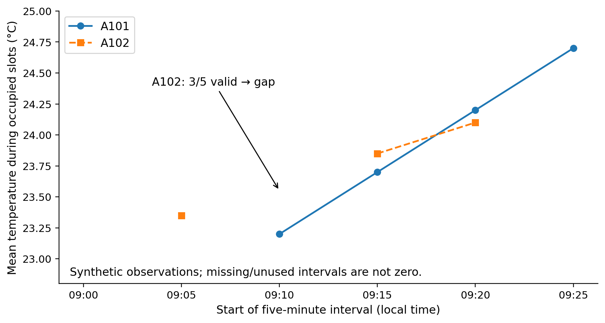
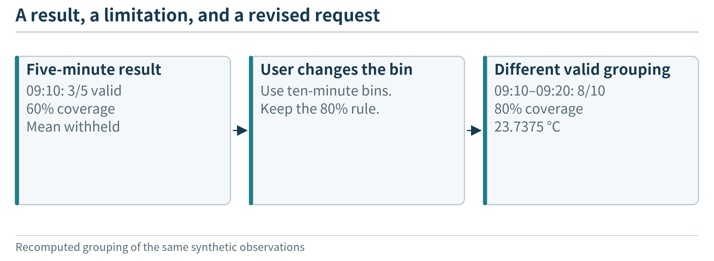
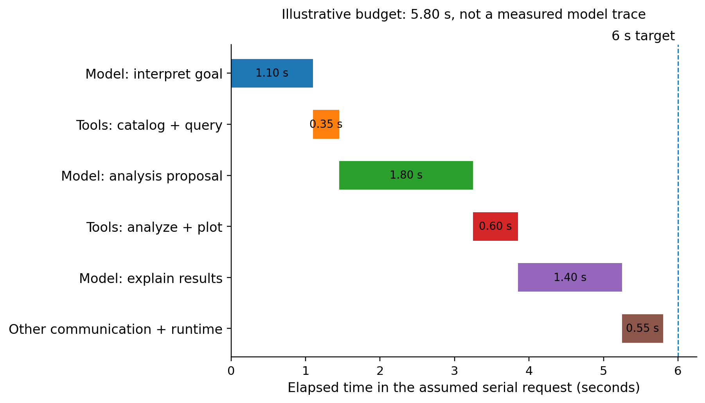

(chapter-2)=

# Chapter 2. An Agentic IoT Application at the Edge

A building manager opens a dashboard and sees two temperature curves. The dashboard answers the questions its developer anticipated: show a reading, select a date, calculate an average. Now the manager asks, “Compare the rooms only while they were occupied. Use five-minute intervals, and leave gaps where the measurements are incomplete.” A second request changes the definition of an event rather than simply changing a date. A third asks for an explanation of the resulting graph. Should a developer have to build a separate screen and analysis pipeline for every such request?

This chapter introduces **RoomEdge**, a local IoT analysis assistant whose processing steps can change with the user’s goal. A language model helps interpret the request, select data, organize a workflow, and propose tool calls or a small analysis program. Software outside the model executes the operations and returns their results. The user receives an answer, a table, or a graph grounded in the site’s observations. The model is therefore involved before analysis begins, not merely asked to describe an answer that a fixed pipeline has already produced.

We will examine the application as a user and a system designer. The examples specify observable behavior and use clearly identified synthetic data; they are not transcripts of an executed model session. The numerical results can be reproduced independently of a model. Installation commands, model adapters, and executor source code are not needed to follow this chapter. Later chapters develop those components and their optimizations.

(section-2-1)=

## 2.1 From a Fixed Dashboard to On-Demand Analysis

(section-2-1-1)=

### 2.1.1 Three requests, one set of capabilities

Suppose two rooms contain temperature sensors and a source of occupancy observations. Devices transmit records to a nearby computer, which keeps a local history. A user can access only rooms for which the application grants permission. The initial application reads observations and produces analysis artifacts; it does not change heating settings, unlock doors, or control other physical equipment.

Consider three requests to the same system:

**A current observation.** “What is the latest temperature in A101, and when was it observed?” The system identifies the room and variable, retrieves an appropriate record, and reports its value and age. A fresh answer requires a recent observation, not an imaginative explanation of an old one.

**A comparison.** “Compare A101 and A102 yesterday while they were occupied. Calculate five-minute means and draw a graph.” The system needs temperature and occupancy information, a common time interpretation, a selection rule, grouped calculations, and a presentation. Simply retrieving the most recent temperature cannot answer it.

**A new analysis rule.** “Find warming events: temperature more than 2°C above the preceding fifteen-minute median, sustained for at least three minutes. Compare event counts during occupied and unoccupied periods.” The user has supplied a definition that need not exist as a preprogrammed application feature. The system must turn that definition into operations, resolve ambiguous details, and check the output. The threshold is an invented analysis rule, not a safety or comfort standard.

(fig-2-1)=

<br>
Figure 2.1. The same data and tools can support different user goals. The first request needs a lookup; the second combines filtering, alignment, aggregation, and plotting; the third introduces a user-defined calculation. The paths illustrate possible workflows, not a claim that a particular model generated them.

The useful flexibility is a change in **what the system does**, not just how it phrases a response. Changing “five minutes” to “ten minutes” modifies a parameter. Asking to filter by occupancy adds a dependency on another stream. Defining an event can introduce a new calculation. Each kind of change should be visible in the task plan and in the resulting analysis. A fluent response that ignores the changed condition is not successful adaptation.

(fig-2-2)=

<br>
Figure 2.2. Different goals reuse the same data and tools; these prepared panels demonstrate the application contract, not measured model-planning ability.

(section-2-1-2)=

### 2.1.2 What makes the application agentic?

A **tool** is an operation that application software exposes for a model to request: discover available fields, query a time interval, run an analysis, or create a plot. A **workflow** is a set of tasks and dependencies, such as retrieving two streams before joining them. An **agentic application** uses a model to help choose or revise those tasks in response to the goal and to observations returned by tools. This usage follows the distinction between predetermined workflows and model-directed tool use described in contemporary agent architectures. [{ref}`81 <ref-81>`, {ref}`82 <ref-82>`]

The distinction is easiest to see at a decision point. A fixed pipeline always computes a daily average because its developer selected that operation. In the proposed application, the model can request a median or a time-ordered series because the user’s question requires it. After discovering a missing field, it can ask for clarification or revise the analysis. The surrounding program still determines which operations exist and which are allowed.

One model and a small tool set are enough for this example. Multiple agents, a sophisticated planning algorithm, and a large orchestration framework are not prerequisites. Nor must every request invoke an open-ended loop: a well-understood lookup can follow a short, predictable path. The reason to include an agentic path is to handle useful variation without writing a complete business workflow for every anticipated question.

(section-2-1-3)=

### 2.1.3 Two kinds of planning

**Task planning occurs while the application runs.** The model proposes how to answer a particular request: identify inputs, query a history, compute an event, and display a result. The plan may be revised when a tool reports unavailable data or a failed calculation.

**System design occurs when the application is built and deployed.** Developers choose the sensors, data schema, host, model, tool interfaces, execution limits, and deployment arrangement. They decide which behaviors must work without the cloud and what performance to target. A model that can plan a data analysis has not automatically solved those infrastructure decisions.

An observable plan is a compact task artifact, such as “retrieve these variables over this interval, then calculate this statistic.” It is not a transcript of a model’s hidden reasoning and does not prove that the plan is sound. Its value is that the user and the runtime can examine the intended operations and compare them with what actually happened.

(section-2-2)=

## 2.2 Why a Language Model, and Why at the Edge?

(section-2-2-1)=

### 2.2.1 Language as an interface to composable computation

Ordinary code is excellent at executing a defined calculation. A language model adds a way to translate varied human requests into candidate calculations and tool interactions. The developer supplies a vocabulary of data and capabilities; the user supplies a goal; the model proposes how to connect them. Tool-using systems interleave these proposals with actual results rather than relying solely on text generated from model parameters. [{ref}`82 <ref-82>`]

The model can contribute at several points: resolving a room alias, identifying the needed fields, decomposing a comparison, proposing a program for a new event definition, and explaining the returned output. These roles do not require the model to perform arithmetic mentally. A program can calculate an exact mean even when the model chose which values to include. The important question is whether that choice matches the user’s request.

The system’s flexibility remains bounded by available data, tools, permissions, and model capability. It cannot recover a variable that was never measured. It cannot make unsupported software available by naming it. It should ask about genuinely ambiguous requests rather than silently select a convenient meaning. For a fixed daily report with no meaningful variation, a conventional pipeline may be simpler and more predictable.

(section-2-2-2)=

### 2.2.2 A local SLM and an optional remote LLM

In this chapter, **SLM** means a language model selected to fit a constrained local serving budget; **LLM** refers to a larger or more resource-intensive alternative in our comparisons. The terms do not impose a universal parameter-count boundary. Size, capability, and execution location are separate properties. A small model can run in a cloud service, and a sufficiently capable local server can host a larger model.

Our initial design puts a tool-capable SLM on the **edge server**, not on the tiny sensing microcontroller. The same nearby host runs the local data service and the application runtime. A remote LLM can be available as an optional enhancement for permitted requests, but it is not required for every local analysis. Model candidates must be tested on tool selection, task interpretation, and generated analysis before choosing one; a model’s name or size does not establish that it can perform these tasks.

Tool-calling support in a serving interface makes the interaction possible, not reliable by itself. For example, Ollama documents a loop in which a model proposes tool calls, the client application executes them, and the tool results are included in a subsequent model request. This is one possible implementation interface, not a requirement that all edge applications use that runtime. [{ref}`83 <ref-83>`]

(section-2-2-3)=

### 2.2.3 Four deployment motivations

**Keep sensitive context local.** Occupancy histories, user questions, and analysis results may reveal information about a site. Local interpretation and computation can avoid sending them to an outside model service. This is a data-flow choice, not an automatic privacy guarantee. Access controls, logs, retained conversations, and exported artifacts still require appropriate protection. The model’s proposal to send something remotely does not authorize that transfer.

**Reduce wide-area communication.** A local analysis can retrieve full-resolution history without uploading it for every model interaction. The runtime can return a compact result to the local model or release an approved summary to a remote service. A useful design keeps large tables as local artifacts and passes handles and relevant descriptions between components, rather than repeatedly copying every record into a prompt. Local network and local process communication still occur; reducing cloud traffic does not mean eliminating all data movement.

**Avoid unnecessary remote round trips.** A multi-step task may require several model/tool exchanges. Keeping the model near the tools can shorten the network component of each exchange. Yet a smaller local host may execute inference more slowly or queue behind other requests. Compare the whole request, not just the distance to the model. Local–remote collaboration research similarly studies a trade-off among model capability, communication, and serving cost rather than guaranteeing a universal improvement. [{ref}`31 <ref-31>`]

**Retain useful flexibility during a cloud-link outage.** A fixed local dashboard can keep showing a predefined chart. A local tool-using model could also process a *new* permitted request while the wide-area link is down. This is a stronger application goal: preserve some ability to interpret and organize work, not merely preserve cached display content. It requires the model, runtime, data, tool dependencies, usable identity, and user interface to be available locally. The local network and power are still needed.

These benefits can occur separately. A remote model that receives only summaries might reduce raw-data disclosure but still require connectivity for every task. A local model may support disconnected use without achieving the lowest latency. Deployment should be selected for the specific combination of requirements that matters.

(section-2-3)=

## 2.3 The Components and Their Responsibilities

(section-2-3-1)=

### 2.3.1 Two paths through the same system

The **observation path** operates whether or not a user asks a question. Sensors acquire measurements; devices attach identity, time, and units; a local receiver accepts records; and a data service stores them. For initial development, a replay source can supply records through the same interface. Replay validates software behavior, not sensor calibration or wireless performance.

The **request path** begins with an authenticated user. The local service establishes the user’s permitted scope, then gives the model the request and descriptions of relevant capabilities. The model proposes an operation, the runtime checks it, and a tool executes it. Results return to the model until it can complete the request, needs clarification, or reaches a stopping condition. The observation store remains distinct from the model conversation: the model does not have to memorize the entire history.

(fig-2-3)=

<br>
Figure 2.3. A local agentic IoT application. The observation path continuously maintains site data; the request path invokes the model and tools as needed. Model proposals do not bypass authorization. A remote LLM is optional and receives only an explicitly permitted payload. Devices, the edge host, and the cloud are different execution locations.

A practical demonstration can use two sensor nodes, a local network, one Linux-capable edge host, and a browser on a phone or laptop. Temperature and occupancy are separate information sources even when delivered in one record. The host needs enough memory for the chosen model and its runtime as well as the data service and analysis processes. No universal RAM requirement follows from this architecture; {ref}`Chapter 5 <chapter-5>` develops resource accounting, {ref}`Chapter 10 <chapter-10>` explains model weights and working memory, and {ref}`Chapter 11 <chapter-11>` examines language-model serving state.

(section-2-3-2)=

### 2.3.2 The model proposes; the runtime executes

The **model service** produces a proposed tool call, analysis program, clarification question, or answer. The **application runtime** manages the interaction, invokes permitted tools, tracks the task’s budget, and records outcomes. A **tool service** retrieves data or performs a computation. These may be processes on one computer or separate services, but their responsibilities are distinct.

Suppose the model proposes reading A102 while the user is authorized only for A101. The data-access boundary must reject that operation. The model cannot override the decision by describing the request as important. Conversely, an authorized request can fail because its data is absent; the returned error should distinguish missing information from denied access without exposing unauthorized details. Authentication identifies the caller, while authorization limits what that caller may obtain or do.

A tool call is not an executed action until the runtime has performed it and received an outcome. An acknowledgment that a job started is also not a completed calculation. This matters when the model summarizes its own progress: “I will compare the rooms” describes a plan, whereas “the comparison returned these values” requires a corresponding result.

(fig-2-4)=

<br>
Figure 2.4. A model proposes the next operation; the runtime checks it and returns the result or a bounded error before the next step.

The runtime need not ask the model about every low-level operation. A single approved analysis job may perform many arithmetic steps. The developer determines the granularity of tools; the model chooses among those capabilities. Too-coarse tools can limit useful variation, while too-fine tools can create unnecessary rounds and overhead. We will first make this boundary explicit and later evaluate alternative designs.

(section-2-3-3)=

### 2.3.3 Generated programs are analysis artifacts

For a request that exceeds a fixed aggregation tool, the model may propose a short program. The program receives selected data and produces a table, plot, or event list. It is not an instruction to execute arbitrary commands on the edge host. A controlled analysis environment should limit reachable files, libraries, network access, execution time, memory, and output size. Source records should be read-only, and ordinary users should not gain device-control authority through generated code. Documentation on code-executing agents emphasizes that a restricted interpreter is not automatically a complete security boundary. [{ref}`84 <ref-84>`]

Execution separates three questions: did the program run, did it calculate what the user requested, and are its conclusions supported by the input? A program can terminate normally while using the wrong time window or unit. The system should retain an inspectable analysis specification and output provenance so that those errors can be detected. A second model’s approval is not a substitute for checking known numeric properties or test cases.

The first application permits analysis artifacts, not physical actuation. This scope still supports substantial flexibility: new filters, comparisons, event definitions, and displays. Adding equipment control later would introduce different hazards and authority requirements, not merely one more harmless tool.

(section-2-4)=

## 2.4 Data and Tool Contracts That Support Planning

(section-2-4-1)=

### 2.4.1 An observation needs meaning, not only a value

The following is an illustrative observation, not executable application code. The room aliases A101 and A102 correspond to stable identifiers r101 and r102. Times are recorded unambiguously; user-facing calendar phrases are resolved using the site’s time zone. This schema illustrates the application design and is richer than the minimal ingestion exercise in Appendix A.

```json
{
  "schema_version": 1,
  "device_id": "sensor-101",
  "boot_id": "boot-a",
  "seq": 17,
  "room_id": "r101",
  "observed_at": "2026-09-14T09:12:00-04:00",
  "received_at": "2026-09-14T09:12:02-04:00",
  "values": {"temperature_c": 23.2, "occupied": true},
  "quality": {"temperature_c": "valid", "occupied": "valid"}
}
```

The logical event identifier is the combination of device, boot, and sequence. A new transmission attempt should not invent a new event, and a rebooted device should not make a new event indistinguishable from an earlier one. These fields mostly serve ingestion and deduplication; the model does not need to see every transport detail to plan an analysis.

Other fields are directly relevant to the requested computation. The room determines which histories can be compared. The unit determines whether subtraction and thresholds are meaningful. Observation time places the value in the physical history, whereas arrival time describes when the service received it. A quality indicator can prevent a failed sensor read from being interpreted as a genuine zero. The schema version identifies the meaning of the fields rather than merely whether JSON parsing succeeds.

The application must distinguish measurement from inference. An occupancy flag might come from a detector and have different uncertainty from a directly measured temperature. A claim that “people were present” should reflect the semantics of that source. Merely displaying a Boolean field does not establish perfect knowledge of the room.

(section-2-4-2)=

### 2.4.2 A catalog tells the model what can be investigated

A **data catalog** describes available sources without exposing every observation. For this application it can list room aliases, field meanings, units, available intervals, sampling information, and data-quality conventions. The service returns only catalog information the user is permitted to discover.

Imagine that a user requests humidity but the catalog contains only temperature and occupancy. The appropriate next step is to report that limitation or ask whether another analysis would be useful. Looking up data capabilities before writing a program prevents a task from depending on imaginary columns. Similarly, a request for “yesterday” requires a definite interval in the site’s calendar; it does not simply mean subtracting 24 hours from the latest timestamp.

```{list-table}
:header-rows: 1
:class: book-table

 * - **Contract element**
   - **What it tells the planner**
   - **What still needs enforcement**
 * - Field name, meaning, and unit
   - Which quantity can answer the question
   - Input validation and unit handling
 * - Available interval and sampling description
   - Whether the requested history may exist
   - Actual query coverage and missing-data checks
 * - Room and source relationships
   - Which records could be combined
   - Caller authorization and valid joins
 * - Quality and provenance information
   - Which limitations the analysis must consider
   - Consistent filtering and output provenance
 * - Tool description and accepted arguments
   - How to request a permitted operation
   - Argument validation, scope, and resource limits
```

A catalog is not the same as the database, and neither is an access token. Putting room\_id in a record does not authenticate its sender or authorize its reader. The trusted receiver associates devices with permitted sources; the query service associates callers with permitted scopes. The model works within those boundaries, not in place of them.

(fig-2-5)=

<br>
Figure 2.5. Metadata helps formulate a meaningful query; the data service still enforces access and validates the actual request.

(section-2-4-3)=

### 2.4.3 Tools expose capabilities, not every implementation detail

The initial tool set can be small: discover fields, query observations, run a specified analysis, and present an artifact. A tool description should state what it accepts, what it returns, and what errors mean. For example, a query returns a bounded data artifact plus its time interval, fields, coverage, and identifier. It does not silently replace missing records with invented measurements.

A local artifact identifier lets a later tool reuse the selected table without placing every row into the model’s context. The model can inspect metadata, preview a few rows when needed, and request a computation on the artifact. The analysis tool returns numeric results and relevant diagnostics. An artifact handle is not a permission grant: each use remains subject to the caller’s scope, task lifetime, and the service’s limits.

The three contracts therefore support different decisions. Observations say what happened according to a source. The catalog says what information can be sought. Tool descriptions say how the application can act on it. Together they give the model a grounded vocabulary for planning rather than asking it to infer a database or execution environment from a vague prompt.

(fig-2-6)=

<br>
Figure 2.6. Observations, a catalog, and tool descriptions answer different questions. The model uses authorized descriptions to propose work; the data and execution services enforce the contracts. Large data artifacts can remain local while their identifiers and relevant metadata move through the task loop.

(section-2-5)=

## 2.5 Follow a Request from Goal to Result

(section-2-5-1)=

### 2.5.1 Resolve the goal and inspect the available evidence

Consider a specific demonstration request: “For September 14, compare A101 and A102 from 09:00 to 09:30 while occupied. Use five-minute means. Omit bins with less than 80% valid temperature coverage.” The time zone is America/Detroit, and the interval includes 09:00 but excludes 09:30. This precise version of the request lets us examine behavior without leaving a calendar or threshold ambiguous.

The demonstration fixture contains one synthetic temperature opportunity and one known occupancy state per minute for each room. A101 is occupied from 09:10 through 09:29; A102 from 09:05 through 09:24. Two A102 temperature observations, at 09:13 and 09:14, are missing, although their occupancy states are known. The temperature sequences and the missing entries are defined in the companion data fixture. These are classroom values, not measurements from actual occupants or sensors.

A suitable proposed plan is to inspect the catalog, resolve the two room identifiers, query the temperature and occupancy histories, align them using the fixture’s minute slots, retain occupied slots, group them into five-minute bins, calculate coverage and means, and create a plot. The plan refers to data and tool capabilities; it does not assume that the model already knows the answer.

For less precise requests, the system may ask one focused question or present an explicit assumption for confirmation. It should not silently reinterpret “while occupied” as “during office hours.” Nor should it treat a request for a room comparison as permission to search every room in the building.

(section-2-5-2)=

### 2.5.2 Execute the plan and preserve the missing-data distinction

The query service first selects an authorized, stable data snapshot. The analysis then joins observations according to the declared time relationship. In this fixture the streams use the same minute slots; a real installation may require a tolerance, a different join, or a policy for unknown occupancy. Those are part of the analysis meaning, not details to hide inside plotting code.

For a bin, the denominator is the number of minute slots *known to be occupied*. The numerator is how many of those slots contain valid temperature observations. The demonstration therefore counts the two missing A102 temperatures against coverage rather than making them disappear by dropping the rows before counting. If occupancy itself were unknown, it would require a separate reported limitation.

(fig-2-7)=

<br>
Figure 2.7. The comparison workflow. Coverage is calculated before a result is accepted for plotting. The branch for insufficient coverage produces a gap with an explanation, not an invented mean. A changed user definition can produce a different workflow over the same tools and data.

The following results are independently computed from the synthetic fixture. Bins start at the displayed time and last five minutes. A dash means that no mean is presented; the reason distinguishes no occupied slots from insufficient temperature coverage.

```{list-table}
:header-rows: 1
:class: book-table

 * - **Bin start**
   - **A101 mean**
   - **A102 mean**
   - **Interpretation**
 * - 09:00
   - —
   - —
   - Neither room has occupied slots
 * - 09:05
   - —
   - 23.35°C
   - A102 has 5/5 valid occupied slots
 * - 09:10
   - 23.20°C
   - —
   - A101 has 5/5; A102 has only 3/5
 * - 09:15
   - 23.70°C
   - 23.85°C
   - Both rooms have 5/5
 * - 09:20
   - 24.20°C
   - 24.10°C
   - Both rooms have 5/5
 * - 09:25
   - 24.70°C
   - —
   - A102 has no occupied slots
```

At 09:10, A102’s three available temperatures do have an arithmetic mean, 23.55°C. The task rejects that bin because 3/5 = 60% is below the requested coverage rule. A successful system preserves that distinction: the value is not mathematically impossible, but it is outside the user’s accepted evidence policy. A graph that draws through the gap could conceal precisely the limitation the user asked to see.

(fig-2-8)=

<br>
Figure 2.8. Five-minute occupied-period means from the synthetic fixture. Markers represent accepted bins; missing bins break the line. The graph demonstrates the specified calculation, not real room conditions or measured language-model accuracy.

(section-2-5-3)=

### 2.5.3 Interpret the result, then change the request

A grounded answer can state that A101’s accepted means rise across the displayed occupied bins and that the A102 comparison is incomplete at 09:10. It should identify the interval, units, coverage rule, and underlying artifact. The data alone does not establish why a temperature changed. Interpreting an association is different from proving a physical cause.

Now change the request: “Use ten-minute bins instead.” The model does not need to invent a new data source. It changes the grouping operation and the expected output. For A102’s 09:10–09:20 bin, eight of ten occupied temperature opportunities are valid, so its 80% coverage reaches the threshold. The accepted mean is 23.7375°C. Previously excluded observations can therefore participate in an accepted *different* grouping. That does not retrospectively make the five-minute result wrong.

A second change, “Use the median rather than the mean,” changes the statistic but not the permissions. A third change, “Compare the unoccupied periods instead,” changes the selection and coverage denominator. These transformations are practical tests of flexibility: the task representation and computation must change where the request changes, while unchanged assumptions remain visible.

(fig-2-9)=

<br>
Figure 2.9. A missing interval is visible evidence about coverage; changing the request changes the analysis contract rather than filling the gap by invention.

(section-2-5-4)=

### 2.5.4 A new rule may require a generated program

Return to the warming-event request in Section 2.1. A possible plan queries temperature with an additional fifteen minutes of history before the requested analysis interval. Without that earlier history, the first rolling baseline cannot be formed as specified. It then computes a preceding-window median, tests the 2°C difference, groups qualifying intervals, checks duration, and associates events with occupancy information.

Several details matter to the meaning of the program. Does the preceding window exclude the current value? What minimum coverage is needed for a median? How are missing minutes treated? Does “three minutes” mean three complete one-minute measurement intervals, or merely three timestamped samples? Three instantaneous samples one minute apart do not prove that a physical condition held continuously for three minutes. The system can propose an explicit sampled-event definition and obtain confirmation where needed.

Once the definition is settled, the model can generate a small analysis program rather than asking the developer to add a new dashboard feature. The runtime executes it in the restricted analysis environment. An empty event list, a table of detected intervals, or an execution error is returned as an actual result. A budgeted repair can correct a program error; repeated retries cannot manufacture missing measurements. We need not read the program’s source here to understand the division of responsibility.

Known test cases should distinguish a correctly working event calculation from code that merely runs. A constant input should not create a warming event under this definition; a deliberately constructed qualifying interval should be detected; a missing-data gap should trigger the declared policy. These checks support the calculation, not a claim that a classroom event detector is a validated building-control system.

(section-2-5-5)=

### 2.5.5 Preserve local usefulness without the cloud

A revealing demonstration disconnects the edge host’s wide-area link while leaving its local network and power intact, then submits a *new* permitted analysis request. The desired observation is that the local model can still select tools and that the local data and analysis services complete their work. Replaying a cached answer to an earlier question would test something weaker.

Optional remote assistance becomes unavailable. The application can identify which tasks remain supported, ask the user to simplify an unsupported request, or return verified results without a generated explanation. It should not silently export private data when connectivity returns, nor label a deterministic demonstration response as a real model result. Running-process, process-restart, and host-reboot tests establish different levels of disconnected readiness; the reliability and platform chapters develop them in detail.

(section-2-6)=

## 2.6 Requirements, Initial Deployment, and the Work Ahead

(section-2-6-1)=

### 2.6.1 Specify success before selecting the host

The application offers a useful function, but several configurations might provide it. Before choosing hardware or a model, specify the intended request classes, users, available history, response targets, data-release constraints, and essential disconnected behavior. Also name the workload: an occasional classroom question is not the same as many concurrent requests to one shared model.

For an illustrative exercise, assume ten registered users, at most two simultaneous requests, and a two-room history. A simple lookup should complete within 2 seconds, a routine comparison within 6 seconds, and a custom analysis within 15 seconds. These are proposed teaching targets, not measurements or general user-interface standards. They should be evaluated per task class; an average across mostly easy lookups could hide poor custom-analysis behavior.

The offline requirement might cover lookups and routine comparisons using data already local. Remote assistance for complex requests could be optional. A stricter requirement could include locally generated custom analysis as well, but then the selected model and host must demonstrate it. The permitted remote payload must also be specified: task text itself can be sensitive, and a numerical summary is not automatically safe to release.

(section-2-6-2)=

### 2.6.2 Account for the complete request

For a simple serial execution, divide elapsed time into nonoverlapping intervals:


$$
T_{request} = T_{model} + T_{tools} + T_{communication} + T_{runtime}.
$$


Here $T_{model}$ includes all model-service intervals, not just the final answer. $T_{tools}$ covers query and analysis service intervals, including their waiting time when measured at that boundary. $T_{communication}$ contains transfers and path delays not already included in the service intervals. $T_{runtime}$ covers local coordination, checks, and presentation. A wall-clock trace is used to avoid counting a nested model call twice. Parallel execution requires a critical-path analysis instead of adding overlapping intervals; {ref}`Chapter 8 <chapter-8>` develops performance tracing, and {ref}`Chapter 12 <chapter-12>` examines workflow dependencies.

Suppose the task trace is assigned the following hypothetical times. They are inputs to a budget calculation, not results obtained from a particular SLM.

```{list-table}
:header-rows: 1
:class: book-table

 * - **Request stage**
   - **Assumed duration**
   - **What happens**
 * - Model: interpret goal and inspect capabilities
   - 1.10 s
   - Propose the first data operations
 * - Catalog and data tools
   - 0.35 s
   - Obtain descriptions and a data artifact
 * - Model: form the analysis request or program
   - 1.80 s
   - Specify the calculation
 * - Analysis and plot tools
   - 0.60 s
   - Execute and check numerical outputs
 * - Model: interpret returned results
   - 1.40 s
   - Form the user-facing explanation
 * - Remaining communication and runtime work
   - 0.55 s
   - Dispatch, transfer, validate, and display
 * - **Total**
   - **5.80 s**
   - End-to-end completion
```

(fig-2-10)=

<br>
Figure 2.10. One hypothetical serial request budget. Three separate model intervals contribute to the response. The total of 5.80 seconds leaves only 0.20 seconds under a 6-second target; it is not a measured latency or a guarantee for other requests.

The total fits the assumed comparison target, but one additional 1.5-second repair would raise it to 7.30 seconds. Likewise, three remote model round trips with an additional 0.12 seconds each would add 0.36 seconds *if everything else remained unchanged*. A real remote model could change compute time, number of rounds, and task quality, so this isolated calculation is not a local-versus-cloud benchmark.

In a running system, measure latency distributions and failures under the intended concurrency. Report the fraction of requests that finish correctly before the deadline, not only the speed of successful easy cases. A locally loaded model also does not eliminate queueing when two users need the same resource.

(section-2-6-3)=

### 2.6.3 Evaluate task completion and flexibility

“Accuracy” needs a task definition. For a lookup, compare the returned value, unit, source, and time with the selected record. For an analysis, check that the program uses the requested rooms, interval, filter, statistic, and missing-data policy. For a plot, check that it represents the computed values and gaps. Explanations should not contradict those artifacts or conceal important limitations.

Build tests whose expected properties are known independently of the model. Include ordinary requests, changed conditions, a new combination of familiar operations, an absent field, an ambiguous time phrase, denied access, incomplete observations, and a cloud outage. Keep development examples separate from held-out combinations used to report results. Success on one rehearsed request does not establish flexible task completion.

Report both coverage and correctness. If 18 of 20 answerable tasks receive an answer and 16 answers satisfy the rubric, coverage is 90%, correctness among answered tasks is about 88.9%, and successful completion over all answerable tasks is 80%. Report correctly handled unanswerable or unauthorized requests separately. A system that refuses every request must not appear perfect because it made no factual claims.

Model-generated programs additionally require functional checks. A test that the execution environment rejects forbidden access is different from a test that the calculation is correct. Likewise, valid JSON does not establish valid analysis. The task’s plan and provenance make errors easier to locate, but do not replace evaluation.

(section-2-6-4)=

### 2.6.4 Choose a low-cost feasible starting configuration

Three candidate arrangements illustrate the first design choice. A **local arrangement** keeps the model, data, and analysis on the edge host. A **remote-planner arrangement** sends permitted requests and tool results to a cloud model while some data tools remain on site. A **hybrid arrangement** handles supported requests locally and uses remote assistance only when policy permits. These labels describe roles, not guaranteed cost or capability rankings.

The objective is to find a low-cost configuration among those meeting the quality, response, data-handling, and disconnected-use requirements. A small host that cannot run the selected model is infeasible; a fast cloud service may be infeasible under the data-release rule. A local model that fails the requested analysis quality is not made acceptable by having no API bill.

Use a common workload and accounting interval. Under invented values, suppose a dedicated edge host costs 600 cost units, has a three-year accounting life, consumes an average 20 W continuously, and requires 40 units of annual maintenance. With energy priced at 0.20 units/kWh, its annual allocation is


$$
600/3 + (0.020 \times 8760 \times 0.20) + 40 = 275.04\ \text{cost units/year}.
$$


At 100 requests per day, this is about 0.00754 units per request. At 10 requests per day, it is about 0.0754. These figures omit common sensing and networking costs and assume all listed host costs are attributed to this service. They are not market prices. An already-owned shared host requires a separate distinction between incremental cost and an allocated share of total cost.

A remote or hybrid estimate must include its own retained site components, remote invocation charges, transferred data, and operational effort. A low token price alone is not the cost of the complete application. The initial exercise can compare two or three feasible candidates; it need not solve a global optimization problem. {ref}`Chapter 8 <chapter-8>` develops placement and adaptation, while {ref}`Chapter 11 <chapter-11>` examines efficient serving and model collaboration.

(section-2-6-5)=

### 2.6.5 Build the pieces, then improve the system

This application exposes a coherent set of implementation questions without requiring their answers all at once. How does a phone or sensor produce a usable observation? How does the record reach a local service? How is a model hosted and called? How is a query made repeatable? How does a tool request become a real operation? Each question needs a working foundation before advanced optimization becomes meaningful.

```{list-table}
:header-rows: 1
:class: book-table

 * - **Part of the application**
   - **Foundational work developed later**
   - **Questions raised by optimization**
 * - Sensing and observation records
   - Acquire data, attach time and units, handle basic quality checks; {ref}`Chapter 3 <chapter-3>`
   - Sampling, energy, and useful local preprocessing
 * - Device-to-service communication
   - Establish an exchange and inspect its messages; {ref}`Chapter 4 <chapter-4>`
   - Protocols, batching, retries, and bandwidth
 * - Model and tool execution
   - Run services on a host and understand their resource boundaries; {ref}`Chapter 5 <chapter-5>`
   - Startup, concurrency, memory, and isolation
 * - Data and task state
   - Store, query, identify, and recover records; {ref}`Chapter 7 <chapter-7>`
   - Caching, replication, and consistency
 * - Evaluation and placement
   - Measure scaling, offloading, and candidate policies; Chapters 6–8
   - Bottlenecks, load, mobility, and offloading
 * - Deployment and trust
   - Manage components and enforce access; Chapters 9 and 13
   - Fleet operations, safe updates, and data protection
 * - Model cooperation and task loops
   - Connect local/remote model roles and coordinate tool outcomes; Chapters 11–12
   - Serving efficiency, bounded workflows, and recovery
```

A prepared demonstration helps us recognize these parts. It is not evidence that a full autonomous implementation already exists in the companion exercises. Appendix A distinguishes the ingestion-and-summary foundation, the tool-driven runtime developed in {ref}`Chapter 12 <chapter-12>`, and actual-model planning that still requires evaluation. Keeping that distinction explicit prevents a deterministic demonstration from being mistaken for model reasoning or planning.

The broader lessons do not depend on classrooms. A field technician might analyze vibration histories; a person might ask a phone to compare an approved activity log; a retailer might investigate local inventory events. The sensing, timing, authority, and resource constraints change. The common opportunity is to connect flexible task interpretation with computation placed appropriately near data and users.

(chapter-2-chapter-summary)=

## Chapter Summary

An agentic edge application can use a language model to interpret a goal, organize analysis, propose tools or programs, and respond to actual execution results. This differs from attaching a prose generator to a fixed data-processing pipeline. The flexibility comes from model-guided composition of capabilities; its usefulness depends on data meaning, reliable tools, permissions, and task evaluation.

Local model execution can support data control, reduced wide-area traffic, shorter communication paths, and useful operation without a cloud connection. None of these benefits follows from the model label alone. A complete design identifies the observation path, request path, execution locations, and authority boundaries, then checks quality, latency, resources, and cost under a stated workload. The following chapters develop the basic implementations and the mechanisms needed to improve them.

**Key terms:** agentic application; SLM; LLM; tool; workflow; task plan; runtime; data catalog; observation contract; artifact; provenance; authorization; task coverage; end-to-end latency; feasible deployment.

(chapter-2-exercises)=

## Exercises

**2.1 Flexibility.** Compare a daily temperature dashboard with the three requests in Section 2.1. Identify a parameter change, a change in task dependencies, and a new computation. Explain what must change in the processing, not merely in the wording of the answer.

**2.2 Roles.** A model proposes reading an unauthorized room and then plotting the result. Identify which component should reject the access and what the model may legitimately do next. Why does a tool-call message not establish that an operation has executed?

**2.3 Contracts.** Explain how units, observation time, quality, and a data catalog affect the warming-event analysis. Which identifier fields primarily support ingestion rather than model planning? Why is a room identifier not an authorization credential?

**2.4 Coverage.** Reproduce the A102 decisions for the 09:10 five-minute bin and the 09:10–09:20 ten-minute bin. Explain why 23.55°C is omitted from the former plot while 23.7375°C is permitted in the latter. State the denominator in each coverage calculation.

**2.5 Budget.** Recalculate the 5.80-second request after one 1.5-second repair. Then consider only three additional network round trips of 0.12 seconds each. Which version meets a 6-second target? Explain why the latter comparison is not enough to choose a real remote model.

**2.6 Evaluation.** A system answers 18 of 20 answerable tasks, with 16 correct. Calculate coverage, conditional correctness, and overall successful completion. Propose two held-out request changes that test flexibility rather than memorized wording.

**2.7 Deployment.** Reproduce the annual local-host cost in Section 2.6.4. Compare its allocated cost per request at 10 and 100 daily requests. Name two costs a remote comparison must include and one nonfinancial requirement that could rule out the cheaper design.

**2.8 Demonstration versus implementation.** Design an observation sheet for a prepared demonstration: user goal, proposed operations, executed tools, data artifact, output, total time, and failure behavior. Explain which evidence would establish a new local analysis during a cloud outage, and which implementation and security properties that observation would still not establish.

