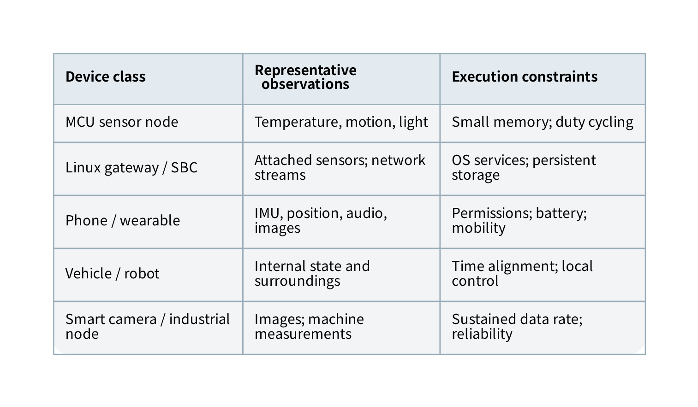
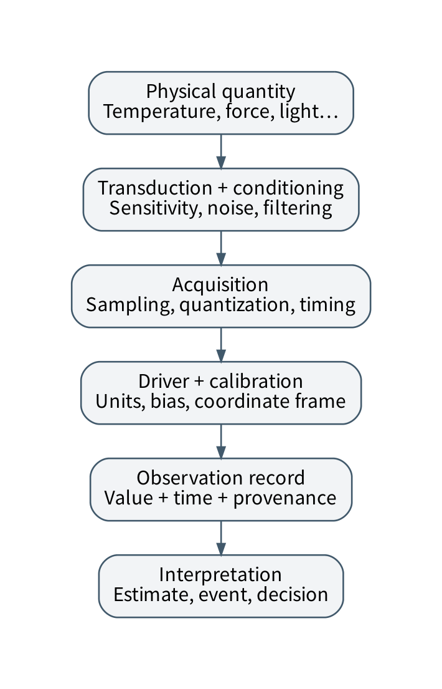
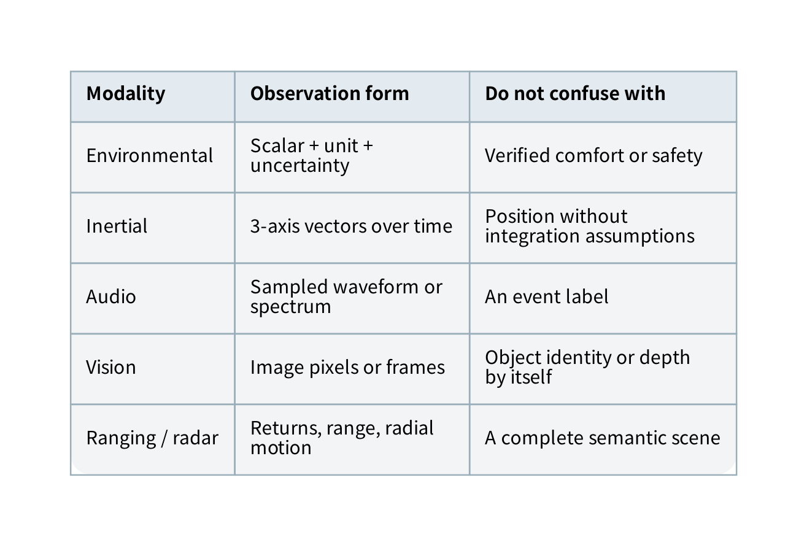
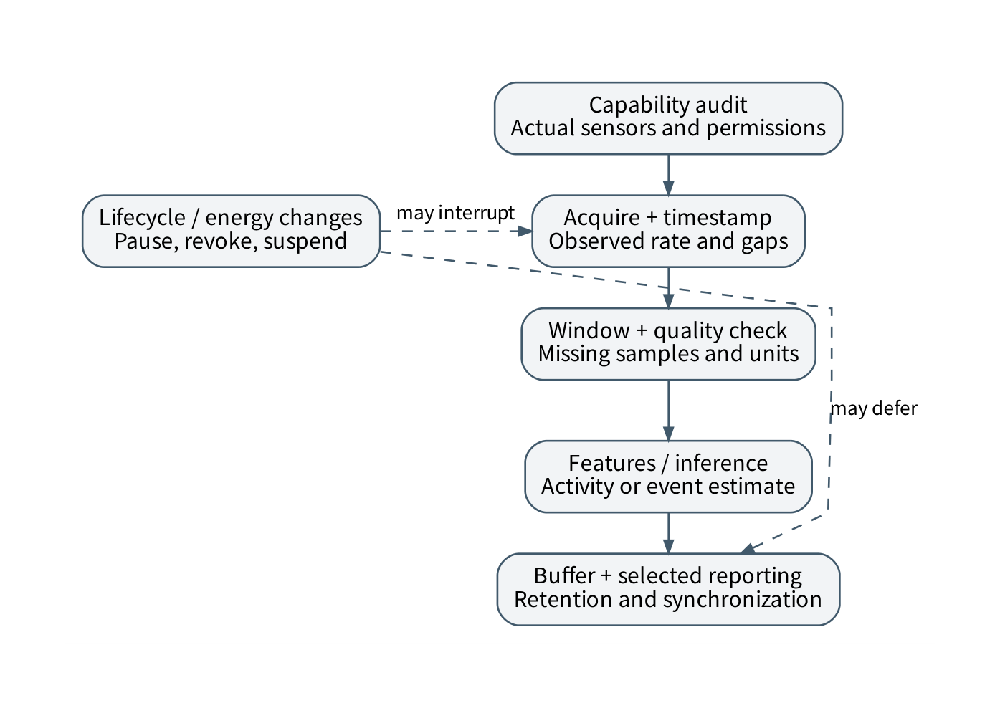
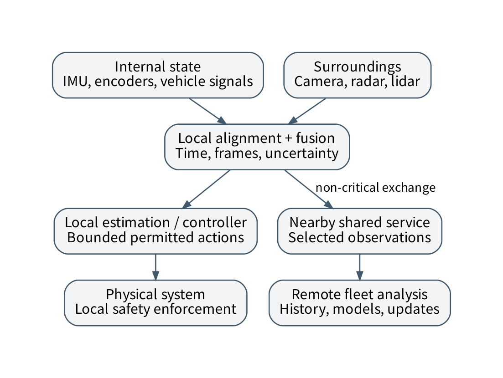
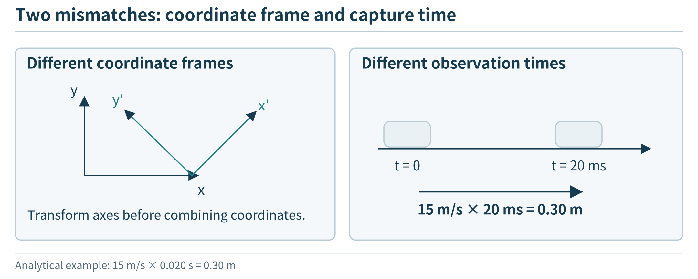

(chapter-3)=

# Chapter 3. IoT Devices and Sensing Systems

(section-3-1)=

## 3.1 A map of the physical edge

An agricultural moisture probe, a smartwatch, a traffic camera, and an industrial robot all produce data near the physical world. They are not interchangeable sources of JSON. Their observations differ in physical meaning, sampling behavior, volume, uncertainty, ownership, and consequences of failure. Before deciding where an application should compute, a designer needs to understand what its devices can actually observe and control.

This chapter separates three classifications. A **device class** describes an execution and deployment platform, such as a microcontroller node or smartphone. A **sensing modality** describes a physical measurement, such as acceleration, sound pressure, or reflected light. An **application domain** supplies the interpretation and requirements, such as activity recognition, road perception, or equipment maintenance. A smartphone contains several modalities, and the same accelerometer can support very different applications. Keeping these classifications separate prevents a product catalog from becoming a substitute for understanding.

The learning goal is not to memorize component specifications. It is to read a device description, identify the observation pipeline, estimate the resulting resource demand, and explain which information an application can and cannot infer. RoomEdge is one possible laboratory application; the chapter also develops mobile, wearable, vehicular, robotic, and industrial examples.

(fig-3-1)=

<br>
Figure 3.1. Device classes and sensing modalities are different axes. A platform can host several sensors, and the same modality can appear in several platforms. This is a conceptual inventory, not a performance ranking.

(section-3-2)=

## 3.2 Representative device classes

(section-3-2-1)=

### 3.2.1 Microcontroller nodes and development boards

A microcontroller integrates a processor with memory and peripheral controllers. A typical sensing program configures timers and interfaces, sleeps or waits for an event, reads a sensor, performs a small amount of computation, and stores or sends a result. It may execute directly as firmware or use a real-time operating system. Its limited memory does not make it unimportant: it often owns the only timely connection to the physical signal.

Representative development families include ESP32 boards, STM32 Nucleo boards, and Raspberry Pi Pico boards. These names identify families, not uniform capabilities. Wireless support, memory, peripheral availability, and supported software differ by chip and board. ESP-IDF is Espressif’s development framework; Nucleo boards provide access to STM32 devices and integrated debugging; Pico boards are microcontroller platforms rather than the Linux computers commonly associated with the Raspberry Pi name. [{ref}`39 <ref-39>`, {ref}`40 <ref-40>`, {ref}`41 <ref-41>`]

A development board adds practical infrastructure around a chip: power regulation, connectors, a programming interface, and sometimes a radio or sensor. An external sensor breakout may include its own regulator and level shifting, but this must be checked rather than assumed. A board suitable for a desk demonstration is not automatically suitable for an outdoor enclosure or a battery-powered product. The final design must account for startup behavior, watchdogs, power loss, and recovery from an interrupted firmware update.

(section-3-2-2)=

### 3.2.2 Single-board computers, gateways, and accelerated edge hosts

A single-board computer provides a more conventional host environment, commonly including external storage, virtual memory, processes, and a full networking stack. A Raspberry Pi computer illustrates this category. A gateway describes a **role**, not a particular board: it may translate protocols, aggregate observations, maintain local state, and host services for less capable devices. An industrial gateway may emphasize environmental tolerance, isolated interfaces, and lifecycle support rather than maximum processing speed. [{ref}`42 <ref-42>`]

An accelerated edge host combines a general-purpose CPU with a GPU, neural accelerator, or other specialized engine. NVIDIA Jetson modules are a representative embedded accelerated platform. A module, its carrier board, its development kit, and the deployed enclosure are different objects; power, cooling, connectors, and software support belong to the complete system. Quoted arithmetic throughput alone does not establish application throughput. Preprocessing, memory transfers, supported operators, and contention still matter. [{ref}`43 <ref-43>`]

A smart camera may combine imaging, encoding, and inference in one enclosure. This can reduce outgoing data but also restrict which intermediate data or models an application can access. A programmable logic controller, by contrast, is primarily an industrial control platform. An edge analytics computer can consume its approved observations without taking over its control responsibilities. Treating all of these devices as generic Linux servers hides important execution and safety boundaries.

(section-3-2-3)=

### 3.2.3 Phones, wearables, vehicles, and robots

A smartphone combines sensing, computation, storage, networking, a user interface, and an owner who can withdraw permission. It is both an end device and a possible gateway for nearby wearables. Its availability cannot be assumed merely because an application was installed. The user may disable a permission, stop the process, change networks, or take the device away.

A wearable is constrained by size, comfort, battery life, placement, and the quality of contact with the body. A vehicle or robot may instead integrate several computers, internal networks, high-rate sensors, and dedicated controllers. The meaningful unit of design is the system of components, not a single device specification.

```{list-table}
:header-rows: 1
:class: book-table

 * - **Device class**
   - **Representative examples**
   - **Questions before deployment**
 * - Microcontroller node
   - ESP32, STM32 Nucleo, Pico
   - What fits in working memory? Which events wake it? How is firmware recovered?
 * - General-purpose edge host
   - Raspberry Pi computer, mini-PC
   - What survives power loss? What are the storage and thermal limits?
 * - Accelerated embedded host
   - Jetson-class module and carrier
   - Which runtime and operators are supported? What is the sustained power budget?
 * - Mobile or wearable platform
   - Phone, watch, activity tag
   - Who controls permissions, placement, and availability?
 * - Domain system
   - Smart camera, industrial gateway, vehicle, robot
   - Which functions are exposed, isolated, or safety-critical?
```

The named platforms are examples for learning to read documentation, not purchasing recommendations or claims that one family is best. Product facts should be checked against the selected variant before a laboratory is assigned. [{ref}`39 <ref-39>`, {ref}`40 <ref-40>`, {ref}`41 <ref-41>`, {ref}`42 <ref-42>`, {ref}`43 <ref-43>`]

(section-3-3)=

## 3.3 From physical quantity to application observation

A sensing pipeline begins with a **measurand**, the quantity of interest. A transducer turns an aspect of that quantity into an electrical or digital signal. Signal conditioning may amplify or filter it; an analog-to-digital converter may sample and quantize it; a device driver reads the result; calibration and coordinate transformations give it usable meaning. A timestamp and context complete the application record.

The stages need not occupy different packages. A digital sensor can integrate the transducer, converter, filtering, calibration support, and interface. The host still needs to know which operations the sensor has already performed. Reading a digital value does not imply that it is an unprocessed or perfectly accurate measurement.

(fig-3-2)=

<br>
Figure 3.2. The observation pipeline separates physical transduction, signal processing, acquisition, and interpretation. A successful network delivery preserves only the information that survived the earlier stages.

Consider a temperature sensor mounted beside a busy processor. The API may return a well-formed value with a precise timestamp, while the enclosure’s self-heating makes it a poor estimate of ambient air temperature. No communication protocol can correct that placement error. Conversely, a reliable physical measurement can become misleading when software drops its unit, calibration version, or measurement time.

An observation contract should therefore include identity, value, unit, time basis, sensor configuration, and quality indicators. Context may include a coordinate frame, an installation location, or the conditions under which calibration is valid. Not every sample needs a copy of all metadata: stable metadata can be versioned separately, provided each sample unambiguously identifies the version it uses.

(section-3-4)=

## 3.4 Common sensing modalities

(section-3-4-1)=

### 3.4.1 Environmental and electrical measurements

Temperature, humidity, pressure, illumination, and gas-related measurements often produce scalar time series. They are useful for illustrating that a number is not a universal environmental description. A light sensor measures illumination at its location, not a camera image. A pressure sensor can support relative-height estimation under assumptions, but changing weather can also affect pressure. A gas sensor’s stated target, cross-sensitivity, warm-up, and calibration requirements matter.

The Bosch BME280 is a concrete example of a component combining humidity, pressure, and temperature measurements with digital interfaces. Sensirion’s SCD41 illustrates a different measurement principle: photoacoustic carbon-dioxide sensing. A device that estimates an equivalent carbon-dioxide value from other gas responses should not be presented as interchangeable with a sensor that measures carbon dioxide using an appropriate physical method. Compare the measurand and documentation, not just the field name on a dashboard. [{ref}`44 <ref-44>`, {ref}`46 <ref-46>`]

Electrical sensing includes voltage, current, contact state, and power-related quantities. A contact switch can directly report a mechanical state; a current sensor may support an inference that equipment is operating. These differ in evidential strength. A motor drawing current may still be stalled. In a maintenance application, the desired diagnosis usually requires a combination of observations and domain assumptions, not a single threshold.

(section-3-4-2)=

### 3.4.2 Motion, orientation, and position

An inertial measurement unit commonly combines accelerometers and gyroscopes. An accelerometer reports acceleration-related specific force; a gyroscope reports angular velocity. Neither directly supplies an indefinitely accurate trajectory. Bias accumulates when measurements are integrated, and interpretation depends on the coordinate frame. A magnetometer contributes information about a magnetic field, which can help orientation estimation but is disturbed by nearby magnetic materials and currents. The BMI270 provides a representative integrated accelerometer-and-gyroscope example. [{ref}`45 <ref-45>`, {ref}`50 <ref-50>`]

GNSS estimates position and time using satellite signals; it is a separate subsystem rather than a magnetometer feature. Wheel encoders measure rotation, not guaranteed travel over the ground: slipping wheels make the distinction important. Combining several imperfect measurements can improve a state estimate only when their limitations and relationships are modeled.

(section-3-4-3)=

### 3.4.3 Cameras, microphones, and ranging

A camera produces spatially organized intensity or color samples. Exposure, field of view, optics, motion blur, and illumination affect the information available to software. A microphone produces an acoustic waveform rather than a transcript. Speech recognition and sound-event detection are downstream interpretations. Compression can reduce data volume while changing the evidence available for a task.

Ranging sensors add another family of information. Ultrasonic devices infer distance using sound propagation; optical time-of-flight devices use emitted light; radar uses radio signals; lidar constructs optical range measurements across directions. A time-of-flight measurement often follows the basic relation $d = v\Delta t/2$, where $v$ is propagation speed and the factor two accounts for the outgoing and returning path. The equation assumes the relevant path is correctly identified; multipath, weak returns, and occlusion complicate a real device.

ST’s VL53L1X is an example of an integrated optical time-of-flight ranging component. TI’s mmWave devices illustrate radar sensing integrated with local processing. These are not interchangeable substitutes for a full camera or a vehicle’s perception stack. The sensing principle, spatial coverage, update behavior, environment, and required output must be compared. [{ref}`47 <ref-47>`, {ref}`48 <ref-48>`]

(fig-3-3)=

<br>
Figure 3.3. Different modalities expose different evidence: scalar readings, vectors, waveforms, images, and range returns. Application labels are inferences built from these observations, not additional physical sensors.

(section-3-5)=

## 3.5 Sampling, resolution, calibration, and uncertainty

Sampling rate is the frequency at which a signal is acquired. Reporting rate is the frequency at which records are delivered to another component. A device might sample vibration thousands of times per second, calculate a feature locally, and send one record per minute. The resulting report rate does not describe the original temporal resolution.

For a strictly band-limited signal with highest frequency $f_{max}$, ideal reconstruction requires a sampling rate greater than twice that frequency under the usual sampling-theorem assumptions. Practical acquisition adds an anti-alias filter and margin. If a physical oscillation aliases into a lower frequency during acquisition, a later cloud algorithm cannot generally infer the original signal from those samples alone. Increasing the reporting rate does not repair inadequate sampling. [{ref}`54 <ref-54>`]

Resolution describes distinguishable increments; accuracy describes closeness to the relevant reference; precision concerns repeatability. An ideal $b$-bit converter divides its input span into approximately $2^{b}$ levels. For an illustrative 0–3.3 V range and 12 bits, the ideal step is about 0.806 mV. This is not a claim that every conversion is accurate within 0.806 mV. Reference error, noise, nonlinearity, and the preceding sensor can dominate.

Calibration estimates a relationship between observations and reference conditions. A simple affine correction is $x = (y - b)/a$, where $y$ is the reported value, $a$ is a scale factor, and $b$ is an offset. This model is useful only over conditions for which it has been checked. Temperature drift, aging, and mounting can require recalibration. Record the calibration version rather than silently changing the meaning of historical readings.

Averaging repeated independent zero-mean noise can reduce variance, but it does not remove a common bias. It also trades temporal detail for smoothing. A ten-second mean may suppress exactly the short event that an impact detector needs. A good design chooses a representation from the downstream task, not from the assumption that fewer records are always better.

Timestamping deserves equal attention. Acquisition time, driver-delivery time, gateway-arrival time, and database-commit time are different events. A batch of old samples may arrive together. A monotonic device clock is useful for intervals, but separate devices need an estimated mapping before their times can be compared. Store uncertainty when alignment is approximate; apparent timestamp precision is not evidence of cross-device synchronization.

(section-3-6)=

## 3.6 Connecting sensors to computing devices

GPIO can represent simple digital input or output. An ADC acquires analog input. I²C uses a shared clock and data connection with addressed peripherals; SPI commonly uses clock, data lines, and device-selection signals; UART provides an asynchronous serial byte stream. These are local interface mechanisms, not alternatives to an end-to-end application protocol such as MQTT. A complete pipeline may read a sensor over I²C and publish its observation over MQTT through Wi-Fi. Representative board documentation exposes these distinct interfaces. [{ref}`39 <ref-39>`, {ref}`41 <ref-41>`]

An interface driver must understand more than the wire format. It may have to request a conversion, wait for readiness, read multiple registers consistently, interpret signed values, apply a scale factor, and detect overflow. Reading each byte correctly is insufficient if the bytes belong to different acquisition instants. A sensor FIFO can preserve bursts while the processor sleeps, but it has finite capacity and an overrun policy.

Polling repeatedly asks whether data are ready. An interrupt notifies the processor of an event. Direct memory access can move data without a CPU instruction for every byte. These choices affect timing and energy, but they do not remove the need for bounded buffers and ownership rules. A driver that performs slow network work inside a timing-sensitive callback can delay subsequent acquisition.

Before connecting hardware, check supply voltage, logic levels, grounding, current limits, and the specific board’s wiring instructions. Do not attach a classroom development board directly to mains wiring or a live vehicle control network. Industrial and vehicular examples in this book use authorized recordings, isolated training hardware, or simulation.

(section-3-7)=

## 3.7 Smartphone sensing as an edge-systems problem

(section-3-7-1)=

### 3.7.1 Discover capabilities rather than assuming them

Android exposes a sensor framework for discovering available sensors, examining their capabilities, and receiving timestamped events. Hardware-based sensors and software-derived sensors are distinguished; a device need not contain every sensor supported by the API. A derived rotation vector, for example, is not the same kind of object as an independent physical transducer. Availability checks and graceful fallback belong in the application design. [{ref}`49 <ref-49>`]

A sensor application’s acquisition loop should be short. It copies the measurement, timestamp, and quality information into a bounded queue; processing and storage occur outside the callback. The requested sampling period should be treated as a configuration request, with achieved intervals verified from event timestamps. Operating-system scheduling and batching mean callback arrival time is not necessarily sample time.

A useful first mobile experiment is a capability audit. Record the available sensor types, their advertised ranges and resolution, the requested acquisition interval, and the observed interval distribution. Repeat under a controlled CPU load. The purpose is to discover which assumptions survive actual execution, not to establish a universal phone benchmark.

(section-3-7-2)=

### 3.7.2 From raw events to an activity estimate

Consider recognizing periods of walking from a phone’s inertial data. A pipeline might acquire accelerometer events, check gaps, form overlapping windows, calculate signal features, classify a window, and report an event with its supporting time interval. A language model may explain an already computed activity summary; it need not calculate every signal feature from a text serialization of the waveform.

The coordinate frame matters. A phone in a pocket, bag, or hand observes motion differently. Taking vector magnitude can reduce some orientation dependence, but it also discards directional information and does not remove all placement effects. Android motion documentation distinguishes raw acceleration, gravity-related signals, and derived linear acceleration. Select the signal according to the intended interpretation rather than mixing them under one field name. [{ref}`50 <ref-50>`]

(fig-3-4)=

<br>
Figure 3.4. A mobile sensing pipeline separates acquisition, windowing, inference, and reporting. Permissions, lifecycle changes, and missing samples can interrupt the pipeline at different boundaries.

(section-3-7-3)=

### 3.7.3 Energy, permissions, and lifecycle

A phone is not a dedicated server. Location acquisition, radio use, screen activity, and computation compete for its battery. Background-location behavior is also constrained by the operating system and the permissions granted by the owner. Exact rules vary across platform versions, so a lab should record its target version and use current official guidance rather than assume indefinite background access. [{ref}`51 <ref-51>`]

Design a visible collection policy: what is collected, when it stops, what remains local, and how the owner can revoke access. Consent to motion sensing does not automatically authorize recording conversations or precise travel histories. Store only information needed by the task, and provide a meaningful result when a permission is unavailable. These are architectural constraints, not merely interface decoration.

An energy-aware design can combine low-cost triggers with short periods of higher-detail acquisition. For example, a motion event may trigger a bounded analysis window rather than continuous expensive processing. Whether this helps must be measured, including false triggers and startup costs. Event-driven operation can save resources in a sparse workload and perform poorly under continuous activity.

(section-3-8)=

## 3.8 Wearables and participatory sensing

Wearable observations depend on attachment and contact. A wrist-worn accelerometer is not a substitute for a sensor rigidly mounted on equipment. Optical pulse measurements depend on illumination, tissue interaction, motion, and contact; a classroom application should not claim clinical validity from a convenient waveform. The systems lesson is to preserve the conditions and uncertainty behind a derived measurement, not to diagnose a person.

A common topology has a wearable send data to a phone, which buffers it and optionally contacts a cloud service. This introduces at least two availability boundaries: wearable-to-phone and phone-to-cloud. A disconnected phone need not imply lost wearable data if the local protocol and buffers support recovery. Conversely, a cloud-connected phone cannot recover samples that the wearable never stored.

Participatory sensing combines observations from many owners. Its coverage is shaped by where participants go, which devices they own, and when they choose to contribute. More samples do not automatically produce a representative view. A noise-mapping study concentrated along commuting routes may leave residential streets poorly observed. Coverage maps, missingness, and device heterogeneity should be reported alongside the inferred map.

A useful design comparison contrasts centralized raw-data collection, local feature extraction, and local event reporting. The last two may reduce disclosure and traffic but can prevent later reanalysis. The correct choice depends on an explicit study or application purpose. A system should not collect raw data indefinitely merely because it might become useful later.

(section-3-9)=

## 3.9 Vehicle and robot sensing

(section-3-9-1)=

### 3.9.1 Internal state and external perception

Separate **proprioceptive** information about the system itself from **exteroceptive** information about its environment. Wheel rotation, steering-related measurements, inertial data, and actuator status describe aspects of internal state. Cameras, lidar, radar, and external positioning contribute observations of the surroundings or pose. A higher-level object track or obstacle alert is a derived representation.

Vehicles often expose selected electronic-control-unit messages through internal networks. CAN is a message-oriented bus whose identifiers participate in arbitration; it is not an IP network with one destination address per sensor. Linux SocketCAN provides a networking interface for supported CAN devices and virtual interfaces, which makes it useful for safe replay-based teaching. Decoding a payload still requires an authorized schema for the specific system. A successful CAN read is not permission to send control commands. [{ref}`52 <ref-52>`]

Robotic sensing follows similar principles but may involve different motion, mounting, and communication constraints. A warehouse robot’s local obstacle avoidance, fleet scheduling, and long-term map analysis can have very different deadlines. They should not be forced through one remote model endpoint merely because all three use sensor data.

(section-3-9-2)=

### 3.9.2 Multi-sensor perception and its costs

A camera supplies rich appearance information; a range sensor supplies distance-related observations; inertial and wheel measurements help estimate motion between less frequent observations. Fusion requires temporal alignment, spatial calibration, and an uncertainty model. More sensors can add useful evidence, but also add synchronization work, computation, failure modes, and maintenance.

A camera–lidar pair illustrates the spatial problem. A lidar point in its local coordinates cannot be placed directly into camera pixels. A rigid transformation relates the two frames, followed by the camera’s projection model. Even with correct geometry, a moving object may occupy different positions when the two sensors acquire their data. Temporal and spatial calibration solve different problems.

(fig-3-5)=

<br>
Figure 3.5. A vehicle or robot contains multiple sensing and execution paths. Immediate local control, shared edge coordination, and remote retrospective analysis have different dependencies; the remote path is not assumed to be part of the safety loop.

Vehicular cooperation introduces another distinction: transmitting observations, features, object tracks, or plans exchanges different amounts and kinds of information. Raw data offers flexibility at high transfer cost; tracks are compact but inherit the sender’s inference errors. A roadside edge service can help combine information, yet limited coverage and changing connectivity prevent it from being treated as an always-available extension of onboard memory. {ref}`Chapter 4 <chapter-4>` introduces the communication setting, and {ref}`Chapter 8 <chapter-8>` returns to mobility-aware placement.

(section-3-10)=

## 3.10 Fusion, coordinate frames, and time alignment

A coordinate frame identifies the origin and axes used to express a quantity. A vector with three correct numbers can still be unusable when its frame is unknown. Let $p_{s}$ be a point in a sensor frame. A rigid transformation into a reference frame can be written as


$$
p_{r} = R_{rs}p_{s} + t_{rs},
$$


where $R_{rs}$ is a rotation matrix and $t_{rs}$ is a translation. Units, direction conventions, and the time at which the transformation applies must be specified. Transforming acceleration also requires care about the physical quantity and gravity convention; a position transformation should not be blindly reused for every signal. ROS’s coordinate conventions provide one explicit example of how a software ecosystem fixes these choices. [{ref}`53 <ref-53>`]

For an illustrative alignment error, suppose a vehicle moves at 15 m/s and two relevant observations are separated by 20 ms. Even in straight, constant-speed motion, the displacement is $15 \times 0.020 = 0.30$ m. A fusion method that treats them as simultaneous can create a substantial geometric error before any model inference begins. Faster inference does not repair a wrong acquisition-time assumption.

(fig-3-6)=

<br>
Figure 3.6. Aligning coordinate systems does not remove a capture-time offset; the illustrative displacement is 0.30 m.

Fusion may occur at the raw-data level, feature level, or decision level. Raw fusion can retain more information but requires compatible representations and greater bandwidth. Feature fusion depends on how features were produced. Decision fusion combines compact outputs but cannot recover evidence discarded earlier. None of these levels guarantees independent errors: two models trained similarly may make correlated mistakes.

A simple scalar example explains why uncertainty matters. If two unbiased, independent estimates have known variances $\sigma_{1}^{2}$ and $\sigma_{2}^{2}$, a weighted estimate can assign weights proportional to $1/\sigma_{i}^{2}$. The smaller-variance estimate receives more weight. This reasoning fails when errors share a bias or the assumed variances are wrong. In a student project, explicit assumptions and a comparison against a single-sensor baseline are more valuable than attaching the word “fusion” to an average.

(section-3-11)=

## 3.11 Data and energy budgets across modalities

The following calculations use invented acquisition settings and exclude headers, compression, timestamps, and retransmission. Their purpose is to show how modality changes the systems problem.

```{list-table}
:header-rows: 1
:class: book-table

 * - **Assumed source**
   - **Payload calculation**
   - **Result**
 * - Environmental node
   - 32 bytes once per second
   - 32 B/s; 2.76 MB/day
 * - Six-axis inertial stream
   - 6 axes × 2 bytes × 100 samples/s
   - 1,200 B/s; 103.68 MB/day
 * - Mono PCM audio
   - 16,000 samples/s × 2 bytes
   - 32,000 B/s; 2.76 GB/day
 * - Uncompressed RGB video
   - 640 × 480 × 3 bytes × 30 frames/s
   - 27.648 MB/s; about 2.39 TB/day
```

The raw video calculation is intentionally different from a compressed stream’s bitrate. An application may never transmit the raw representation, but the acquisition or preprocessing stage may still have to move it through memory. Conversely, a compact event report can hide substantial local sensing and computation. Bandwidth savings and local resource savings are not the same quantity.

Energy is similarly a pipeline property. For a device with several operating modes, an initial model is $E = \sum_{i}^{}P_{i}t_{i}$, with transition energy added when significant. Suppose a hypothetical node spends 0.02 s at 0.1 W and the remainder of each one-second cycle at 0.001 W. Its average power is $0.1(0.02) + 0.001(0.98) = 0.00298$ W. This omits radio transmission and startup; adding them may change the conclusion about where optimization matters.

Compare three designs for a battery-powered vibration monitor: continuous raw upload, local feature extraction with periodic upload, and event-triggered raw windows. Evaluate detection quality, missed events, local CPU work, radio activity, and recovery from lost connectivity. The choice cannot be made from data rate alone. This multi-design comparison is the bridge from sensing to the communication and placement chapters.

(section-3-12)=

## 3.12 Laboratory and exercises

The laboratory is a **device-and-signal audit**, not a RoomEdge-specific wiring tutorial. Choose a phone, an authorized sensor board, or a replay dataset with documented acquisition settings. Identify the device class, physical modality, interface, unit, coordinate frame where relevant, requested and observed sampling behavior, missing-data policy, and one plausible source of bias. Compare the resulting design with a different modality, such as scalar sensing versus audio. A replay-only submission must distinguish supplied metadata from properties it cannot measure.

**3.1 Classification.** Classify an ESP32 development board, an accelerometer, a smartphone, an object track, and a roadside camera by device class, sensing modality, or derived information. Explain why some objects belong to more than one architectural role.

**3.2 Calculation.** A wearable records three 16-bit acceleration axes at 50 Hz. Calculate raw payload per second and over eight hours. Add an eight-byte timestamp per sample and recompute. State which further costs are excluded.

**3.3 Diagnosis.** Two temperature nodes deliver perfectly valid packets but disagree consistently after one is placed beside a processor. Propose tests that distinguish placement bias, unit errors, and communication failures.

**3.4 Mobile sensing.** Design a walking-detection pipeline that remains interpretable when a phone changes orientation or temporarily stops delivering events. Identify what a model may infer and what the system must label as unknown.

**3.5 Vehicular sensing.** Two sensors acquire observations 40 ms apart on a platform moving at an assumed 12 m/s. Estimate straight-line displacement and explain why a coordinate transform alone cannot correct the entire mismatch.

**3.6 Transfer.** Compare a field moisture sensor, an audio event detector, and a warehouse robot. For each, select a device class and reporting representation, and identify one reason not to send all raw data continuously.

(chapter-3-chapter-perspective)=

## Chapter perspective

The physical edge is diverse. Device roles, sensing principles, acquisition quality, mobile ownership, and domain constraints all affect what a computation can legitimately conclude. A sound design begins with the observation process, then chooses communication and processing mechanisms that preserve the information the task needs.

