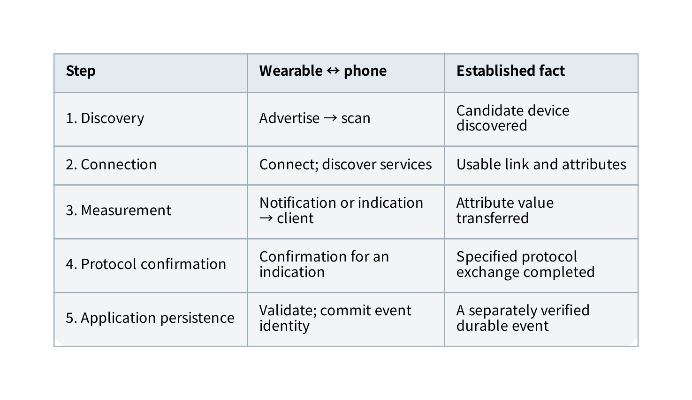
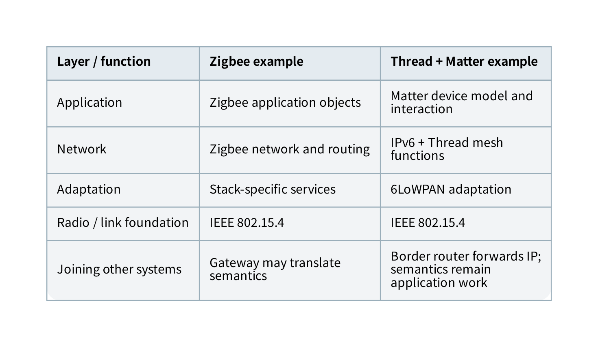
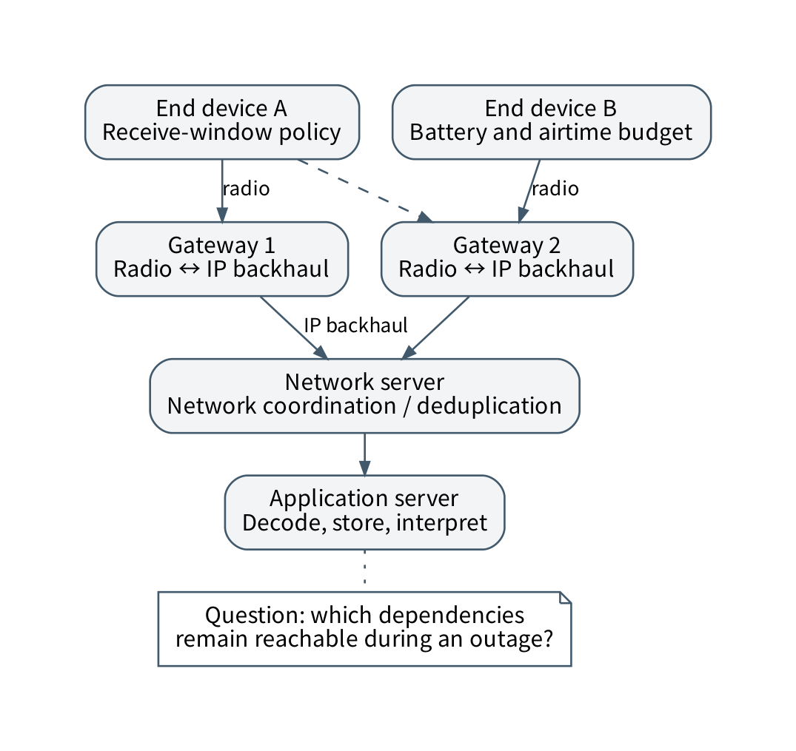
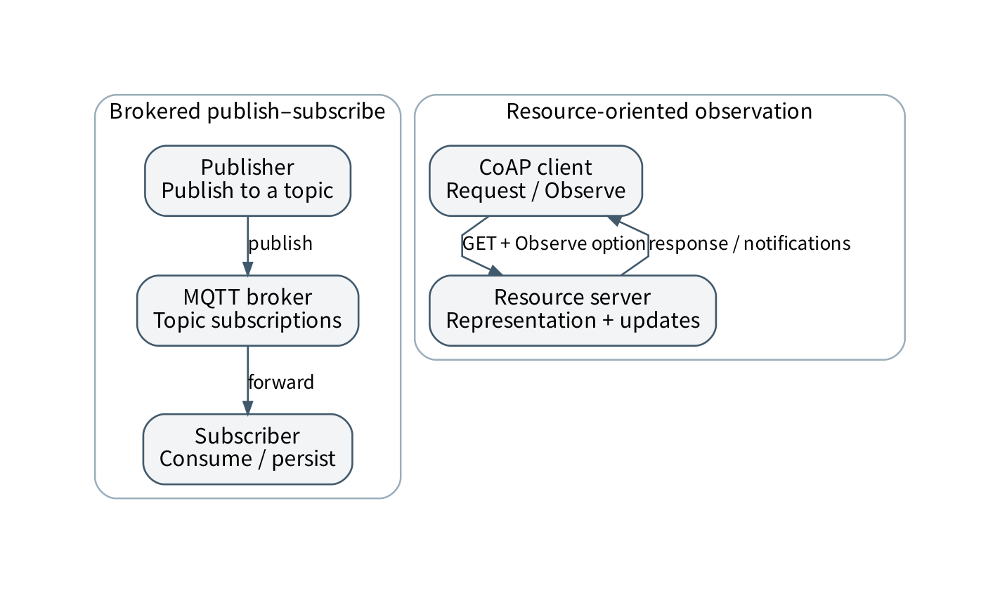
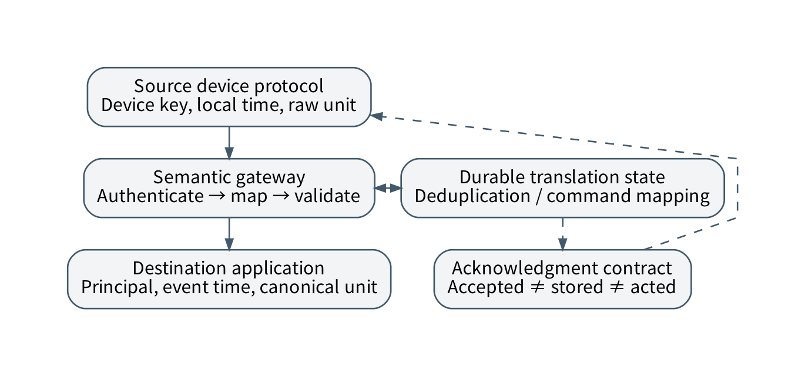
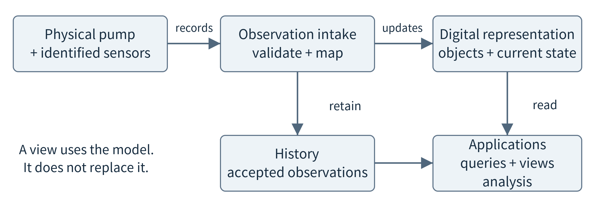
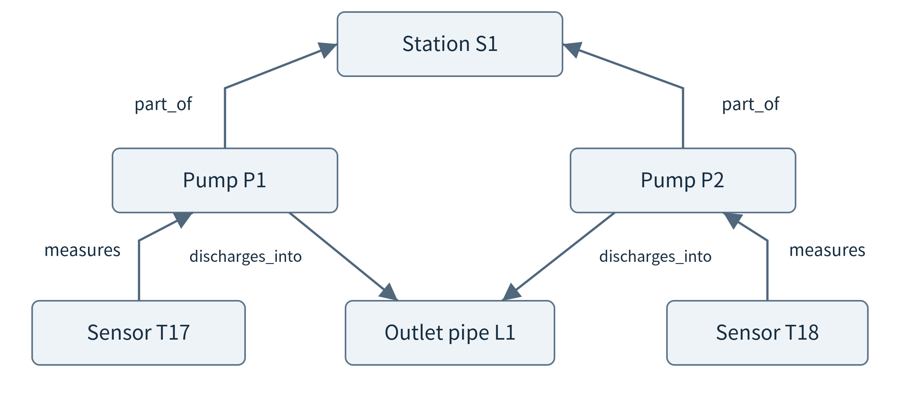
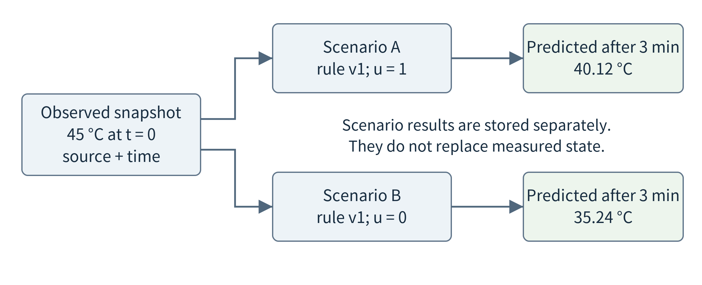
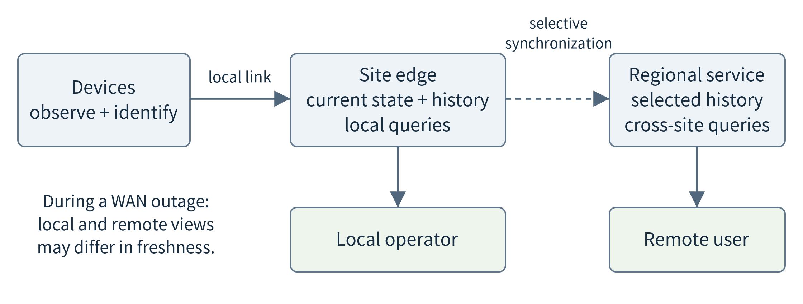

(chapter-4)=

# Chapter 4. Communication and Networking for IoT and Edge Systems

(section-4-1)=

## 4.1 A network is a set of responsibilities

An agricultural sensor sends a few measurements after sleeping for several minutes. A wearable streams short bursts to its owner’s phone. A camera sends compressed video to a nearby server. A robot exchanges observations and commands with neighboring machines. All four applications communicate, but they do not need the same network. Their payloads, deadlines, power sources, mobility, and administrative arrangements differ.

This chapter builds a map of the available choices and then explains several representative mechanisms. Its objective is not to memorize a universal ranking of protocols. It is to identify which layer makes a decision and which assumptions a proposed stack requires. A complete choice includes the access technology, network organization, transport, application interaction, identity, and operational infrastructure.

Begin with a traffic description. Record the typical and maximum payload, production frequency, burst size, tolerated loss, delivery deadline, expected outage duration, and direction of traffic. Describe who supplies power, installs gateways, controls credentials, and pays for connectivity. A two-way command channel has different requirements from a one-way historical log, even when both carry the same number of bytes.

**Payload rate is not radio capacity.** Headers, channel acquisition, acknowledgements, contention, retransmissions, and time spent listening all consume resources. A link advertised at a particular physical rate does not provide that rate to every application. Likewise, a device that transmits rarely may still consume substantial energy while keeping a receiver active. Chapters 7 and 8 use measured communication costs rather than infer application performance from a protocol name.

(section-4-2)=

## 4.2 Keep the layers separate

A practical stack can be read from the bottom upward. The physical and link layers move frames across a local medium. Network mechanisms address nodes and forward packets across networks. Transport mechanisms offer communication between processes. Application protocols organize operations such as publishing an event or reading a resource. Information models define what the data and operations mean.

(fig-4-1)=

<br>
Figure 4.1. Protocols at different layers can be used together; each path is a complete example, not a universal stack.

Ethernet and Wi-Fi are familiar access technologies. Bluetooth LE has its own link and host protocols. IEEE 802.15.4 supplies foundations used by several low-power networking systems. Thread builds an IPv6 mesh system; Zigbee defines a different networking and application framework. MQTT and CoAP organize application messages rather than select a radio. Matter addresses application interoperability over IP networks. A question such as “Should we use Wi-Fi or MQTT?” therefore confuses layers. An application can use MQTT over TCP over IP over Wi-Fi. [{ref}`5 <ref-5>`, {ref}`6 <ref-6>`, {ref}`7 <ref-7>`, {ref}`59 <ref-59>`, {ref}`60 <ref-60>`]

A gateway also needs a precise description. A router forwards packets between networks. An application gateway terminates one protocol and originates another, potentially translating identities, schemas, and delivery semantics. A Thread border router and an MQTT-to-database ingestion service both connect parts of a system, but perform different functions. A bridge that changes the meaning of acknowledgements or timestamps changes the application contract, not just its wiring.

(section-4-3)=

## 4.3 Local access: wired networks, Wi-Fi, and Bluetooth LE

(section-4-3-1)=

### 4.3.1 Wired access and Wi-Fi

Wired Ethernet is worth considering for fixed cameras, industrial computers, and gateways. Cabling creates installation costs and constrains mobility, but can remove dependence on a shared radio channel. Power over Ethernet can combine power and data where the equipment supports compatible standards. A cable does not eliminate switch congestion, configuration errors, or failures upstream. Deterministic timing requires an end-to-end design, not merely replacing a wireless link with a wire.

Wi-Fi integrates devices into local IP networks and is a natural candidate when existing infrastructure and substantial data transfer matter. Its actual behavior depends on the supported generation, frequency band, channel width, interference, access-point load, signal conditions, and power-management behavior. A battery sensor’s association and wake-up costs may dominate a short transmission. A camera’s sustained traffic may contend with unrelated users. These are deployment questions to measure, not reasons to label Wi-Fi universally unsuitable for IoT.

For a first comparison, separate **coverage** from **capacity**. A device may be able to associate at the edge of a coverage area but deliver too little useful throughput for its application. Adding an access point can improve coverage while introducing roaming or channel-planning work. A mobile application’s service endpoint may remain unchanged even though the device changes its radio attachment. Connectivity and computation placement are separate decisions, revisited in Chapter 8.

(section-4-3-2)=

### 4.3.2 Bluetooth LE: discovery, attributes, and connection events

Bluetooth Low Energy is useful to understand through a wearable–phone exchange. A peripheral can advertise its presence; a phone scans and may establish a connection. Within a connection, communication occurs through scheduled connection events rather than an assumption that the radio transmits continuously. Advertising can also carry data without establishing a conventional point-to-point connection. The relevant modes and parameters must be supported by both devices. [{ref}`56 <ref-56>`]

The Generic Attribute Profile, or GATT, organizes data as services and characteristics. A characteristic has a value and declared operations such as reading, writing, or notification. The client discovers the relevant attributes and uses these operations. A notification does not request an ATT-layer confirmation, while an indication does. Neither should be mistaken for proof that a phone application has committed data to permanent storage. Link-layer recovery and application-level persistence remain different responsibilities. [{ref}`57 <ref-57>`]

The connection’s central/peripheral roles and GATT’s client/server roles describe different relationships. Do not infer which application owns a value only from which device initiated a radio connection. Similarly, pairing or bonding is not a complete authorization policy for every characteristic. The application must decide which authenticated party may read or modify each resource.

(fig-4-2)=

<br>
Figure 4.2. A wearable–phone exchange separates discovery, connection, attribute operations, and application persistence. A protocol acknowledgement and a stored observation are distinct events.

Connection intervals, batching, and application wake-ups influence both delay and energy. Suppose a wearable accumulates one second of samples before sending them. Fewer application transactions may reduce overhead, but the oldest sample already has roughly one second of intentional waiting. A notification setting cannot remove a delay introduced before transmission. Bluetooth mesh is another system with its own provisioning and message-delivery mechanisms; it should not be described as a chain of ordinary GATT connections. [{ref}`58 <ref-58>`]

(section-4-4)=

## 4.4 Low-power meshes: IEEE 802.15.4, Zigbee, and Thread

A mesh network can forward data through intermediate nodes rather than require every endpoint to reach one access point directly. This can extend connectivity, but creates routing, capacity, and energy obligations. If a battery endpoint sleeps most of the time, it cannot be treated as a continuously available relay. Powered routers and sleepy endpoints therefore often have different roles.

Zigbee and Thread illustrate why sharing a radio foundation does not imply interoperability. Zigbee includes networking and application conventions. Thread carries IPv6 through a low-power mesh and connects to adjacent IP networks through border routers. An application protocol can operate over Thread without being identical to Thread. Matter is an important example of an IP-based application framework, but a Thread network is not necessarily a Matter application, and Matter need not use Thread for every device. [{ref}`7 <ref-7>`, {ref}`59 <ref-59>`, {ref}`60 <ref-60>`]

(fig-4-3)=

<br>
Figure 4.3. Zigbee and Thread share some lower-layer foundations but use different stacks. A Thread border router forwards between IP networks; a semantic gateway has additional responsibilities.

IPv6’s standard header is large relative to a small low-power frame. The 6LoWPAN adaptation specifications address efficient carriage of IPv6, including header compression. Compression uses information already available in the communication context instead of repeating it unnecessarily. Fragmentation is a related concern when a packet cannot fit into one frame; losing a fragment can prevent reconstruction of the whole packet. RPL is a routing protocol for low-power and lossy IPv6 networks. It is useful as a separate design example, not as a synonym for Thread’s routing system. [{ref}`62 <ref-62>`, {ref}`63 <ref-63>`]

A mesh’s hop count is not enough to predict latency. Relays may sleep, contend for the same channel, or maintain limited queues. A path with good individual links can still become overloaded when many devices converge on one relay. A useful deployment exercise therefore identifies router roles, failure alternatives, and aggregate traffic near the border, rather than merely demonstrating that every device once delivered a packet.

(section-4-5)=

## 4.5 Wide-area IoT: LoRaWAN and cellular access

(section-4-5-1)=

### 4.5.1 LoRa is not LoRaWAN

LoRa names a radio technology; LoRaWAN specifies a network architecture and protocol above the radio. A typical LoRaWAN deployment connects end devices through gateways to a network server and application services. A transmission may be received by more than one gateway. The gateway provides a path to the backend rather than running an arbitrary peer mesh among all sensors. Device activation, security state, frame handling, and downlink scheduling are part of the network design. [{ref}`61 <ref-61>`]

LoRaWAN device classes make receive opportunities explicit. Class A devices open receive windows following uplink transmissions. Class B adds scheduled receive opportunities, and Class C listens more continuously except when transmitting. These choices affect when the application can deliver a command and how much energy receiving consumes. A network suited to small, infrequent observations does not thereby provide a continuously responsive control channel. [{ref}`61 <ref-61>`]

(fig-4-4)=

<br>
Figure 4.4. A LoRaWAN path separates the radio hop, gateway backhaul, network-server responsibilities, and application processing. Local gateway presence alone does not establish an offline application service.

For a remote environmental deployment, ask where the network and application servers run. A nearby gateway with an unavailable internet backhaul may still hear transmissions while failing to deliver usable data to a remote application. Offline operation requires an explicit local processing and storage arrangement; it cannot be inferred from gateway placement. Radio settings, regional constraints, downlink capacity, and the chosen operator’s policies must be checked before deployment. This chapter deliberately avoids universal distance and battery-life promises.

(section-4-5-2)=

### 4.5.2 NB-IoT, LTE-M, and other cellular paths

NB-IoT and LTE-M provide cellular IoT options rather than require the application owner to install every access point. A representative integrated modem such as Nordic’s nRF9160 supports both technologies, a separate application processor, and power-saving mechanisms such as PSM and eDRX. These capabilities are concrete examples of how radio operation and application execution interact; they do not imply that every operator enables the same features. [{ref}`55 <ref-55>`]

Power Saving Mode can make a device unavailable for immediate downlink while conserving energy. Extended discontinuous reception changes how often a device listens. Consequently, “the modem supports downlink” is not equivalent to “a command will arrive within this application’s deadline.” The application must account for negotiated settings, registration, coverage, retries, and the device’s wake schedule.

An LTE-M versus NB-IoT choice should be checked against required throughput, mobility behavior, latency, supported bands, certification, subscription, and the actual network. General LTE or 5G access is relevant for richer mobile workloads such as vehicle data upload and video. A private cellular deployment also introduces management responsibilities. None of these access choices alone specifies whether application computation is in a distant cloud, an operator edge site, or an enterprise server.

(section-4-6)=

## 4.6 Network, transport, discovery, and protection

An IP address identifies a network endpoint within a routing context, not a durable physical-device identity. Addresses may change while a device retains its application identity. DNS maps service names to records used to locate endpoints; local discovery mechanisms can help locate nearby services. After discovery, a client must still verify who is answering and whether the requested service is authorized. Discovery is not authentication.

TCP provides an ordered byte stream with retransmission and congestion control. The application still needs message framing and timeouts. UDP provides datagrams without those same stream guarantees; an application above UDP can add acknowledgements and retries, or deliberately prefer fresh data over retransmission. QUIC builds secured, multiplexed transport over UDP. Its independent streams can avoid one form of application-level head-of-line blocking, but packet loss and congestion still affect performance. HTTP semantics are not inherently tied to one radio or to only one version of the transport stack. [{ref}`8 <ref-8>`, {ref}`9 <ref-9>`]

Encryption boundaries matter. TLS protects a stream-based connection; DTLS serves datagram-oriented uses. A gateway terminating a secured connection may see plaintext before forwarding it on another connection. OSCORE provides object security for CoAP messages, allowing protection to be considered beyond a particular transport hop. Appropriate deployment still requires key management, replay handling, and an explicit authorization policy. Security properties do not follow merely from including the word “encrypted” in an architecture diagram. [{ref}`64 <ref-64>`]

A **protocol conversion table** is a useful design artifact. For every boundary, record the incoming identity, outgoing identity, payload schema, timestamp interpretation, error representation, and acknowledgement meaning. If a gateway acknowledges before its local durable write, the system has one recovery contract; if it acknowledges after a replicated commit, it has another. {ref}`Chapter 7 <chapter-7>` develops the resulting correctness issues through synchronization and retry examples.

(section-4-7)=

## 4.7 Application interaction: HTTP, MQTT, and CoAP

(section-4-7-1)=

### 4.7.1 Request–response and publish–subscribe

A request–response application asks a known service to perform an operation and returns a result. This is natural for reading a resource or submitting a bounded inference request. Publish–subscribe separates a producer from consumers through named topics or other matching rules. This supports independently evolving consumers, but requires decisions about the intermediary, subscription state, retained data, and delivery behavior.

HTTP’s resource and method semantics make it useful for service APIs and integration with web infrastructure. A long-lived stream or event channel may be more appropriate than repeatedly polling a changing resource. The choice should follow the interaction pattern and operational environment. Using a familiar web protocol is not automatically excessive; repeatedly waking a constrained device for unnecessary polling is an application-design issue. [{ref}`8 <ref-8>`]

(section-4-7-2)=

### 4.7.2 MQTT: the broker is a system component

An MQTT client publishes to a broker; the broker forwards matching messages to subscribers. A topic hierarchy can reflect site and device roles, but a topic name is not an access-control decision. The broker authenticates clients and enforces allowed operations. A retained message can provide a last known value to a later subscriber; it is not an unlimited history. Session settings determine which communication state survives reconnection. [{ref}`5 <ref-5>`]

MQTT offers QoS 0, 1, and 2. QoS 0 avoids a protocol acknowledgement exchange. QoS 1 permits retry and hence duplicates at the receiving protocol endpoint. QoS 2 uses additional state and exchanges to provide exactly-once message delivery within the specified MQTT protocol relationship. Publisher-to-broker and broker-to-subscriber relationships are distinct. None of these levels alone provides exactly-once execution of an arbitrary database transaction, email, or physical command. [{ref}`5 <ref-5>`]

Consider an ingestion worker that receives a message, writes a record, and crashes before completing the relevant acknowledgement. A repeat delivery can lead to a second insert unless the application enforces a stable event identifier. Conversely, acknowledging before a write may lose work after a crash. The transport setting does not choose the database transaction boundary. This reasoning applies to many messaging systems, not just MQTT.

(section-4-7-3)=

### 4.7.3 CoAP: resources for constrained environments

CoAP presents resources and operations in a compact protocol designed for constrained nodes and networks. In its base UDP mapping, confirmable messages use acknowledgements and retransmission, while non-confirmable messages omit that exchange. Message identifiers support duplicate detection and tokens associate requests with responses. An empty acknowledgement can precede a separately delivered response when processing takes longer. [{ref}`6 <ref-6>`]

CoAP Observe lets a client register interest in changes to a resource instead of repeatedly polling it. This is not the same architecture as an MQTT broker matching arbitrary publisher topics to subscribers. CoAP can also use reliable transports through a separate specification; it is incorrect to define CoAP as “always UDP.” Proxies and gateways may connect constrained resources to other systems, but must preserve relevant semantics. [{ref}`65 <ref-65>`, {ref}`66 <ref-66>`]

(fig-4-5)=

<br>
Figure 4.5. MQTT publish–subscribe and CoAP resource observation organize communication differently. Both need application-level decisions about persistence, freshness, authorization, and failure.

(section-4-8)=

## 4.8 Robotics, industry, and semantic interoperability

DDS is a data-centric publish–subscribe standard with typed topics and configurable quality-of-service policies. Reliability, history, durability, and deadline-related policies allow a producer and consumer to express more than “send these bytes.” Offered and requested policies must be compatible. A declared deadline can support detection of missing updates; it is not proof that the operating system and network will satisfy a hard real-time bound. DDS and its implementations are important to recognize in robotics and distributed control discussions. [{ref}`67 <ref-67>`, {ref}`68 <ref-68>`]

OPC UA adds an explicit information-modeling perspective. A client can discover structured objects and their variables, methods, and relationships rather than interpret an undocumented sequence of registers. OPC UA supports client–server interaction and a publish–subscribe model. Security and deployment choices remain necessary even when the information model is standardized. It should not be reduced to another transport protocol competing at the same layer as Ethernet. [{ref}`69 <ref-69>`]

Within vehicles and machines, networks such as CAN and industrial serial buses connect controllers and sensors. Linux SocketCAN exposes CAN interfaces through a networking-oriented API, but decoding a frame requires the relevant signal definitions. A gateway that exports selected vehicle information must understand that model and enforce a read-only boundary where appropriate. Classroom work should use recordings or virtual interfaces, not connect experimental software to a safety-relevant live bus. [{ref}`52 <ref-52>`]

Matter provides another useful distinction between packet delivery and interoperability. A common IP path is necessary but insufficient for two products to agree about device capabilities, state, and operations. Standardized application models, commissioning, and trust mechanisms address that additional problem. A successful packet exchange is not yet a successful device integration. [{ref}`7 <ref-7>`]

(fig-4-6)=

<br>
Figure 4.6. A semantic gateway translates more than bytes. Identity, units, time, operation meaning, and acknowledgement boundaries must survive the conversion.

(section-4-9)=

## 4.9 Work a communication budget before choosing a stack

Use invented values to separate payload, framing, and time. Suppose a sensor produces a 20-byte payload once per second. Assume the chosen exchange adds 40 bytes of total overhead and the effective serialization rate is 100,000 bits/s. One 60-byte transmission needs $60 \times 8/100000 = 4.8$ ms of serialization. This is not the end-to-end latency: channel access, waiting, propagation, processing, and retries remain.

Batching ten measurements produces a 200-byte payload plus the same assumed 40-byte overhead, or 1,920 bits per ten seconds. Sending ten separate messages uses 4,800 bits. The batch reduces this modeled traffic by 60%, but the oldest measurement waits nine seconds before the batch is complete. If the maximum tolerated age is two seconds, this apparent optimization is infeasible. The actual stack may also fragment a larger packet, so the fixed-overhead assumption must be checked.

A second calculation illustrates loss. If each independent attempt succeeds with probability $1 - p$, unlimited retry gives an expected $1/(1 - p)$ attempts per delivered message. At $p = 0.2$, the expectation is 1.25 attempts. Independence, unlimited retries, and an unchanged channel are strong assumptions. Bursty interference, duty constraints, and deadlines invalidate this simple estimate. The formula is a starting model, not a promise of eventual delivery.

Do not confuse communication reliability with useful information. Replaying every old position after reconnection can overwhelm a robot’s controller with obsolete data. Retaining only the latest position may suit immediate navigation while losing the history needed for investigation. A system can maintain separate paths: a freshness-oriented local stream and a durable event log for later analysis.

(section-4-10)=

## 4.10 Compare complete designs across applications

A comparison should name a plausible stack, infrastructure, and reason for rejection—not simply select a winning acronym.

```{list-table}
:header-rows: 1
:class: book-table

 * - **Scenario**
   - **Candidate arrangement**
   - **Design question to resolve**
 * - Wearable activity sensing
   - Bluetooth LE to a phone; phone forwards approved summaries
   - Does the phone remain available, and what happens when background execution is restricted?
 * - Sparse field measurements
   - LoRaWAN or supported cellular IoT access
   - Who operates gateways or subscriptions, and when can a downlink arrive?
 * - Multi-camera inspection
   - Wired or Wi-Fi access to a local inference server
   - Can aggregate traffic and queueing satisfy the deadline under simultaneous streams?
 * - Mobile robot coordination
   - Local IP network with explicitly chosen middleware and QoS
   - Which exchanges require freshness, ordered state, or durable recovery?
 * - Multi-vendor device integration
   - A supported interoperable application framework over compatible links
   - Are data models, commissioning, permissions, and update responsibilities aligned?
```

These are starting hypotheses. A field deployment with no reachable gateway can reject one otherwise attractive radio. A warehouse with available cabling can choose wired communication even though the endpoints are IoT devices. A wearable can compute features locally rather than stream continuously. No single choice is best across all traffic and ownership conditions.

(section-4-11)=

## 4.11 From IoT Data to Digital Twins

The preceding sections explained how observations travel from devices to software. Consider what happens after a maintenance application receives a temperature of 46 °C. The message arrived successfully, but an operator still needs to know which machine it describes, where the sensor is mounted, when the measurement was taken, and whether the machine is operating. Communication delivers information; an application also needs a useful representation of the physical system.

We will build the idea around a small, fictional pump station with two electric pumps, temperature sensors, and a shared outlet pipe. Its first goal is modest: let an operator inspect the state of a particular pump, relate measurements to equipment, and compare recent history. Later we add a simple what-if calculation. The station, identifiers, measurements, and numerical coefficients in this section are teaching examples, not observations of a deployed plant.

A digital twin is a digital representation linked to an identifiable real-world entity or system through an explicit updating relationship. Its useful scope may include structure, observed state, history, and computational descriptions of behavior. Definitions differ across industries: some emphasize simulation, bidirectional interaction, or an entire product lifecycle. Rather than resolve every naming difference, we will state what our representation contains, how it stays connected to the physical object, and which questions it can support. NIST discusses both this definitional variation and the importance of a dynamic connection. [{ref}`124 <ref-124>`, {ref}`125 <ref-125>`]

(section-4-11-1)=

### 4.11.1 Start with a purpose, not a 3D scene

Suppose the operator asks, “Which pump in station S1 has a recently observed outlet temperature above 45 °C?” The threshold is an exercise condition, not a safety limit. To answer, the application needs station membership, sensor-to-pump associations, temperature values, and observation times. A photorealistic image of the pump is unnecessary for this query. Conversely, a detailed 3D scene without a connection to actual equipment and changing data cannot answer it.

Begin with the decisions or questions the application must support, then choose the necessary detail. Tracking equipment identity and recent temperature calls for a different model from predicting mechanical vibration or evaluating a new pipe layout. Greater detail is useful only when it improves a needed result enough to justify the added data collection, calibration, computation, and maintenance.

```{list-table}
:header-rows: 1
:class: book-table

 * - **Representation**
   - **Pump-station example**
   - **Question it helps answer**
 * - Description
   - Pump P1 is installed in station S1.
   - Which physical object is this?
 * - Observed state
   - Outlet temperature: 46 °C at 10:00:04.
   - What was most recently observed?
 * - History
   - Time-stamped readings and maintenance events.
   - What changed over an interval?
 * - Behavior model
   - A stated relation between load and temperature.
   - What might happen under an assumption?
 * - Presentation
   - A list, graph, floor plan, or 3D scene.
   - How can a user understand the information?
```

These are complementary parts, not a mandatory ladder in which every project must reach 3D simulation and automatic control. A read-only monitoring representation is a useful starting component of a twin application. Name its limits explicitly: it describes accepted observations and relationships, but it does not yet predict failures. In this section, the first version stays read-only.

(fig-4-7)=

<br>
Figure 4.7. From a physical object to an application-facing representation. Observation processing and behavioral analysis are separate responsibilities; visualization is one consumer, not the twin itself.

(section-4-11-2)=

### 4.11.2 Represent objects, relationships, and meaningful state

Give the equipment and sensors stable identities. In our example, Pump P1 and Pump P2 belong to Station S1, both discharge into Pipe L1, and temperature sensor T17 measures the outlet of P1. These relationships allow software to answer a question about a station without requiring a user to remember every sensor address. {ref}`Figure 4.8 <fig-4-8>` is an information model, not a diagram of network routes.

(fig-4-8)=

<br>
Figure 4.8. The same physical system can be represented as identified objects and typed relationships. A measures relationship has different meaning from part\_of or discharges\_into.

A model describes a kind of object; an instance represents one particular object. A Pump model might define an outlet-temperature property, a nameplate identifier, and a connection to a pipe. P1 and P2 are separate instances with different values. This is similar to a class and its objects in programming. Azure Digital Twins uses models, properties, components, and relationships to define and instantiate such representations. The following record is our teaching schema, not Azure syntax. [{ref}`126 <ref-126>`]

```json
{
  "twin_id": "pump-P1",
  "model_type": "Pump.v1",
  "temperature": {
    "value": 46.0,
    "unit": "degC",
    "observed_at": "2026-01-15T10:00:04Z",
    "source_id": "sensor-T17",
    "event_id": "T17/boot-a/103",
    "quality": "valid"
  }
}
```

The identity says what is being described; the type says how to interpret its fields. The value and unit belong together. The timestamp describes the measurement, not the time at which the dashboard was opened. Source and event identifiers preserve a route back to the contributing observation. The valid flag means the record passed declared input checks; it does not prove that a sensor is calibrated or that a physical value is correct.

A twin is not necessarily one giant JSON document. This compact form explains the information contract. An implementation might store object metadata in one database, observations in a time-series store, and files elsewhere, while presenting a joined view. AWS IoT TwinMaker illustrates this separation through entities and components connected to data sources, including externally stored time-series values. [{ref}`128 <ref-128>`]

A physical change can require a model change even when the network remains unchanged. If T17 is moved from P1 to P2, retain when that association changed so earlier readings are not relabeled as P2 history. Likewise, replacing a pump is not the same event as restarting its software. Identity and relationships must follow the physical meaning the application intends to preserve.

(section-4-11-3)=

### 4.11.3 Turn arriving messages into state updates

The communication layer delivers a message; a mapping step decides which object and property it should update. In our design, an authenticated device identity selects a registered sensor, the sensor association selects a pump, and a field definition provides the unit and meaning. Accepting an arbitrary pump identifier from an untrusted payload would bypass this mapping. Successful parsing is therefore only the beginning.

A small ingestion path can validate the record, resolve its source, convert a documented unit if needed, retain the observation in history, and update the appropriate current-state property. Microsoft’s IoT Hub ingestion example similarly uses processing code to translate telemetry into Digital Twins API updates. The transport subscription alone does not create this application mapping. [{ref}`127 <ref-127>`]

For the next trace, assume one trusted temperature source, one boot session, comparable timestamps, and no corrections to an already accepted event. Our teaching policy keeps each unique valid observation in history and uses event time to choose the latest temperature. A repeated event with identical content has no additional effect; conflicting content under the same event identity is held for review. These are explicit example policies, not universal rules for all twins.

```{list-table}
:header-rows: 1
:class: book-table

 * - **Arrival**
   - **Observation**
   - **Decision**
   - **Latest state**
 * - 10:00:00.2
   - 101: 42 °C at 10:00:00
   - Store; update.
   - 42 °C, 10:00:00
 * - 10:00:04.2
   - 103: 46 °C at 10:00:04
   - Store; update.
   - 46 °C, 10:00:04
 * - 10:00:05.0
   - 102: 43 °C at 10:00:02
   - Store late history only.
   - 46 °C, 10:00:04
 * - 10:00:05.1
   - 103 repeated, unchanged
   - Ignore duplicate effect.
   - 46 °C, 10:00:04
 * - 10:00:05.2
   - 103 repeated as 47 °C
   - Hold conflicting record.
   - 46 °C, 10:00:04
```

The late record is useful for a historical query, but it must not move the current display backward in event time. Different properties can update independently: a new vibration reading does not make an old temperature reading fresh. An application that combines several properties must check whether their observation intervals are suitable for that particular calculation.

At 10:00:11, the latest accepted temperature in the table is seven seconds old. If the exercise allows at most five seconds, report “46 °C, observed seven seconds ago; stale for the current-state query.” Do not replace missing data with zero or imply that the equipment is normal. Computing age from event time assumes known clock accuracy; an uncertain device clock requires an uncertainty allowance or a qualified statement, not a falsely exact age.

(fig-4-9)=

<br>
Figure 4.9. Arrival order can differ from observation order; history and current state therefore use explicit update rules.

(section-4-11-4)=

### 4.11.4 Ask questions across equipment, time, and relationships

Return to the operator’s query about station S1. A useful answer needs more than a database search for values above 45. First find the pumps that belong to S1. Next obtain each pump’s accepted temperature observation and check its age. Apply the threshold only where evidence meets the freshness rule. Finally return the pump identity, value, observation time, and source. This is an object-and-evidence query; it does not require a language model.

Suppose the query time is 10:00:08. P1 reports 46 °C at 10:00:04; P2 reports 44 °C at 10:00:02. With a five-second rule, P1 satisfies the example condition, while P2 lacks a sufficiently recent observation. The answer should distinguish “P1 is above the exercise threshold” from “P2 cannot be assessed as current.” Treating P2’s older value as a current negative result would conceal missing information.

A different question, “Which pump warmed faster during the last minute?”, needs history rather than a latest-value field. A question about a shared pipe needs the discharge relationships. A maintenance question may need installation and replacement history. The model earns its complexity by making relevant questions easier to express, not by collecting every possible field.

The same pattern transfers beyond a pump station. A building representation links rooms, air-handling equipment, and environmental sensors; a fleet representation links vehicles, components, and trips; an agricultural representation links plots, soil sensors, and irrigation equipment. The relationships and update rates differ. Copying the pump schema verbatim would be less useful than asking what objects, evidence, and questions matter in each application.

(section-4-11-5)=

### 4.11.5 Add a behavioral model without confusing prediction and observation

A structural model explains what the objects are and how they relate. A behavioral model computes how some state might change. It may be an equation, a simulator, a rule set, or a learned model. These two meanings of model should remain distinct: declaring a temperature property does not create a thermal predictor. Digital-twin credibility depends on checking the representation and its results for the intended use, not on visual realism alone. [{ref}`129 <ref-129>`]

To see the distinction, assume a deliberately simplified one-minute update rule for a fictional component. T is temperature in °C, the ambient temperature is fixed at 25 °C, and u is a dimensionless load indicator, either 0 or 1. At each one-minute step, the rule removes 20% of the difference from ambient and adds 2 °C when u = 1:


$$
T(k + 1) = T(k) + 0.2 \times \left\lbrack 25 - T(k) \right\rbrack + 2u(k)
$$


Starting from a measured 45 °C, one loaded step gives 45 + 0.2 × (25 − 45) + 2 = 43 °C. A step with u = 0 gives 41 °C. Repeating the same stated rule produces the table below. A temperature decrease under load is not a contradiction within this toy model: the assumed cooling term is larger than the added heat at this initial state.

```{list-table}
:header-rows: 1
:class: book-table

 * - **Time from snapshot**
   - **Scenario A: u = 1**
   - **Scenario B: u = 0**
 * - 0 minutes
   - 45 °C, observed start
   - 45 °C, same observed start
 * - 1 minute
   - 43.00 °C, predicted
   - 41.00 °C, predicted
 * - 2 minutes
   - 41.40 °C, predicted
   - 37.80 °C, predicted
 * - 3 minutes
   - 40.12 °C, predicted
   - 35.24 °C, predicted
```

The table establishes the arithmetic consequences of an assumption; it does not validate a real pump. It omits fluid flow, changing ambient conditions, thermal delays, and equipment-specific parameters. Checking physical adequacy would require independent observations under relevant conditions. A useful experiment first tests data mapping and arithmetic, then separately tests whether the behavior model predicts well enough for its intended purpose.

(fig-4-10)=

<br>
Figure 4.10. A what-if analysis starts from a named observation snapshot and creates separate scenario results. Its predictions must not overwrite the observed-state record.

Keep the initial snapshot, model version, input assumptions, and prediction horizon with each result. If later observations disagree, retain the disagreement as evidence about the model rather than replacing the observations with the prediction. AI can supply a behavior model or help interpret results, but it does not remove this distinction. Detailed model deployment and evaluation belong in the Edge AI part of the book.

(section-4-11-6)=

### 4.11.6 Place the digital representation across device, edge, and cloud

A digital twin is a logical representation, not a requirement to put every component in one machine or one cloud database. In a candidate pump-station design, sensors acquire measurements, a nearby gateway maintains accepted local state and recent history, and a regional service keeps selected long-term history and compares sites. A browser queries the service appropriate to the task. Model files, graphs, and time-series records do not all need identical placement.

(fig-4-11)=

<br>
Figure 4.11. A candidate deployment separates a local observation path from selective remote synchronization. A cloud view remains available during a link outage only as a last-known or otherwise qualified view.

This arrangement is useful if a local operator must inspect data during a wide-area outage or if raw observations should remain at the site. It is not automatically better than a cloud-centered arrangement. A local gateway needs power, storage, maintenance, and sufficient resources. A task that compares many sites may still benefit from remote aggregation. Choose placement from the operation being supported rather than from the word twin.

State availability and state freshness are different. A cloud service can answer a query from stored state while receiving no new observations. If the site last synchronized at 10:00 and connectivity failed, an answer at 10:15 must not silently claim that the equipment still has its 10:00 condition. The local view may be newer than the remote view; a remote user must be able to see that limitation.

The update rate should match the question. A maintenance summary may accept minute-scale data; a rapidly changing position display needs a different policy. Local aggregation can reduce outgoing traffic, but an average alone may hide a short excursion or remove the order of events. Before reducing the data, identify which future queries require the detail. {ref}`Chapter 7 <chapter-7>` develops buffering, synchronization, and consistency; {ref}`Chapter 8 <chapter-8>` develops resource and placement decisions.

(section-4-11-7)=

### 4.11.7 Keep requested settings separate from observed reality

A digital model may record what an application wants as well as what a device has reported. Suppose an operator requests a two-second reporting interval, while the sensor last reported that it uses five seconds. The representation should preserve both values until there is evidence that the device accepted and applied the change. Updating a database field does not physically reconfigure the device.

AWS IoT Device Shadow makes this distinction explicit through desired and reported state, with a delta representing differences. Its cloud state can remain accessible while a device is disconnected. That is a useful state-synchronization mechanism, not proof of the device’s present physical condition or a complete physical-behavior model. The product name shadow should not be treated as a universal definition of digital-twin maturity. [{ref}`20 <ref-20>`]

```{list-table}
:header-rows: 1
:class: book-table

 * - **Application request**
   - **Device report**
   - **What the application may claim**
 * - Report every 2 s
   - Reports every 5 s
   - A change is requested; application is unconfirmed.
 * - Report every 2 s
   - Reports every 2 s, with version and time
   - The device reported applying that version at that time.
```

Where physical actions are allowed, they require an explicit command path, authorization, local checks, and outcome evidence. A scenario calculation must not acquire those permissions simply because it is attached to a twin. Our exercise changes only recorded information and simulated scenarios; it does not control a live pump. Safety and multi-party trust are developed in Part IV.

(section-4-11-8)=

### 4.11.8 Build a small representation and test what it means

For a first exercise, define P1, P2, S1, and the sensor associations. Replay the five arrivals in Section 4.11.3. After each arrival, inspect both the historical records and the displayed latest state. Then advance the query time without sending new data and observe the change from fresh to stale. Finally, run the two scenarios in {ref}`Section 4.11.5 <section-4-11-5>` from the same initial snapshot.

This can be completed with structured files and a small local program; a managed platform and a 3D renderer are unnecessary for the first version. The companion replay illustrates the mapping, latest-state policy, evidence query, and arithmetic. It is not a networked twin platform, a physical simulator validated against equipment, or a security-complete service.

Evaluate three different properties. First, the information mapping: does T17 update P1 rather than another pump, with correct units and timing? Second, the update behavior: do late and duplicate messages preserve the declared policy? Third, the application result: can an answer distinguish observed state, missing evidence, and predicted scenarios? Passing the first two does not validate physical predictions.

Platform documentation provides recognizable implementations of these responsibilities. Azure Digital Twins emphasizes typed entities and relationships; its ingestion path needs explicit logic to turn device data into updates. AWS IoT TwinMaker illustrates contextual models connected to multiple data stores and user-facing scenes. These are architecture examples, not requirements that every twin use a cloud service. Platform deployment details are reserved for Chapter 9. [{ref}`126 <ref-126>`, {ref}`127 <ref-127>`, {ref}`128 <ref-128>`]

The essential transition is now complete: communication produces delivered records, while an explicitly maintained representation makes those records usable in questions about real objects. The next part of the book asks where the software should run, how it scales, and how components cooperate. Those decisions apply to twin updates and queries just as they apply to other edge applications.

The digital representation is evidence about a physical object, not independent proof of its condition. Chapters 13 and 14 revisit source authentication, stale state, and cross-organization provenance.

(section-4-12)=

## 4.12 Laboratory: inspect an exchange and its boundaries

Choose two application patterns: request–response and publish–subscribe. Use a local HTTP service and a local MQTT broker when available; otherwise, produce annotated message traces from supplied or synthetic records. Identify the sender, receiver, payload identity, acknowledgement, persistent state, and timeout for each step. Mark where the trace establishes a fact and where it leaves uncertainty.

Add a simulated delay and duplicate delivery at the application boundary. Verify whether the consumer distinguishes an old observation from a new one and a duplicate from a conflicting record. This laboratory does not require radio hardware and does not validate radio range. An optional hardware extension measures achieved sampling and arrival intervals on a student-owned device with explicit permission.

(section-4-13)=

## 4.13 Exercises

**4.1** Place BLE, IPv6, TCP, MQTT, Thread, and Matter in a layered diagram. Explain why some pairs can be combined and why others are not direct substitutes.

**4.2** A device emits a 12-byte payload every 200 ms. Assume 36 bytes of overhead per message. Compare separate messages with batches of five. Calculate traffic and the maximum intentional waiting time. State which assumptions can fail on a real stack.

**4.3** A publisher receives an MQTT acknowledgement, but the application’s database contains no record after a crash. Describe two architectures in which this can occur without violating the publisher’s protocol exchange.

**4.4** Compare a Thread border router with a gateway that translates proprietary sensor records into MQTT messages. Identify which one must understand application units and identity mappings.

**4.5** A command must reach a battery device within 500 ms at any time. Explain why average uplink rate and radio range are insufficient for choosing between receive schedules. Do not assume that every low-power mode permits immediate downlink.

**4.6** Design two different communication paths for a vehicle: fresh local state for immediate interpretation and durable historical evidence for later analysis. Specify the consequences of loss, duplication, and reconnection for each.

**4.7** A 3D scene shows pump P1, but its temperature never changes after import. Which parts of a useful digital-twin application are present, and what must be added to answer a current-state query?

**4.8** Using the arrival trace in {ref}`Section 4.11.3 <section-4-11-3>`, list the accepted unique events and the latest state after all arrivals. At 10:00:11, does the state satisfy a five-second freshness rule? Explain the role of clock assumptions.

**4.9** In the illustrative temperature rule, change the initial observation to 40 °C while keeping u = 1. Calculate two steps. State two observations you would need before treating this rule as a predictor for actual equipment.

**4.10** A remote interface reports a newly requested configuration as already active during a site outage. Explain the mistake and redesign the displayed fields. Then explain why reopening the interface does not refresh physical evidence.

(chapter-4-chapter-perspective)=

## Chapter perspective

A protocol is one part of a communication design. Layering clarifies which component provides reachability, which organizes interactions, and which preserves meaning. The engineer’s task is to assemble compatible mechanisms around workload and failure requirements, then measure the resulting system. RoomEdge can use one of these stacks, but the same reasoning must work for wearables, agriculture, industrial inspection, and moving machines.

Digital-twin questions extend this communication design: delivered observations need identities, relationships, explicit update policies, and a qualified representation of state. {ref}`Section 4.11 <section-4-11>` connects these concerns to the digital model of the physical system.

