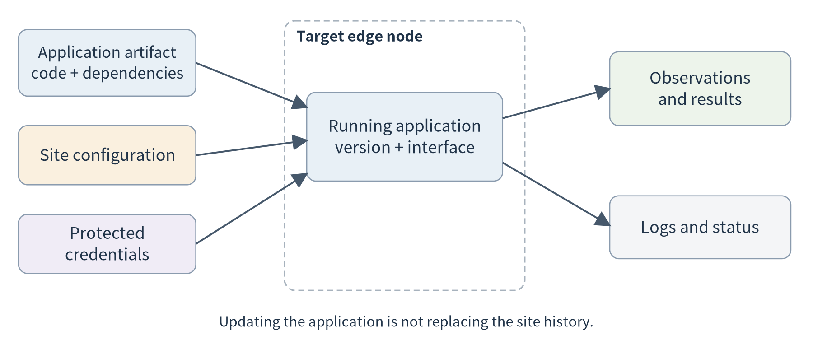
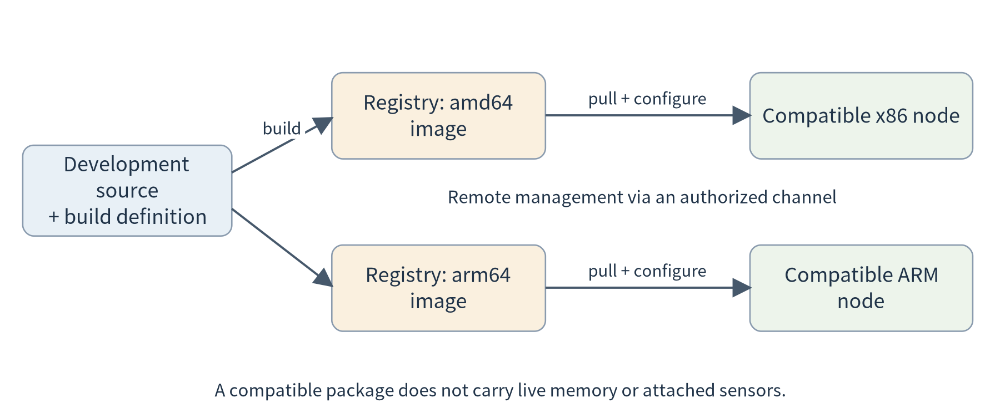
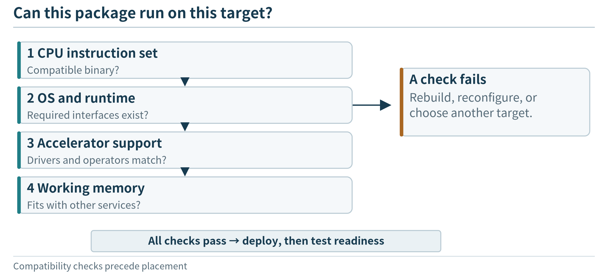
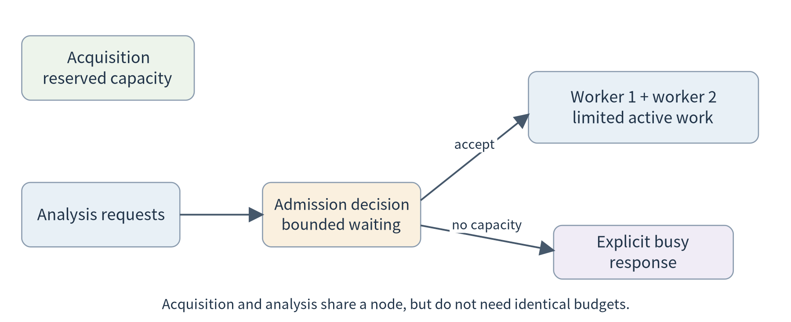

(chapter-5)=

# Chapter 5. Running and Deploying Applications on Edge Nodes

A student team has built a useful workshop-monitoring demonstration. A sensor supplies short windows of vibration readings. An analysis program calculates statistics, and a technician sees the results on a nearby display. A camera-analysis component may be added later. On the team’s laptop, starting the demonstration takes one command. The workshop, however, has a small Linux computer rather than that laptop. It must also receive sensor messages, store recent observations, and support another team’s application. The developers cannot leave a terminal open beside the machine all semester.

The immediate problem is not to invent a better analysis algorithm. It is to make the existing application run in a different environment, alongside other work, with a repeatable deployment procedure. This chapter follows that transition. The workshop supplies the opening questions; the same ideas also apply to a phone application, a smart camera, a field gateway, and a nearby server. The mechanisms differ with the target, but the developer still needs to know what is being deployed, what it depends on, and which resources it may use.

The first milestone is deliberately modest: deploy a callable application on one edge node, explain its packaging and resource requirements, and verify its behavior. Managing replicas across many nodes comes in Chapter 6.

(section-5-1)=

## 5.1 From a working prototype to an edge deployment

(section-5-1-1)=

### 5.1.1 What actually has to move?

Suppose the team copies its analysis script to the workshop computer. The first attempt fails because a required library is missing. After installing the library, the program starts but looks for its configuration in the wrong directory. Once that is corrected, it writes results into a folder that the service account cannot access. None of these failures changes the mathematical analysis, yet each prevents the application from doing useful work.

An application is therefore more than its source code. Its executable instructions, libraries, configuration, input interfaces, and output locations must fit together. An AI component additionally needs a compatible model artifact and inference runtime. The developer should be able to name these dependencies before choosing a packaging tool. A language model downloaded on the laptop is not automatically present on the edge node, and an artifact stored on disk is not the same thing as a model loaded into working memory.

For the workshop, separate the deployment into five kinds of material. The **application artifact** contains code and fixed dependencies. **Configuration** supplies the site identifier, service port, or analysis options. **Credentials** establish permitted access and are distributed through an appropriate protected mechanism rather than baked into a public image. **Input and result data** change as the application operates. **Logs** record what happened during execution. Keeping these roles separate makes it possible to update the program without accidentally replacing the site’s history or publishing a secret.

```{list-table}
:header-rows: 1
:class: book-table

 * - **Material**
   - **Workshop example**
   - **What a deployment should do**
 * - Code and fixed dependencies
   - Analysis program and language runtime
   - Install an identified version
 * - Configuration
   - Site name, endpoint, concurrency setting
   - Supply values appropriate to the target
 * - Credentials
   - Device or service identity
   - Grant only the access required
 * - Mutable data
   - Sensor history and accepted results
   - Preserve according to the application’s policy
 * - Logs and status
   - Startup message, request outcome
   - Make operation observable
```

The useful question is not “did the copy command succeed?” It is “can this node now accept the intended input and return an appropriate result?” A deployment check should exercise a small known request and inspect its response. A process that exists but cannot load its model or reach its input is not yet providing the intended service.

(fig-5-1)=

<br>
Figure 5.1. A deployment transfers an identified application and supplies target-specific configuration. Observations and results belong to the running site; they are not silently replaced whenever the application is updated.

(fig-5-2)=

<br>
Figure 5.2. A deployment bundle includes more than code; readiness is checked against the intended application operation.

(section-5-1-2)=

### 5.1.2 Start with the target, not the tool

For this first deployment, write a small target description: processor architecture, operating system, available memory and storage, required devices, and permitted network access. It is not necessary to inventory every detail of the operating system. The description should answer the compatibility questions that can stop this application from working.

A tiny microcontroller may receive new firmware rather than a container. A phone receives an application within its mobile operating system’s rules. A Linux-based camera, gateway, development board, or server can host general-purpose services when its resources and software support them. Calling all of these machines “edge nodes” does not make their deployment interfaces identical. Conversely, a Linux development board and a rack server can sometimes use the same application interface even though their capacities differ greatly.

Our practical path uses a Linux-capable target because it lets us inspect services and containers directly. That choice is a teaching route, not a definition of the edge. In a wearable system, for example, a microcontroller can acquire measurements, a phone can aggregate them, and a nearby computer can provide an optional analysis service. {ref}`Chapter 7 <chapter-7>` will connect such different execution environments.

A **process** is simply a running instance of a program, with memory and access to resources such as files and network connections. A **service** adds an interface that other components can call and an expectation about when it is available. An analysis script that exits after processing one file and a program that listens continuously for requests may use the same calculation, but they have different execution lifecycles. This distinction is enough operating-systems background to begin the deployment discussion.

(section-5-1-3)=

### 5.1.3 Define one small service before scaling the application

The companion exercise exposes a read-only analysis endpoint. A request supplies an identified window of numeric samples and its unit. The response contains the sample count, mean, root-mean-square value, and the identity of the worker that performed the calculation. The algorithm is ordinary code, not a simulated language model or a validated machine-condition detector. Its purpose is to make deployment and execution visible.

The interface separates two responsibilities. The caller decides which observation window to submit; the service validates and processes that window. A future agent can use the same endpoint as a tool, and a future camera pipeline can supply a different analysis implementation. We do not need to implement either complete application before learning how a service runs.

A first local experiment starts the service, sends the supplied sample.json, and checks the numeric output. The response should identify the version and worker so that later experiments can show which deployment served a request. These identifiers are diagnostic information, not authentication. Only synthetic data should be used with the teaching endpoint; a shared deployment needs the authentication and network protections discussed in Chapter 13.

(section-5-2)=

## 5.2 Packaging and isolation: sharing a machine without sharing everything

(section-5-2-1)=

### 5.2.1 Why a second application changes the problem

The workshop computer now hosts two applications. One receives sensor records; the other analyzes them. A second team wants to add a local model service with a different set of libraries. Installing every dependency into one shared environment makes upgrades difficult to coordinate. Giving all programs access to the same folders is convenient but unnecessary. A crash or a large allocation in one application should not routinely disrupt acquisition.

These are related but distinct requirements. **Packaging** makes the application’s files and dependencies reproducible. **Access isolation** limits what a program can see or modify. **Resource controls** bound how much of a shared resource it can consume. No single label should substitute for checking all three. For example, an isolated filesystem does not tell us whether the application is allowed to consume the node’s remaining memory.

A virtual machine and a container provide different ways of organizing execution. A virtual machine includes a guest operating system with its own kernel on virtualized hardware. A container runs an isolated application environment while sharing the host kernel. Containers and virtual machines can be combined: a cloud virtual machine can itself host several containers. [{ref}`10 <ref-10>`]

(fig-5-3)=

<br>
Figure 5.3. Packaging, visibility and resource limits are separate decisions even when they are configured through one platform.

The diagram explains the developer’s choices more usefully than a list of definitions. Direct execution may be sufficient for a small, controlled device with one maintained application. A container makes the application’s filesystem and dependencies easier to distribute consistently. A virtual machine can be useful when an application needs a separately managed operating-system environment. The appropriate choice depends on what must be independent and what the target can support.

(section-5-2-2)=

### 5.2.2 Images, containers, and configuration

In the Docker workflow, an **image** is a packaged filesystem and execution metadata; a **container** is an instance created from an image. The same image can create more than one instance with different configuration. Image layers support reuse, while an individual container has its own writable layer. [{ref}`85 <ref-85>`]

For our analysis service, the image should contain the program and its runtime. A site identifier is better supplied when the instance starts. Sensor history should not become part of an image merely because both happen to be files. Keeping the application artifact separate from its changing data also helps make updates comprehensible: a new program version need not imply a new observation history.

A minimal Dockerfile for the supplied standard-library service is shown below. The excerpt sets an unprivileged user and a suitable working directory; the full lab file also includes the client and synthetic sample. EXPOSE describes an intended port; the run configuration still determines whether and where it is published.

```dockerfile
FROM python:3.12-slim
WORKDIR /app
COPY edge_service.py /app/edge_service.py
ENV EDGE_HOST=0.0.0.0 EDGE_PORT=8080
USER 10001:10001
EXPOSE 8080
CMD ["python", "-u", "/app/edge_service.py"]
```

This is a starting recipe, not an immutable release specification. Before a reproducible deployment, record the resolved base-image digest and the resulting application-image digest. A version tag is useful for people, but a tag can be reassigned. The image’s compatibility also matters: an ARM node cannot simply execute arbitrary x86 binaries from an image. Docker supports multi-platform image indexes that select an appropriate platform variant; that support does not remove the need to build and test the variants. [{ref}`85 <ref-85>`, {ref}`86 <ref-86>`]

Consider the student who says, “Docker makes the program run anywhere.” A more precise statement is: packaging reduces differences in the application’s userspace environment, while the target still has to supply a compatible kernel, instruction architecture, and required devices. A GPU application may also depend on an appropriate host driver and accelerator runtime. This is why the target description in {ref}`Section 5.1 <section-5-1>` remains useful after adopting containers.

(fig-5-4)=

<br>
Figure 5.4. An image, a runtime configuration, and a running instance are separate artifacts. This schematic traces SITE=A101 and /data; it is not evidence of an executed Docker deployment.

(section-5-2-3)=

### 5.2.3 Separate environments, then control their resource use

Imagine a node with 8 GiB of physical memory. For an illustrative budget, reserve 1.5 GiB for the operating environment and management, 0.5 GiB for acquisition, and 1 GiB for storage and the interface. That leaves 5 GiB for analysis. If one analysis worker has a 2 GiB working set, two workers fit this simple budget with 1 GiB left over; a third does not. These numbers are teaching assumptions, not measurements of the supplied program.

A container memory limit can help contain an unexpectedly large allocation, but it does not create the missing memory or make every request fit. Docker supplies CPU and memory controls; by default, a container does not have application-specific resource constraints unless they are configured. Exceeding an enforced memory limit may terminate work instead of slowing it gracefully. [{ref}`11 <ref-11>`]

For the small teaching service, a first constrained run can use:

```bash
docker build -t edge-analysis:1.0 .
docker run -d --name analysis-a \
  --cpus=1 --memory=512m \
  -p 127.0.0.1:8080:8080 edge-analysis:1.0
```

The values are initial lab settings, not measured resource requirements or a latency guarantee. The port binding deliberately exposes the endpoint only on the host’s loopback interface. A remote user can test through an authorized SSH tunnel instead of exposing the unprotected teaching endpoint to the public Internet.

For two applications, distinguish **limiting interference** from **guaranteeing a share**. A CPU ceiling stops one container from consuming more than its configured allowance; it does not prove the remaining application will always meet a deadline. Both still depend on shared storage, networking, and possibly the same accelerator. Observe the other application’s behavior while changing the analysis load rather than judging isolation from configuration alone.

Persistent application data needs a separately managed location. Docker volumes outlive an individual container, but persistence on one host is not automatic replication to another host. [{ref}`87 <ref-87>`] This is enough state management for the present chapter: understand which data disappears with a process or container and which data remains. Cross-node copies and synchronization are introduced when we need them in Chapter 7.

(section-5-3)=

## 5.3 Cross-platform and remote deployment

(section-5-3-1)=

### 5.3.1 A repeatable path from development to the device

Once the application runs locally, the next request from the workshop is predictable: install the same version on the actual node without repeating every manual step. A simple workflow is to build an image, publish it to an authorized registry, select a compatible target, provide configuration, and start the container. The registry distributes artifacts; it does not by itself start the application or choose its resource budget.

(fig-5-5)=

<br>
Figure 5.5. A common source can produce platform-specific images. The target obtains a compatible artifact and receives its own configuration. Moving an application package does not transfer live memory or automatically reconnect local devices.

Suppose IMAGE names a repository and version in a registry that the developer may use. A multi-platform build can publish Linux variants for x86-64 and ARM64:

```bash
# Set IMAGE to your authorized registry/repository:version first.
docker buildx build --platform linux/amd64,linux/arm64 \
  -t "$IMAGE" --push .
```

The command needs an appropriately configured builder and access to the registry. Building multiple variants is not evidence that both were executed on real hardware. The publication workflow and build options are documented by Docker; the lab record should identify which target architectures were actually tested. [{ref}`86 <ref-86>`, {ref}`106 <ref-106>`]

For remote control, Docker supports an SSH-based context. This uses an authorized account on the target instead of opening an unprotected Docker daemon port. Access to a Docker daemon is powerful and must be restricted to the intended administrators. [{ref}`88 <ref-88>`]

```bash
# EDGE_HOST is an authorized user@host; IMAGE was set above.
docker context create workshop --docker "host=ssh://$EDGE_HOST"
docker --context workshop pull "$IMAGE"
docker --context workshop run -d --name analysis-a \
  --cpus=1 --memory=512m \
  -p 127.0.0.1:8080:8080 "$IMAGE"
```

Reading these commands as a process is more important than memorizing them. The first establishes where management commands go. The second obtains the application artifact. The third creates one running instance with a chosen resource budget and network binding. The host-side port is on the remote node, not the developer’s laptop. Confusing those two locations is a common reason a deployment appears to succeed while the developer cannot reach the service.

(section-5-3-2)=

### 5.3.2 Verify the application, not only the installation

After deployment, first inspect the instance and its logs. Next query its health endpoint. Finally submit a known analysis request through the approved connection and compare the result with a local reference calculation. Each observation establishes something different: installation, execution, reachability, and useful behavior.

A test record should state the application version, target architecture, request identifier, returned worker identity, and result. Add end-to-end request time, but do not interpret one value as a benchmark. A first request may include initialization; later requests may use already prepared resources. {ref}`Chapter 6 <chapter-6>` will make this distinction important for elastic execution.

Now change only the site’s configuration and repeat. The application version should remain the same while the intended site-specific behavior changes. Then deploy a new version and repeat the known request again. This small sequence teaches an important separation: **a configuration update, a code update, and a data update are different actions**. They should not be indistinguishable because everything was copied into one mutable directory.

The basic lifecycle here is manual and local: start, check, stop, and replace an instance. We are not yet building a fleet manager. Nevertheless, the developer should know whether a program is a finite task that exits after producing a result or a long-running service that should remain available. Treating a correctly completed batch job as a crashed server would be a management error, not a problem with the job.

(section-5-3-3)=

### 5.3.3 Portability is not live migration

Suppose the workshop replaces its small computer. If a compatible image, configuration, and required files can be installed on the replacement, the application is portable between those environments. But an in-progress request and an in-memory queue are not automatically present there. A camera attached to a local USB port may also need a new connection or a different endpoint.

At this stage, “move the application” means stop or drain the old instance and start another instance using a documented configuration. Preserving live sessions, moving application state, or shifting a task without interruption requires additional design. That distinction prevents a packaging success from being mistaken for a complete mobility solution.

The same reasoning applies outside containers. A phone app can be reinstalled while its user data requires a separate backup or synchronization mechanism. A microcontroller firmware update can replace executable code while calibration values need their own preservation policy. The packaging format changes; the distinction between code, configuration, and state remains useful.

(fig-5-6)=

<br>
Figure 5.6. A compatible artifact still needs matching runtime capabilities and enough working resources before deployment is feasible.

(section-5-4)=

## 5.4 Organizing execution on limited resources

(section-5-4-1)=

### 5.4.1 One program or several cooperating services?

Our first workshop prototype could put acquisition, storage, analysis, and presentation in one program. This can be a reasonable starting point: fewer interfaces need configuration, and debugging a single request is straightforward. It becomes less convenient when a slow analysis blocks acquisition or when the model dependencies change much more often than the collector.

Splitting the application into services can give those parts separate resource budgets and update lifecycles. The collector can continue receiving observations while analysis restarts. However, separation introduces communication, interface versioning, and more components to observe. “Microservices” names an approach to organizing independently deployable services; it is not a requirement to turn each helper function into a network endpoint.

For the workshop, begin with a small separation that answers a real need: acquisition and storage remain available while a replaceable analysis service handles requests. A local model can later call that service through the same documented interface. For a battery-powered wearable, the sensible separation may instead be firmware on the wearable and an application on the phone. There is no need to imitate a large cloud architecture on every device.

(section-5-4-2)=

### 5.4.2 Waiting, concurrency, and admission

A running service may receive a second request before the first finishes. It can handle requests one at a time, execute several concurrently, or queue some work until capacity is available. Each choice should be tied to the resource that actually limits execution.

Concurrency is useful when one request waits for I/O while another can progress. It can be harmful when every concurrent request holds a large working set and all compete for the same accelerator. The memory budget in {ref}`Section 5.2 <section-5-2>` gives a simple example: permitting three 2 GiB workers does not become sensible merely because the server library can create three threads.

(fig-5-7)=

<br>
Figure 5.7. An application can preserve acquisition while bounding concurrent analysis. A finite waiting area and an explicit busy response make overload visible; resource limits are a last boundary, not a substitute for deciding which work to admit.

A useful initial service has a small concurrency limit and a clear response when that limit is reached. It may ask the caller to retry later or offer an asynchronous job identifier, depending on the application. The supplied service chooses a simple bounded policy: it accepts only a configured number of active analyses and returns an explicit busy response to excess requests. This is not an optimized scheduler. It is a concrete way to keep one test from allocating unbounded analysis work.

Do not hide overload by allowing a queue to grow indefinitely. If work arrives faster than it is completed for a sustained interval, queued requests become older even though none has yet failed. For a live display, an old answer may be less useful than a clear refusal. For a historical report, waiting may be acceptable. The application requirement determines whether to queue, reject, or deliberately discard superseded work.

(section-5-4-3)=

### 5.4.3 Keep a component running, or start it when needed?

A sensor receiver often needs to remain available as observations arrive. A daily report can run periodically and then exit. A model service may benefit from keeping its model loaded across requests. These are different execution patterns, even when all are packaged as containers.

The first deployment should make this choice explicit. A component that starts for every request may save some idle resources but repeat initialization. A permanently running component avoids some startup work but consumes memory while idle. {ref}`Chapter 6 <chapter-6>` examines how a platform can manage these choices through elastic and serverless execution. Here, the developer only needs to recognize that packaging and execution timing are separate decisions.

(section-5-4-4)=

### 5.4.4 Complete the first deployment experiment

Use the supplied edge\_service.py and client.py to establish a baseline before introducing containers. Start one local process, submit sample.json, and retain the expected result. Then run the same application image with a stated CPU and memory budget. Compare the functional output and identify the worker that served the request. Run a second instance on another local port and observe both while increasing client concurrency.

The program deliberately uses only Python’s standard library to keep this path inspectable. Its HTTP server is a teaching harness, not an Internet-facing production server; Python’s documentation does not recommend http.server for production. [{ref}`105 <ref-105>`] Use loopback or a controlled laboratory network and synthetic input. Do not grant the service broad filesystem privileges simply to bypass an installation problem.

The experiment is complete when you can explain which artifact ran, how it was configured, where requests entered, and what limited simultaneous execution. Record a failure as well as a successful request: malformed input, a stopped service, or deliberate overload. The next chapter begins when one well-understood node is no longer enough for the offered work.

The protection supplied by packaging is only one boundary. {ref}`Section 13.5 <section-13-5>` revisits shared-host isolation, while {ref}`Section 13.4 <section-13-4>` connects remote updates to artifact authenticity and release policy.

(fig-5-8)=

<br>
Figure 5.8. A rendering of two measured local Python processes during a one-second sampling interval. The workloads are synthetic; CPU is reported on a one-core basis, and no CPU or RAM limit was enforced. This is not a container or physical-edge benchmark.

(chapter-5-chapter-summary)=

## Chapter summary

Deploying an edge application means matching software and its dependencies to a concrete execution environment. Packaging, isolation, remote distribution, and resource controls address different parts of that task. Devices as well as servers need these capabilities, but not necessarily through the same tools.

The first useful system is a bounded service on a known node, not a large collection of unexplained platform features. Once its behavior is visible, we can ask whether adding more nodes will actually increase the amount of useful work it completes.

(chapter-5-exercises)=

## Exercises

**5.1 Deployment materials.** A team places code, sensor history, a model file, and a cloud credential into one public container image. Explain which materials should be separated and why. Which problems remain even after the image is made private?

**5.2 Portability.** A container works on an x86 laptop but not on an ARM gateway. Identify three compatibility checks to perform before rewriting the application. Explain why a multi-platform image still requires testing.

**5.3 Resource budget.** An 8 GiB node reserves 3 GiB for non-analysis work. Each active worker needs 2 GiB. Calculate the largest number of workers that fits this simplified budget, then identify two reasons a real deployment might choose fewer.

**5.4 Isolation.** Two containers have separate filesystems, but one causes the other’s response time to rise. Give two plausible shared bottlenecks and describe one experiment to distinguish them.

**5.5 Transfer.** Redesign the workshop’s deployment for a phone that collects motion data. Which deployment requirements remain, and which container-specific operations no longer describe the application lifecycle?

