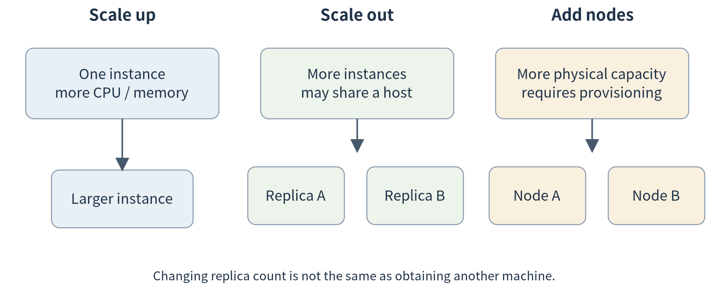
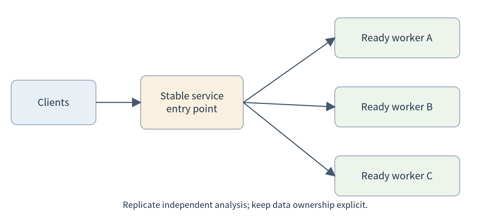
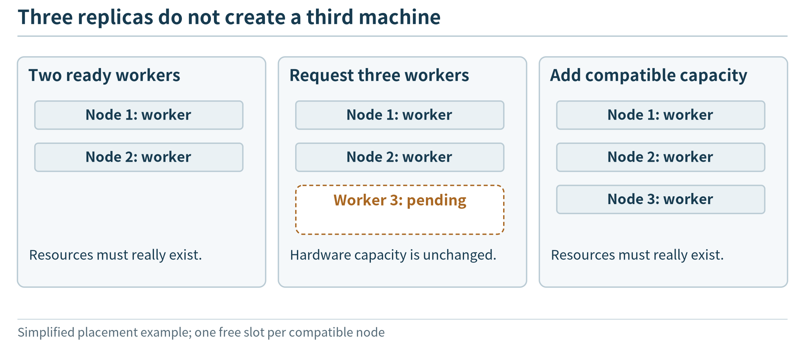
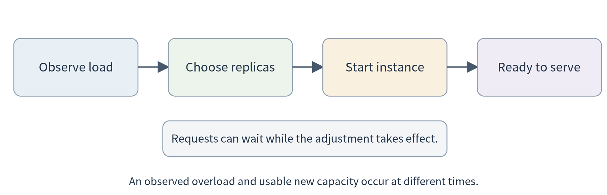
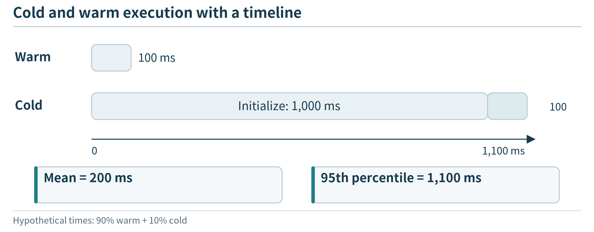
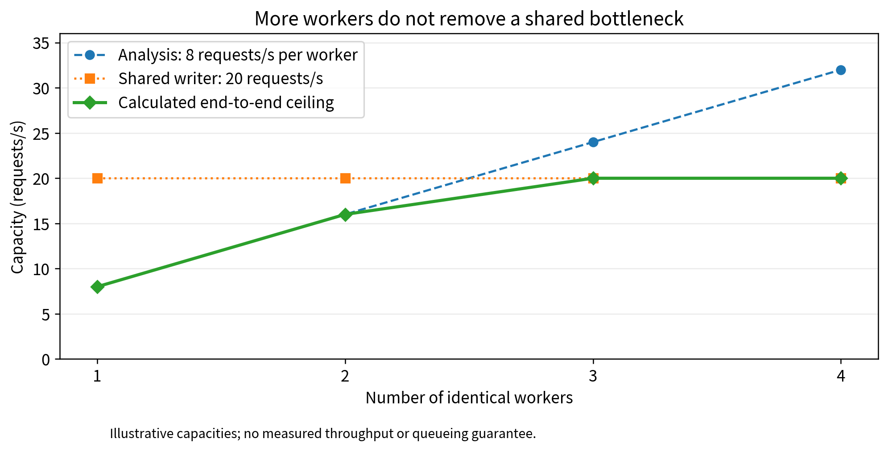

(chapter-6)=

# Chapter 6. Scaling Edge Applications and Elastic Execution

The workshop’s first analysis node now works reliably. More stations begin submitting observation windows, and several technicians request historical comparisons at the same time. A single request is still handled correctly, but requests increasingly wait. The team has access to two additional computers similar to the first one. Can it simply start more copies of the program and obtain three times the useful capacity?

That question introduces scaling. We initially assume compatible Linux nodes on a controlled local network, with similar resources and one administrative owner. They may be small edge computers rather than rack servers. These assumptions let us understand replication, request distribution, and lifecycle management before adding the location and policy differences of the wider continuum in Chapter 7.

The chapter develops one progression: recognize overload, replicate an independent service, give it a stable entry point, use a controller to maintain its instances, and adjust execution as demand changes. Serverless appears near the end as another way to manage when execution environments exist, not as a substitute for understanding their resource needs.

(section-6-1)=

## 6.1 When one node is no longer enough

(section-6-1-1)=

### 6.1.1 More requests are not the same as a slower algorithm

Suppose a simplified analysis worker finishes one independent window every 0.125 seconds when continuously occupied. Its nominal service capacity is eight windows per second. At a steady arrival rate of four windows per second, it may have ample spare capacity. At twelve windows per second, it cannot indefinitely finish all offered work on time. If nothing is rejected or dropped, the unfinished workload grows.

This example describes an assumed worker, not a benchmark of the companion service. Its purpose is to distinguish three quantities. **Arrival rate** is how much work is offered. **Throughput** is how much the system completes per unit time. **Response time** is how long a particular request waits from submission to result. More simultaneous clients can raise offered load without raising completed throughput; the extra work may simply wait or fail.

An application can improve its local implementation, give a worker more resources, or add workers. Increasing the resources of an existing instance is **vertical scaling**, or scale-up. Increasing the number of instances is **horizontal scaling**, or scale-out. Adding actual machines is a further resource-provisioning action: several new instances on one already saturated machine do not necessarily create additional capacity. Kubernetes documents workload and node autoscaling as separate concerns. [{ref}`96 <ref-96>`, {ref}`97 <ref-97>`]

(fig-6-1)=

<br>
Figure 6.1. Vertical scaling changes the resources of an instance. Horizontal scaling adds instances. New physical capacity and new service replicas are separate changes; several replicas can still share one constrained node.

Our team first chooses horizontal scaling because independent requests can be sent to compatible workers and two more nodes are available. Three workers with the assumed capacity have an ideal aggregate rate of 24 requests per second. That is a starting estimate, not a promise: the network, input store, result collector, or shared model dependency may impose another limit.

(section-6-1-2)=

### 6.1.2 Decide what can be replicated

The easiest component to replicate is one whose request contains the information needed to produce a result and whose processing does not depend on private session state left by an earlier request. Our window-analysis endpoint has this shape. A request sent to worker A or worker B should produce the same numeric result, apart from diagnostic fields such as worker identity.

A continuously running collector is different. Starting three copies that all read the same sensor and append observations can create three deliveries of the same logical event. A database is different again: three independent database containers do not automatically become one consistent database. Replicate the analysis workers first while keeping the input and result responsibilities explicit.

This distinction is useful beyond workshop monitoring. Independent image-classification requests can often be distributed among workers, while a live video stream may carry decoding or tracking state that must remain associated with a session. A speech transcription service may have similar session context. The question is not “can we start another process?” It is “can another instance correctly handle the work that might be sent to it?”

(section-6-2)=

## 6.2 Replicas need a stable entry point

(section-6-2-1)=

### 6.2.1 From three addresses to one service

After starting three workers, the team has three addresses. Giving every technician a list and asking them to choose is inconvenient. It also exposes instance changes to every client. A **service entry point** separates the logical service from its current workers. A request distributor forwards work to eligible instances, while service discovery supplies the addresses that are currently usable.

(fig-6-2)=

<br>
Figure 6.2. Clients use one logical entry point while independent requests are distributed to ready replicas. The replicated analysis tier does not automatically replicate the input store or remove a shared result-writing bottleneck.

A first policy can distribute requests round-robin: A, then B, then C, then A again. For similar independent jobs on similar workers, that makes the idea easy to observe. More sophisticated routing can wait until Chapter 8. At this stage, record the worker identifier in every response and check that more than one worker actually serves the workload.

Balance is not guaranteed merely because a service address exists. Some mechanisms select a backend for a connection rather than for each application request; a long-lived connection can consequently keep sending work to one backend. In the first experiment, use multiple clients or independent connections and inspect response identities rather than assuming that every three requests must visit three different workers. Kubernetes Services provide a stable abstraction over a changing set of backends; the exact traffic behavior depends on the service implementation and configuration. [{ref}`93 <ref-93>`]

(section-6-2-2)=

### 6.2.2 Readiness matters before counting capacity

A container can be running while its application initializes. A model service might be loading weights; an analysis service might be waiting for configuration. Sending ordinary work immediately can produce failures that look like a scaling problem. Count **ready** workers, not merely created processes.

Kubernetes distinguishes readiness checks, which determine whether a Pod should receive service traffic, from liveness checks, which can trigger a restart when a container is unhealthy. Startup checks provide a separate allowance for initialization. [{ref}`94 <ref-94>`] The first lab only needs simple health and readiness endpoints, but their meaning should be explicit. For the supplied stateless service, readiness means it has initialized and can accept analysis requests; it does not certify the freshness of an external sensor history.

Removing a worker also needs an application policy. Stop sending it new work, allow accepted requests to finish where appropriate, and then terminate it. A long-running job may need a durable job record rather than a short drain interval. We introduce the basic lifecycle here because otherwise “reduce the replica count” hides what happens to the requests that were already accepted.

(section-6-3)=

## 6.3 Managing replicas with Docker Swarm and Kubernetes

(section-6-3-1)=

### 6.3.1 Describe what should run instead of starting every instance manually

Manual replication quickly creates bookkeeping. Which node is running version 1.0? Which instance failed? Are there still three usable workers? The team can replace individual start commands with a description of the desired service: its image, configuration, resource settings, and replica count. A management system observes the current deployment and acts to maintain that description.

Docker Swarm models a service as desired state and creates tasks on swarm nodes to realize it. A replicated service specifies how many tasks should run; when a task fails, the manager can create a replacement task if the deployment’s conditions can be satisfied. [{ref}`89 <ref-89>`] This illustrates **orchestration** without requiring the student to implement a controller.

Assume the lab administrator has prepared a small swarm, its private inter-node network, and access to the chosen image. On its manager, an illustrative service command is:

```bash
# IMAGE names the image available to every participating worker.
docker service create --name analysis --replicas 3 \
  --limit-cpu 1 --limit-memory 512m \
  --publish published=8080,target=8080 "$IMAGE"
docker service ps analysis
```

The full lab guide explains the environment prerequisites and clean-up. Swarm’s published-port routing mesh can accept a connection at a participating node and forward it to an active service task. The required management and overlay-network ports must be available only where the cluster design permits them. [{ref}`90 <ref-90>`, {ref}`91 <ref-91>`] Do not use a public, unrestricted lab network merely to avoid configuring access correctly.

Changing the service to two replicas is now a change to the desired count rather than a request to remove a particular process by hand. Observing the manager’s response helps distinguish the service description from the instances that currently implement it. A one-manager teaching swarm also has a management failure point; replacing an application worker is not the same experiment as losing that manager.

(section-6-3-2)=

### 6.3.2 Read Kubernetes through the same questions

Kubernetes addresses the same broad need with a different set of objects. A **node** supplies execution resources. A **Pod** is a deployment unit that contains one or more closely associated containers. In our exercise, each analysis Pod contains one worker container. A **Deployment** maintains the desired set of application replicas and supports controlled updates. A **Service** provides access to matching ready backends. The control plane manages these objects while node-side components and a container runtime execute the assigned work. [{ref}`12 <ref-12>`, {ref}`92 <ref-92>`, {ref}`93 <ref-93>`]

(fig-6-3)=

<br>
Figure 6.3. A Deployment describes the replicated workload; the control plane maintains it, and nodes run the resulting Pods. The Service carries application access, not the control plane itself. This simplified diagram omits internal components that are not needed for the first deployment.

The important relationship is between description and execution. Editing a Deployment does not directly deliver an HTTP request to a worker. The workload controller maintains replicas; a scheduler selects nodes for unassigned Pods; the node runtime starts containers. Application requests reach workers through the service path. This separates management traffic from useful application traffic before {ref}`Chapter 9 <chapter-9>` maps them onto a commercial platform.

Using Docker to build an image does not mean Kubernetes requires Docker Engine as its node runtime. Kubernetes uses its container runtime interface, commonly with runtimes such as containerd or CRI-O. [{ref}`103 <ref-103>`] The reusable artifact is the compatible container image; students do not need to learn runtime internals to understand this distinction.

A small excerpt of our Deployment reads as follows:

```yaml
apiVersion: apps/v1
kind: Deployment
metadata:
  name: analysis
spec:
  replicas: 3
  selector:
    matchLabels: {app: analysis}
  template:
    metadata:
      labels: {app: analysis}
    spec:
      containers:
      - name: worker
        image: REPLACE_WITH_YOUR_IMAGE
        ports:
        - containerPort: 8080
```

The executable manifest in the package adds a namespace, resource settings, health checks, and the separate Service. Generate it with an actual authorized image reference; the placeholder above is not a downloadable image. A command such as kubectl apply submits the description. It does not prove that the nodes can pull the image or have enough resources. Inspect Pod status, events, and a real response after submission.

Three replicas need not imply three different machines. Where placement separation matters, configure it and inspect the node assigned to each Pod. For the introductory lab, a single-node cluster can demonstrate the control loop, but it cannot demonstrate physical scale-out. Record that distinction in the experiment rather than counting virtual replicas as new hardware.

(section-6-3-3)=

### 6.3.3 Resource requests, limits, and unavailable capacity

A Kubernetes resource **request** informs placement and resource accounting; a **limit** constrains consumption according to the resource’s enforcement mechanism. They are not interchangeable. CPU limits can throttle computation, while a memory overrun can lead to termination. Neither setting is a complete response-time guarantee. [{ref}`95 <ref-95>`]

Suppose all three available nodes are already occupied by admitted workloads. Increasing the desired replica count to five does not automatically make five workers ready. Some work can remain pending. Node autoscaling, where supported and configured, deals with provisioning or removing underlying nodes; workload autoscaling changes the number of application replicas. [{ref}`97 <ref-97>`]

This is particularly important on a physical edge deployment. A workshop with three small computers does not gain a fourth merely because a controller requests it. Options include reserving spare capacity, adding hardware, deferring lower-priority work, or using another execution location. The last option leads to {ref}`Chapter 7 <chapter-7>`; selecting among the options is developed in Chapter 8.

(fig-6-4)=

<br>
Figure 6.4. A requested instance needs suitable capacity; changing the replica count alone does not add physical resources.

(section-6-4)=

## 6.4 From fixed replicas to elasticity

(section-6-4-1)=

### 6.4.1 Follow the load, but allow time for the response

A fixed set of three workers can be wasteful during long quiet periods and insufficient during a large burst. **Elasticity** means adjusting the deployed capacity as demand changes. It requires a measurement, a decision, an action, and time for that action to take effect.

For an introductory policy, measure a service’s load and adjust its desired replica count between stated minimum and maximum values. Kubernetes Horizontal Pod Autoscaling supports this kind of control using resource or configured application metrics. CPU-utilization targets depend on the relevant resource requests and require the appropriate metrics pipeline. HPA does not generally mean “add a worker whenever any request waits.” [{ref}`96 <ref-96>`]

We can estimate an initial count without pretending to have solved the full control problem. Let arrival rate be lambda, per-worker capacity be mu, and a chosen operating utilization target be u. Under balanced, independent work, a provisional count is:

```text
n = ceil(lambda / (u × mu))
```

For lambda = 12 requests/s, mu = 8 requests/s, and u = 0.6, the calculation gives three workers. It includes a chosen amount of spare capacity but does not establish a tail-latency guarantee. If arrivals increase to 24 requests/s, the same calculation asks for five workers. A three-node installation must either provide more execution slots with verified capacity or change what it accepts. Rounding the answer down to the available count does not make the original requirement disappear.

(fig-6-5)=

<br>
Figure 6.5. Elasticity is delayed: observe load, decide, start an instance, and wait for readiness. A burst can build a queue before new capacity becomes useful. Adding an application replica is separate from obtaining another physical node.

(section-6-4-2)=

### 6.4.2 Maintain the application while changing it

Scaling, recovery, and updates share lifecycle mechanisms but serve different purposes. Scaling changes capacity. Recovery replaces failed execution. An update changes the application version. A platform may use replicas and readiness checks in each case, yet the success criteria differ.

For the analysis service, a rolling update can introduce a new version while keeping some old workers available. Compare known requests during the transition and include the version in each response. If the output schema changes incompatibly, keeping both versions running may break callers even when every health check passes. Deployment management cannot infer the intended mathematical equivalence of two implementations.

A practical introduction should therefore observe three changes separately: increase the replica count, stop a worker and watch replacement, and update the image. Kubernetes Deployments provide mechanisms for maintaining replicas and managing rollouts, but the application must still supply meaningful checks. [{ref}`92 <ref-92>`, {ref}`94 <ref-94>`] Do not combine all three changes in the first experiment; otherwise it becomes difficult to explain an unexpected result.

(section-6-5)=

## 6.5 Serverless: let the platform manage execution on demand

(section-6-5-1)=

### 6.5.1 Why keep every worker running while it is idle?

The workshop adds a daily report generator. Unlike the continuously used analysis endpoint, this component runs briefly after a batch of observations becomes available. Leaving a dedicated worker resident all day may be unnecessary. The developer would rather submit a function or service definition, specify its trigger and constraints, and let a platform arrange execution when work arrives.

This is the motivation for the serverless execution model considered here. Servers still perform the work, but the application developer delegates more instance-management decisions to a platform. Function-as-a-service is one representative form; request-driven serverless containers are another. An event-driven program can also run in a permanently resident process, so “triggered by events” alone does not make an application serverless.

A request-driven path can be understood in five steps: a request arrives, the platform identifies a suitable execution environment, creates or reuses an instance, invokes the application, and returns the result. Afterward the environment may remain available for reuse or be reclaimed. AWS Lambda documents initialization and invocation as distinct lifecycle stages, which helps explain why the first use of an environment can differ from a later use. [{ref}`100 <ref-100>`]

(fig-6-6)=

<br>
Figure 6.6. Reuse can avoid some preparation; execution, dependencies and application state still need explicit treatment.

(section-6-5-2)=

### 6.5.2 Serverless can use an edge cluster

The concept is not restricted to a remote cloud. Knative Serving builds on Kubernetes to support request-driven container services, routing, revisions, and automatic scaling. [{ref}`98 <ref-98>`] With suitable configuration, its Knative Pod Autoscaler can scale a revision to zero application replicas when idle. [{ref}`99 <ref-99>`]

This does not mean the cluster itself disappears. The platform’s control and networking components, the machines, and other resident services still consume resources. On a small edge installation, that overhead can be important. A serverless layer is justified by the execution management it provides, not by an assumption that it is intrinsically lighter than directly running one small service.

The same application image used earlier can illustrate this distinction. Under a fixed Deployment, the developer chooses a resident replica count. Under a Knative Service, the platform can adjust instances according to requests and configured policies. Students need not install the serverless platform from scratch in the introductory exercise; an instructor-provided environment is enough to inspect the application-level behavior.

(section-6-5-3)=

### 6.5.3 Cold starts change the comparison

Consider a purely hypothetical service with a warm response time of 100 ms and a cold response time of 1,100 ms. If 10% of requests are cold and the rest warm, the two-point model has a mean of 200 ms. Its 95th percentile is 1,100 ms. The mean alone hides the experience of requests that trigger initialization.

This does not establish those times for any real platform. It shows what to measure. A model service may have substantial initialization because it loads weights, while a small arithmetic function may initialize quickly. Keeping a minimum warm instance, separating a resident model server from short-lived orchestration code, or batching non-urgent work are possible designs. Their resource and latency consequences need comparison rather than an automatic preference for scale-to-zero.

Serverless execution also does not make private in-memory state durable or enlarge an edge site’s physical resources. If the function must consult local sensor history, it still needs a defined data interface and permission. If it writes results, retries must not accidentally duplicate logical actions. {ref}`Chapter 7 <chapter-7>` develops those state and communication questions.

(section-6-6)=

## 6.6 Measure the expansion before claiming success

(section-6-6-1)=

### 6.6.1 An additional replica can expose a different bottleneck

Return to workers that can each process eight requests per second. Suppose every completed request must pass through a shared result writer whose capacity is 20 requests per second. Under a simplified pipeline model, the total capacity cannot exceed the smaller of 8n and 20, where n is the worker count.

```{list-table}
:header-rows: 1
:class: book-table

 * - **Workers**
   - **Analysis capacity, requests/s**
   - **Shared writer capacity, requests/s**
   - **Simplified overall ceiling**
 * - 1
   - 8
   - 20
   - 8
 * - 2
   - 16
   - 20
   - 16
 * - 3
   - 24
   - 20
   - 20
 * - 4
   - 32
   - 20
   - 20
```

These are calculated ceilings from invented capacities, not measured throughput. They explain why the fourth worker might add no useful capacity. A real comparison must also account for waiting, transport, varying service times, and failures. Once the bottleneck moves, continuing to replicate the old bottleneck is not an optimization.

For a speech application, the shared dependency could be one model server behind many lightweight request handlers. For a camera deployment, it could be one storage device or uplink. Counting front-end replicas is therefore not enough to explain where the computation actually occurs.

(fig-6-7)=

<br>
Figure 6.7. With a hypothetical 8 requests/s per analysis worker and a 20 requests/s shared writer, the calculated ceiling is 8, 16, 20 and 20 requests/s. More replicas alone do not remove the writer bottleneck.

(section-6-6-2)=

### 6.6.2 A small reproducible scaling experiment

Use the same request set and response checks for one, two, and three workers. Separate warm-up from the measured interval. Record offered requests, completed requests, failures, worker identities, and response-time percentiles. Report the actual node distribution and resource settings. If only one physical host is available, describe the result as a replica-management experiment rather than a multi-node capacity benchmark.

First keep the replica count fixed and increase offered load. Next keep load comparable and change the count. Finally observe a simple recovery or scaling action. This order distinguishes steady-state capacity from the delay involved in changing that capacity.

A convenient local kubectl port-forward connection is useful for testing one accessible application path, but it selects a Pod and is not a valid way to demonstrate Service-wide load distribution. [{ref}`104 <ref-104>`] For the distribution experiment, send traffic through the configured Service from an authorized in-cluster client or a properly configured external entry point. The companion guide supplies an in-cluster client path and explains its prerequisites.

The provided Python harness can demonstrate multiple workers and record requests on one machine. Its optional artificial delay is explicitly labeled and is not a model-inference benchmark. Docker, Kubernetes, and Knative behavior must be tested in their respective environments; a successful local HTTP test does not validate their controllers.

(chapter-6-chapter-summary)=

## Chapter summary

Scaling requires more than creating copies. The application must support the chosen replication pattern, clients need a usable entry point, and a management system must maintain ready instances within available resources. Elasticity adds observation and delayed adjustment; serverless delegates more decisions about instance lifetime while retaining the underlying resource and state problems.

We now know how a pool of similar nodes can serve more independent work. The next question is different: how should an application use resources that differ in capacity, location, data access, and connectivity?

(chapter-6-exercises)=

## Exercises

**6.1 Capacity.** A worker handles eight requests/s in a stated test. Estimate the provisional replica count for 12 requests/s at 60% utilization. Explain why neither the estimate nor an HPA setting proves that 95% of requests finish within 200 ms.

**6.2 Replication.** Which component is easiest to replicate first: a stateless window analyzer, a collector writing unique events, or an in-memory user session service? Explain the additional contract required for each of the other two.

**6.3 Observation.** A Deployment requests three replicas, but all run on one node. What has been demonstrated? What further observations and configuration are needed to claim physical scale-out or failure-domain separation?

**6.4 Elasticity.** A site owns only three fully occupied machines. Its controller requests five more Pods. Explain the difference between increasing the desired workload and obtaining capacity, and give two responses available to the application operator.

**6.5 Serverless.** Compare a continuously used local language model with a once-daily report generator. What startup, state, and idle-resource measurements would inform the choice between resident and on-demand execution?

