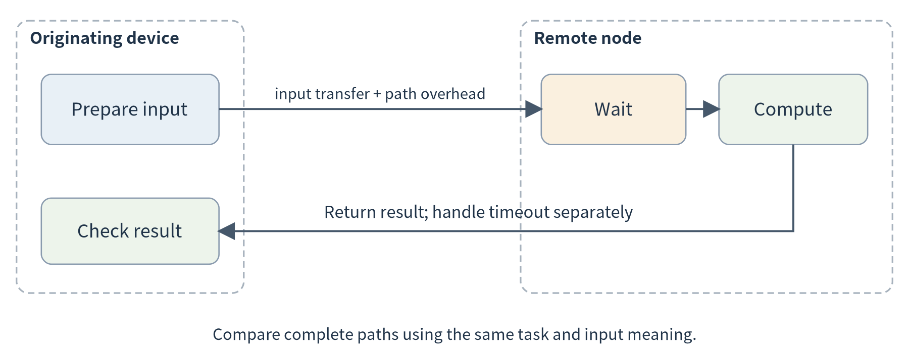
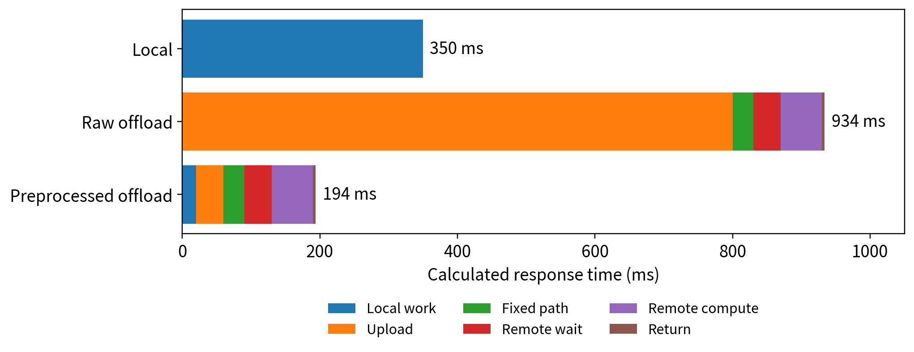
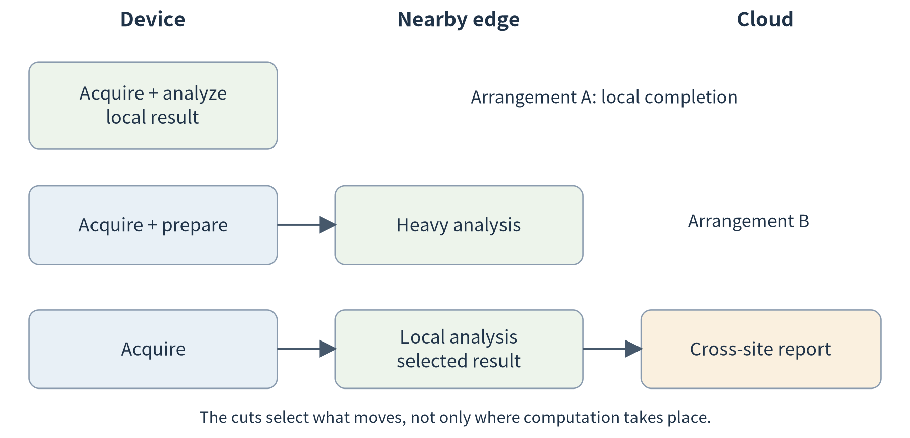
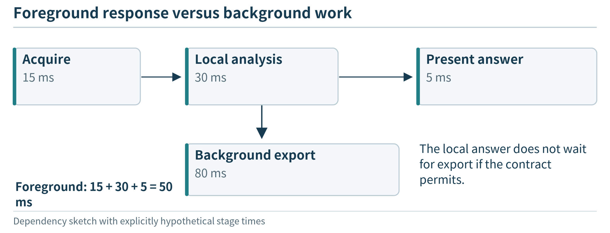
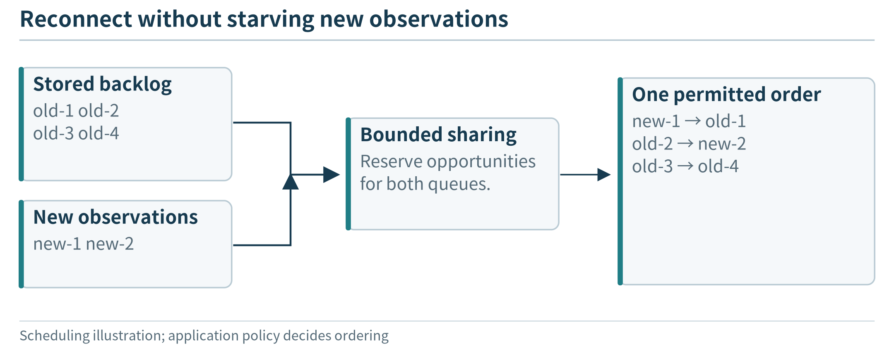

(chapter-7)=

# Chapter 7. Computation Offloading and Device–Edge–Cloud Collaboration

The workshop can now expand its analysis service across several similar local computers. A new deployment changes the problem. A field technician carries a small device between sites, some sites have an accelerator-equipped gateway, and a cloud service stores approved long-term reports. The mobile device cannot always use the nearby gateway, and the uplink is sometimes slow or unavailable. The resources are no longer interchangeable copies in one room.

Should a request run on the device, at a site gateway, or in the cloud? Should the entire request move, or only an expensive stage? Where should the observations and intermediate results remain? Those questions define collaboration across the continuum. Adding resources is still useful, but distance, compatibility, ownership, and data dependencies now influence how they can be used.

This chapter first follows one offloaded computation. It then extends that exchange into a multi-component application and introduces the data consistency needed to make the collaboration meaningful. The goal is a small working design with explicit responsibilities, not a universal algorithm for choosing the best deployment.

(section-7-1)=

## 7.1 From similar workers to different execution locations

(section-7-1-1)=

### 7.1.1 More capacity does not imply the same role

In {ref}`Chapter 6 <chapter-6>`, the analyzer replicas offered essentially the same interface and could process the same independent input. We deliberately simplified the environment so that replica count and request distribution were the main concerns. A device, a nearby edge node, and a cloud service introduce additional differences.

The device may have direct access to sensors but little spare memory. A local accelerator may run a computation quickly but serve several users. A cloud service may offer more capacity while requiring an uplink and permission to disclose the input. A peer device may be available only while its owner participates. These are not simply different values of the same “speed” parameter.

Before choosing a location, ask whether the task is allowed and able to run there. Is the necessary software compatible? Can the input be accessed? Is memory sufficient? Is the route reachable? Is the transfer permitted? Only candidates that pass these checks should enter a performance comparison. A fast but unauthorized location is not a slightly worse choice; it is outside the permitted design.

```{list-table}
:header-rows: 1
:class: book-table

 * - **Candidate**
   - **Possible role in the teaching deployment**
   - **Question to check first**
 * - Originating device
   - Acquire data and complete essential local analysis
   - Does the task fit its resources?
 * - Nearby edge node
   - Share an accelerator or a site-local data service
   - Is the service reachable and authorized?
 * - Peer device
   - Contribute approved observations or spare processing
   - Can participation end without breaking essential behavior?
 * - Cloud service
   - Combine approved histories or run deferred analysis
   - May the data leave the site, and is the link usable?
```

A communication link does not itself create a collaboration contract. The participants need compatible interfaces and an agreed meaning for the data. The remainder of the chapter builds those contracts through increasingly complete examples.

(section-7-2)=

## 7.2 Follow one computation from device to remote service

(section-7-2-1)=

### 7.2.1 Offloading is a request with a result

Suppose the technician’s device has collected a window that must be analyzed. In a local design, it calls an analysis function and receives a result. In an offloaded design, it prepares an input representation, sends a request to another execution site, waits for remote processing, and receives the result. The implementation needs a request identifier, an input schema, a result schema, and an explicit timeout or failure outcome.

Our numerical analysis service makes this boundary easy to inspect. The same sample window can be processed by a local function or submitted to the HTTP endpoint introduced in Chapter 5. Compare the numeric results before comparing speed. If the two paths use different windows, units, or analysis versions, the timing difference cannot be interpreted as a clean placement comparison.

(fig-7-1)=

<br>
Figure 7.1. Offloading includes input preparation, communication, remote waiting and execution, and result return. A local service address and a remote service address can expose the same interface without having the same cost or failure behavior.

A timeout means that the caller did not receive an acceptable result within its waiting policy. It does not prove that the remote worker never executed the request. Repeating a read-only calculation may waste work but does not necessarily change shared state. Repeating a state-changing operation requires a stronger duplicate-handling policy. HTTP’s concept of idempotence concerns the intended effect of repeated requests; choosing a method name is not enough to implement an application’s event identity or result handling. [{ref}`8 <ref-8>`]

For this first comparison, keep the operation read-only and bounded. If the remote path is unavailable, report that outcome or use a documented local fallback. Do not silently change the analysis and still describe the result as identical service.

(section-7-2-2)=

### 7.2.2 A response-time budget before a placement decision

For one sequential request, a useful first estimate is:

```text
T_remote = T_prepare + D_up / B_up + L_path
           + T_queue + T_compute + D_down / B_down
```

Here D\_up and D\_down are transmitted input and output sizes, and B\_up and B\_down are effective transfer rates in matching units. L\_path captures fixed communication overhead not already counted in transfer time. It can include a measured round-trip baseline for the exchange. Do not add a full measured network duration again if that duration already includes the payload transfer. Connection setup, retries, and serialization belong in the measured path where they occur.

Consider a hypothetical image task. Local execution takes 350 ms. Its remote input is 2 MB, using decimal units, so the payload is 16 megabits. Assume a 20 Mb/s uplink, a 30 ms fixed communication component, 40 ms of remote waiting, 60 ms of remote computation, and a 10 kB result returned at 20 Mb/s. Ignore additional preparation for this first calculation.

The upload takes 800 ms and the result transfer takes 4 ms. Remote completion is therefore 800 + 30 + 40 + 60 + 4 = 934 ms. A faster remote processor has not made the whole request faster. The input transfer dominates the comparison.

Now consider a different design: 20 ms of local preprocessing produces an approved 0.10 MB representation. Its transfer takes 40 ms. If the remaining assumptions still apply, completion is 20 + 40 + 30 + 40 + 60 + 4 = 194 ms. This is promising only if the smaller representation preserves the information the task requires. Its task quality must be evaluated separately; the timing equation cannot establish that.

(fig-7-2)=

<br>
Figure 7.2. Calculated response components for the hypothetical task: local execution, raw-input offload, and offload after local preprocessing. The values are teaching assumptions, not device or network measurements.

The calculation suggests a practical order of work. First identify what the application must accomplish. Next measure the local path and the complete remote path. Then investigate whether input preparation or placement should change. Moving a model or computation merely because another machine is faster skips the communication part of the application.

(fig-7-3)=

<br>
Figure 7.3. Changing representation changes the bytes crossing the link and the information available later. These are uncompressed payload calculations at an assumed 10 Mb/s; no network speed or equivalent task quality is measured.

(section-7-2-3)=

### 7.2.3 Time, energy, and data disclosure are separate constraints

A wearable task may be acceptable in latency but unacceptable in daily energy use. A site may have ample bandwidth but prohibit uploading a particular data class. A remote path may save device energy while consuming more total energy across the system. These are different questions and require different measurement boundaries.

For a device-energy estimate, account for local preparation, radio use, and the device’s behavior while waiting. For a system-wide estimate, include the remote computation and relevant infrastructure as well. Similarly, bandwidth should state which link is being measured. Reducing traffic to the cloud may increase traffic on the local wireless network.

This chapter compares a few feasible arrangements rather than forcing all outcomes into a single weighted number. Record the required latency, allowed data transfer, minimum task quality, and relevant resource budget. A candidate that satisfies all required conditions can then be compared on the cost or efficiency the application actually values. {ref}`Chapter 8 <chapter-8>` develops that decision process.

(section-7-3)=

## 7.3 Split responsibilities, not just execution time

(section-7-3-1)=

### 7.3.1 A multi-stage application has choices at its boundaries

The new field application collects readings, checks their format, computes local features, requests a heavier analysis when needed, and records a report. These steps can be represented as a small task graph. An edge in the graph means that one step needs information produced by another; it is not a requirement to send every intermediate result to the cloud.

Keeping acquisition on the device is natural when it owns the sensor interface. A nearby node might combine streams from several devices or provide a shared accelerator. A cloud service might combine approved reports across sites. The exact allocation depends on the workload. A live camera detector and a weekly vibration report can use similar infrastructure while placing their expensive work differently.

(fig-7-4)=

<br>
Figure 7.4. Three possible cuts of the same application: all local, local preparation with nearby analysis, and local processing with cloud aggregation. The task boundary determines both the transmitted data and the work that remains local.

A good interface says what crosses each boundary. Does the next component receive raw samples, extracted features, an object reference, or a completed result? Who interprets missing data? Which analysis version produced the output? A reference to an object does not remove the transfer cost if the receiving node must fetch the object from another location.

The application split is also different from the internal split of a neural network. Sending a whole image task to another service is an application-level decision. Dividing one model’s layers across devices introduces additional model-specific mechanisms, which belong in Chapter 11. We can build a useful continuum application without introducing those mechanisms here.

(section-7-3-2)=

### 7.3.2 Sequential requests and background work need different timing

If the user must wait for acquisition, analysis, and report generation in sequence, the user-visible time includes those dependencies. If uploading a history is a background task, it need not delay a local answer that uses already available evidence. Drawing the dependency graph prevents the system from waiting for remote work that is not actually needed for the requested result.

For an illustrative three-stage pipeline taking 20, 60, and 10 ms, a single item needs at least 90 ms of stage execution before communication and waiting. If the stages run on different resources and overlap across independent items, the 60 ms stage limits the ideal steady-state pipeline rate to about 16.7 items per second. Summing the stage times and inverting the sum answers a different question: sequential processing without overlap.

A pipeline does not eliminate queues. If the source offers 25 items per second to that 16.7-item/s stage, buffers eventually fill unless the application slows acquisition, changes the processing plan, or rejects work. Device–edge–cloud collaboration therefore needs an explicit pressure signal or overload policy, not just arrows pointing downstream.

(fig-7-5)=

<br>
Figure 7.5. Only required dependencies delay this response; asynchronous work still consumes resources and needs its own completion policy.

(section-7-3-3)=

### 7.3.3 Horizontal collaboration is not another mandatory tier

Two nearby gateways can share an approved summary without involving a central cloud in every exchange. A mobile device can use a peer while it is present. Such horizontal collaboration complements the vertical arrangement of device, site edge, and cloud.

Consider two agricultural plots. Each gateway knows its own local sensor history. A comparison service can request a bounded summary from both, then combine them. Raw records can remain at their sites when the question can be answered from summaries. But the summaries must describe compatible intervals and units. Averaging two means without their sample counts can give a misleading result when the groups have different sizes.

Cooperation also needs a rule for missing participants. A two-site report can say “one site unavailable” rather than present one site’s observations as a regional conclusion. A vehicle or phone that leaves should not be treated as a failed permanent server that a controller is entitled to reclaim. Participation, permission, and availability are part of the application’s interface to the continuum.

(section-7-4)=

## 7.4 Where data lives, and what consistency means to the application

(section-7-4-1)=

### 7.4.1 More execution locations create more versions of knowledge

The technician’s device has recent observations. The site gateway has a longer history. The cloud may have only the records uploaded before a link failure. All three can answer a historical query, but not necessarily from the same evidence. Before introducing a consistency mechanism, ask what the user expects the answer to mean.

A current-status display may require a sufficiently recent local observation. A monthly report can tolerate delayed uploads if it states its completeness. A configuration command may require an acknowledgment that the device has actually applied the change. These requirements should not all be implemented as “read whichever copy responds first.”

```{list-table}
:header-rows: 1
:class: book-table

 * - **Information**
   - **Useful ownership rule for an initial design**
   - **What another node needs to know**
 * - Sensor observation
   - Originating source creates an identified event
   - Source, event time, unit, and quality
 * - Derived result
   - Analysis worker records method and input identity
   - Which evidence and version produced it
 * - Configuration
   - One designated authority proposes a revision
   - Which revision the device actually applied
 * - Model artifact
   - A release process publishes an identified version
   - Compatibility and artifact identity
 * - Cached copy
   - Cache retains an explicitly described snapshot
   - Age, scope, and invalidation or expiry policy
```

A cache speeds access by retaining a copy; it does not define how current that copy must be. A replicated record can survive another node’s failure, but replicas do not automatically agree about concurrent edits. The application needs rules for ownership, update propagation, and acceptable age before it can choose a suitable mechanism.

(section-7-4-2)=

### 7.4.2 Keep observation time separate from arrival time

An observation collected at 10:00 may reach the cloud at 10:12 after a disconnection. Its event time remains 10:00. Replacing that time with the arrival time would change the meaning of the history. Record both when needed: one describes the physical observation, the other its delivery.

Suppose a cloud query asks for readings from 10:00 to 10:05 and receives only records that arrived before 10:06. It can return the data available so far, but should not claim that the interval is complete unless the system has a way to establish completeness. A later query may legitimately include delayed observations. Recording the evidence snapshot or collection revision allows users to understand the difference.

A strict instantaneously synchronized view across disconnected sites cannot be obtained by ignoring the disconnection. For a first application, a practical policy is to keep local work available and label remote views with their freshness and coverage. Applications that require coordinated changes must wait for the relevant agreement or refuse the operation during a partition. The right behavior follows from the requested function, not from a universal preference for either availability or freshness.

(section-7-4-3)=

### 7.4.3 Desired configuration and applied configuration are different facts

The cloud changes a sampling interval from ten seconds to five seconds. While the device is offline, the cloud knows what it wants but the device still runs the old setting. A useful interface shows both: proposed revision 8 and applied revision 7. Once the device receives, validates, and applies revision 8, it reports that fact.

(fig-7-6)=

<br>
Figure 7.6. A proposed revision, its application and the report of application are different events.

This is the application-level idea behind a desired/reported-state pattern. AWS IoT Device Shadows provide separate desired and reported objects, but the devices and applications must still implement the behavior that keeps their state meaningful. [{ref}`20 <ref-20>`] {ref}`Chapter 9 <chapter-9>` will examine the platform representation after the need has been established here.

For the introductory design, assign configuration writes to one authority and use increasing application revision numbers. Do not use arrival order alone when messages can be delayed. If several independent writers must edit the same field, the system needs a conflict rule or coordination mechanism; “keep the last received message” may silently overwrite a newer decision. This chapter introduces the problem and a simple single-writer solution rather than a full distributed-database protocol.

(section-7-5)=

## 7.5 Disconnection and recovery are part of collaboration

(section-7-5-1)=

### 7.5.1 Preserve useful local work

Imagine the field site loses its cloud connection for ten minutes. The device can still reach its local gateway. We choose the following behavior for the teaching application: acquire observations, perform approved local analysis, and retain results; defer the cross-site report; label the cloud view as stale. A local query must not silently switch to a model or database endpoint that is also unreachable.

Offline operation is a property of a particular function and its dependencies. Local code, model artifacts where needed, stored data, and an accessible interface must be available for that function. A local analysis can continue while remote deployment updates are unavailable. A failed local radio link, a failed host, and a failed cloud uplink are different fault cases and should be tested separately.

A phone application gives a useful contrast. It may continue an on-device computation without cloud connectivity but still be suspended by its operating environment. A local network connection does not grant another device unlimited background execution. The collaboration design should name which participant controls continued execution.

(section-7-5-2)=

### 7.5.2 Retain an event until its delivery outcome is known

For a simple upload path, store each event in a local persistent pending set. Attempt to deliver it with a stable event key. At the receiver, store that key with the content and return an acknowledgment after the defined acceptance step. Remove or mark the sender’s pending entry only after receiving that acknowledgment.

(fig-7-7)=

<br>
Figure 7.7. If the receiver stores an event but its acknowledgment is lost, the sender retries the same event key. The receiver recognizes the duplicate and returns the existing acceptance result. This achieves duplicate-safe ingestion only at the defined receiving boundary.

Suppose event device-7 / boot-b / 42 is accepted but the reply is lost. The sender cannot know whether acceptance occurred, so it retries the same key. A receiver that enforces uniqueness can recognize the repeated content. If the key is reused with different content, it should report a conflict rather than silently overwrite a different event.

Local transactional storage can keep related changes together; SQLite, for example, supports explicit transactions for a local database. [{ref}`101 <ref-101>`] That does not create a transaction spanning the device, gateway, and cloud. The companion exercise implements a small persistent journal to make the pending and accepted states inspectable; it is not a general exactly-once messaging platform.

An MQTT acknowledgment also should not be confused with a database commit in a downstream application. The broker-level exchange and the application’s acceptance boundary are different. AWS IoT Core’s supported MQTT delivery levels describe messaging behavior, not the completion of arbitrary consumer-side work. [{ref}`37 <ref-37>`] The application must decide which acknowledgment establishes the property it needs.

(section-7-5-3)=

### 7.5.3 Recovery must not overwhelm current work

When the link returns, ten minutes of buffered data can compete with current observations and interactive requests. Sending the backlog as fast as possible may make the apparently recovered system unusable. A first policy can rate-limit backlog upload, preserve current local service, and expose the remaining pending count.

Storage is finite as well. If the disconnection outlasts the buffer budget, the application must apply a declared retention policy: stop accepting a class of work, discard designated old data, or reduce collection where that is allowed. It should not silently lose arbitrary records and later claim a complete history. This is a requirement decision before it is a clever recovery algorithm.

Do not infer global ordering from a sorted list of unsynchronized device clocks. A source sequence can order one source’s observations; combining multiple sources may require synchronization assumptions and an uncertainty allowance. For our first report, use explicit source intervals and report missing coverage rather than invent a precise causal ordering across devices.

(fig-7-8)=

<br>
Figure 7.8. Recovery competes with current work; a bounded policy makes catch-up explicit instead of releasing an uncontrolled burst.

(section-7-6)=

## 7.6 Build and compare a small continuum application

A practical exercise can use two approved endpoints. The originating node prepares a window and calls its local analyzer or the second node’s service using the same request format. An integration test compares deterministic results, records elapsed time, and exposes an unavailable destination. The remote location can initially be another process on the same computer to debug interfaces, but that is not evidence of a real wide-area latency advantage.

Next separate local analysis from asynchronous report export. Use the supplied persistent journal to queue synthetic results while delivery is disabled. Re-enable delivery and intentionally lose one acknowledgment in the test harness. Inspect the pending set, the receiver’s unique records, and the final counts. Restart the journal process between attempts to check that pending work survives. This demonstrates a bounded recovery mechanism without needing to interfere with a real network.

Finally compare two fixed application splits on the same workload. In one, transmit the complete input for remote analysis. In the other, compute an approved representation locally and transmit that. Measure bytes, time, and task quality separately. For numerical windows, a mean may be sufficient for a mean query but insufficient for a question about the sequence of changes. The correct placement and representation depend on the task.

The exercise should end with an architecture description, not a claim that one location is always preferable. Identify where each computation runs, where each important state resides, and which functions remain available under the selected failure. A diagram that marks both the data path and the management path makes those statements easier to inspect.

The synchronization mechanisms here maintain application state. {ref}`Chapter 14 <chapter-14>` asks the additional question of who may authorize shared records when several organizations do not accept one unilateral writer; replication alone is not a blockchain.

(chapter-7-chapter-summary)=

## Chapter summary

The continuum combines different resources through explicit task and data interfaces. Offloading must account for the complete request path, not only remote computation. Splitting an application introduces data-placement and consistency questions, while disconnection turns recovery into part of the normal design.

A small set of fixed, measured arrangements provides the foundation for optimization. {ref}`Chapter 8 <chapter-8>` asks how to choose and adapt among such arrangements when requests, resources, and conditions change.

(chapter-7-exercises)=

## Exercises

**7.1 Budget.** Recalculate the raw-input offload example at 100 Mb/s upload bandwidth while keeping the stated return link and other terms unchanged. Which path is faster than the 350 ms local baseline? Identify assumptions that could reverse the result.

**7.2 Representation.** A local gateway uploads one mean per minute instead of the time series. Give one query this supports and one query it may no longer support. How should the system react to the second query?

**7.3 Consistency.** The cloud desires configuration revision 8, but an offline device last reported revision 7. What can a user interface truthfully display? What event justifies showing revision 8 as applied?

**7.4 Recovery.** Draw the case where a receiver commits an event and its acknowledgment is lost. Explain the roles of persistent pending state and stable event identity. Why is a transport acknowledgment alone insufficient to prove arbitrary downstream completion?

**7.5 Transfer.** Design a two-site agricultural comparison or a mobile inspection application. Specify the computation split, evidence locations, one allowed stale view, and one operation that must wait or be refused during disconnection.

