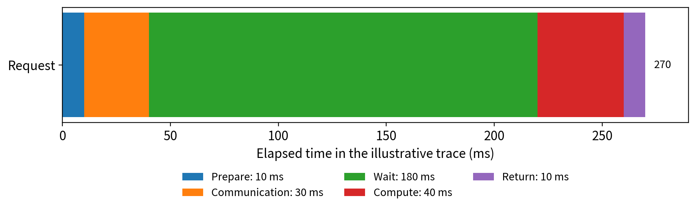
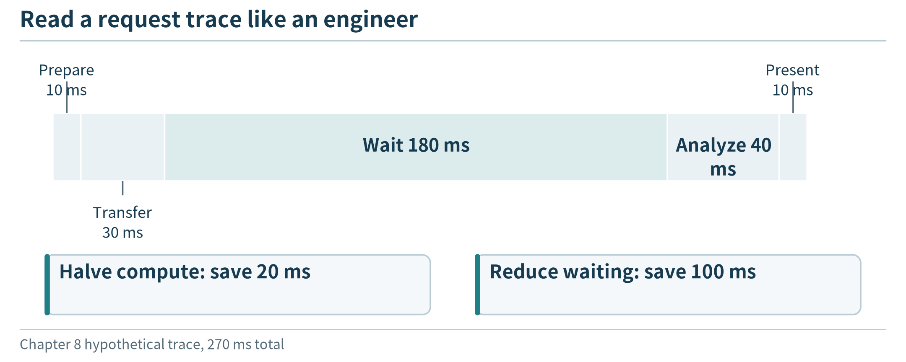
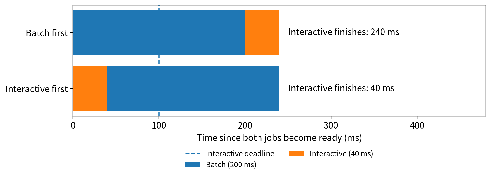
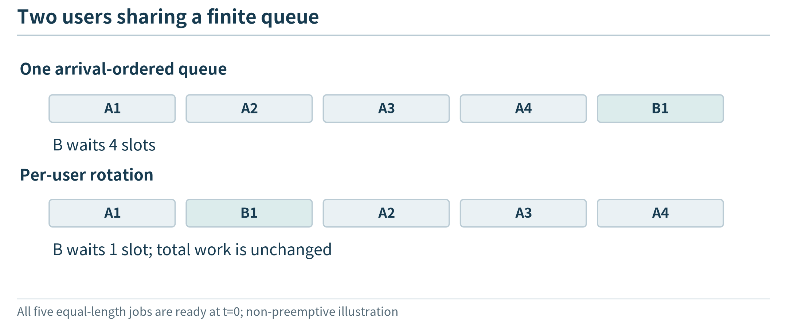
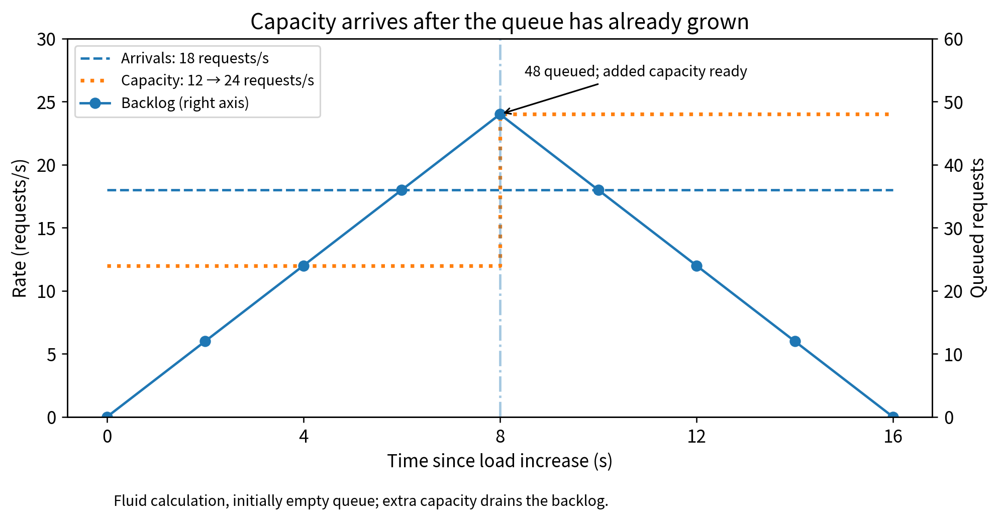
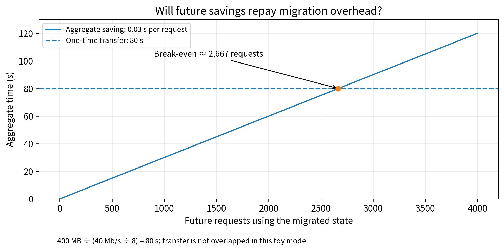

(chapter-8)=

# Chapter 8. Scheduling and Optimizing Edge Systems

The workshop’s application now has several feasible execution paths. Short analyses can run on a device or a local worker pool. More demanding work can use a shared accelerator, and approved historical reports can run in the cloud. Yet technicians still experience slow responses when a batch report starts at the same time as interactive work. Sometimes the cloud path is faster; sometimes its network delay makes it worse. Adding a worker helps on one day and changes little on another.

The missing ingredient is no longer a deployment mechanism. It is a decision process: which work to admit, where to send it, how much resource to assign, and when to change the arrangement. This chapter uses small examples and measured comparisons to introduce scheduling and optimization from an application perspective. It does not require implementing an operating-system scheduler or solving a large mathematical program.

We begin with an explicit goal, observe the part of the system that prevents it from being met, and compare a few understandable policies. An optimization is useful only if it improves the requested behavior without quietly changing the task, disclosing prohibited data, or creating an unacceptable failure mode.

(section-8-1)=

## 8.1 Define the decision before choosing a policy

(section-8-1-1)=

### 8.1.1 Five decisions often hidden behind the word “scheduling”

The technician asks for a result, while the operator manages applications and machines. These activities have different decision units. A service can be placed on a node long before an individual request arrives. A load balancer routes a request to an existing replica. A worker then decides which queued request to execute. An autoscaler may change the number of replicas available for future requests.

```{list-table}
:header-rows: 1
:class: book-table

 * - **Decision**
   - **Example question**
   - **Typical timescale in our design**
 * - Service placement
   - Which nodes should host an analysis component?
   - Deployment or occasional reconfiguration
 * - Replica count
   - How many ready workers should be maintained?
   - Repeated capacity adjustments
 * - Request routing
   - Which eligible worker should receive this request?
   - Each request
 * - Queue scheduling
   - Which accepted job should execute next?
   - Each worker becoming available
 * - Admission and resource allocation
   - Can this job be accepted, and with what budget?
   - Before or during execution planning
```

These are not fixed universal timescales, but separating them prevents an unclear experiment. Kubernetes’ scheduler, for example, primarily assigns unscheduled Pods to nodes; it does not automatically choose the order of the application’s internal analysis requests. [{ref}`102 <ref-102>`] A study of round-robin request routing should not be described as replacing the Kubernetes scheduler unless it actually changes Pod placement.

(fig-8-1)=

<br>
Figure 8.1. Placement, scaling, routing, queue scheduling, and admission act on different objects. Application measurements inform policy; a platform executes permitted changes. A working mechanism does not determine which policy best meets the application’s goals.

(section-8-1-2)=

### 8.1.2 Requirements first, preference second

Suppose the teaching application has two classes of work. Interactive requests should produce an acceptable answer within a stated response target; historical reports may wait longer. Raw personal data must remain at the site. The system may use a remote service only for approved inputs. These conditions define the feasible designs before comparing cost.

For an illustrative study, set the interactive target to 300 ms for at least 95% of submitted valid requests and require an acceptable result on a fixed evaluation set. These are invented study requirements, not industrial safety limits. An application with different consequences needs different targets. Report how rejected, failed, and timed-out requests count; excluding all difficult requests would make the apparent success rate misleading.

A useful formulation is to seek a lower-cost arrangement **among those that satisfy the required quality, response, and data-handling conditions**. This avoids assigning arbitrary weights that allow a privacy violation to be “compensated” by a small speedup. Where no candidate satisfies the requirements, report that outcome. The next step may be to change resources or negotiate the requirement, not to label the least-bad candidate compliant.

Cost also needs a boundary. Comparing an owned edge node with a per-request cloud service requires a common workload and accounting period. Hardware allocation, energy, network use, and remote calls may all matter. For a routing decision on equipment that is already powered on, marginal cost can differ from the total cost used for a deployment purchase. State which decision the accounting is intended to support.

(fig-8-2)=

<br>
Figure 8.2. Constraints filter candidates before preferences rank them; sometimes the correct result is that no candidate satisfies the request.

(section-8-2)=

## 8.2 Locate the bottleneck with an application trace

(section-8-2-1)=

### 8.2.1 A slow response can contain little useful computation

Before changing replica counts, record a request’s important stages: input preparation, transmission, waiting, computation, result transfer, and presentation. Use a monotonic clock for elapsed durations within one process. When different machines contribute timestamps, do not subtract them as though their wall clocks are perfectly synchronized. A first trace can combine client-measured total time with explicitly measured server durations and report the remaining communication overhead.

Consider this invented trace:

```{list-table}
:header-rows: 1
:class: book-table

 * - **Stage**
   - **Time**
 * - Prepare request
   - 10 ms
 * - Transfer and fixed communication
   - 30 ms
 * - Wait for analysis worker
   - 180 ms
 * - Analyze
   - 40 ms
 * - Return and present
   - 10 ms
 * - **Total**
   - **270 ms**
```

Halving computation saves only 20 ms in this trace. Reducing the waiting time by 100 ms has a much larger effect. The trace does not yet tell us why the queue formed: too few workers, a burst, poor routing, or long batch jobs could all contribute. It does tell us where to investigate first.

(fig-8-3)=

<br>
Figure 8.3. An illustrative request spends most of its time waiting, not computing. Optimization should target the measured limiting stage while preserving the task and result-quality requirements.

For a language-model tool workflow, measure the complete user request as well as individual model calls. Reducing one model call’s time may not matter if the workflow makes unnecessary serial calls or repeatedly retrieves the same data. Model-specific techniques come in {ref}`Chapter 11 <chapter-11>`; the application-level need to locate time applies already.

(fig-8-4)=

<br>
Figure 8.4. Intervals must refer to the same request and a consistent clock; a long response need not mean long computation.

(section-8-2-2)=

### 8.2.2 Inspect a distribution and its failures

A mean response time hides variation. Record at least a distribution or selected percentiles, together with completion and failure counts. If five of one hundred valid requests time out, those requests belong in the report even if no final response-time value is available for them. Report successful-response latency and the timeout rate separately rather than silently discarding the timeouts.

The numerator of a useful success rate should reflect the application’s task, not simply an HTTP 200 response. For our numeric analyzer, an accepted result must match the declared calculation on the correct input. For a generated report, a rubric can check supported claims, required qualifications, and whether the requested comparison was completed. A policy that returns a cached answer about the wrong interval is not an optimization of the original task.

The workload generator also matters. A closed-loop client waits for its previous response before sending another request, so a slow system can unintentionally reduce its own offered load. An open-loop trace schedules arrivals independently of response completion. Neither is always preferable; use the one that represents the question and state which was used. In a practical classroom experiment, a few explicit burst and steady-load patterns are more informative than one unexplained benchmark number.

(section-8-2-3)=

### 8.2.3 A baseline makes improvements interpretable

Begin with a fixed configuration and a simple policy. For example, keep two workers ready, route requests round-robin, and serve each worker’s queue first-come, first-served. Save the request trace and test it again after changing one policy. Keep the analysis version, input distribution, result checks, and network assumptions consistent.

Not every useful comparison changes only one parameter, but a complex change must explain its components. If a new design both adds an accelerator and compresses inputs, report those changes explicitly. Otherwise the reader cannot tell whether the benefit comes from scheduling, hardware, or a changed representation.

(section-8-3)=

## 8.3 Arrange execution when jobs compete

(section-8-3-1)=

### 8.3.1 Queue order can change which requests meet their targets

Suppose a historical job needs 200 ms and an interactive job needs 40 ms. Both are waiting when a single worker becomes available. The historical job’s deadline is 400 ms from now; the interactive job’s deadline is 100 ms. With the historical job first, completions occur at 200 and 240 ms, so the interactive job is late. With the interactive job first, completions occur at 40 and 240 ms, and both meet their deadlines.

(fig-8-5)=

<br>
Figure 8.5. Two non-preemptive orders for the same assumed jobs. Executing the short-deadline job first meets both stated deadlines in this example. The example does not prove that one policy is optimal for every arrival pattern or objective.

This motivates a deadline-aware queue without requiring scheduling theory. A first-come, first-served policy is easy to understand and does not favor a job that arrives later merely because it is short. An earliest-deadline policy gives urgent work priority. A shortest-estimated-job policy can improve some completion measures but may repeatedly postpone large jobs. Choose the policy according to the application’s commitments and test it under its expected mix.

Our example assumes both jobs are available, durations are known, and execution is non-preemptive. If the batch job is already running and cannot be interrupted, the urgent job may still wait. If duration estimates are wrong, the planned order may fail. These conditions belong beside the example so that a convenient illustration is not mistaken for a universal guarantee.

(section-8-3-2)=

### 8.3.2 Admission is part of meeting a promise

A service should not accept an unlimited amount of work and then hope every deadline is met. Before admitting a request, an application can compare its remaining time budget with an estimate of waiting, transfer, and execution. If no allowed path is likely to meet the target, it can return a busy response, offer a deferred result, or invoke a defined lower-cost mode when the user permits it.

Such decisions must preserve the task contract. Replacing a requested detailed analysis with a simple threshold check is acceptable only if it is an explicitly permitted fallback, not if the interface claims the original task was completed. For a classroom design, record fallback use separately from ordinary success.

A bounded queue also protects memory and data freshness. If an arriving status request supersedes an older request for the same display, the application may choose to replace the old queued request. That policy is inappropriate for a historical event log where each event must be retained. The same mechanism can be useful or harmful depending on what the request represents.

(section-8-3-3)=

### 8.3.3 Share resources across users, not only requests

Two users may submit very different workloads. One sends frequent tiny queries; another sends fewer large reports. Equal request counts do not necessarily mean equal resource use. A simple multi-user design can maintain per-user limits, separate queues, or a fair rotation, while preserving a bounded amount of service for background work.

The purpose is not to introduce a complicated fairness theory. It is to stop an implementation detail, such as who can open the most connections, from silently becoming the allocation policy. Test a heavy user and a light user together and report each one’s outcomes. An improved aggregate mean can conceal that one user no longer receives useful service.

Resource isolation from {ref}`Chapter 5 <chapter-5>` supplies an enforcement boundary, but it does not by itself choose a fair policy. A configured CPU or memory limit also does not establish that an application has enough capacity for its admitted workload. The configuration and admission decision must fit together.

(fig-8-6)=

<br>
Figure 8.6. The same total work can distribute waiting very differently across users; the policy must state whose requirement it protects.

(section-8-4)=

## 8.4 Choose placement, routing, and replica count together

(section-8-4-1)=

### 8.4.1 Filter candidates before estimating performance

A placement worksheet for one task can list its compatible runtime, memory requirement, data access, permission constraints, and candidate locations. Remove infeasible locations first. Then estimate the full response path using {ref}`Chapter 7 <chapter-7>`’s budget and current load observations.

Consider three hypothetical candidates for a task with a 250 ms response target:

```{list-table}
:header-rows: 1
:class: book-table

 * - **Location**
   - **Communication and preparation**
   - **Predicted waiting**
   - **Execution**
   - **Predicted total**
   - **Eligible?**
 * - Device
   - 10 ms
   - 20 ms
   - 180 ms
   - 210 ms
   - Yes
 * - Nearby worker
   - 40 ms
   - 120 ms
   - 50 ms
   - 210 ms
   - Yes
 * - Cloud worker
   - 100 ms
   - 10 ms
   - 30 ms
   - 140 ms
   - No for restricted raw input
```

The cloud has the lowest estimated time but cannot receive this input under the assumed rule. The device and nearby worker have equal estimates for different reasons. A policy can use another relevant criterion, such as device energy or local capacity needed for other work, to choose between them. It should also account for uncertainty: a 210 ms estimate with large variability is not equivalent to an assured 210 ms completion.

If an approved transformed input makes the cloud candidate eligible, reevaluate both its preparation cost and task quality. Do not carry over the old estimate without changing the input assumption. This is how application design and scheduling interact without requiring a single enormous optimization model.

(section-8-4-2)=

### 8.4.2 Avoid decisions that ignore the work already sent

A shortest-queue router can be a useful improvement over round-robin, but queue length alone can be misleading when jobs have different durations. An estimate of unfinished work is more informative than a count of requests. A first implementation can track the expected finish time of each worker and add the estimated service time of newly assigned jobs.

If many independent clients all see the same apparently idle worker, they may simultaneously send it new work. The measurement becomes stale immediately. A centralized dispatcher can account for assignments as it makes them; a distributed scheme needs a way to avoid relying only on old observations. This is a useful systems limitation to explain, not a reason to begin the chapter with a complex distributed scheduling algorithm.

For the small teaching simulator, compare two policies on the same arrival trace: round-robin and minimum predicted completion time. The second chooses among eligible workers and updates its prediction after every assignment. Because it uses specified processing times and delays, the results describe the simulator, not measured hardware. A real deployment would need to estimate those quantities and examine estimation error.

(section-8-4-3)=

### 8.4.3 Replica count affects both waiting and cost

More replicas can shorten queues if useful work can be distributed and sufficient capacity exists. They also hold memory, may duplicate model weights, and consume resources needed by other services. Fewer replicas can be economical at low load but respond slowly to bursts. The count cannot be chosen separately from worker capacity and startup delay.

A small candidate comparison is often enough for a course project: one, two, or three local replicas, possibly with a permitted remote path. Use the same workload horizon and task quality requirement. Calculate or measure response outcomes and cost for each candidate, then identify which satisfy the stated requirements. There is no need to claim a global optimum over every possible architecture.

```{list-table}
:header-rows: 1
:class: book-table

 * - **Candidate**
   - **Assumed total cost per hour, units**
   - **Requests meeting time and quality target**
   - **Decision under a 95% target**
 * - One local worker
   - 1.0
   - 82%
   - Does not satisfy the target
 * - Two local workers
   - 1.6
   - 97%
   - Feasible in this assumed comparison
 * - One local worker plus approved remote overflow
   - 1.4
   - 96%
   - Feasible while the remote path is available
```

The table is an invented decision example, not an experiment. If offline service is also mandatory, the hybrid candidate needs a separate offline test and may not remain feasible. If costs are estimates, report their assumptions and sensitivity. A cheaper plan should not be selected by comparing an hourly cloud charge with an edge device’s purchase price without a common accounting basis.

(section-8-5)=

## 8.5 Adapt without spending more than the change saves

(section-8-5-1)=

### 8.5.1 New capacity takes time to become useful

Suppose a service can currently finish 12 requests/s. A burst offers 18 requests/s while a new worker takes eight seconds to become ready. In a simplified fluid model with no rejection, the backlog increases by (18 - 12) × 8 = 48 requests during startup. If ready capacity then becomes 24 requests/s and arrivals remain at 18, draining that backlog takes another 48 / (24 - 18) = 8 seconds.

(fig-8-7)=

<br>
Figure 8.7. At 18 arrivals/s and 12 completions/s, an initially empty queue accumulates 48 requests in eight seconds. Raising capacity to 24/s then needs another eight seconds to clear that backlog. This is a calculated fluid model, not a measured queue.

A controller that reacts correctly to load can therefore still miss many short deadlines. Possible responses include retaining headroom, starting capacity earlier when demand is predictable, rejecting or deferring work, or using a permitted ready remote service. {ref}`Chapter 6 <chapter-6>` supplied the scaling mechanism; this calculation explains why its timing belongs in the policy.

(section-8-5-2)=

### 8.5.2 Moving a component has an amortization period

A service relocation can require transferring artifacts, initializing a model, and moving or reconnecting state. Consider an illustrative 400 MB artifact over a 40 Mb/s link with no cached copy. Transfer alone takes 80 seconds in decimal units. If relocation saves 30 ms on each of the next 1,000 requests, the aggregate service-time saving is only 30 seconds. Under this deliberately simplified non-overlapping cost model, the transfer is not repaid within that workload.

The comparison is not a universal monetary or latency formula. Artifact transfer can overlap other work, the target may already have the image, and saving user-visible tail latency can matter even when aggregate time is small. The point is to identify one-time costs and the horizon over which a benefit occurs. Repeatedly moving an application to follow small load changes can be worse than tolerating a slightly imperfect placement.

Updating or moving a model also may require old and new versions to coexist briefly. Verify the peak resource budget, not only the steady-state budget after the old version disappears. If both versions cannot fit, the update procedure must state how service is interrupted or redirected.

(fig-8-8)=

<br>
Figure 8.8. The illustrative transfer costs 80 seconds, while each future request saves 0.03 seconds. About 2,667 requests repay the transfer in this non-overlapped accounting model; 1,000 requests save only 30 seconds.

(section-8-5-3)=

### 8.5.3 Use simple stability rules before complex policies

A practical first policy can require a meaningful improvement before switching, retain a choice for a minimum interval, and cap how often it changes. This introduces hysteresis: the rule for leaving a state differs from the rule for entering it. The purpose is to avoid changing placement every time two noisy measurements trade places.

For example, switch from the local path only when the remote path is eligible and its estimated saving exceeds a stated threshold for several observations. Switch back when the network becomes unavailable or the local choice becomes clearly preferable. The threshold is a policy parameter to evaluate, not a universal constant.

Device mobility adds a residence-time question. If a moving device will leave a nearby service area before setup is complete, initiating a heavy migration may make little sense. Often a simpler reconnection to a stateless service is enough; other applications need explicit session or state transfer. Choose the level of continuity the application actually requires.

(section-8-6)=

## 8.6 Compare policies with a reproducible experiment

Begin by writing a testable claim: for example, “under the supplied mixed request trace, separating urgent and batch queues increases the fraction of interactive requests meeting their deadline without preventing batch completion.” This is more informative than “our scheduler improves performance.” State the workload, allowed resources, quality checks, and failure treatment before examining outcomes.

The package contains a deterministic event simulator for queue order and request routing, plus arithmetic checks for the worked examples. Use it to predict behavior, then test selected policies against the real service where the environment is available. Keep simulated service times and measured service times in different files so they cannot be confused in a report.

An initial study can follow three comparisons. First compare first-come, first-served and deadline-based queue order on a known set of jobs. Next compare round-robin and completion-time routing while holding the replica set fixed. Finally add a simple scaling policy and include its startup delay. Changing one level at a time shows which mechanism produced the effect.

Record the result as several outcomes rather than a single unqualified score: completed useful work, response distribution, rejections and failures, per-user behavior, and resource or cost accounting. Repeat a policy under a different load pattern. A policy that works only for the trace used to tune it has not yet demonstrated broad usefulness.

A negative result can be valuable. If a more complicated router gains nothing because every request waits on one shared model endpoint, the next design change may be to address that shared component. Optimization should revise the explanation of the system, not merely search for a setting that produces a favorable chart.

(chapter-8-chapter-summary)=

## Chapter summary

Scheduling and optimization choose how to use the deployment and collaboration mechanisms already available. The developer should distinguish placement, replica count, request routing, queue order, and admission; observe the relevant bottleneck; and compare policies under explicit requirements.

An application-oriented approach does not need sophisticated algorithms to produce useful insights. Clear baselines, complete time budgets, bounded policies, and honest failure accounting can explain when an improvement is real and when a deployment change is not worth its cost. {ref}`Chapter 9 <chapter-9>` examines which of these mechanisms a commercial platform supplies and which decisions remain with the application team.

(chapter-8-exercises)=

## Exercises

**8.1 Decision units.** A report says that changing a Kubernetes Deployment from two replicas to four “improved the request scheduler.” Rewrite the claim precisely. What separate measurements would show whether routing or queue scheduling also changed?

**8.2 Queue order.** Reproduce the 200 ms batch and 40 ms interactive example. Then let the batch start 20 ms before the interactive request arrives and assume it cannot be preempted. What benefit remains available from changing only queue order?

**8.3 Feasibility.** Use the placement table in Section 8.4. What changes if raw input cannot leave the device, rather than only the site? Why should that condition be checked before choosing the fastest candidate?

**8.4 Adaptation.** Derive the backlog and drain time in Section 8.5. What happens if capacity after startup reaches only 18 requests/s? What additional action is needed to reduce the existing backlog?

**8.5 Evidence.** Design a comparison of two routing policies for image analysis or language-model tools. State the baseline, workload, quality checks, cost boundary, and how you will report failures and per-user outcomes.

