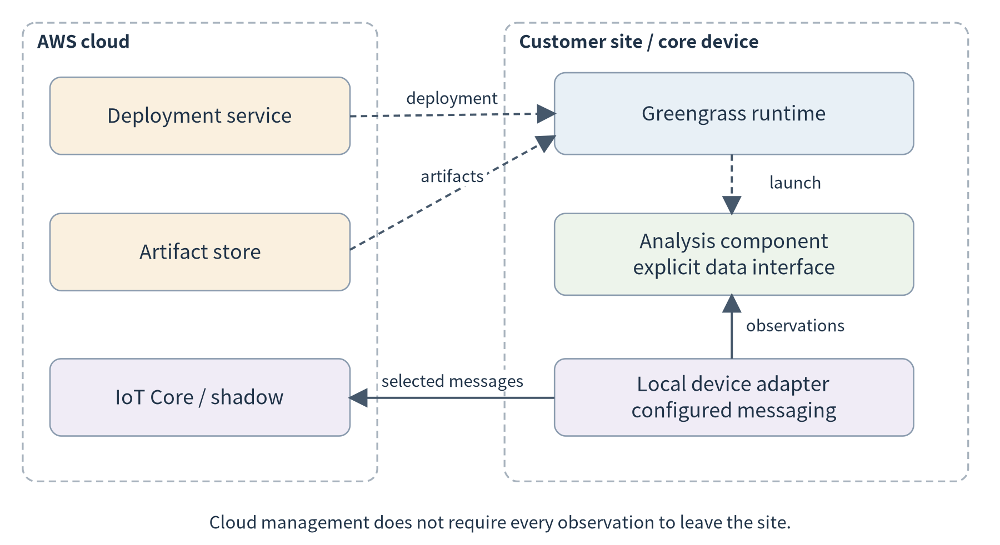
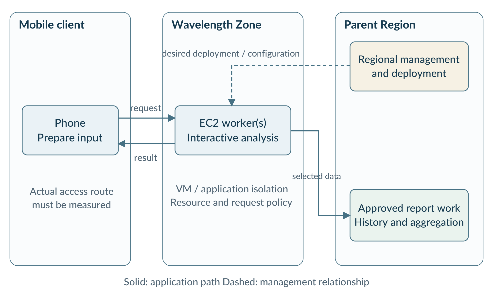
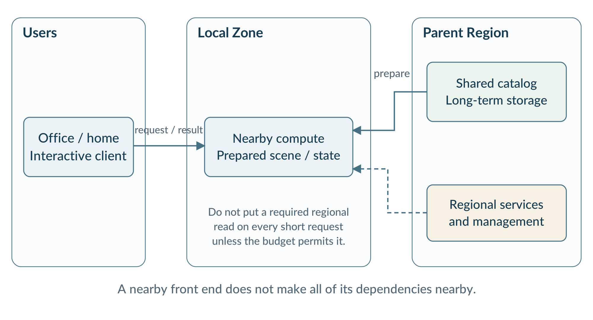
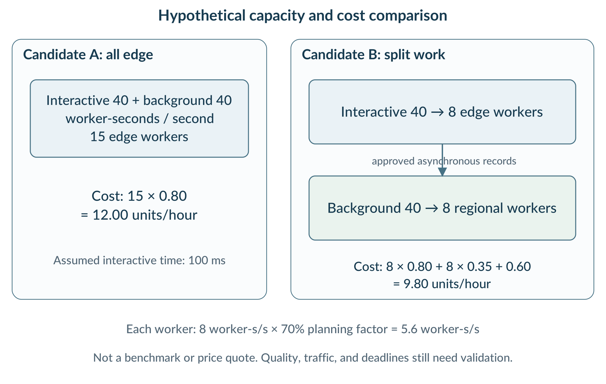

(chapter-9)=

# Chapter 9. Commercial Edge Platforms: From Mechanisms to Deployment

The workshop application now serves several buildings. Its local analysis works, its replicas can share requests, and a policy can send suitable work to a remote service. A new requirement changes the problem: technicians also want to use the application from phones while visiting customers. Managers want daily reports across all sites. A public dashboard needs to deliver selected results to many readers.

One deployment arrangement need not serve all three needs. A computer beside a machine has direct access to local observations. Infrastructure in a communications provider’s network may offer a useful path to mobile users. A regional service can combine historical records from many sites. A content-delivery service can distribute a public dashboard without becoming the place where private sensor analysis runs. The application has become a practical example of the continuum from Chapter 7.

This chapter examines how commercial platforms implement the execution, scaling, collaboration, and policy mechanisms of Chapters 5–8. AWS provides several contrasting deployment structures; Cloudflare Workers supplies a second provider’s example of managed function execution. Each case begins with an application requirement and follows the request and management paths. Product capabilities are documented facts; the proposed application arrangements and numerical examples are teaching designs, not reports of deployments that have been performed.

(section-9-1)=

## 9.1 Read a platform through the system it must support

(section-9-1-1)=

### 9.1.1 Four questions carried forward

The first question is **what runs, and where**. A deployable unit might be a program on a customer-selected device, a container inside a virtual machine, or a function inside a provider-managed runtime. This connects directly to Chapter 5. A platform name alone does not identify the executable artifact, required dependencies, or isolation boundary.

The second question is **how additional work is accommodated**. A fleet-management service can install the same component on many devices without automatically distributing incoming requests among them. Conversely, a managed function service may handle requests without exposing replica counts to the developer. {ref}`Chapter 6 <chapter-6>` supplies the vocabulary for distinguishing software distribution, replication, load balancing, and elasticity.

The third question is **how computation and state are divided**. Follow a request beyond its first nearby server. Does it need a regional database before answering? Which records remain local, which are copied, and which configuration is actually applied? These are {ref}`Chapter 7 <chapter-7>`’s collaboration and consistency questions.

The fourth question is **who chooses the policy**. A platform can expose metrics and deployment APIs while leaving the developer responsible for a cost-aware routing rule or a quality constraint. {ref}`Chapter 8 <chapter-8>` is not made unnecessary by buying a managed service.

```{list-table}
:header-rows: 1
:class: book-table

 * - **Earlier chapter**
   - **Look for this mechanism**
   - **Ask this application question**
 * - 5: execution and deployment
   - Runtime, artifact, configuration, isolation
   - Can the required program run here, with the right access and resources?
 * - 6: scaling and elasticity
   - Replicas, request entry point, health, capacity
   - What grows when demand grows, and what remains limited?
 * - 7: offloading and collaboration
   - Network paths, data copies, local dependencies
   - Which work stays nearby, and which remote dependencies remain?
 * - 8: scheduling and optimization
   - Measurements, controls, placement and routing choices
   - Which decisions are automatic, configurable, or still application-built?
```

The important output is a responsibility map, not a checklist on which every product must score equally. A lightweight request function and a GPU-equipped virtual machine intentionally expose different execution environments. They are useful for different portions of an application.

(section-9-1-2)=

### 9.1.2 Keep deployment location and management location separate

A cloud API can install software that subsequently runs on a customer device. A regional Kubernetes control plane can manage workers located elsewhere. A function can be published through a regional interface and executed through a content-delivery network. In all three cases, the location of an administrative action does not by itself establish the location of application computation. [{ref}`15 <ref-15>`, {ref}`109 <ref-109>`, {ref}`118 <ref-118>`]

{ref}`Figure 9.1 <fig-9-1>` organizes the platform cases by their execution boundary. It is not a chain through which every observation must travel. A complete application should use only the locations and services justified by its requirements.

(fig-9-1)=

![Platform families mapped to system responsibilities; Greengrass; Customer device; ; Component runtime + cloud; management; Wavelength; Carrier-network location; ; Near-user compute + regional; dependencies; Local Zones; Provider site near users; ; Selected regional services; extended locally; Outposts; Managed hardware on premises; ; Local resource pool + service; link; CloudFront; HTTP delivery path; ; Caching + selected function; triggers; Workers; Provider distributed runtime; ; Isolates + explicit state; dependencies](../images/asset-1a1d81fcf035e3b9.png)<br>
Figure 9.1. A platform combines execution, management and data responsibilities; similar edge labels can describe different boundaries.

(section-9-2)=

## 9.2 Greengrass and IoT Core: manage software on devices you already have

(section-9-2-1)=

### 9.2.1 The application problem and the architecture

The workshop already owns suitable Linux gateways. It needs to deliver an analysis component to twenty sites, set a different sensor mapping at each site, and observe which version is running. Replacing every gateway with provider-owned hardware is not part of this requirement.

AWS IoT Greengrass combines software running on a compatible core device with cloud-based deployment and management. A component packages application functionality through a recipe and artifacts. AWS IoT Core is a distinct cloud service for device communication and related functions. [{ref}`14 <ref-14>`, {ref}`15 <ref-15>`, {ref}`16 <ref-16>`] In our design, acquisition and a bounded history remain local; selected results can be exported. Greengrass manages the installed components but does not decide what the analysis should conclude.

(fig-9-2)=

<br>
Figure 9.2. A Greengrass deployment separates the cloud management path from the local application path. Connecting a sensor requires an actual local interface or messaging adapter; installing a component alone does not create that connection.

{ref}`Chapter 5 <chapter-5>`’s packaging concepts now acquire concrete names. The artifact holds the application files. The recipe states version, configuration, dependencies, applicable platform conditions, and lifecycle actions. Installing the artifact does not supply an absent accelerator driver, a missing model, or a user’s data access permission. The device must still satisfy the execution contract.

(section-9-2-2)=

### 9.2.2 Follow installation, observation, and configuration separately

A minimal deployment proceeds from a versioned artifact and recipe to a target device, then to runtime verification. First test the component on an authorized core; only then publish it for an approved remote target. The Greengrass development CLI supports local deployments, while the cloud deployment operation specifies target identities and component versions. [{ref}`17 <ref-17>`, {ref}`38 <ref-38>`] The companion systems lab provides staging helpers and a small read-only analysis service.

The service’s correct output is a stronger check than a status saying that a process has started. A test request should expose the actual application version, returned result, and execution host. During an update, compare these values before and after replacement. Keep application history outside a disposable code artifact, as in Chapter 5.

The sensor path is different. Local device MQTT, local component publish/subscribe, and cloud MQTT are separate communication domains. A configured bridge can route selected messages among supported domains; a data adapter must still understand the observation schema. [{ref}`18 <ref-18>`, {ref}`19 <ref-19>`] An HTTP-only analysis component is not a live MQTT consumer merely because it shares a device with a broker.

Configuration makes {ref}`Chapter 7 <chapter-7>`’s state discussion visible. An operator requests a sampling interval, the device applies it, and then reports its applied value. IoT Device Shadows represent desired and reported state and identify differences; the application implements the actual transition. [{ref}`20 <ref-20>`] During a disconnection, the latest desired value in the cloud need not be the value currently used by the device.

(section-9-2-3)=

### 9.2.3 What this case teaches about scaling and functions

Sending the same component to twenty gateways is **fleet deployment**. It does not create a pool in which any gateway may serve any other site’s private requests. Such sharing would require suitable connectivity, authorization, routing, and capacity rules. This is a useful boundary between {ref}`Chapter 6 <chapter-6>`’s cluster scaling and {ref}`Chapter 7 <chapter-7>`’s collaboration among sites.

Greengrass also supports importing eligible Lambda functions as components on supported core devices. Its documented lifecycles include on-demand and long-lived functions. [{ref}`114 <ref-114>`] This is local function execution, not the regional Lambda service magically moving into the gateway. The local device supplies the capacity. A warm model may reduce initialization work for repeated requests, but the application must budget for the memory it retains.

For the workshop, consider a long-running acquisition component, a reusable analysis service, and an occasional report task. The operator chooses this organization using {ref}`Chapter 6 <chapter-6>`’s reasoning about warm resources and intermittent demand. Deployment management cannot make insufficient device memory disappear.

This case connects all four chapters: the component is packaged and constrained locally; management maintains its lifecycle; observations and configuration cross selected boundaries; the application team chooses concurrency and export policy. It also leaves physical work at the site: power, cabling, storage, and sensor quality still need an owner.

(section-9-3)=

## 9.3 Wavelength: shared compute in a communications provider’s network

(section-9-3-1)=

### 9.3.1 Begin with a mobile request, not a server location

A technician points a phone at a machine and requests visual assistance. Assume, for teaching, that the interaction has a response-time target and that some computation is too large for the phone. The question from {ref}`Chapter 7 <chapter-7>` is whether a nearby remote execution site can help. Distance on a map is insufficient; the path from the actual phone, access network, and service endpoint must be measured.

Wavelength places selected AWS compute and storage resources in communications service provider infrastructure. A Wavelength Zone extends a parent AWS Region; a VPC can include a subnet in that zone. An EC2 instance there can run the application’s nearby computation while using other services in the Region. [{ref}`22 <ref-22>`] We will study a carrier-network deployment, without assuming that every current Wavelength location has identical access arrangements.

The proposed application separates a short interactive path from background work. The phone prepares a request; a Wavelength service performs the selected analysis and returns a compact result. Approved event summaries are also sent to a regional service for later aggregation. The regional report is not required before the interactive response is returned.

(fig-9-3)=

<br>
Figure 9.3. A proposed Wavelength application keeps the interactive path near the mobile client and sends approved background work to the parent Region. Dashed links show management relationships, not extra stages that every response must traverse.

Follow both directions of the interactive exchange. Upload size, carrier access, service load, and returned data all matter. Adding a nearby compute resource helps only when the complete request path meets the application’s requirements. Keep a regional or local fallback explicit; an endpoint change should not silently claim identical latency or task quality.

(section-9-3-2)=

### 9.3.2 Multi-tenancy and isolation: Chapter 5 in a managed infrastructure

Wavelength is a shared infrastructure offering rather than a promise of a dedicated physical edge server. AWS describes multi-tenant use, and the documented EC2 considerations exclude Dedicated Instances and Dedicated Hosts in Wavelength Zones. [{ref}`107 <ref-107>`, {ref}`109 <ref-109>`] A customer selects supported virtual resources, not arbitrary access to the provider’s host.

The isolation discussion has several levels. EC2 supplies a virtual execution boundary; AWS describes Nitro as part of the infrastructure supporting instance isolation. [{ref}`110 <ref-110>`] A VPC and its routing describe the customer’s network arrangement, and security groups control permitted traffic to associated resources. [{ref}`111 <ref-111>`] Within an instance, the application team may run one service or several containers, applying the access and resource rules introduced in Chapter 5.

```{list-table}
:header-rows: 1
:class: book-table

 * - **Boundary**
   - **What to identify in the design**
   - **What it does not decide for the application**
 * - Provider infrastructure and EC2 instance
   - Virtual compute allocation and provider-managed isolation
   - Which business user may read a particular record
 * - VPC, routes, and security groups
   - Reachability and permitted network traffic
   - Whether returned content is valid or sufficiently fresh
 * - Processes or containers inside an instance
   - Dependencies, permissions, and resource limits
   - Which request should have priority
 * - Application service
   - User identity, data scope, request budget
   - How much physical capacity the provider can supply
```

This table is a design decomposition, not a claim that every row independently guarantees security. For example, a permitted HTTPS connection can still carry a wrong user’s identifier. Application authorization remains necessary. Similarly, infrastructure isolation should not be mistaken for an end-to-end response-time guarantee: test the service under its intended load.

Imagine two tenants with different request patterns. One sends short interactive requests; another submits large batch analyses. They may need separate instance groups, quotas, or queues. The platform supplies execution and network boundaries; {ref}`Chapter 8 <chapter-8>`’s policy determines whether one workload can delay the other. Multi-tenancy therefore connects isolation to scheduling, rather than ending the discussion at the existence of virtual machines.

(fig-9-4)=

<br>
Figure 9.4. The design separates tenant execution and the latency-sensitive path from approved regional work; management and execution locations are distinct.

(section-9-3-3)=

### 9.3.3 Scaling: distinguish workers, control, and request distribution

The {ref}`Chapter 6 <chapter-6>` service can be deployed on compatible EC2 instances and managed through supported ECS or EKS arrangements. In the Wavelength EKS arrangement described by AWS, cluster creation uses regional Availability Zones, while self-managed workers can be placed in a Wavelength Zone. [{ref}`109 <ref-109>`] The control plane and the application workers should consequently be shown separately.

Now ask three different questions. How many application replicas are desired? How many compatible worker instances are available? How does traffic reach the replicas? A larger desired replica count does not itself obtain additional hardware or establish a usable mobile entry point.

Load-balancing support must be checked for the chosen location. At the documentation check for this chapter, AWS lists Application Load Balancer support in selected Wavelength Zones, while Network Load Balancer and cross-Wavelength-Zone load balancing are not supported there. [{ref}`108 <ref-108>`] The durable lesson is to validate a concrete entry path, not to memorize an assumption that either all regional load balancers or none of them exist at the edge.

A scaling experiment should use the actual client network and verify which zone and instance answered. Otherwise a successful Kubernetes deployment can conceal a regional request path. Keep capacity availability, account quota, application readiness, and routing as separate observations. Each can prevent a nominal scale-out action from producing useful throughput.

(section-9-3-4)=

### 9.3.4 The continuum: keep only justified work on the critical path

AWS’s Wavelength architecture guide recommends a hub-and-spoke relationship with the Region, assigning latency-sensitive components to Wavelength and considering the Region for shared, persistent, or less latency-sensitive work. [{ref}`108 <ref-108>`] This is an application of {ref}`Chapter 7 <chapter-7>`’s decomposition rather than a rule that all data must leave the edge.

For our teaching design, nearby inference returns the immediate result. A compact audit event enters a regional history; daily aggregation and model evaluation run later. A model version and required reference data are prepared before the request arrives. If every nearby inference must first wait for several serial regional database calls, the architecture has put the network delay back into the interactive path.

Data requirements can overturn the first design. Raw images may need to remain under local control; a report may need only counts. A current authorization decision may not tolerate the same staleness as yesterday’s totals. Specify what is copied and how it is refreshed. A cache is useful only when its contents and freshness are appropriate for the operation.

The argument is not that edge compute is universally more expensive. Available capacity, utilization, commitments, data transfer, and operating effort affect cost differently in each deployment. The aim is to avoid consuming scarce or costly nearby resources on work that does not need them. {ref}`Section 9.8 <section-9-8>` works through a hypothetical comparison.

(section-9-3-5)=

### 9.3.5 Where does Lambda execute in this design?

Do not infer a local Lambda runtime from the name Wavelength. The official Wavelength resource list emphasizes EC2, EBS, VPC and related services; it does not describe standard regional Lambda as a native execution service inside a Wavelength Zone. [{ref}`22 <ref-22>`] In the design here, a regional Lambda function handles an approved asynchronous report event **in the Region**, while the interactive service runs on EC2 in Wavelength.

Giving a regional Lambda function access to a VPC is a networking configuration, not a mechanism for placing its runtime on an EC2 worker. Lambda’s VPC documentation distinguishes the managed execution environment from access to customer VPC resources. [{ref}`112 <ref-112>`] This is the same separation between connectivity and placement used throughout the book.

There are two other, different possibilities. Lambda@Edge executes in CloudFront’s request/response system, discussed in Section 9.6. Alternatively, a team could investigate operating a function layer on its own compatible edge workers. That would be an additional, self-managed design whose networking, scaling, and resource use must be validated; it is not a Wavelength-native Lambda guarantee.

A clear diagram should therefore label both the trigger and the execution site of each function. “Serverless” describes how execution is managed, not a unique physical location.

(section-9-4)=

## 9.4 Local Zones: place selected services near a region’s users

(section-9-4-1)=

### 9.4.1 A different access problem

Consider a design team using an interactive visualization application from offices and home networks. The organization wants nearby provider-operated compute but does not need to own hardware at each office or rely on a particular carrier access path.

AWS Local Zones extend selected regional capabilities to additional locations. To use one, the developer enables it, creates a subnet there, and launches supported resources in that subnet. A Local Zone has its own internet connectivity and can support Direct Connect. [{ref}`113 <ref-113>`, {ref}`115 <ref-115>`] Availability of individual services and instance types is location-specific; it is not a complete copy of the parent Region.

The application may place an interactive rendering or inference service in the Local Zone while keeping project history and asynchronous processing in the Region. This is another instance of the same continuum design, but with a different access path and infrastructure responsibility from both Greengrass and Wavelength.

(fig-9-5)=

<br>
Figure 9.5. In a proposed Local Zone design, the interactive service is near the users while selected background services remain regional. A required regional read is still part of the response path even when the front-end process is nearby.

(section-9-4-2)=

### 9.4.2 Trace the dependency, then choose the placement

Suppose a visualization request needs a scene description, a compute step, and a final image. Keeping the compute step near the user may help, but repeatedly retrieving a large scene from the Region can dominate the request. Possible changes include preparing a local working copy, reusing a versioned scene across requests, or moving only a different stage.

These are application choices. A private network address does not imply zero communication cost, and a nearby service is not useful if its important dependencies are poorly placed. Local Zone networking documentation also distinguishes direct local paths from paths that traverse the parent Region. [{ref}`113 <ref-113>`] Measure the route that the deployment actually uses.

The practical mapping to earlier chapters is straightforward: {ref}`Chapter 5 <chapter-5>` selects a compatible execution artifact; {ref}`Chapter 6 <chapter-6>` provides replicas and an entry point; {ref}`Chapter 7 <chapter-7>` determines the scene and history placement; {ref}`Chapter 8 <chapter-8>` compares latency, capacity, and cost. The developer does not need a new systems vocabulary for Local Zones, but must verify a new set of service and network conditions.

(section-9-4-3)=

### 9.4.3 A minimal deployment and a meaningful test

The basic workflow is to enable the chosen zone, create the subnet and intended routes, launch a supported instance with narrow permissions, deploy the previously tested service, and issue the same request from the relevant client location. [{ref}`115 <ref-115>`] A regional instance can serve as a comparison where the application permits it.

Record the zone, instance configuration, software version, input, response quality, and end-to-end time. Separately identify transfer, initialization, and compute costs. A comparison between a warm Local Zone instance and a cold regional process with a different resource allocation does not isolate location.

The purpose is not to select a universally better zone. It is to learn how a locality-oriented infrastructure choice changes a complete application path.

(section-9-5)=

## 9.5 Outposts: bring managed infrastructure to the site

(section-9-5-1)=

### 9.5.1 When software management alone is not enough

A larger factory wants several applications to share on-site compute and storage. Its requirements include local access to high-volume data and consistent infrastructure operations. The question is different from Greengrass’s software management on an existing gateway: the organization is also choosing who supplies and manages the on-site infrastructure.

Outposts extends selected AWS infrastructure and services to customer premises. The rack case studied here uses provider-supplied hardware with a connection to a parent Region. [{ref}`77 <ref-77>`] It is not software that converts an arbitrary old server into an Outpost.

The physical resource pool is finite. In a hypothetical 64-vCPU application budget, three services requesting 24 vCPUs each require 72 vCPUs before reserve capacity is considered. A deployment controller cannot make the extra capacity appear. The operator must reduce simultaneous demand, resize, move permitted work, or obtain more capacity. This revisits {ref}`Chapter 6 <chapter-6>`’s distinction between requesting more replicas and actually having resources for them.

(section-9-5-2)=

### 9.5.2 Shared resources and the two paths out of the rack

Several teams may share the infrastructure while using distinct accounts and network scopes. AWS Resource Access Manager support enables selected Outposts resources to be shared across accounts within an organization. [{ref}`21 <ref-21>`] Such sharing does not prescribe application priorities. {ref}`Chapter 5 <chapter-5>`’s execution boundaries and {ref}`Chapter 8 <chapter-8>`’s admission and resource policies still matter.

An Outposts rack uses a local gateway for connections to the site’s network and a service link for management and traffic involving the parent Region. AWS documents the service link as an encrypted connection required for operating the managed infrastructure. [{ref}`116 <ref-116>`] The two paths should be drawn separately: an on-site camera request should not be assumed to visit the Region simply because management does, nor assumed to be region-independent simply because the camera is nearby.

Suppose the analysis service needs a local image but a remote identity service. Its compute and data can be local while one request dependency is not. Test the whole operation. Keeping a file on-site also does not automatically keep backups, logs, metadata, and application outputs there; those paths need explicit review.

(section-9-5-3)=

### 9.5.3 Place the control plane deliberately

EKS on Outposts provides a particularly useful connection to Chapter 6. AWS distinguishes **extended clusters**, with the Kubernetes control plane in the Region and workers on the Outpost, from **local clusters**, with control plane and workers on the Outpost. [{ref}`117 <ref-117>`] This changes which operations depend on the regional connection and how much local capacity management consumes.

(fig-9-6)=

<br>
Figure 9.6. EKS extended and local cluster arrangements put the control plane in different places. Local control consumes on-site resources but can preserve more cluster operations during temporary regional disconnection. Regional dependencies must still be checked individually.

The rack FAQ states that Outposts racks are not designed as fully disconnected infrastructure. At the same time, EKS local clusters are specifically designed to support Kubernetes operations through temporary disconnects. [{ref}`21 <ref-21>`, {ref}`117 <ref-117>`] These statements refer to different scopes. Continued cluster operation does not establish that regional APIs, credential renewal, image downloads, or every application dependency remain available.

For the factory, the appropriate question is concrete: which already-installed functions and which recovery operations must continue for a stated outage interval? The answer determines local artifacts, identity arrangements, data, management placement, and reserve capacity. “Runs on premises” is only the beginning of that analysis.

(section-9-6)=

## 9.6 CloudFront functions and Lambda@Edge: execute within a delivery path

(section-9-6-1)=

### 9.6.1 The task changes before the runtime changes

The workshop publishes a dashboard containing approved aggregate information and documentation. Its private analysis does not need to run for every page view. Some requests only need a URL rewrite, a header change, or selection of an already prepared object.

CloudFront Functions and Lambda@Edge execute code in response to supported CloudFront request/response events. CloudFront Functions targets small, short-running transformations, while Lambda@Edge supports a broader set of event-processing tasks and capabilities. [{ref}`118 <ref-118>`] They illustrate {ref}`Chapter 6 <chapter-6>`’s managed execution model at a different boundary from a device runtime or EC2 service.

(fig-9-7)=

<br>
Figure 9.7. In this simplified viewer-request path, a permitted function can transform a request before cache lookup. A cache hit can avoid the origin; a miss proceeds to an origin service. Lambda@Edge additionally supports origin-side events, which are distinct from viewer events.

The code should match the event. A deterministic path normalization is a plausible small function; loading a private model, querying several site databases, and generating an extended analysis is a different task. The phrase “edge function” does not make those resource requirements disappear.

(section-9-6-2)=

### 9.6.2 Isolation and restrictions are part of the interface

CloudFront Functions does not expose arbitrary outbound network access or request bodies, and its runtime restricts facilities such as dynamic code evaluation and filesystem access. [{ref}`119 <ref-119>`] A design that requires it to send an image body to a model endpoint is therefore not just inefficient; it uses capabilities outside the selected interface.

Lambda@Edge can support external network requests and additional event types, but has its own restrictions. Deployment uses a numbered function version created in US East (N. Virginia); execution is distributed through CloudFront. VPC attachment and container-image deployment are not supported for Lambda@Edge. [{ref}`120 <ref-120>`] Publication location, execution location, and the origin’s location are three different properties.

This is a direct continuation of {ref}`Chapter 5 <chapter-5>`: portability means matching the artifact and API to the runtime. A Docker image that works on an edge server is not automatically a valid package for every managed function product.

For the dashboard, separating public static delivery from authenticated live data also makes correctness easier to reason about. A cache key must preserve every request distinction relevant to the cached response. Never improve a hit rate by collapsing two users’ private results into the same cached object. The exercise can use public synthetic content, keeping the mechanism visible without exposing real records.

(section-9-6-3)=

### 9.6.3 Compare four uses of function execution

```{list-table}
:header-rows: 1
:class: book-table

 * - **Function arrangement**
   - **Execution site in the design**
   - **Where to look for the main constraint**
 * - Regional AWS Lambda
   - Managed regional environment
   - Regional dependencies, invocation limits, initialization and cost
 * - Lambda function component in Greengrass
   - Compatible customer core device
   - Local runtime support, device capacity and lifecycle
 * - Lambda@Edge
   - CloudFront-supported execution locations
   - Event contract, package and feature restrictions
 * - Self-managed function layer on edge workers
   - The workers selected by the operator
   - Operator-provided runtime, scaling, networking and capacity
```

These arrangements share a programming idea but not an identical service contract. [{ref}`98 <ref-98>`, {ref}`112 <ref-112>`, {ref}`114 <ref-114>`, {ref}`120 <ref-120>`] A regional function processing a report from Wavelength does not execute in Wavelength. A local Greengrass function does not obtain unlimited regional Lambda capacity. An application team operating its own function layer remains responsible for that layer.

To evaluate the dashboard, measure the complete response rather than only function CPU time. A tiny function can still trigger an expensive origin request or change cache behavior. {ref}`Chapter 8 <chapter-8>`’s optimization target remains the user’s result, not the smallest isolated runtime metric.

(fig-9-8)=

<br>
Figure 9.8. Similar function interfaces can hide different execution sites and downstream dependencies; compare the complete request path.

(section-9-7)=

## 9.7 Cloudflare Workers: a second managed runtime perspective

(section-9-7-1)=

### 9.7.1 Compare the mechanism, not only the provider name

Suppose the dashboard needs a small application endpoint that validates a request, calls an approved data API, and constructs a response. Cloudflare Workers offers another example of provider-managed execution. Its JavaScript runtime uses V8 isolates, allowing multiple applications to execute within a shared runtime while separating their execution contexts. [{ref}`121 <ref-121>`]

An isolate is not a customer-managed Linux VM and is not a Docker container that the student administers. This is a useful contrast to {ref}`Chapter 5 <chapter-5>`: platform isolation may be implemented below an application-facing interface very different from the operating-system environment used in the first lab.

The application still needs durable state outside ephemeral execution context. Cloudflare explicitly cautions against relying on mutable global state to persist across requests or assuming consecutive requests reach the same instance. [{ref}`121 <ref-121>`] A convenient global variable may cache a reusable value, but should not be the only record that an event was accepted.

(section-9-7-2)=

### 9.7.2 Follow downstream work before choosing a location

A Worker that spends little CPU time can still keep a user waiting for a remote database or model. Cloudflare’s limits distinguish CPU time from elapsed duration, and specify memory and other runtime constraints. [{ref}`122 <ref-122>`] Thus the {ref}`Chapter 8 <chapter-8>` trace should include downstream calls rather than count only the Worker handler.

Cloudflare also documents placement facilities intended to reduce latency to back-end services. [{ref}`123 <ref-123>`] Their settings and availability should be checked at deployment, rather than assuming that every function always executes physically closest to the user. The general design question is familiar: is it better to place a small coordinator near the client or near a back end that it contacts repeatedly?

For a teaching comparison, run an equivalent read-only endpoint in two eligible environments and record the client path, back-end path, input, result, and elapsed time. An invocation of a model service should be reported as a separate service operation, not as proof that the model executed in the Worker runtime.

This short contrast is sufficient to generalize the chapter. Across providers, students should recognize the execution boundary, scaling model, state contract, and remaining policy decisions. Learning another platform should primarily mean identifying how it supplies those mechanisms.

(section-9-8)=

## 9.8 Combine platforms according to requirements, not a universal price rule

(section-9-8-1)=

### 9.8.1 A capacity-and-cost example

Return to the workshop’s three needs: interactive analysis for technicians, background reports, and public dashboard delivery. We now have several possible execution sites, but using all of them is not a goal. Compare a few explicit designs using the same workload and correctness requirements.

The following values are **invented teaching assumptions**, not AWS or Cloudflare measurements or prices. Let interactive work require 40 worker-seconds each second at the peak. Background work contributes another 40 worker-seconds per second. Assume each chosen VM worker supplies eight usable worker-seconds per second and we plan not to exceed 70% of that capacity. Identical task quality and processing speed are assumed for this arithmetic.

A worker therefore contributes a planned capacity of $8 \times 0.70 = 5.6$ worker-seconds per second. Keeping all work nearby requires


$$
n_{\text{all-edge}} = \text{ceil}\left( \frac{40 + 40}{5.6} \right) = 15
$$


workers. Splitting interactive work and background work requires eight edge workers and eight regional workers. The split needs sixteen workers because each pool is rounded separately; fewer edge workers does not necessarily mean fewer workers overall.

Assume an edge worker costs 0.80 cost units per hour, a regional worker costs 0.35, and the split adds 0.60 per hour for its extra transfer and coordination. Compare steady operation at the stated demand:

```{list-table}
:header-rows: 1
:class: book-table

 * - **Candidate**
   - **Edge workers**
   - **Regional workers**
   - **Assumed cost per hour**
 * - All work at edge
   - 15
   - 0
   - 12.00
 * - Interactive at edge, background regional
   - 8
   - 8
   - 9.80
 * - All work regional
   - 0
   - 15
   - 5.25
```

The split saves about 18.3% relative to all-edge **under these assumptions**. All-regional is still cheaper. It is not selected simply because cost is lower: the interactive requirement must also be met. Conversely, if regional execution meets all constraints, there is no justification for rejecting it just to include an edge platform.

(section-9-8-2)=

### 9.8.2 Check feasibility before interpreting the saving

Suppose a hypothetical response-time budget is 120 ms. An assumed nearby path consists of 25 ms of communication, 45 ms of processing, 20 ms of waiting, and 10 ms of other work: 100 ms. An assumed regional path replaces communication with 90 ms: 165 ms. Under those constructed conditions, the all-regional design misses the budget while the nearby path fits.

These sums are point scenarios, not percentile guarantees. The 70% capacity target does not prove the assumed waiting time or a p95 deadline. A real study must measure the latency distribution, missed deadlines, failed requests, and quality at the stated load. Startup delays, bursts, and multiple failure domains also need separate allowance.

(fig-9-9)=

<br>
Figure 9.9. The worked design separates a latency-sensitive path from deferrable work. Capacity, cost, and latency are evaluated as different questions; the numerical example is an assumption-based comparison, not a vendor benchmark.

The break-even reasoning is also useful. Before extra split overhead, the difference is $12.00 - (6.40 + 2.80) = 2.80$ cost units per hour. If transfer, coordination, and other added costs exceed 2.80, this split no longer saves money relative to the all-edge candidate. If privacy prevents the regional job from receiving its input, the candidate is infeasible regardless of that arithmetic.

For an actual project, add storage, network charges, idle periods, warm capacity, reservations or commitments, platform charges, and operating effort as applicable. Do not double-count a management charge already included elsewhere. Keep one-time deployment costs separate from recurring request costs. The purpose is a transparent comparison, not a precise bill derived from imaginary prices.

(section-9-8-3)=

### 9.8.3 Keep mechanisms, configuration, and optimization separate

A plausible implementation could use Greengrass for workshop-owned devices, a compatible provider-edge service for the mobile path, regional processing for permitted reports, and a content-delivery service for public output. This is a teaching architecture, not a recommendation that every workshop needs four platforms.

The runtime runs the chosen code; the deployment system installs a chosen version; the load balancer sends traffic to eligible targets; the application’s policy decides which class of work belongs on which path. Each platform replaces some implementation effort, but does not automatically discover the best end-to-end arrangement.

Use a simpler design whenever it satisfies the same constraints with acceptable cost and effort. A local application plus a regional service may be enough. A public dashboard may not need a custom edge function at all if ordinary caching meets its requirements.

(section-9-9)=

## 9.9 Turn architectural understanding into a bounded deployment

Choose one practical route to implement deeply and analyze two contrasting routes from documentation. A small class project should not purchase racks, open every zone, and deploy every service merely to demonstrate coverage. Each route should produce the same kind of evidence.

**Device route.** On an authorized Greengrass core, deploy the supplied analysis component, send a known request, change its diagnostic version, and verify the change. Trace any added MQTT adapter separately. Test permitted local behavior during cloud-uplink loss and after reconnection; do not claim that all restart conditions have been tested unless they have.

**Infrastructure route.** In an approved Wavelength or Local Zone environment, verify the zone-specific resources and network entry path, launch a compatible instance, and run the same bounded service. Identify execution location separately from the regional management interface. When two replicas are tested, record their actual hosts and the entry mechanism. A pair of VMs elsewhere is useful preparation, but is not a Wavelength network experiment.

**Function route.** Implement a small public-data request transformation or read-only handler that fits the chosen runtime. Deploy a version, trigger the appropriate event, and inspect output and elapsed time. Record any downstream calls and their locations. Do not move private analysis into a public cache path as a shortcut.

For every route, keep an inventory of created resources, access rules, region and zone, versions, logs, and charges. Remove only the resources created for the exercise after preserving the required results. The companion instructions describe prerequisites and expected observations; no real commercial deployment is established by a successful local unit test.

```{list-table}
:header-rows: 1
:class: book-table

 * - **Evidence item**
   - **The question it answers**
 * - Artifact and version
   - What software was actually installed?
 * - Host, zone, or function execution context
   - Where was the relevant work performed?
 * - Input, output, and task checks
   - Did the application perform the intended task?
 * - Trace and traffic observations
   - Which local and remote dependencies contributed to the result?
 * - Capacity, failure, and update observations
   - What happened when conditions changed?
 * - Responsibility map
   - What did the platform provide, and what did the team implement?
```

A final comparison should identify one capability the platform supplies, one setting the operator chooses, one decision left to the application, and one condition still unverified. This makes the commercial example a continuation of Chapters 5–8 rather than a new vocabulary test.

Device enrollment and service identity do not by themselves establish certification or a jointly maintained history. {ref}`Section 14.7 <section-14-7>` examines an IoT compliance ledger as a separate multi-party case, not a mandatory component of these commercial platforms.

(chapter-9-chapter-summary)=

## Chapter summary

Commercial edge platforms implement different combinations of execution, isolation, distribution, elasticity, and coordination. Greengrass manages software on suitable customer devices. Wavelength and Local Zones offer nearby provider resources under different access arrangements. Outposts brings a managed infrastructure pool to a site. CloudFront functions and Cloudflare Workers expose managed execution interfaces suited to selected request-processing tasks.

The common method is to begin with a workload, trace where its computation and state go, identify the platform’s actual mechanisms, and evaluate a feasible arrangement. A product’s name cannot establish local execution, offline independence, isolation of business data, or minimum cost. Those conclusions require a specific design and evidence.

(chapter-9-exercises)=

## Exercises

**9.1 Map mechanisms.** Choose Greengrass and Wavelength. For each, identify an execution unit from {ref}`Chapter 5 <chapter-5>`, an expansion or management mechanism from {ref}`Chapter 6 <chapter-6>`, a data relationship from {ref}`Chapter 7 <chapter-7>`, and a policy decision from Chapter 8. Explain why deploying to many targets is not necessarily load balancing.

**9.2 Trace a mobile request.** Draw the phone, network entry, Wavelength worker, regional control, and regional report service. Which steps must complete before an interactive response? What evidence would reveal an unexpected regional dependency?

**9.3 Separate isolation from policy.** Two applications use distinct EC2 instances and security groups but share an application-level request queue. Explain which problems those infrastructure boundaries address and which latency or authorization problems remain.

**9.4 Locate the function.** Compare a regional Lambda report handler called by a Wavelength application, a Greengrass Lambda component, and a Lambda@Edge function. State the execution location, trigger, and capacity or interface constraint for each.

**9.5 Control during disconnection.** Compare EKS extended and local clusters on an Outposts rack. Explain why a local control plane can help during a temporary outage without proving that every regional dependency or credential operation is available.

**9.6 Check the cost example.** Recalculate {ref}`Section 9.8 <section-9-8>` with an edge-worker price of 0.60 cost units per hour. Keep all other assumptions unchanged. Does the split still save money, and what additional evidence is needed before calling either candidate feasible?

**9.7 Choose a runtime.** A proposed CloudFront Function must read an image request body and call an external model. Identify the interface mismatch. Propose a division of work that keeps a lightweight delivery function without pretending it performs the model inference.

**9.8 Challenge a deployment claim.** A team reports “the platform meets our p95 deadline” after timing one warm request. Specify a workload, repeated measurements, output checks, and failure observations needed to evaluate that claim.

