(chapter-10)=

# Chapter 10. Running and Optimizing AI on Edge Devices

A portable reader is supposed to recognize a label and show the result even when its network connection is unavailable. The recognition model works on a development computer. On the intended device, however, loading takes longer, other programs compete for memory, and the camera supplies images that differ from the clean training examples. The problem is no longer simply whether a classifier can learn. It is whether a complete sensing application can deliver useful predictions with the resources actually available.

This chapter starts with that deployment problem. We first run a small non-language model, identify the input and output contract, and measure its resource needs. We then examine ways to change the architecture, numerical representation, retained computation, training procedure, and execution runtime. These are alternative design choices, not a sequence of mandatory transformations. A camera reader supplies continuity; wearable activity recognition, keyword spotting, and machine monitoring expose constraints that a single image example cannot represent.

Chapters 5–9 supplied mechanisms for packaging software, sharing resources, distributing tasks, and operating deployments. Here the software workload itself becomes a design variable. A different model, a different tensor precision, or a different input window can alter both the answer and the resources needed to produce it. The objective is not the smallest file at any price. It is an application whose task quality, responsiveness, and resource use satisfy explicitly stated requirements.

(section-10-1)=

## 10.1 Start with a prediction task, not a model name

For the reader, specify what the camera sees and what the application must return. Recognizing one already-cropped digit is a different task from finding a label in a cluttered image, reading a sequence of characters, and checking the sequence against an inventory database. A model that solves the first task is one component of the second application. Treating these tasks as equivalent hides the work needed before and after inference, and makes an impressive classifier score look like evidence of a complete system.

A small laboratory can isolate the classification component without pretending to implement the full camera application. The companion experiment uses the digits dataset distributed with scikit-learn: 1,797 labeled, 8 × 8 grayscale images in ten classes. These are real dataset examples, not newly captured field images and not generated sensor measurements. Ready-trained artifacts are supplied so the first activity is loading and prediction, not waiting for a training job. Optional training scripts make the later transformations inspectable. [{ref}`130 <ref-130>`]

(fig-10-1)=

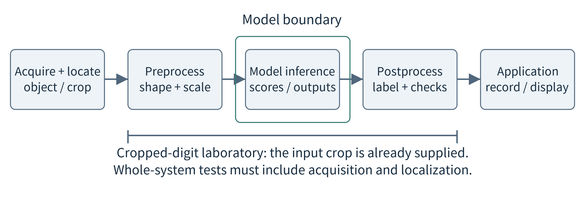<br>
Figure 10.1. The visible result depends on a complete pipeline. The model is only the middle component; a cropped-digit test does not evaluate camera acquisition or label localization.

A wearable supplies another starting point. Its input may be a window of acceleration measurements, and its output an activity label. An engineer can calculate features such as mean, variation, and signal energy, then use a linear classifier or a small decision tree. A neural model can instead learn useful transformations from the window. The first approach makes the feature choices explicit; the second can learn richer representations but introduces a model graph and intermediate tensors that must fit the target runtime. Neither should be chosen solely because it appears more advanced.

```{list-table}
:header-rows: 1
:class: book-table

 * - **Task**
   - **Input → output**
   - **A deployment question**
 * - Classification
   - Cropped image or feature vector → class scores
   - Are input scaling and class order identical to training?
 * - Detection / segmentation
   - Image → boxes or pixel labels
   - How much preprocessing and output processing is required?
 * - Keyword / activity recognition
   - Audio or motion window → event / activity
   - How long must we observe before deciding?
 * - Regression / anomaly scoring
   - Measurements → estimate or anomaly score
   - Which error or threshold is meaningful for the application?
```

Task definition determines what counts as success. For a ten-class digit test, classification accuracy is a reasonable first metric. For a rare machine fault, an always-normal predictor may obtain high accuracy while missing every fault. Report missed faults and false alarms as well. In a hypothetical set of 2,000 windows containing 100 faults, detecting 95 faults while raising 20 false alarms yields 95% recall and 95/115 ≈ 82.6% precision, despite an overall accuracy of 98.75%. These invented counts illustrate why the application, not a familiar score, must define acceptance. [{ref}`131 <ref-131>`]

State operational requirements before choosing transformations. An illustrative reader might need an accepted answer within 150 ms, enough free memory for acquisition, and a way to ask for another image when evidence is poor. Those values must be justified for a real deployment. Also state whether privacy requires images to remain local, whether the device is battery powered, and whether it operates continuously. A laboratory model and a field application can share a deployment method without sharing the same valid accuracy or timing claims.

(fig-10-2)=

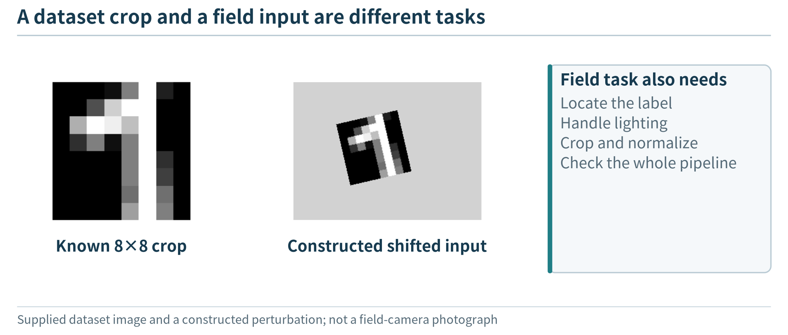<br>
Figure 10.2. The left panel is a supplied digits-dataset crop. The center is a deliberately constructed rotation/background example, not a field image or a model evaluation. Locating and normalizing a label remain separate application tasks.

(section-10-2)=

## 10.2 Understand just enough of the model to deploy it

(section-10-2-1)=

### 10.2.1 Training chooses parameters; inference uses them

A learned model is a parameterized computation. During training, examples and a learning procedure adjust its parameters so that outputs better match the training objective. During inference, the application supplies a new input and evaluates the computation using the selected parameters. Training is commonly performed on a development machine or a remote resource; deploying inference locally does not require training locally. Conversely, moving a training script to a device is not an efficient way to package a prediction service.

Keep three roles of data separate. Training examples update parameters. Validation examples guide choices such as a stopping point or a quantization configuration. Held-out test examples evaluate the chosen procedure. If a device records many nearly identical frames of the same item, randomly splitting those frames can leak information about that item into every subset. A deployment study should often split by subject, device, session, or time. The small digits experiment uses a fixed sample split for a classroom comparison; it does not establish generalization to new writers or a new camera installation.

(fig-10-3)=

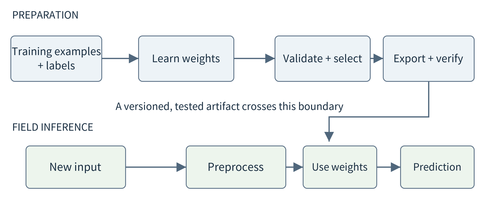<br>
Figure 10.3. Model preparation and field inference are different activities. Evaluation and conversion checks connect them; ordinary predictions do not update weights unless the application explicitly enables learning.

A model score is an output of the computation, not a certificate of truth. A classifier may assign its highest score to an incorrect class, especially on inputs unlike its development data. Thresholds and abstention rules need evaluation on representative examples. If the application requests a new image after an uncertain result, report how often that happens as well as the correctness of accepted results. Rejecting every input is not a useful solution simply because no incorrect label is shown.

(section-10-2-2)=

### 10.2.2 Weights, activations, and operators

Consider a fully connected layer. It multiplies an input vector by a weight matrix and adds a bias. A nonlinear operation such as ReLU then replaces negative intermediate values with zero. Another layer combines those values into a new representation. The weights and biases persist across inputs; the intermediate values, called activations here, change for each input. An operator is a supported computational step such as matrix multiplication, convolution, or an activation function. A runtime must know how to execute every required operator in the chosen numerical format.

h = ReLU(W₁x + b₁), logits = W₂h + b₂

For an input with 64 values, a hidden layer with 16 units, and ten output classes, the first matrix has 16 × 64 entries and the second 10 × 16. Adding 16 and 10 biases gives 1,210 parameters. A softmax can turn logits into normalized scores; it does not change which class has the largest logit. This small amount of arithmetic is sufficient to understand the companion network. The chapter does not require deriving gradients or building a training framework.

(fig-10-4)=

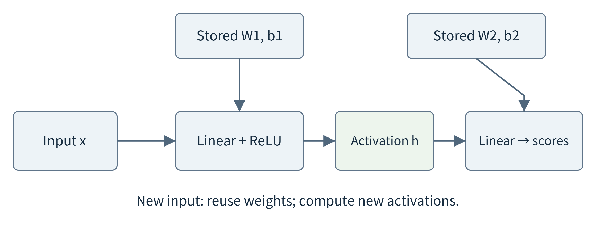<br>
Figure 10.4. The same stored weights are reused for new inputs, while activation buffers hold input-dependent values. Smaller parameter storage does not necessarily imply proportionally smaller activation memory.

Convolutional neural networks (CNNs) provide a useful contrast. A small filter is reused at many image positions instead of learning an unrelated weight for every position. Channels represent collections of features; each layer produces feature maps whose spatial dimensions and channel count affect working memory. For temporal data, one-dimensional convolutions or recurrent models process windows or sequences. A streaming implementation may also retain state between windows. Changing the order or resetting that state can change the answer, even with identical model weights.

Ordinary algorithms remain legitimate alternatives. A calibrated threshold can solve a well-defined limit check; a compact classifier can recognize a fixed set of states; a language model can interpret a flexible instruction. These are different jobs. Before deploying a large general model, ask whether the application needs that flexibility. A later agent may call the reader as a tool, but the reader need not become a language model merely to participate in an intelligent application.

(section-10-3)=

## 10.3 Build the first complete inference path

(section-10-3-1)=

### 10.3.1 The input contract is part of the model

Loading a model successfully does not establish that its inputs mean the right thing. A deployment contract records tensor shape, element type, scaling, channel order, expected sampling or image geometry, and output interpretation. For the digits example, the input is an 8 × 8 grayscale array with values in [0,16], flattened in row-major order and divided by 16. Output index 0 denotes digit zero, and so on. Dividing the values by 255 because that is familiar from another image pipeline would silently change the input distribution.

A real label reader must also decide how to crop, resize, orient, and normalize camera frames. When that procedure differs between training and deployment, changing the neural weights may be the wrong repair. Save a few reference inputs, their preprocessed tensors, and expected output properties. Compare these at each stage after deployment. A diagnostic image and a tensor checksum can expose a channel-order or scaling error that remains invisible in a single overall accuracy number.

The application also records when a prediction was made, which input it describes, and which model and preprocessing versions produced it. This is the AI counterpart of the data contract in {ref}`Chapter 2 <chapter-2>` and the observation history in Chapter 7. A late result from an earlier frame should not be displayed as though it describes the current frame. A model update should not silently change the meaning of a stored score or the ordering of output classes.

(section-10-3-2)=

### 10.3.2 From a training model to a deployable artifact

A deployment normally separates model preparation from the application loop. Preparation selects the trained parameters, exports a computation graph, performs compatible transformations, and produces an artifact the target runtime can load. Execution creates a runtime instance, loads that artifact, prepares input tensors, invokes the model, and interprets outputs. Conversion may reject an unsupported operator or produce a valid artifact with different numerical behavior. Check a floating-point conversion first, before introducing quantization, so that conversion errors and approximation errors are not mixed together. [{ref}`132 <ref-132>`, {ref}`139 <ref-139>`]

(fig-10-5)=

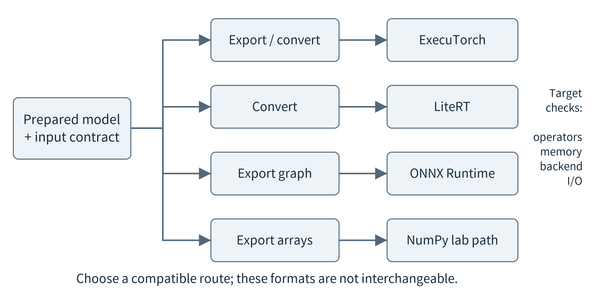<br>
Figure 10.5. Export and runtime selection connect model preparation to the target device. The routes are representative alternatives, not a requirement to install every runtime or evidence that every operator is portable.

Three representative routes illustrate the responsibilities. ExecuTorch prepares a PyTorch program through export and transformation for device execution. LiteRT provides model-conversion and device-runtime paths, including a distinct microcontroller route. ONNX Runtime loads compatible ONNX graphs and assigns supported subgraphs to execution providers. These names are examples of the same architectural separation: a training framework, a deployed artifact, a runtime, and a hardware backend are not interchangeable terms. [{ref}`132 <ref-132>`, {ref}`133 <ref-133>`, {ref}`134 <ref-134>`, {ref}`152 <ref-152>`]

The companion starts with an even smaller route: a NumPy evaluator loads fixed matrix and bias arrays from an NPZ file. It deliberately supports only the dense layers and ReLU used by this experiment. This makes the executed computation easy to inspect and lets students run the pretrained floating-point models without PyTorch. It is not a general model-conversion tool. A second, version-pinned PyTorch route exercises real dynamically quantized linear operators on the available CPU. Neither route implies an Android, NPU, or microcontroller deployment has been completed.

For the first successful run, use one saved input and a known model before connecting a live sensor. The evaluator checks input shape, allowed values, finite numbers, and compatible matrix dimensions; then it performs the forward computation. Compare its logits with the training implementation within a stated numerical tolerance and check the predicted class. Next process multiple saved inputs. Only then add camera or sensor acquisition. This order isolates model access from the separate difficulties of sampling, image capture, networking, and driver configuration.

```bash
python predict_numpy.py --model results/student_direct_11.npz \
  --inputs results/sample_inputs.npz --index 0
```

The command above runs supplied, already-trained weights. It does not retrain the model. The laboratory guide provides complete commands and dependency versions; the useful idea for deployment is to keep preprocessing, model invocation, and postprocessing as inspectable stages. A saved model file should travel with its input contract, output labels, version information, and test examples. Moving only the file is not enough to reproduce the application.

(fig-10-6)=

![Inspect model tensors, not only the filename; student_direct_11.npz; Stored tensors; w0: \[16, 64\] float32; b0: \[16\] float32; w1: \[10, 16\] float32; b1: \[10\] float32; Inspect before deployment; Names, shapes, numerical types, artifact digest.; Still not established; Kernel selection, accelerator use, or measured; latency.](../images/asset-079acf649ba4b02c.png)<br>
Figure 10.6. A view generated from the supplied trained student artifact shows the stored array names, shapes and dtypes. This is parameter-artifact inspection, not a Netron screenshot or evidence of compiled hardware execution.

(section-10-3-3)=

### 10.3.3 The target is a device, not just an available backend name

A CPU-only baseline is valuable even when the target has an accelerator. The accelerator may support only part of the graph, a limited set of precisions, or particular tensor shapes. A runtime can send unsupported work to the CPU, but crossings may introduce copying, synchronization, and layout conversion. Inspect actual operator placement rather than assuming the whole model ran on the NPU because the application selected an NPU option. ONNX Runtime explicitly uses provider capabilities to allocate supported nodes or subgraphs. [{ref}`133 <ref-133>`]

On a microcontroller, the inference engine may be compiled into firmware with a preallocated tensor arena. On a phone, an application works within the platform lifecycle and often shares accelerators with other functions. A Linux edge computer may host a model service and several simultaneous clients. LiteRT for Microcontrollers is designed for constrained devices and supports only a subset of operations; its core-runtime footprint must not be mistaken for the memory of an entire model application. The same source model may need different deployment artifacts and validation on these targets. [{ref}`134 <ref-134>`]

(section-10-4)=

## 10.4 Find the resource constraint before changing the model

(section-10-4-1)=

### 10.4.1 Storage, working memory, and computation are different budgets

The easiest quantity to estimate is parameter storage. If a model has P stored parameters using b bits each, the raw numeric payload is P × b / 8 bytes. One million parameters occupy 4 MB at FP32 or 1 MB at INT8, using decimal megabytes. Metadata, bias precision, scales, alignment, and container formats add overhead. A compressed archive can be smaller than both, yet expand when loaded. Compare the raw payload, actual deployable file, and runtime allocations separately.

M\_values = P × b / 8

Peak working memory includes more than these parameters. Input buffers, simultaneously live activations, operator scratch space, the runtime, and the surrounding application all matter. Some devices can read weights from read-only storage; some runtimes copy or unpack them. Do not blindly add two numbers that already include the same allocation, and do not assume weights on disk occupy no RAM. Establish the accounting boundary using the target runtime, then measure the high-water mark under the intended input shape and concurrency.

(fig-10-7)=

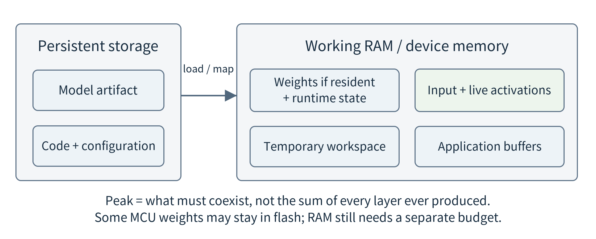<br>
Figure 10.7. Storage and RAM answer different feasibility questions. Only activations that remain live together need coexist, but workspace and application buffers can make the peak much larger than one layer output.

As a worked calculation, one 224 × 224 RGB tensor with three FP32 channels occupies 602,112 bytes. A 112 × 112 × 32 FP32 feature map occupies 1,605,632 bytes, about 1.53 MiB. Two such maps that must coexist already need about 3.06 MiB, before weights or other allocations. Representing these maps in eight bits would quarter their numeric payload, but only if the deployed execution actually keeps them in that form. Quantizing weights alone does not produce this activation-memory reduction.

Computation counts are another estimate, not a latency result. A multiply–accumulate combines a multiplication and an addition; reporting conventions may count it as one MAC or two floating-point operations. State the convention. Models with the same count can have different execution times because memory access, parallelism, unsupported operators, and invocation overhead differ. A nominal accelerator throughput is not a promise for the particular small batch and graph used by the application.

(fig-10-8)=

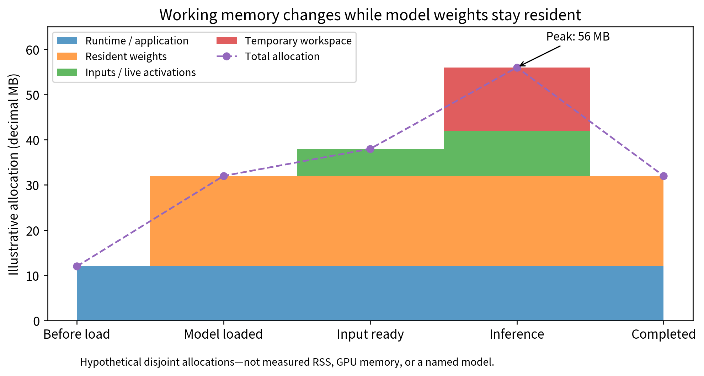<br>
Figure 10.8. A hypothetical allocation budget separates resident weights from runtime state, live tensors and workspace. The 56 MB peak is larger than the 20 MB weight storage, and completion does not necessarily unload the model. These are illustrative values, not memory measurements.

(section-10-4-2)=

### 10.4.2 Latency, energy, and sustained operation

Measure the path the user actually waits for: acquisition or window formation, preprocessing, waiting for execution, inference, and result handling. In a hypothetical reader these stages take 10, 25, 15, 70, and 10 ms, totaling 130 ms. Halving only inference reduces the total to 95 ms, not 65 ms. If an activity detector requires a fresh two-second window, a five-millisecond model call cannot create a decision five milliseconds after observation begins. Streaming overlap changes when windows are ready, not the amount of past evidence the rule requires.

Power and energy should not be interchanged. Energy is the integral of power over the measured interval. Under a deliberately simplified constant-power assumption, 2 W for 80 ms is 0.16 J, whereas 4 W for 30 ms is 0.12 J. Higher active power can coexist with lower energy per inference. A battery application must additionally include acquisition, idle time, communication, and duty cycle. Label whether a measurement covers the whole device or incremental inference above an idle baseline; those are different accounting choices.

A short warm-device timing test also does not establish sustained behavior. Device temperature and system activity can change the resources available during a long run. Android exposes thermal status and headroom interfaces precisely because applications may need to respond to changing thermal conditions. For a deployment experiment, record the run duration, temperature or available thermal indicators, frequency behavior if accessible, and the workload from other processes. This chapter provides a measurement plan, not a measured thermal claim about the companion CPU environment. [{ref}`151 <ref-151>`]

These budgets guide the next choice. If the model file cannot fit in storage, examine representation or architecture. If activations exhaust RAM, examine input shape, tensor precision, liveness, and workspace. If preprocessing dominates latency, a smaller neural network may barely help. If the model is already fast enough but unreliable on new camera images, investigate data and task quality before optimizing arithmetic. A resource report should identify the limiting term, not simply label the whole system “too heavy.”

(section-10-5)=

## 10.5 Choose a suitable model before compressing it

The label reader does not necessarily need the largest available visual model. First compare a few candidate architectures on the same defined task and target. A smaller model designed for the input may already meet the quality requirement. This provides a strong baseline for later compression: otherwise, an elaborate pruning or distillation procedure may merely rediscover that a compact model could have been trained directly. A feature-based classifier is also a legitimate candidate when the task has stable, informative features.

Lightweight architecture design changes how computation is expressed. MobileNet offers a particularly understandable example: a depthwise convolution filters each input channel separately, followed by a pointwise 1 × 1 convolution that mixes channels. This replaces a standard convolution with two different operations. It is not the same as deleting learned weights, and it is not a promise of equal accuracy. The model must be trained or obtained as a compatible pretrained artifact. [{ref}`136 <ref-136>`]

(fig-10-9)=

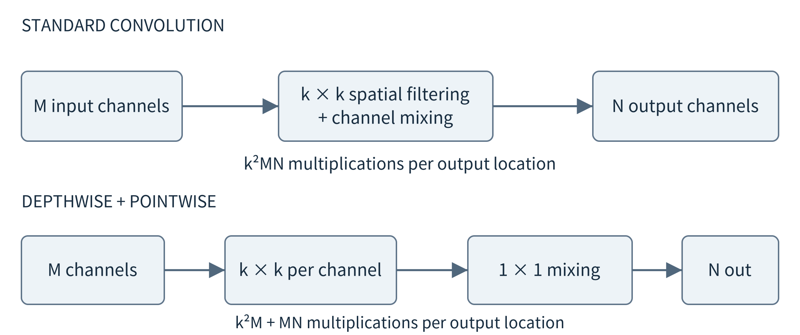<br>
Figure 10.9. A depthwise stage processes channels separately; a pointwise stage mixes them. This changes the architecture. The operation-count reduction below is an analytical comparison, not a measured device speedup.

For a k × k convolution with M input channels and N output channels, a standard layer uses k²MN multiplications at each output location, ignoring bias and boundary details. A depthwise-plus-pointwise arrangement uses k²M + MN. With k = 3, M = 32, and N = 64, the counts are 18,432 and 2,336, an ideal count ratio of about 7.89. These assumptions hold output geometry fixed. Real latency depends on kernel efficiency, data movement, and parallel execution, so it need not improve by that ratio. [{ref}`136 <ref-136>`]

Width and input resolution are practical design knobs. Reducing channels decreases some weight matrices and feature maps; reducing spatial resolution decreases the positions at which image operations execute. But a tiny defect can disappear during downsampling. In a wearable, shortening a time window reduces data and may also remove the motion pattern needed to distinguish activities. Every such change must preserve enough information for the task. Keep the input-selection policy in the experiment record rather than attributing the entire effect to the network architecture.

Compact designs can still have large intermediate tensors. MobileNetV2, for example, uses blocks that expand an internal representation and then project it back to a narrow bottleneck. A small stored parameter count is therefore not a sufficient memory budget. For very constrained devices, MCUNet illustrates joint design of a network and its inference engine rather than treating runtime support as an afterthought. We use these systems to identify design responsibilities, not to import their reported benchmark gains into our own device. [{ref}`135 <ref-135>`, {ref}`137 <ref-137>`]

After choosing a feasible baseline, compare three transformation families. Quantization changes how numbers are represented. Pruning removes selected connections or structures. Distillation changes how a student learns from a teacher. They act on different objects and require different preparation. If a developer receives only a deployable model with no training data, some post-training transformations may be possible while retraining-based recovery is not. Access to data, code, and a model license is part of feasibility, just as memory and hardware support are.

(section-10-6)=

## 10.6 Quantization: represent numbers with fewer bits

(section-10-6-1)=

### 10.6.1 Floating-point reduction is not integer casting

Suppose the baseline is stored in 32-bit floating point. Using 16-bit floating point changes precision and range but still uses a floating-point representation. Integer quantization instead maps a range of real values onto a finite grid of integer codes. INT8 has 256 possible codes; INT4 has 16. A four-bit representation can be packed more tightly, but only a compatible kernel and packing scheme can exploit it. The useful questions are which tensors change format, how their ranges are chosen, and which arithmetic the runtime actually executes. [{ref}`138 <ref-138>`, {ref}`139 <ref-139>`, {ref}`140 <ref-140>`, {ref}`141 <ref-141>`]

Simply casting 0.34 to an integer would lose its fractional information. Affine quantization instead associates a positive scale s and an integer zero point z with a tensor or a slice. The code q represents the approximate real value s(q − z). Rounding chooses a nearby grid point, and clipping keeps the code in the supported range. The zero point allows real zero to have an exact code, which matters for operations involving padding or zeros. [{ref}`138 <ref-138>`, {ref}`140 <ref-140>`]

q = clip(round(x / s) + z, q\_min, q\_max)

x̂ = s × (q − z)

Use a deliberately coarse example: s = 0.1, z = 0, and signed INT8 codes from −128 to 127. The values −0.26, 0.34, and 0.56 become codes −3, 3, and 6, reconstructed as −0.3, 0.3, and 0.6. A value of 15 becomes 12.7 after clipping. Inside the representable range, nearest rounding contributes at most half a grid step; that bound does not apply to a clipped outlier. The procedure changes values in a controlled representation, not by deleting their decimal point.

(fig-10-10)=

<br>
Figure 10.10. Rounding selects a representable grid point; clipping handles values outside the representable range.

Integer codes still need arithmetic with sufficient intermediate range. For x = [0.2, 0.7] and w = [−0.4, 0.3], both using scale 0.1 and zero point zero, the integer dot product is 2(−4) + 7(3) = 13. Multiplying by the two scales gives 0.13, matching this example’s floating-point dot product. Larger layers typically need wider accumulators, and conversion to the next layer’s scale introduces another rounding step. Biases and accumulators need not have the same precision as stored weights. [{ref}`140 <ref-140>`]

(section-10-6-2)=

### 10.6.2 Which tensors and which ranges?

Weight-only quantization reduces how weights are stored but may dequantize them for computation or combine them with floating-point activations. Dynamic activation quantization estimates ranges during invocation for selected operators. Static quantization establishes activation ranges beforehand using calibration inputs. A fully integer path additionally requires compatible integer operators and a deliberate input/output policy. These choices produce different memory, computation, and conversion costs; the label “INT8 model” alone is incomplete. [{ref}`139 <ref-139>`, {ref}`141 <ref-141>`]

```{list-table}
:header-rows: 1
:class: book-table

 * - **Choice**
   - **Preparation**
   - **What to verify**
 * - Weight-only
   - Estimate weight scales
   - Whether weights are unpacked; activation type
 * - Dynamic quantization
   - Store quantized weights; estimate selected activation ranges at runtime
   - Invocation overhead; input-batch behavior; kernel support
 * - Static PTQ
   - Calibrate a trained model using representative inputs
   - Range coverage; operators; actual input/output types
 * - QAT
   - Train or fine-tune while simulating quantization
   - Exported integer behavior and held-out task quality
```

Calibration is not ordinary training: it estimates tensor ranges rather than learning a new task from labels. Choose representative training or validation inputs, not the held-out test set used for the final report. For a camera reader, include relevant lighting and contrast conditions; for motion sensing, include the operational range of activities and sensor values. Random numbers with the correct tensor shape are useful for interface testing, but are not automatically representative calibration data. Outliers create a trade-off between range coverage and resolution.

A scale can be shared across an entire tensor or assigned separately to channels or groups. If one output channel has weights near 0.2 and another near 20, one scale covering both can represent the smaller channel poorly. Per-channel scales can preserve more detail, at the cost of metadata and supported-kernel requirements. In a symmetric example spanning approximately ±20, the step 20/127 is about 0.157; a weight of 0.05 can round to zero. A channel-specific range of ±0.2 gives a much finer step. [{ref}`138 <ref-138>`]

(section-10-6-3)=

### 10.6.3 PTQ first; QAT when preparation effort is justified

Post-training quantization (PTQ) starts from a trained floating-point model. It is attractive when the model and suitable calibration data are available but a new training cycle is undesirable. First validate the unquantized exported model, then transform it, check tensor formats and supported operators, and evaluate on the same task. If quality falls, investigate problematic layers and calibration coverage before concluding that all low precision is unsuitable. Keeping a sensitive operation at higher precision is another design option, provided the backend can execute the mixed graph.

(fig-10-11)=

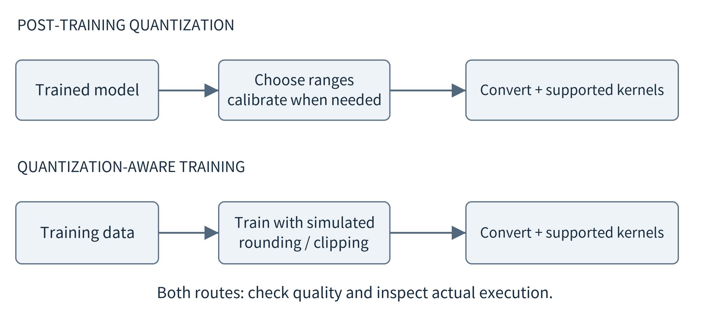<br>
Figure 10.11. PTQ estimates a representation after training; QAT exposes training to simulated rounding and clipping. Both still need conversion, actual supported execution, and independent evaluation.

Quantization-aware training (QAT) exposes training to the effect of quantization, often through fake-quantization operations that simulate rounding and clipping while training machinery still uses floating point. Parameters can adapt to that approximation. A final conversion must produce the intended deployable operations; fake quantization in a training graph is not evidence that the device performs integer arithmetic. QAT needs a suitable training path and data, so its preparation cost should be included in the decision rather than treated as a free final step. [{ref}`139 <ref-139>`, {ref}`140 <ref-140>`, {ref}`142 <ref-142>`]

Quantization is complete only when the resulting application is checked. Re-run the input contract, compare output classes and important error categories, inspect actual arithmetic or backend traces, and measure file size, peak memory, and latency. A dynamic quantized linear layer can execute integer products while adjacent ReLU and interface tensors remain floating point. That is useful, but it is not an all-integer application. The companion experiment makes exactly this narrower claim: its three dense linear layers are converted to real dynamic INT8 operators on an x86 CPU.

(section-10-7)=

## 10.7 Pruning: remove work the model may not need

(section-10-7-1)=

### 10.7.1 Zeros are not the same as a smaller executable graph

Suppose the quantized reader still performs too much computation. Pruning asks whether some connections or larger structures can be removed while retaining acceptable task quality. A simple unstructured method ranks individual weights by magnitude and sets selected small weights to zero. Magnitude is a heuristic, not a proof of irrelevance: a weight’s effect also depends on its inputs and neighboring computation. The original learning-and-pruning work pairs removing connections with further training to recover quality. [{ref}`143 <ref-143>`]

If a dense matrix contains 50% zeros but retains its original shape, an ordinary dense kernel can still multiply and load every position. A dense checkpoint can still store every zero. A sparse representation may instead store values and indices, but indexing overhead and sparse-kernel support matter. Counting zeros, compressing a download file, reducing runtime storage, and accelerating inference are therefore four different claims. The runtime decides whether a sparsity pattern becomes skipped work. [{ref}`145 <ref-145>`, {ref}`146 <ref-146>`, {ref}`153 <ref-153>`]

(fig-10-12)=

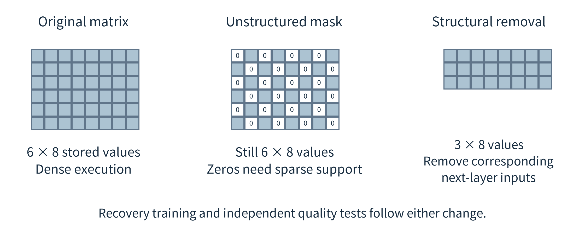<br>
Figure 10.12. An unstructured mask leaves matrix dimensions unchanged; structural removal shrinks dimensions and corresponding inputs to the next layer. A sparse kernel is needed to exploit arbitrary zeros as skipped arithmetic.

Structured pruning removes whole units, channels, filters, or blocks. Removing a hidden unit means removing its output computation and the corresponding inputs to the next layer, not merely hiding that unit from a drawing. For a convolutional layer, filter pruning changes the associated feature maps and connected layer dimensions. This can produce smaller dense operations that ordinary optimized libraries can execute. It may also remove a larger useful structure and damage quality, so the retained network must be evaluated. [{ref}`144 <ref-144>`]

A numerical example exposes the distinction. A dense layer with 64 inputs and 64 outputs has 4,096 weights. Setting half to zero leaves a 64 × 64 matrix unless storage or execution changes. Removing half its output units produces a 32 × 64 matrix with 2,048 weights, and reduces the corresponding input dimension of the following layer. Biases, masks, residual connections, and branches must be handled consistently. Model editing is a graph transformation, not a sequence of unrelated tensor deletions.

(section-10-7-2)=

### 10.7.2 Recover quality and compare the right baselines

A practical pruning experiment begins from an evaluated model, fixes what may be removed, applies the change, and measures the immediate damage. A limited fine-tuning phase may recover quality; the pruning mask or compact structure must remain enforced. Otherwise, weights intended to stay removed can regrow during optimization. Finally, export the actual compact graph or sparse representation supported by the device, and measure again. A training-time mask by itself is not a finished deployable acceleration.

Compare both before and after recovery. Also record the extra training effort and, for a stronger study, train the same compact architecture from scratch with a comparable total budget. If the compact model performs well only after additional training, the comparison cannot attribute every improvement to pruning. The companion provides before/after recovery variants but does not include every equal-budget architecture-search control. Its results demonstrate a procedure and its limitations, not a general superiority claim for pruning.

The local experiment gives a useful concrete contrast. The masked network retains 6,570 logical parameters and 26,280 bytes of floating-point parameter payload; 50% of its weight entries are zero, but tensor dimensions stay fixed. The structurally compact network has hidden widths 32 and 16 instead of 64 and 32, yielding 2,778 parameters and 11,112 payload bytes. Its initial quality drops sharply and recovers after the stated fine-tuning procedure. The original dense network, zeros-in-dense network, and physically compact network must remain distinct artifacts in the report.

Pruning is also not restricted to CNNs, but the suitable structures depend on the model. Removing independent hidden units in a simple multilayer perceptron is easier to inspect than editing a network with residual branches or attention heads. We use the small network to teach the mechanism and a CNN diagram to explain channels. Translating either idea to another architecture requires a valid graph, compatible kernels, and fresh evaluation; a percentage of removed weights is not a transferable speedup prediction.

(section-10-8)=

## 10.8 Knowledge distillation: teach a deployable student

(section-10-8-1)=

### 10.8.1 Transfer behavior rather than copy a compressed file

A small model may fit the device but make errors on difficult inputs. Distillation asks whether a teacher can provide additional training guidance to a student. The teacher can be a larger model or an ensemble, but the essential role is to produce guidance for learning. The student can have a different architecture and need not retain a subset of the teacher’s weights. At deployment, a conventional distilled classifier needs only its own learned parameters and runtime; the teacher is a preparation dependency, not a required call on every prediction. [{ref}`147 <ref-147>`]

(fig-10-13)=

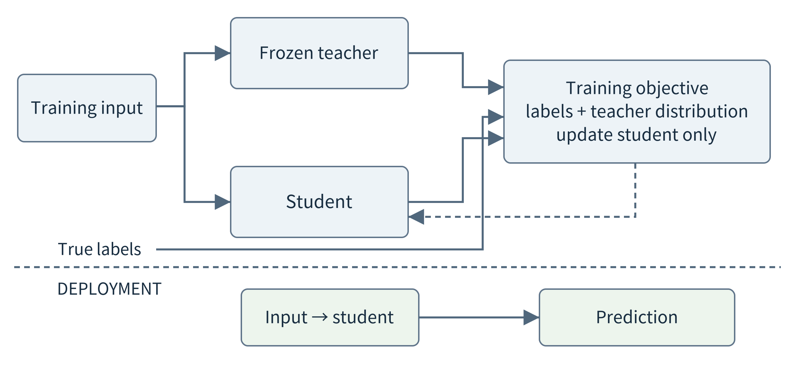<br>
Figure 10.13. During preparation, both the true label and the frozen teacher can guide student learning. During ordinary deployment, only the student executes. Calling the teacher at inference time would be a different collaboration design.

For an ambiguous handwritten digit, a teacher might place most probability on “3” and some on “8,” rather than treating every wrong class as equally unrelated. These are hypothetical outputs used to explain the idea. Soft targets can communicate relations that a single hard label does not express. They can also communicate mistakes or biases. Distillation therefore still needs trustworthy evaluation labels and representative inputs; a fluent or high-scoring teacher is not an oracle.

A temperature parameter can soften a teacher’s class distribution to expose relative scores. A typical training objective combines an ordinary label loss with a teacher–student disagreement loss. The balance determines how strongly the student follows labels versus teacher guidance. The companion fixes temperature 3 and teacher-loss weight 0.6 before examining the test set; it includes the usual temperature-squared scaling in the soft loss. These are experimental settings, not recommended universal hyperparameters. [{ref}`147 <ref-147>`, {ref}`148 <ref-148>`]

student objective = (1 − α) × label loss + α × teacher-guidance loss

(section-10-8-2)=

### 10.8.2 What a useful distillation comparison must hold fixed

First train or obtain a teacher and evaluate it. Freeze its parameters during student training. Use the same training examples, student architecture, initialization, optimizer, and epoch budget for a direct-label student and a distilled student. Evaluate both on the same held-out inputs. Otherwise, a change attributed to distillation may come from a different architecture, more training steps, or different data. Record the teacher’s preparation cost as well when deciding whether the deployment benefit justifies the process.

The local results make this control important. With a fixed sample split and three initialization seeds, the direct 16-unit student averages 97.41% test accuracy, while the identically sized distilled student averages 96.48%. Both have 1,210 parameters. The teacher averages 96.67%. This experiment does not show a distillation advantage, and we retain that result rather than searching the test set for a more attractive setting. It also does not refute distillation: the teacher, task, student capacity, data, and training objective form only one small instructional configuration.

A valuable follow-up would use a genuinely stronger teacher or a different training-data budget, choose settings using validation data, and evaluate once on a fresh test split. A student should explain why that new comparison addresses the observed limitation. Repeatedly adjusting temperature after seeing the test score turns the test set into development data. The appropriate lesson is that an optimization technique is a hypothesis about a deployment problem, not a promise that its named variant must win.

(fig-10-14)=

<br>
Figure 10.14. For initialization seed 11, the first stored test example in each nonempty outcome category is shown. The direct and distilled students have matching architectures. These selected cases explain aggregate differences; they do not establish superiority on a new dataset.

(section-10-8-3)=

### 10.8.3 Combine methods only when their purposes remain clear

A directly trained or distilled student can later be quantized; a structurally pruned model can be fine-tuned and then exported in a lower precision. Such combinations can be useful, but errors and preparation requirements interact. Calibration should describe the final model, not a stale tensor range from an earlier architecture. Keep a record of the starting artifact, transformation, validation choice, and resulting artifact at every step. Deep Compression illustrates that multiple compression mechanisms can be combined, but its particular sequence is not mandatory for a new task. [{ref}`153 <ref-153>`]

```{list-table}
:header-rows: 1
:class: book-table

 * - **Method**
   - **What changes?**
   - **Typical extra preparation**
   - **What must be checked?**
 * - Lightweight architecture
   - Graph and capacity
   - Compatible pretrained model or training
   - Quality and operator support
 * - Quantization
   - Numeric representation
   - Range estimation; sometimes training
   - Real arithmetic, error, memory
 * - Unstructured pruning
   - Selected weight values
   - Mask and optional recovery
   - Sparse representation / kernels
 * - Structured pruning
   - Units / channels and graph sizes
   - Graph rebuilding and recovery
   - Shape correctness; task quality
 * - Distillation
   - Student learning objective
   - Teacher outputs and student training
   - Same-size direct-training baseline
```

(section-10-9)=

## 10.9 Optimize execution without changing the task

(section-10-9-1)=

### 10.9.1 Use the graph and memory more efficiently

A model can remain mathematically the same while its implementation improves. A runtime may fold constants, combine supported adjacent operators, reuse temporary storage, or choose a faster kernel. For example, inference-time normalization can sometimes be folded into a preceding linear operation when its statistics are fixed and the transformation is valid. Fusion can avoid writing and rereading a complete intermediate tensor. These are execution transformations, not pruning or new learning. ONNX Runtime documents graph optimizations at several levels, including combinations that depend on the selected execution provider. [{ref}`149 <ref-149>`]

(fig-10-15)=

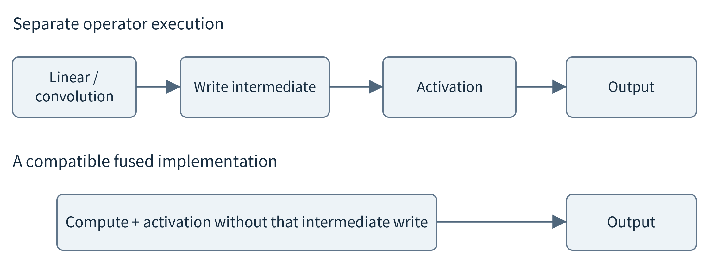<br>
Figure 10.15. Separate operators can materialize intermediate tensors; a valid fused implementation may avoid some traffic. The diagram illustrates a runtime opportunity, not a guarantee that this exact fusion is available on every backend.

Memory reuse depends on when a tensor stops being needed. In a simple chain, the output of an early operation may be released after its last consumer finishes. A skip connection or branch can extend that lifetime. Counting every layer’s output as permanently resident overestimates memory, but counting only the largest output can underestimate overlapping lifetimes and scratch requirements. A memory planner uses these relationships to organize reusable buffers. ExecuTorch provides memory-planning inspection tools that make tensor lifetimes and allocations observable. [{ref}`150 <ref-150>`]

The target backend may require data in a particular layout or precision. Repeatedly copying frames between CPU and accelerator, transposing tensors, or converting formats can dominate a small graph. Keep measurements for transfers and execution separate, then inspect the complete path. An integrated device can share physical memory while still paying synchronization and conversion costs. Fewer nominal arithmetic operations do not remove those costs. If a single unsupported operation repeatedly moves work back to the CPU, a compatible alternative model can be more useful than further parameter compression.

(section-10-9-2)=

### 10.9.2 The input and service policy also consume resources

Batching combines independent inputs to amortize overhead and use parallel hardware more effectively, but waiting to fill a batch adds latency and more inputs may enlarge activation memory. A continuously operating inspection line and an occasional interactive camera query need not use the same policy. Reuse the capacity and queueing reasoning from Chapters 6 and 8, now with an AI-specific memory model. Measure accepted tasks per second together with individual response times and rejected or dropped inputs.

Reducing redundant input processing is another option. A camera may analyze a selected region or a subset of frames; a vibration monitor may invoke a richer model only after a cheap feature check. Specify which events that policy can miss. Reusing a previous prediction requires a condition that the relevant input has not changed sufficiently, not simply that the previous call was recent. The policy is part of task quality. Conditional exits and remote escalation extend this idea and are developed in {ref}`Chapter 11 <chapter-11>` rather than added invisibly to the local-model baseline.

A useful local service loads its model once when possible, checks readiness, and keeps acquisition separate from long computation. It bounds concurrency, stores the model identity with results, and provides an explicit failure or retry behavior. These are not replacements for the mechanisms of {ref}`Chapter 5 <chapter-5>`; they are their application to inference. A compact model that starves acquisition or returns old predictions without timestamps still fails as an edge application.

(section-10-10)=

## 10.10 Evaluate a deployment and keep it useful over time

(section-10-10-1)=

### 10.10.1 Compare complete, compatible conditions

For each candidate, record the task definition, dataset split, preprocessing, model identity, precision, runtime, actual backend, input shape, and concurrency. Report quality, deployable file size, available memory measurements, latency, and energy only where it was measured. A dash with an explanation is better than a calculated number presented as a measurement. A model-count estimate is not resident memory, and CPU wall-clock duration multiplied by an assumed power value is not a power measurement.

Use a staged decision. Exclude incompatible artifacts and configurations that cannot meet essential quality or memory requirements. Compare the feasible candidates on the measures the application values. A low-latency candidate with unacceptable missed detections is not a useful trade. Neither is an accurate configuration that repeatedly exhausts memory. Keep a floating-point, uncompressed, or direct-training baseline even when a transformed model appears attractive; it makes the origin of a change visible.

Timing experiments require a clearly named boundary. A warmed model-call measurement excludes model loading and acquisition. A process-start measurement includes some initialization but may benefit from a warm file cache. A full application measurement includes the user-visible path. Record warmup, repetitions, input order, and surrounding load. Avoid interpreting tiny differences on a shared machine as a reliable speedup. For asynchronous accelerators, the measured interval must include completion rather than only command submission.

(section-10-10-2)=

### 10.10.2 Updating a model updates an application contract

After deployment, changed lighting, a moved sensor, new products, or changed user behavior can make the original examples less representative. Monitor input quality and error evidence separately. A shift in the score distribution is a warning, not proof that accuracy has fallen or improved. Obtain labels or other trustworthy feedback when evaluating a revised model. Local observations should not automatically enter training without checking permission, provenance, and whether they are reliable examples.

(fig-10-16)=

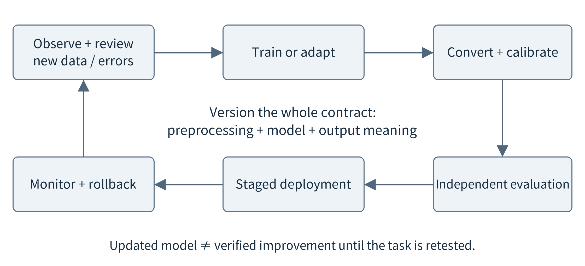<br>
Figure 10.16. A model update returns through data review, preparation, conversion, and evaluation. Rollback includes preprocessing and output interpretation, not just replacing a weight file.

Package an update with model version, preprocessing version, label mapping, calibration information where relevant, and test inputs. Validate the complete package before expanding a deployment. Keep the last accepted package available for rollback. A replacement model may require a different runtime or more working memory, even if its download file is smaller. Reuse the staged deployment mechanisms of Chapters 5, 6, and 9; the difference is that output quality now also belongs to the acceptance test.

Most applications can start with centralized preparation and local inference. Fine-tuning, personalization, or collaborative learning are possible extensions when data and authority permit. They are not prerequisites for using a pretrained model and should not be confused with distributing one inference call. For now, the important loop is observe, identify a justified change, prepare and validate a new artifact, deploy it, and continue measuring. {ref}`Chapter 11 <chapter-11>` develops how multiple resources and models can collaborate when one local model is not enough.

(section-10-11)=

## 10.11 A reproducible small-model study

(section-10-11-1)=

### 10.11.1 Start with supplied weights; retraining is optional

The laboratory is intentionally small enough to inspect. Its teacher is a multilayer perceptron with widths 64 → 64 → 32 → 10, using ReLU after the two hidden layers. The direct and distilled students both use 64 → 16 → 10. The structurally pruned model uses 64 → 32 → 16 → 10. These are digit classifiers, not trained camera-label detectors. They let us isolate representation, structural removal, and teacher-guided learning without requiring a large model download or a GPU. [{ref}`130 <ref-130>`]

The fixed stratified split contains 1,077 training, 360 validation, and 360 test examples. Initializations and minibatch order use seeds 11, 22, and 33 while the split stays unchanged. The teacher and both students receive a 120-epoch budget; the checkpoint with the lowest validation cross entropy is retained. Masked and compact recovery each receive up to 30 additional epochs with the same validation-selection rule, including the pre-recovery state as a candidate. None of these choices is selected using the test score.

Dynamic quantization transforms the teacher’s three linear layers using real quantized CPU operators. It does not use a static calibration set. Testing invokes one sample at a time because dynamic ranges can depend on invocation contents. All model variants are serialized, reloaded, and evaluated; the floating-point variants also have NPZ exports for the inspectable NumPy path. The graph audit checks that quantized linear operators actually occur. Simulating rounded floating-point weights alone would not satisfy that check.

(section-10-11-2)=

### 10.11.2 Read the results without forcing a preferred winner

{ref}`Table 10.1 <table-10-1>` reports local measurements, not assumed benefits. Accuracy is the mean over three initializations on the same 360 test examples; the range describes these initializations, not a confidence interval over new deployments. Parameter payload counts stored numerical values before serialization metadata. For the dynamic INT8 variant it includes INT8 matrix values and FP32 biases, but excludes quantization metadata. Warm-call timing is descriptive CPU timing in a shared container and is not a benchmark for a phone, development board, NPU, or camera pipeline.

(table-10-1)=

Table 10.1. Measured classroom comparison. Timing is the median of three per-seed warmed-call medians, each based on 1,000 single-sample calls; it excludes acquisition, preprocessing, loading, and network time.

```{list-table}
:header-rows: 1
:class: book-table

 * - **Variant**
   - **Test accuracy: mean [range]**
   - **Parameter-value bytes**
   - **Warm call: median (μs)**
 * - Teacher FP32
   - 96.67% [95.83, 97.22]
   - 26,280
   - 11.24
 * - Dynamic INT8 linear layers
   - 96.76% [96.11, 97.22]
   - 6,888
   - 11.11
 * - 50% mask + recovery
   - 96.48% [96.39, 96.67]
   - 26,280
   - 11.24
 * - Compact structure + recovery
   - 97.22% [96.67, 97.50]
   - 11,112
   - 10.89
 * - Small student, direct training
   - 97.41% [97.22, 97.78]
   - 4,840
   - 8.33
 * - Same student, distillation
   - 96.48% [95.83, 97.22]
   - 4,840
   - 8.32
```

(fig-10-17)=

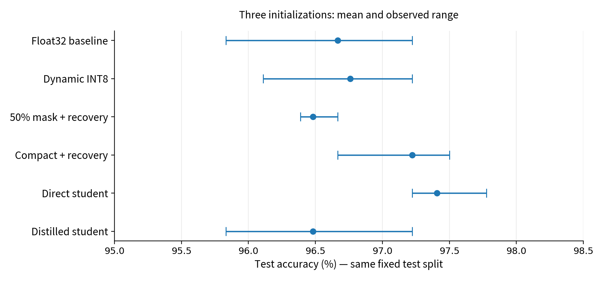<br>
Figure 10.17. Measured test accuracy for three initializations on one fixed split. The error bars show the observed range, not a statistical confidence interval. The same-size direct student is an essential distillation control.

Three observations are especially useful. The masked model retains the original dense payload despite many zero weights. Physically removing hidden units reduces that payload, while recovery is important for this compact model’s quality. Finally, distillation does not outperform direct training here. Each observation answers a different question. We do not average them into an unexplained score or claim that one technique is universally superior. A new device and a different task need a new comparison.

(fig-10-18)=

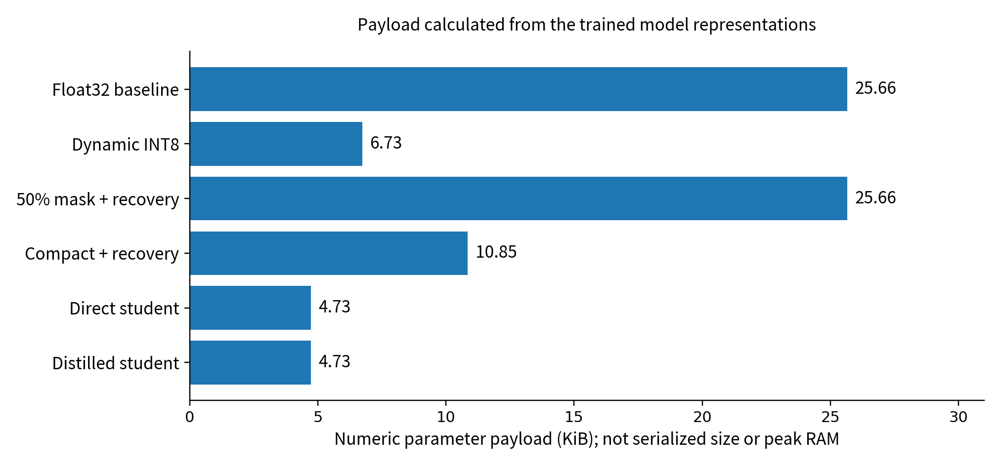<br>
Figure 10.18. Calculated numeric payload from the actually trained and transformed models. Biases remain FP32 in the dynamic quantized variant. Serialized file size, peak RAM, and energy are different quantities.

Do not interpret the nearly equal teacher and dynamic-INT8 call times as either a robust quantization speedup or proof that quantization cannot help. The model is tiny, the batch is one, and invocation and runtime overhead are material. The measurements use PyTorch 2.10.0+cpu, one CPU thread, and its x86 quantized engine in an AMD EPYC container. Timing conditions are recorded in the results. Energy, sustained thermal behavior, and peak memory were not measured. The large difference between payload reduction and call-time reduction is itself a useful systems lesson.

The compatibility experiment uses TorchScript serialization and a torch.ao dynamic-quantization API that emits a deprecation warning in the installed version. Its exact environment and warnings are preserved in the laboratory record. This is a reproducible experiment path, not the permanent API contract of the book. For a new deployment, consult the maintained runtime and quantization path, such as torchao or the chosen target exporter, then repeat the same correctness and resource checks. A pinned old API can preserve an experiment without becoming advice to build every future deployment on that API. [{ref}`142 <ref-142>`]

(section-10-11-3)=

### 10.11.3 A practical sequence for a different edge device

First load the supplied student and classify saved examples. Inspect its input normalization, class mapping, and outputs. Next reproduce the small model comparison or use the saved artifacts and test records. Then choose a target-supported runtime and export the floating-point model first; validate the same examples before enabling compression. Add the actual sensor only after this comparison succeeds. Each step should leave an artifact and an observation that explain what has been established.

On the target, compare a fixed workload under identical acquisition and output rules. Include cold start and steady operation, a reasonable load from other applications, and a condition outside the normal input range. Report why each rejected configuration was rejected: unsupported execution, insufficient quality, excessive latency, or resource exhaustion. If hardware execution is unavailable, complete the local comparison and explicitly leave device metrics unmeasured. A simulator can explore assumptions, but cannot establish a hardware speed or energy result.

The resulting local model now has a clear contract, a deployable artifact, and an evidence-based resource profile. The next question is not automatically how to make it even smaller. Some requests may genuinely require more information, more computation, or a different model. {ref}`Chapter 11 <chapter-11>` examines how local, nearby, and cloud resources can cooperate; {ref}`Chapter 12 <chapter-12>` then uses such capabilities as tools in a more flexible edge agent. The distinction remains: a useful prediction service must exist before an agent can depend on it.

(chapter-10-chapter-summary)=

## Chapter summary

Deploying AI means delivering an input-to-result application, not copying a weight file. Begin with an explicit task and a working local model. Account separately for parameter storage, activation memory, runtime workspace, full-path latency, and energy. Lightweight design, quantization, pruning, and distillation change different aspects of the model; runtime and input policies offer further choices. Select methods to address measured constraints and keep fair baselines. Real integer execution, real graph compaction, and measured task quality matter more than an optimization label.

(chapter-10-exercises)=

## Exercises

**10.1.** A fault detector sees 2,000 windows, including 100 faults. It detects 95 faults and raises 20 false alarms. Calculate accuracy, fault recall, and precision. Which application question does each metric leave unanswered?

**10.2.** A pipeline spends 10, 25, 15, 70, and 10 ms in acquisition, preprocessing, waiting, inference, and result handling. What is the end-to-end improvement if inference is twice as fast? Name a case in which reducing the sampling window changes the task itself.

**10.3.** Calculate raw parameter bytes for 1.2 million parameters at FP32, FP16, and INT8. Then calculate the bytes in one 112 × 112 × 32 FP32 feature map. Explain why weight-only quantization does not establish the total RAM saving.

**10.4.** With s = 0.1, z = 0, and signed INT8, quantize −0.26, 0.34, 0.56, and 15. Reconstruct them and distinguish rounding error from clipping error.

**10.5.** A developer runs a floating-point model with artificially rounded weights and calls the measured time “INT8 latency.” What evidence is missing? Distinguish this experiment from dynamic INT8 execution, static PTQ, and QAT.

**10.6.** Half the weights in a 64 × 64 matrix become zero, but its dense shape is unchanged. Compare this with removing 32 output units. Explain changes to the next layer, file representation, and executable work.

**10.7.** The direct and distilled students have identical architectures, but the distilled one receives twice as many training steps. Why is this not a clean distillation comparison? Design a better control and explain how to handle an unfavorable result.

**10.8.** For k = 3, M = 32, and N = 64, compare multiplications per output location in a standard convolution and a depthwise-plus-pointwise block. Why should the result not be reported as measured speedup?

**10.9.** An exported graph runs on an accelerator except for one operator that repeatedly falls back to the CPU. List measurements that distinguish arithmetic time from transfer and synchronization overhead; propose two design alternatives.

**10.10.** A camera records nearly identical frames from each physical object. Explain why a random frame split may overstate deployment quality. Propose a split and an update-evaluation procedure for new objects and lighting conditions.

**10.11.** Use the supplied artifacts to compare two models. Record task quality and raw payload, then measure a clearly named timing boundary. State which hardware, energy, and memory claims your evidence cannot establish.

**10.12.** A hypothetical MCU has 256 KiB of SRAM and enough flash for a 320 KiB model. Runtime, input, live activations, scratch, and application buffers require 12, 16, 190, 48, and 40 KiB of SRAM. Does the application fit? Would compressing only the flash-resident weights prove that it now fits?

