(chapter-11)=

# Chapter 11. Collaborative Edge Intelligence: From Perception Models to Language Models

A portable reader now runs a compact recognition model on its own device. Most cropped labels are easy to classify, but a few are blurred or unfamiliar. A nearby computer has another model, while a cloud service offers additional capabilities. Sending everything away would discard some of the reasons for computing locally. Keeping every request local would leave some useful resources unused. The next design question is not simply how to make one model smaller. It is how to choose, divide, or combine computation for the particular work in front of the system.

{ref}`Chapter 10 <chapter-10>` established a local inference baseline and ways to change its model and runtime. This chapter keeps that baseline visible while adding collaboration. We first examine conditional execution and model partitioning for ordinary perception tasks. We then introduce the distinctive execution behavior of language models and compare request-level, token-level, and task-level collaboration. A final section separates adapting future models from completing a current request. Detailed agent planning, retrieval, and tool execution are developed in Chapter 12.

The reader supplies continuity, not a restriction on the subject. A wearable, a group of cameras, a local document assistant, and a field-maintenance service expose different reasons to collaborate. For each, ask what crosses the boundary, what dependency it creates, and how success will be measured. A second model is an additional component with its own errors and costs, not an automatic source of truth.

(section-11-1)=

## 11.1 Start with the reason for collaboration

Suppose a user asks the reader for a label and a confidence indication. One design always runs the compact model. Another first runs that model and sends selected difficult inputs to an alternate service. A third divides the computation of one model between two hosts. These are different designs even if all diagrams contain a device and a cloud. In the second design, two complete models can disagree. In the third, the hosts are intended to implement parts of the same computation.

Separate three motivations. Capacity collaboration borrows memory or processing resources. Capability collaboration selects models with different learned behavior. Evidence collaboration combines observations unavailable to one participant. More processing cannot recover a character that was never captured clearly. A request for another image may be more useful than another model call. Likewise, adding a camera view changes the available evidence, whereas copying a model to another machine mainly changes the execution arrangement.

(fig-11-1)=

<br>
Figure 11.1. Identify what crosses the boundary and when before choosing a collaboration mechanism.

The baseline requirements still apply. The reader may require images to stay within an approved site, a bounded response time, and an explicit request to recapture an unreadable label. A wearable may give energy and local availability greater weight. A shared camera service may emphasize throughput and missed events. Write these constraints before designing communication. An unavailable or unauthorized endpoint should not enter a cost comparison merely because it would be fast.

Throughout this chapter, local and remote describe execution relationships, not fixed hardware classes. Local inference might run on a phone, a Linux board, or a nearby shared accelerator. Remote inference might run on another edge node or in a regional cloud. Likewise, small and large language model are relative descriptions. Parameter count helps estimate storage, but deployment suitability also depends on architecture, context, runtime support, and observed task behavior.

(section-11-2)=

## 11.2 Spend extra computation only when it is useful

(section-11-2-1)=

### 11.2.1 A cascade and an early exit are not the same mechanism

A cascade runs an initial model, applies an acceptance rule, and conditionally invokes another model. For the reader, the rule might inspect the largest class score, the gap between the two largest scores, or whether the predicted label passes an application check. Accepting means that the system is willing to use that result under its evaluated policy. It does not mean the model has proven its answer correct. A rejected first answer may lead to another model, a recapture request, or an explicit abstention.

An early-exit network instead attaches prediction branches to intermediate stages of one network. Some inputs leave through an earlier branch; others continue through more layers. The prefix computation is reused inside that architecture. Two separately trained classifiers in a cascade do not automatically share this work. BranchyNet is a representative early-exit design: intermediate branches allow selected inputs to avoid later computation. The model and its exit policy still require training and evaluation for the target task. [{ref}`154 <ref-154>`]

(fig-11-2)=

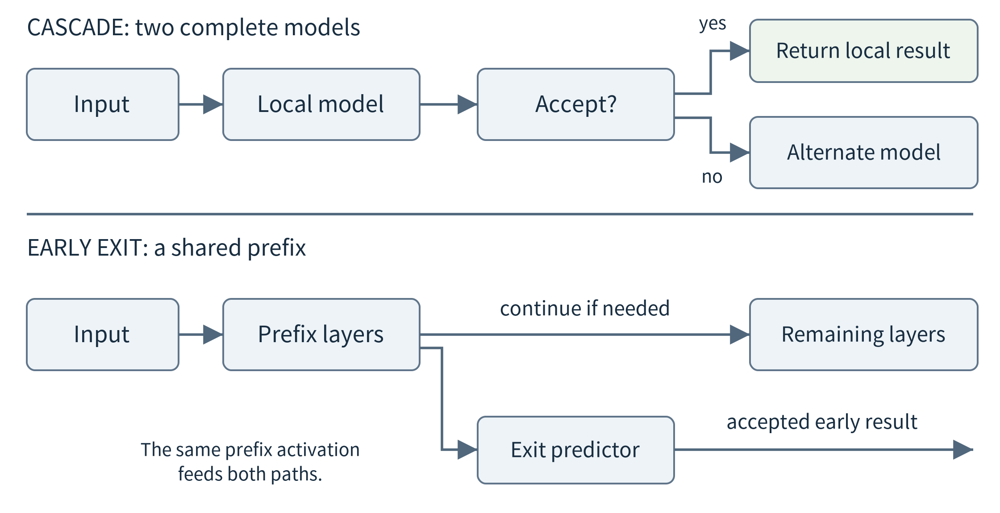<br>
Figure 11.2. A cascade may repeat work in a second complete model. An early-exit network reuses a prefix but needs suitable intermediate predictors. Arrows show conditional execution, not guaranteed quality.

A score threshold must be chosen using examples separate from the final evaluation. Even a normalized class score of 0.99 is not automatically a 99% chance of correctness. Calibration examines how reported confidence relates to observed correctness across examples. Guo and colleagues document calibration problems in modern neural networks and study post-processing methods such as temperature scaling. For this course, the essential habit is to measure acceptance errors and coverage rather than treating a score as a certificate. [{ref}`155 <ref-155>`]

Coverage is the fraction of requests for which a usable answer is returned. Accepted-answer accuracy conditions on the requests a policy chooses to answer. If a service answers only one easy input out of a hundred, high accepted-answer accuracy says little about usefulness. When a remote branch is enabled, report the accuracy of that branch on the escalated subset. Its accuracy on an unrelated full dataset cannot be substituted, because escalation selects a different mixture of inputs.

(section-11-2-2)=

### 11.2.2 A measured cascade that does not improve accuracy

The companion study reuses {ref}`Chapter 10 <chapter-10>`’s saved digit models without retraining them. For each of three initializations, a compact directly trained student is the local model and the larger model previously used as a teacher is the alternate. Teacher is its role in the earlier training study, not a claim that it is more accurate. Both models execute locally in this experiment; no network delay, energy use, or camera pipeline is measured.

The selection rule is fixed before evaluating the cascade: among a declared threshold grid, accept as many validation inputs as possible while retaining at least 100 accepted examples and an empirical accepted error of at most 1%. If no threshold qualifies, the policy accepts none locally. The rule selects 0.90 for all three initializations. This is an empirical validation rule, not a calibrated probability or a statistical guarantee of at most 1% error on future data.

The 360-image evaluation set is inherited from {ref}`Chapter 10 <chapter-10>` and was already reported there. It is not a newly independent holdout for the whole textbook. Within the present comparison, the escalation rule uses only the separate validation set, and the evaluated test outcomes are not used to adjust it. The three initializations share the same images; they do not provide 1,080 independent field observations.

```{list-table}
:header-rows: 1
:class: book-table

 * - **Initialization**
   - **Local correct / 360**
   - **Alternate correct / 360**
   - **Escalated**
   - **Cascade correct / 360**
 * - 11
   - 350
   - 345
   - 35
   - 346
 * - 22
   - 350
   - 350
   - 27
   - 350
 * - 33
   - 352
   - 349
   - 33
   - 349
```

The local models average 97.41% accuracy; the cascades average 96.76%. Across the three runs, escalation rescues four local mistakes but replaces eleven correct local predictions with wrong alternate predictions. For initialization 11, the alternate is correct on only 24 of the 35 escalated inputs. It is therefore the wrong lesson to conclude that uncertain local results should always be replaced. The measured lesson is to evaluate complementarity and the replacement rule.

(fig-11-3)=

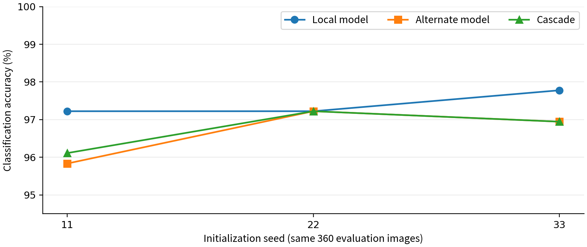<br>
Figure 11.3. Actual classification results using unchanged {ref}`Chapter 10 <chapter-10>` artifacts and the inherited 360-image evaluation set. The cascade does not outperform the local baseline in this setup. No inference-speed claim is implied.

If the alternate becomes unavailable, a meaningful fallback is to return accepted local predictions and abstain on the remaining inputs. For initialization 11, that mode answers 325 of 360 inputs, of which 322 are correct. It must not inherit the normal cascade’s full coverage. Alternatively, an application may choose a different evaluated local-only policy. Name the mode and report its own quality and availability; silently returning every low-score prediction changes the contract.

(fig-11-4)=

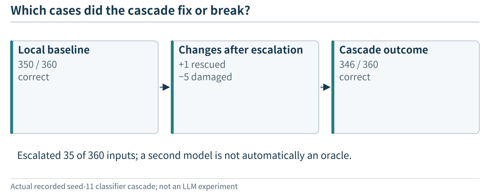<br>
Figure 11.4. Escalation changes individual decisions; count newly introduced errors as well as corrected errors.

(section-11-3)=

## 11.3 Split one inference computation across nodes

(section-11-3-1)=

### 11.3.1 What crosses a model boundary?

Instead of choosing between complete classifiers, the reader can execute the first part of one network locally and the remaining part elsewhere. The local stage produces intermediate tensors rather than a final class. The remote stage must use the matching model version and continue from the correct boundary. Neurosurgeon is an early systems example of selecting a DNN partition between mobile and cloud resources according to compute and communication characteristics. The useful idea is to compare candidate cuts, not to assume that a middle cut is best. [{ref}`156 <ref-156>`]

A practical boundary contract contains the model and preprocessing versions, the cut identifier, tensor names, shapes, numerical representation, and request identity. A network with skip connections may require several tensors at a cut, not only the most recently produced one. Dynamic input shapes and batch sizes also matter. The receiver must reject an incompatible boundary rather than apply a plausible-looking array to the wrong layer.

The raw tensor can be much larger than the original input. A 224 × 224 RGB image represented with one byte per channel contains 150,528 bytes. A hypothetical early feature tensor of 112 × 112 × 32 float32 values contains 1,605,632 bytes. A later tensor of 7 × 7 × 128 float32 values contains 25,088 bytes. These are illustrative shapes, not measurements of a named model. Comparing against a JPEG requires the actual compressed image size, not the RGB tensor size.

(fig-11-5)=

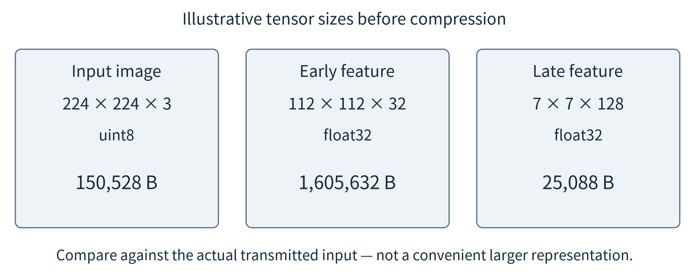<br>
Figure 11.5. A smaller computation prefix need not produce a smaller message. Sizes are calculated for the stated hypothetical tensors; metadata, protocol overhead, and compression are excluded.

(section-11-3-2)=

### 11.3.2 Compare complete paths, not just model stages

For a single dependent request, a first timing estimate adds local prefix execution, input serialization and transfer, remote waiting and suffix execution, and return handling. To keep a worked example inspectable, assume serialization and the small output transfer are negligible, use a 20 Mbit/s link and 20 ms total propagation/round-trip overhead, and consider the following invented stage times. No overlap is assumed.

T = T\_prefix + 8B / R + T\_network + T\_queue + T\_suffix

B is the transmitted byte count and R the link rate in bits per second. The transfer term is therefore in seconds; convert all terms to one time unit before adding them. T\_network here covers propagation and round-trip overhead, not the input serialization time already counted by 8B/R.

```{list-table}
:header-rows: 1
:class: book-table

 * - **Arrangement**
   - **Local prefix**
   - **Transferred input**
   - **Remote suffix**
   - **Total, no queue**
 * - All remote
   - 0 ms
   - 150,528 B
   - 30 ms
   - 110.21 ms
 * - Early cut
   - 10 ms
   - 1,605,632 B
   - 20 ms
   - 692.25 ms
 * - Late cut
   - 45 ms
   - 25,088 B
   - 10 ms
   - 85.04 ms
 * - All local
   - 130 ms
   - 0 B
   - —
   - 130 ms
```

The late cut wins in this assumed setting, but adding a 60 ms remote queue makes it slower than the local baseline. Reducing feature precision or compressing tensors changes both bytes and possibly numerical behavior, so it requires another quality comparison. Intermediate tensors must also remain within the data-release policy. Hiding raw pixels behind a feature extractor is not, by itself, evidence that sensitive information has been removed.

The companion implementation tests a narrower, real property. It splits each saved teacher network at both internal boundaries, serializes the activations as float32 bytes, restores them, and runs the suffix. On all 360 evaluation inputs for each initialization and cut, predicted classes match the unsplit model; the maximum logit difference in this local calculation is zero. This verifies the supplied serialization path, not a WAN implementation or every possible accelerator backend. Its 64-value and 32-value boundaries carry 256 and 128 raw bytes per input, respectively.

Those messages should be compared with the correct baseline. The lab’s normalized input has 64 float32 values, or 256 bytes, whereas 64 one-byte pixel values occupy only 64 bytes. Even the later 128-byte feature is not smaller than that compact pixel representation. A split can still be useful for another resource reason, but a bandwidth claim must identify the actual wire representation.

(section-11-3-3)=

### 11.3.3 Walk through a two-stage request

The smallest split implementation has an explicit sender and receiver. The sender normalizes an input using the same rule as training, runs the prefix, and sends the resulting tensor with its metadata. The receiver validates the metadata, restores the array, runs the suffix, and returns class scores with the request identifier. Only then does the application apply its output policy. Each step has a different failure: a missing input, an unsupported tensor type, a model-version mismatch, or a missing reply should not all appear as a wrong classification.

First compare the split and unsplit implementations on exactly the same inputs without a network. Next introduce serialization. Finally place the stages on different hosts and measure communication and failure behavior. This staged procedure isolates numerical problems from transport problems. If both implementations produce the same wrong label, splitting preserved the model’s behavior but did not make it accurate. If they differ, inspect normalization, shape, layout, precision, and versions before proposing a new partitioning algorithm.

(section-11-4)=

## 11.4 Collaborate on evidence, not only on compute

Two cameras may see different sides of one object. A phone and a wearable may observe complementary aspects of an activity. Their collaboration differs from three replicas processing interchangeable requests. Here the system must first establish which observations refer to the same entity and interval. It then decides whether to exchange raw inputs, intermediate representations, or local decisions. The choice changes communication, available information, and the requirements of the combining model.

(fig-11-6)=

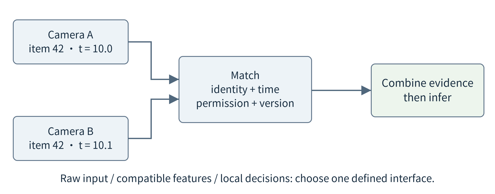<br>
Figure 11.6. Match identity and time before combining observations. A missing view should remain missing rather than being replaced by a confident model statement.

Raw-data fusion retains flexibility but can require substantial transfer. Feature fusion depends on compatible feature definitions and a fusion method that can use them. Decision fusion exchanges compact outputs but may discard the information needed to resolve a disagreement. A useful baseline compares one view, two views processed independently, and the chosen fusion method under the same quality criterion. More participants do not imply independent errors.

Distributed Deep Neural Networks (DDNNs) provide a research example of jointly designing distributed inference and local exits across device, edge, and cloud resources. This is not a promise that arbitrary independently trained feature extractors can be joined. A cooperative system may need training for its participants, missing inputs, and exit conditions. Use the architecture to motivate these interfaces rather than transplanting a reported performance gain to unrelated cameras or devices. [{ref}`157 <ref-157>`]

For the reader, a second image request can be an evidence policy, not merely a retry of computation. Record whether the recapture actually occurred and whether it concerns the same object. A system using an old image from a different item can produce an apparently consistent but irrelevant answer. If a device leaves, permission is revoked, or one view becomes stale, the combined task needs an explicit reduced-evidence mode. Time and provenance from the IoT data contract remain important even when outputs have become learned features.

(section-11-5)=

## 11.5 Add language understanding without hiding the system

(section-11-5-1)=

### 11.5.1 From a predicted label to a changing user request

A recognition model answers a fixed kind of question: which label best matches this input? Now the operator asks, “Which batches needed manual review this morning, and how did that change after the lighting adjustment?” The application needs to interpret the request, identify the relevant records, calculate a comparison, and explain the result. A language model can supply a flexible interface to these existing capabilities. The classifier and ordinary statistical code remain useful tools rather than being replaced by text generation.

Before making the application agentic, run one bounded language-model request. Supply a small, versioned set of already permitted observations and ask for a structured explanation. This lets students observe model loading, input processing, output generation, and failure without also debugging a planner. {ref}`Chapter 12 <chapter-12>` turns the same model interface into a controlled tool loop. A plain summary is a foundation for that implementation, not the final definition of the flexible application introduced in Chapter 2.

Local execution can keep some interpretation and data access available without a live cloud connection, provided the model, tokenizer, runtime, relevant records, and permissions are already usable locally. It may also reduce outgoing context. However, a local HTTP endpoint can be a proxy for a remote service, and an installed client is not a local model. Verify the artifact and actual execution path, then test the required operation with the wide-area link disconnected. Do not infer offline capability from the server address alone.

(section-11-5-2)=

### 11.5.2 What must be present on a language-model host?

The deployment contains more than a weight file. It includes the model architecture, tokenizer, numerical format, inference runtime, and the expected chat template. A tokenizer maps input text to token identifiers and output identifiers back to text. A chat template arranges roles and control markers in the sequence expected by a chat-trained model. Replacing it with a visually similar string can change behavior. The Transformers documentation explains why the same conversation must be formatted using the template appropriate to the model. [{ref}`165 <ref-165>`]

(fig-11-7)=

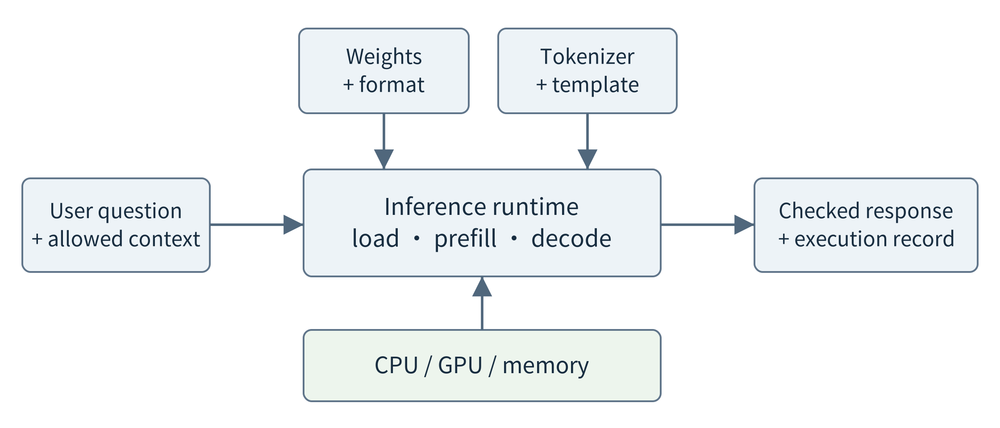<br>
Figure 11.7. A local model service joins compatible artifacts, a runtime, hardware, and a bounded request interface. A model name alone does not specify this deployment.

There are several practical routes. llama.cpp supplies inference implementations and a server for compatible models, including CPU and accelerator execution and hybrid CPU/GPU use. Ollama provides a local model-management and HTTP interface. vLLM emphasizes model serving, including scheduling and memory-management features for supported configurations. These are examples of roles, not an instruction to install all three. Select one route that supports the target artifact and device, and record its version. [{ref}`159 <ref-159>`, {ref}`160 <ref-160>`, {ref}`166 <ref-166>`]

The word offload needs special care here. A runtime can keep some layers in host memory and execute others on a GPU in the same machine. That is a local hardware arrangement, with its own data-transfer cost. It is not the same as sending a user request over a network to another language model. Similarly, dividing one model among local GPUs does not automatically provide an efficient wide-area device–cloud partition.

Record an artifact digest or equivalent immutable identifier, tokenizer/template version, quantization format, runtime/backend version, context limit, and generation settings. Also identify the model license and permitted data path before distributing it. A friendly model tag is convenient for installation but can change. A reproducible comparison needs to establish what actually ran. CPU execution may make a demonstration possible without dedicated hardware, but its usefulness must be measured for the intended request length and response deadline.

(section-11-5-3)=

### 11.5.3 Prepare a usable local-model baseline

A first baseline can be specified with a small deployment sheet rather than a long installation tutorial. Name the selected model artifact, the host resources available to it, the local service address, the supported request size, and the output the application will accept. Then make one request whose expected factual content is easy to verify. For the reader, synthetic records might say that twelve items were accepted and three need review. The explanation must preserve those counts and must not invent a cause for the review status.

Observe preparation and execution separately. Does the artifact exist before the request? Is the model already resident? Does the server return the expected response structure? How long does the whole call take, and what does the host’s memory use look like? Repeat with a longer but still permitted input. The purpose is to obtain a known local reference point before comparing remote assistance. A failed deployment should not be hidden behind an automatic remote fallback during this first check.

The request interface is also a boundary between deployment and application logic. The application supplies a question and permitted context; the adapter translates them into the runtime’s protocol. A different runtime may use another wire format while implementing the same application contract. Keep timeouts, evidence limits, and output validation above that difference. However, matching an API shape does not establish equal model behavior: a replacement must pass the same task tests.

A compact deployment can support both the earlier classifier and the language model, but their execution should remain identifiable. The classifier produces its label using image evidence; a query retrieves approved history; ordinary code computes counts; the language model explains or organizes the next request. When the language model is unavailable, the application may still show valid labels and verified counts. When image evidence is absent, a fluent explanation cannot substitute for a new measurement.

(section-11-6)=

## 11.6 Understand language-model latency and memory

(section-11-6-1)=

### 11.6.1 Loading, prefill, and decoding

A request may wait for admission, then load an artifact if the model is not resident. During prefill, the model processes the input sequence and prepares state used for generation. Autoregressive decoding then extends the sequence step by step. The tokens within one output depend on their preceding prefix, although a runtime may schedule work across several independent sequences. This difference from a fixed-shape classifier is why request length and concurrency deserve explicit treatment. [{ref}`28 <ref-28>`, {ref}`158 <ref-158>`]

Consider a hypothetical warm request with 40 ms waiting, 300 ms to process the prompt and produce the first token, another 63 tokens at 20 ms each, and 50 ms for final checks and display. The first token appears after 340 ms, while the complete checked result takes 1,650 ms. Loading a cold model for an additional 1,500 ms increases the complete time to 3,150 ms. These are chosen teaching values, not a measurement of any model or runtime.

(fig-11-8)=

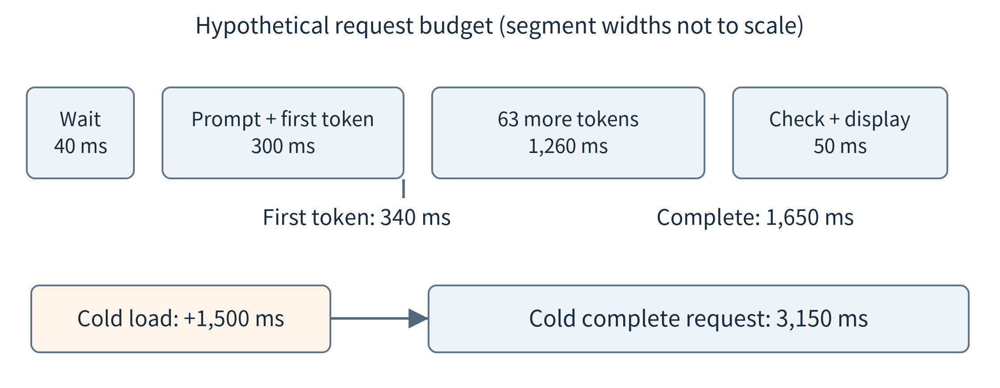<br>
Figure 11.8. First-token responsiveness and complete-task latency answer different questions. The timeline uses the explicitly hypothetical values in the text.

A conversational interface may display partial text. A program expecting a JSON object often cannot safely use it until the object is complete and checked. Measure the boundary that matters to the application. Token throughput alone can conceal long waiting, loading, or prompt-processing time. Compare the same supported task and document input/output token counts; a short refusal and a long successful report are not equivalent workloads.

Keep model-serving concurrency distinct from {ref}`Chapter 6 <chapter-6>`’s replica count. One replica may schedule several sequences, while several replicas may each reserve their own weights. Increasing either can exhaust memory before compute appears fully used. Batch scheduling can improve utilization, but accepting an additional sequence still consumes prompt work, generation steps, and state. vLLM is a representative serving system with continuous batching and related scheduling support; those mechanisms must be configured and tested on the intended hardware. [{ref}`166 <ref-166>`]

(fig-11-9)=

<br>
Figure 11.9. Weights are reused while request-specific state grows with the retained prefix; token IDs and timings here are illustrative.

(section-11-6-2)=

### 11.6.2 A context window is also a memory commitment

Weight storage remains an important starting point. Three billion parameters at four bits per parameter occupy 1.5 billion bytes before quantization metadata, approximately 1.40 GiB. Runtime memory additionally includes activations, workspaces, allocator overhead, and per-sequence state. A Transformer that caches attention keys and values avoids recomputing all past states, but retains memory as the context grows. Cache organization and architecture differ, so use a formula only with its stated assumptions. [{ref}`158 <ref-158>`]

M\_KV = 2 × L × h\_KV × d × T × b × N

Here L is the layer count, h\_KV the number of key/value heads per layer, d their head dimension, T retained tokens per sequence, b bytes per stored value, and N the number of equally sized sequences. The factor two represents keys and values. The key/value head count need not equal the query-head count. The estimate assumes a simple dense retained cache; sliding windows, shared prefixes, quantized caches, and non-Transformer state require different accounting.

For L = 24, h\_KV = 8, d = 128, T = 4,096, and b = 2, one sequence requires 384 MiB of such cache. Doubling retained tokens gives 768 MiB. If a hypothetical host has 1.5 GiB left for this cache after weights, runtime reservations, and headroom, four 4,096-token sequences reach that budget, but only two 8,192-token sequences do. These are upper bounds under the simplified cache estimate, not recommended admission settings.

(fig-11-10)=

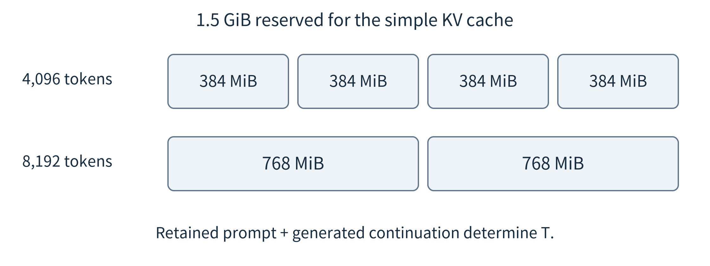<br>
Figure 11.10. Longer contexts reduce the number of sequences fitting in a fixed cache budget. The 1.5 GiB example excludes weights and already reserves other memory separately.

T includes the retained prompt and the generated continuation, not just the user’s latest sentence. Retrieved passages, tool outputs, and prior conversation can increase it. Reserve a bounded output allowance when admitting work; otherwise a request that fits initially may outgrow its allocation. The policy should also limit total active work and explain waiting or refusal rather than routinely letting allocation failure terminate the service.

PagedAttention is an example of improving cache allocation and sharing without changing the task’s trained weights. The systems lesson is that memory organization can affect how many requests a service handles. It does not make cache space free. Prefix reuse likewise requires a compatible model and the same relevant token prefix. Reusing cached computation is different from reusing an old answer, which also requires unchanged evidence and application policy. Shared caches should respect access boundaries. [{ref}`28 <ref-28>`]

(section-11-7)=

## 11.7 Choose a model for the request

(section-11-7-1)=

### 11.7.1 Route before execution or escalate after an attempt

A router chooses an endpoint before paying for its full answer. It may use request type, input length, privacy rules, available memory, and previous validation results. A cascade first obtains a local attempt, then decides whether to keep it or invoke another model. The cascade gains evidence about the attempted answer but has spent time and resources. RouteLLM studies learned routing from preference data; FrugalGPT studies cost-aware use of model APIs, including cascades. Their methods motivate policy design, but their particular task distributions and costs do not transfer automatically to a local sensing application. [{ref}`30 <ref-30>`, {ref}`161 <ref-161>`]

(fig-11-11)=

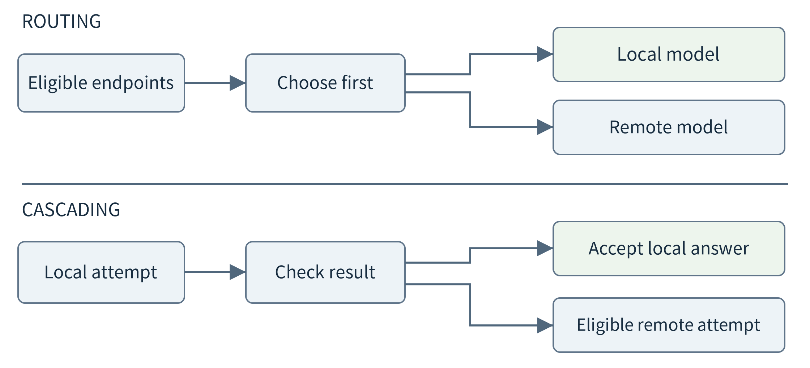<br>
Figure 11.11. Both designs filter infeasible endpoints. Routing chooses before a full attempt; cascading pays for the initial attempt before deciding whether to escalate.

For the first implementation, use a small explicit policy. An ordinary count stays in verified code. An evaluated local explanation task uses the local model. A request outside that scope may use an approved remote model only if its data can leave, the endpoint is available, and the expected path fits the remaining budget. Other requests return a limitation or ask for clarification. This is a testable starting point, not a claim that a few rules solve general semantic routing.

Never use a model’s self-reported confidence as the only acceptance check. A structured answer can cite valid record identifiers and still reverse the comparison between two batches. Inspect task-specific conditions: required fields, correct numerical values, supported claims, missing-data qualifications, and whether the original request was actually completed. Some checks are deterministic; others require labeled evaluation or a carefully assessed verifier. A larger verifier can also make mistakes and adds its own cost.

(section-11-7-2)=

### 11.7.2 Quality, average cost, and deadlines are separate tests

Consider an invented 1,000-request evaluation. The cascade accepts 800 local answers, of which 784 are correct. Of the 200 escalated requests, the remote branch answers 198 correctly. All requests return an answer. Overall accuracy is 982/1,000 = 98.2%, not a weighted average using the remote model’s accuracy on some other full dataset. More generally, use conditional branch quality:

Q\_total = a × Q\_local\|accepted + (1 − a) × Q\_remote\|escalated

Let local processing cost 3 units, the acceptance check 0.5 units, and a remote attempt 12 additional units. With 20% escalation, mean cost is 3 + 0.5 + 0.2 × 12 = 5.9 units per request. These are illustrative comparable accounting units, not prices. They omit any standing local deployment costs unless those have already been included. A complete comparison must use the same accounting boundary for local-only, remote-only, and hybrid designs.

Now assume local execution takes 45 ms, checking takes 5 ms, and an entire additional remote attempt takes 280 ms including its communication. The mean is 106 ms, but an escalated request takes 330 ms. Under this deliberately fixed two-outcome example, the 95th percentile is also 330 ms. A 300 ms requirement is therefore not established by the attractive mean. A deadline-aware router could sometimes skip the local attempt; that changes both the policy and the quality evidence required.

A deployed policy must also define its behavior when estimates are wrong. A request can wait longer than predicted, a remote model can become unavailable, and evidence can become stale. Filtering by an estimated deadline is not a hard timing guarantee. Keep a bounded fallback and record the outcome category. After a model, prompt, or workload change, re-evaluate the router and acceptance conditions rather than assuming that an old threshold remains appropriate.

(section-11-7-3)=

### 11.7.3 Choose a policy under changing conditions

Return to three requests: read one label, summarize a permitted batch, and explain a new comparison across several records. A candidate policy keeps the first in the classifier, gives the second to an evaluated local language model, and considers an approved remote model for the third. The choices follow task support, not a ranking in which every remote model is superior. If the user forbids disclosure, the third request may require local analysis, a more limited answer, or clarification instead of escalation.

Now make the remote route slower and increase the local queue. A fixed rule based only on model size cannot see either change. A resource-aware policy uses current estimates but should retain a simple baseline for comparison. Avoid switching every request on tiny estimate differences when switching also loads models or transfers context. Conversely, a long commitment to one endpoint can miss a genuine outage. A useful experiment varies one condition at a time and records both decisions and observed outcomes.

For a sequential cascade, allocate the user-visible time budget before starting. If a first attempt consumes most of it, the system cannot give the remote branch a fresh full timeout. It may return a checked partial answer or a limitation instead. This is the same end-to-end budgeting principle used for ordinary services, now applied to uncertain model behavior. More elaborate learned routing should improve on such an explicit policy under the same constraints, not silently relax them.

(section-11-8)=

## 11.8 Collaborate while generating tokens

(section-11-8-1)=

### 11.8.1 Drafting and verification

Speculative decoding addresses a different bottleneck: repeated target-model generation steps. A draft model proposes several next tokens. The target evaluates that proposed continuation and applies an acceptance and correction procedure. The objective is to advance the target generation more efficiently, not to replace difficult user questions with a different model’s preferred answer. With the appropriate speculative sampling algorithm, the output distribution can match the target distribution. That is not a guarantee of factual correctness or identical sampled strings. [{ref}`29 <ref-29>`]

The draft and target must agree on a suitable token representation and expose the operations required by the algorithm. Two ordinary text-completion APIs are not sufficient merely because both return fluent text. Exact acceptance may need probabilities beyond a few displayed alternatives, plus target evaluation of a proposed prefix. Different tokenizers and sampling transformations require special handling. A teaching implementation should not silently substitute a semantic “looks correct” check and retain the exactness claim.

(fig-11-12)=

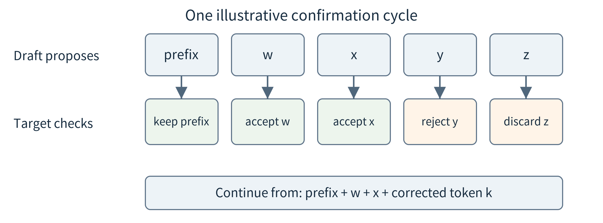<br>
Figure 11.12. Only a confirmed prefix becomes the basis of subsequent accepted work. Rejected draft suffixes cannot be treated as completed output. This is an algorithm illustration, not a model trace.

A small one-step example makes correction understandable. Suppose the target probabilities over three tokens are p = (0.6, 0.3, 0.1), while the draft probabilities are q = (0.2, 0.5, 0.3). For a token sampled from q, accept with probability min(1, p/q). Accepted probability mass is then (0.2, 0.3, 0.1). The remaining mass, 0.4, must be assigned according to the positive part of p − q, which here assigns it to the first token. The final distribution is p, rather than q. [{ref}`29 <ref-29>`]

The companion code computes this identity and samples the accept-or-correct step 100,000 times with a fixed seed. Observed frequencies are approximately (0.60016, 0.30031, 0.09953), close to p. This is a three-category probability experiment. It does not execute a language model, demonstrate a multi-token server, or measure decoding acceleration. Its purpose is to show why accepting draft tokens without correction changes the distribution.

(section-11-8-2)=

### 11.8.2 The network is inside the decoding loop

A local draft and a remote target exchange work repeatedly. Count each dependent cycle, not only total token bytes. Let D be draft time, N communication and coordination time, V target verification time, and K the average number of useful confirmed output tokens per cycle. A first non-overlapped estimate is (D + N + V)/K. K counts actual confirmed progress, including any correction or bonus token supplied by the algorithm; it is not simply the proposed block length.

T\_per\_confirmed\_token ≈ (D + N + V) / K

Use invented values D = 40 ms, V = 30 ms, K = 3, and target-only generation of 50 ms per token. With N = 20 ms, the speculative estimate is 30 ms per confirmed token. At N = 80 ms it breaks even, and at N = 140 ms it becomes 70 ms. Increasing the draft block could reduce communication per token, but can also waste more work when proposals are rejected. Quality equivalence and speedup are separate claims.

(fig-11-13)=

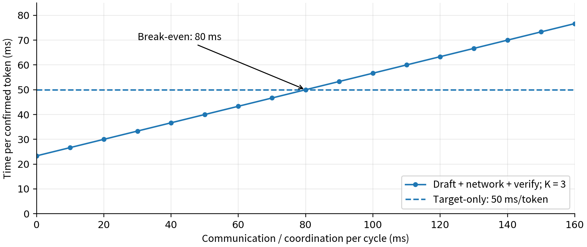<br>
Figure 11.13. Analytical timing under fixed draft, verification, and confirmed-progress assumptions. The crossover changes if acceptance, queueing, overlap, or server behavior changes.

PicoSpec, a March 2026 preprint, studies pipelined collaborative decoding between edge and cloud, including asynchronous work and more compact exchanges. It illustrates why a useful distributed design requires more than putting the draft on one machine and the target on another. Pipelining must manage which work depends on an unconfirmed prefix; compression and protocol changes must be evaluated for both overhead and algorithmic behavior. The paper is a dated research case, not a platform capability or a guarantee on another network. [{ref}`33 <ref-33>`]

Model partitioning can also impose repeated communication during autoregressive generation, but its exchanged values are intermediate computations of one model rather than draft proposals and acceptance decisions. For both mechanisms, a diagram with one cross-network arrow can hide many round trips. Begin with a timeline, count dependent exchanges, and compare against the simplest local-only and target-only services that meet the same task definition.

(section-11-9)=

## 11.9 Collaborate on subtasks and evidence

(section-11-9-1)=

### 11.9.1 Exchange task results instead of internal model state

Some applications need a different division of labor. A local service holds private equipment history; a remote model can help organize a difficult analysis. The models can exchange task descriptions and approved results without splitting layers or coordinating individual tokens. For example, a remote request might ask a local worker to compare two specified intervals. The worker queries the permitted records and returns the computed comparison and its scope. Raw observations need not all be included in that response, but the response itself still discloses information.

Minions studies this form of local–remote collaboration over context held locally, including decomposition into smaller tasks that local models can handle. It is useful for asking how much work and context should cross the boundary. It does not establish that every summary is private or that every local model follows a complicated plan reliably. The application must still control allowed data access and outbound information, and compare the total workflow against simpler baselines. [{ref}`31 <ref-31>`]

(fig-11-14)=

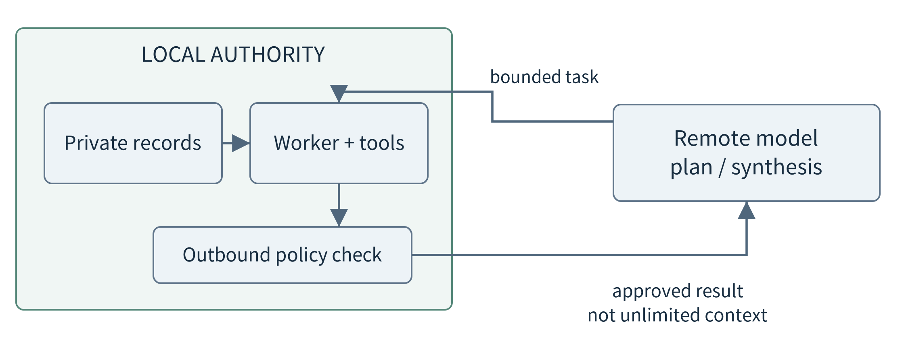<br>
Figure 11.14. The local data boundary is enforced by the application. A task description travels inward and a permitted result travels outward; neither model receives unlimited authority.

Count complete calls. A plan, three local analyses, a remote synthesis, and one repair can cost more than a single target-model request. Parallel independent analyses can shorten a critical path only when resources are available. If three local models each require 4 GiB but the usable model budget is 8 GiB, running all three at once is not feasible merely because the task graph permits it. Queuing or reusing one resident model changes the timeline. {ref}`Chapter 8 <chapter-8>`’s resource reasoning still applies.

Evidence should have an identity outside the model conversation. A returned statistic names the query interval, data version or snapshot, computation version, and missing-data policy. A model can phrase these results but must not turn an incomplete subtask into a completed one. Detailed permission checks, retries, generated-program execution, and workflow persistence are developed in {ref}`Chapter 12 <chapter-12>`; here the objective is to identify the collaboration boundary and its cost.

(fig-11-15)=

![Audit the payload leaving the edge; Local evidence stays here; Raw histories; Names and access scopes; Detailed observations; Source documents; Approved payload; task: compare two intervals; metric: temperature_c; aggregate: \[24.2, 25.1\]; coverage: \[1.0, 0.9\]; Discloses these aggregates.](../images/asset-a0a967cf0dba85b3.png)<br>
Figure 11.15. A permitted summary is still a disclosure; the runtime checks the actual outbound payload rather than trusting the model’s intent.

(section-11-9-2)=

### 11.9.2 Several small models are not automatically one large model

Another option is to obtain several candidate solutions, perhaps from different small models, and select or combine them. SLM-MUX, published in the ICLR 2026 proceedings, studies multi-sample self-consistency and selection across small models for reasoning. It is an example of spending additional inference computation to exploit complementary behavior. It is not the same as choosing one endpoint before answering: candidate-generation costs have already been incurred. [{ref}`32 <ref-32>`]

(fig-11-16)=

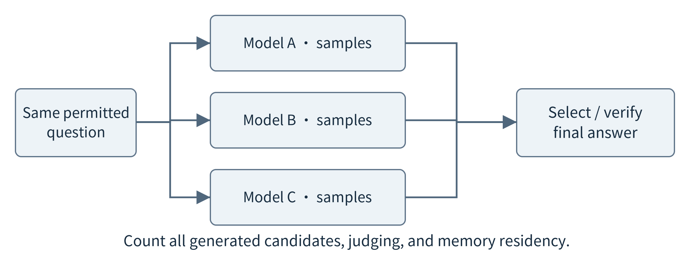<br>
Figure 11.16. Candidate generation, selection, and resource scheduling are separate costs. Agreement among candidates is not independent evidence that their common claim is true.

For a sensing application, all candidates may inherit the same missing observation or misleading intermediate result. Count supported evidence, not just votes. Compare one local model, one larger model, several independent local samples, and the proposed combination using a stated total budget. Otherwise the experiment may demonstrate only that spending more calls helps on the selected questions. Report disagreements, selected-answer quality, token generation, memory residency, and the latency added by judging candidates.

These task-level methods return us to the motivation of {ref}`Chapter 2 <chapter-2>`: users can change goals without requiring a separately programmed end-to-end function for every wording. Flexibility, however, is an application outcome to test. Include new combinations of time intervals, filtering conditions, output formats, and available tools. A demonstration that always follows the same plan does not establish general planning ability, and an offline system cannot quietly rely on a remote judge.

(section-11-10)=

## 11.10 Update future models without confusing training and inference

The reader may encounter a new label style; a wearable may be used by a different person; a local assistant may receive a new equipment manual. These changes do not all require the same response. Updating a data index changes what information is retrieved. Changing a prompt changes the requested behavior. Fine-tuning changes model parameters. Deploying a new artifact changes the version used for future requests. State which object is being updated before discussing collaboration.

(fig-11-17)=

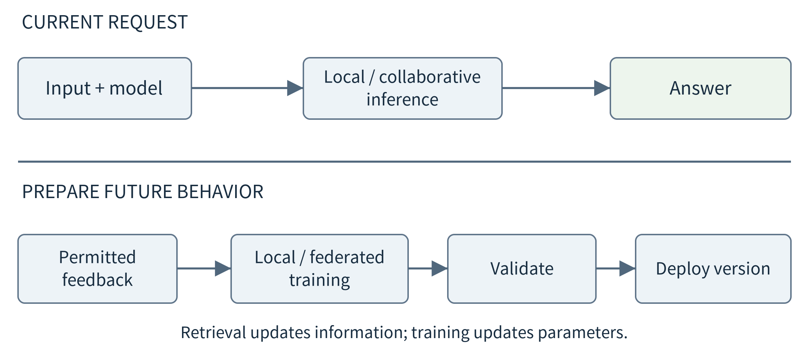<br>
Figure 11.17. Inference cooperation produces an answer now. Adaptation uses permitted data or feedback to prepare a model for later requests, followed by validation and deployment.

Parameter-efficient adaptation can reduce the number of trainable values. LoRA freezes base weights and learns low-rank updates for selected transformations. QLoRA combines low-rank adaptation with a quantized frozen base. Neither means that a tiny device can train a large model merely because the adapter file is small: forward computation, activations, trainable parameters, gradients, and optimizer state still require resources. The practical decision is where to prepare the adaptation and whether the resulting artifact fits the inference host. [{ref}`162 <ref-162>`, {ref}`163 <ref-163>`]

Federated learning addresses another boundary. Participating devices start from a coordinated model version, perform local training, and contribute updates for aggregation. A basic weighted average assigns weight according to each participant’s example count. FedAvg is a foundational example of this approach. It improves a model for subsequent inference; it does not divide the layers of one current prediction across devices. [{ref}`34 <ref-34>`]

For a deliberately small arithmetic example, two compatible updates are (0.2, −0.2) and (0.6, −0.6), based on 10 and 30 examples. Their sample-weighted result is (0.5, −0.5). That computation alone is not a federated-learning implementation. Devices must agree on parameter coordinates and starting version, handle participation and communication failures, and evaluate the aggregated model. Unequal data distributions, biased participation, and stale updates can change what is learned.

Keeping raw training examples local does not by itself guarantee privacy. Deep Leakage from Gradients demonstrates that shared gradients can expose training information under particular conditions. This motivates threat-specific protections and evaluation, not the claim that every update always reveals all data. Secure aggregation or differential privacy can be introduced later as different protection mechanisms; this chapter does not implement or validate them. [{ref}`164 <ref-164>`]

After any adaptation, repeat the application-level validation and deployment checks. A new model can alter confidence, output lengths, memory demand, and tool-call behavior. Revisit cascade thresholds, compatible split points, cached prefixes, and resource budgets. Retain rollback information. A smaller adapter is useful only if the resulting complete service still meets the requirements used to justify local or collaborative execution.

(section-11-11)=

## 11.11 Build and evaluate a bounded collaboration

(section-11-11-1)=

### 11.11.1 Three reproducible paths through the mechanisms

The first laboratory path is the actual digit-model study in Sections 11.2 and 11.3. Load the supplied artifacts, reproduce the validation-selected cascade, inspect rescued and damaged predictions, and verify the split/unsplit outputs. The study retains the original image identifiers and model hashes. It does not train a new model, and it does not claim a production OCR system. The central question is whether a proposed collaboration actually changes correctness in a useful way.

The second path makes one optional real request to an already installed local language model. The example client lists installed artifacts, sends a non-streaming chat request with a JSON response schema, and records the returned model identifier, artifact digest, token counts when supplied, and client elapsed time. Ollama documents these chat and listing interfaces and structured-output support. Structured output constrains format; semantic correctness still requires application checks. [{ref}`3 <ref-3>`, {ref}`4 <ref-4>`, {ref}`167 <ref-167>`]

The request contains a tiny synthetic batch summary, not private observations. The client accepts only a literal loopback endpoint, does not follow redirects or automatically download a model, limits response size, and rejects unknown evidence identifiers. Its timeout bounds the client exchange but does not prove that server-side generation stopped. The operator must still verify that the daemon and selected artifact execute locally. A model listed by a local service is not sufficient evidence of network independence.

```python
result = run_local(
    base="http://127.0.0.1:11434",
    model=configured_local_model,
    evidence=approved_synthetic_snapshot,
    deadline_s=30,
)
```

No actual language model was invoked when validating this chapter’s companion package. The protocol tests use an explicitly labeled loopback test double. They verify request handling and output rejection, not model quality or inference performance. The optional real-model path is provided for the reader’s configured environment. Do not place a test-double response in a performance table beside a real model response without an unmistakable distinction.

The third path examines analytical models: the split timing table, conditional cascade quality and cost, context-memory accounting, and the speculative accept-or-correct calculation. Parameters can be varied independently to locate a design’s failure boundary. The distinction between a measured prediction, an assumed latency, and a probability calculation must remain visible in both code and report. None of these analytical paths is a hidden simulator claiming to run a full language-model system.

(section-11-11-2)=

### 11.11.2 A comparison should preserve the task and count all work

Use the same authorized inputs, task definition, output requirements, and evaluation policy across candidates. Separate development examples from final reporting where possible, and disclose inherited evaluation data. Report correct completed tasks, incorrect completed tasks, justified abstentions, other failures, and coverage. For timing, include waiting, communication, generation, verification, and necessary retries. For cost, include local resources and all remote attempts, not just the accepted final answer.

Expose the boundary assumptions. Measure or declare network conditions, concurrency, input/output lengths, cache state, artifact versions, and failure policies. Compare both average behavior and difficult subsets. A lower mean can hide a worse tail, and high accepted-answer accuracy can hide widespread refusal. A system that fails safely can be preferable for a particular application, but that preference must not conceal what functionality was lost.

```{list-table}
:header-rows: 1
:class: book-table

 * - **Question**
   - **Evidence to record**
 * - What changed?
   - Model choice, split boundary, token protocol, or task decomposition
 * - What crossed the boundary?
   - Authorized payload, bytes, rounds, versions, and retained state
 * - Was the task completed?
   - Correctness, required qualifications, failures, abstention, coverage
 * - Was collaboration worthwhile?
   - End-to-end time, resource use, total cost, and a simpler baseline
 * - What happens without the partner?
   - Named fallback and its separately evaluated behavior
```

Collaboration is justified by application evidence, not by the number of machines or models in a diagram. A useful result may be a negative one: the cascade harms this dataset, the split transfers too many bytes, or the speculative protocol loses to target-only generation at the measured round-trip time. Such a result tells the developer which complexity to avoid. The next chapter builds an edge agent from these model interfaces and ordinary tools, while making its decisions, execution, and resource use explicit.

(chapter-11-chapter-summary)=

## Chapter summary

A complete-model cascade changes which learned predictor supplies an answer. An early exit changes how much of a prepared network runs. A partition divides one computation and exchanges compatible intermediate state. Cooperative sensing changes the evidence. Language-model routing selects whole-request execution, speculative decoding coordinates token generation, and task-level collaboration exchanges plans and results. Model adaptation prepares future behavior rather than answering the current request. These mechanisms can be combined, but each introduces its own interfaces, evaluation requirements, and costs. Begin with the simplest usable local baseline and add only the collaboration that serves a stated need.

(chapter-11-exercises)=

## Exercises

11.1 Two similar devices each host the same classifier and receive disjoint requests. Another pair observes the same item from two camera angles. Explain why capacity scaling and evidence collaboration require different evaluations.

11.2 For initialization 11 in {ref}`Section 11.2 <section-11-2>`, compute offline coverage and accepted-answer accuracy. Explain why neither number alone equals the online cascade’s quality.

11.3 The same run rescues one local error and damages five correct answers. Derive the change from 350 to 346 correct predictions. Propose a validation study, not a test-set adjustment, for a better replacement policy.

11.4 Explain how an early-exit model reuses computation and why placing two independently trained classifiers in a cascade does not necessarily provide that reuse.

11.5 Recalculate the late-cut example with 60 ms remote queueing. Is it preferable to the 130 ms local baseline under these assumptions? Which measurements are needed before using this conclusion on a real device?

11.6 A local feature contains 128 bytes, while the original image is 64 one-byte pixels. A report claims a 50% traffic saving by comparing features to normalized float32 input. Explain the missing baseline assumption.

11.7 Use the cache assumptions in {ref}`Section 11.6 <section-11-6>` for three 8,192-token sequences. Compute the total in MiB and GiB. Does a 1.5 GiB cache budget suffice? Include reserved output tokens when describing the admission rule.

11.8 Reproduce the 98.2% cascade quality, 5.9-unit mean cost, and 106 ms mean time. Explain why the same example does not satisfy a 300 ms 95th-percentile requirement.

11.9 Given p = (0.6, 0.3, 0.1) and q = (0.2, 0.5, 0.3), identify the accepted mass and the correction mass. Why does simply accepting every draft token fail to preserve the target distribution?

11.10 For D = 40 ms, V = 30 ms, K = 3, and a 50 ms/token target, find the largest non-overlapped communication time that still improves the estimate. Explain why a longer proposed block does not necessarily increase K.

11.11 Compare a pre-request router, a token-verification protocol, and a three-model candidate selector. What has already been computed when each makes its main choice?

11.12 Twenty devices each upload and download four million two-byte adapter values per round. Estimate ten rounds of traffic, excluding the initial base model and protocol overhead. Why is this not a measure of current-request inference cost?

11.13 Design an offline test for a local language-model service. Distinguish installed artifacts, loopback API reachability, a running process, and successful completion after a cold restart without WAN access.

11.14 Design a fair comparison of one local model, one approved remote model, and task-level cooperation. Include a privacy restriction, a novel request combination, and a condition where returning a limitation is appropriate.

