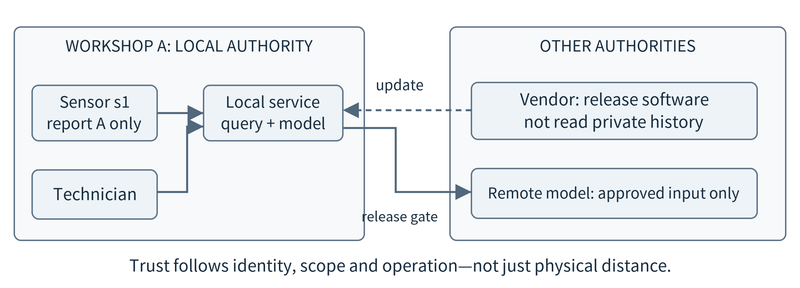
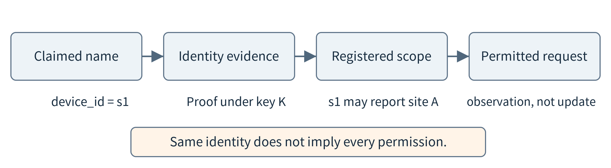
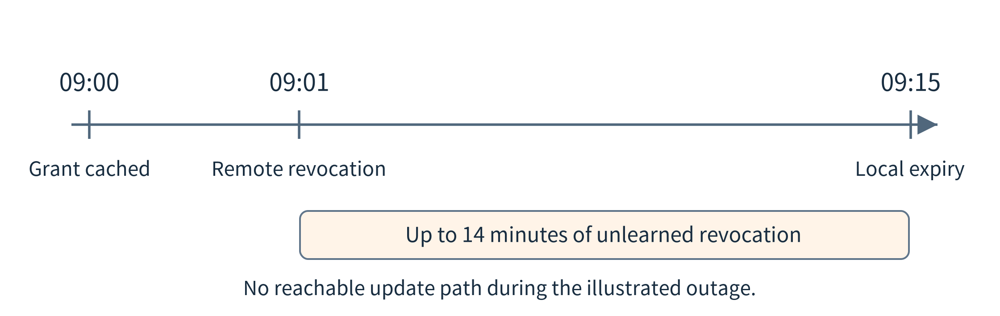
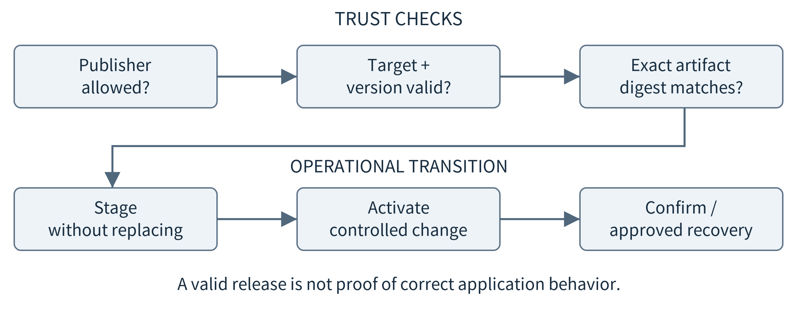
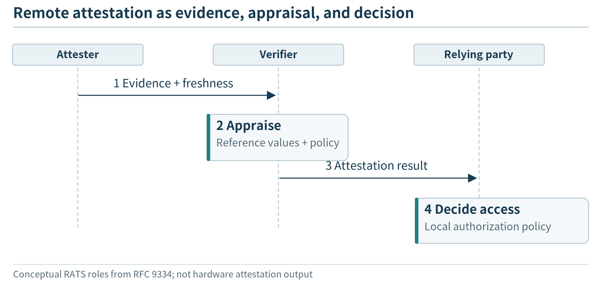
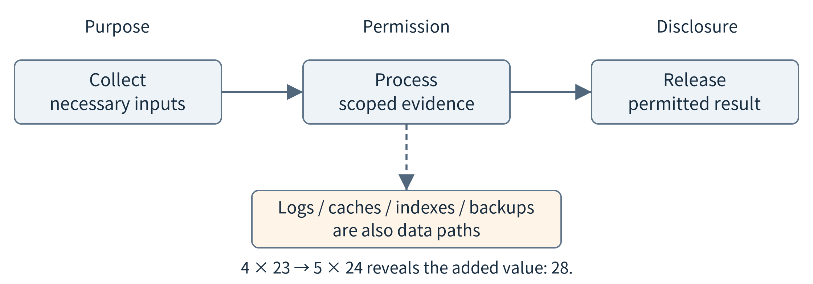
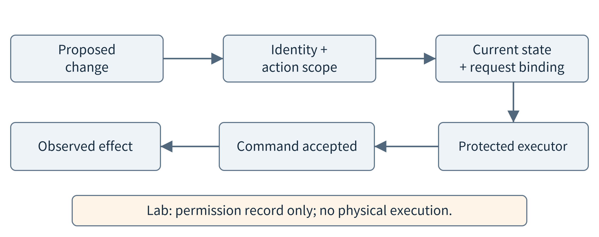
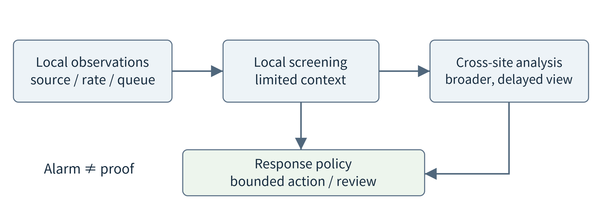

(chapter-13)=

# Chapter 13. Security, Privacy, and Safety in Edge Systems

A maintenance assistant now works at two workshops. Portable sensors send observations to each site, a local model helps technicians analyze equipment histories, and a vendor distributes software updates. During the demonstration, every device and user was supplied by the development team. In the field, a replacement sensor arrives from another supplier, a contractor needs temporary access, and one site loses its wide-area connection. The application still performs the same calculations, but the assumptions about who can be trusted have changed.

Suppose an incoming record claims to describe a pump in Workshop A. Does that label prove its origin? If a model proposes a useful command, who is allowed to approve it? If an update has a valid signature, is it the right version for this device? These questions concern different properties. Security limits unauthorized access and modification. Privacy concerns what information about people or organizations is collected, inferred, used, and disclosed. Safety concerns unacceptable harm from the system’s behavior, including failures with no attacker at all.

The aim is not to become a cryptographer or to certify an industrial controller. It is to locate enforcement in an application architecture, understand the evidence each mechanism supplies, and test both successful and refused operations. Basic safeguards already appeared in deployment and agent execution. This chapter connects them across devices, local services, and cloud dependencies. The following chapter extends the same reasoning to records shared among organizations.

(section-13-1)=

## 13.1 Start with the operation and its trust boundaries

Begin with one operation: a technician asks for the history of pump A17. Draw the path from the user interface to the local query service, the observation store, and any remote model. For each crossing, ask who sends information, what the receiver assumes, and what could happen if that assumption is wrong. A trust boundary is not necessarily a network cable. Two containers on the same computer can have different permissions; the same administrator may control computers at several distant sites.

(fig-13-1)=

<br>
Figure 13.1. Separate device, user, update, and external-service authority. A local network does not give every participant the same rights. The drawing describes a teaching deployment, not a particular product.

A compact threat model connects four items: an asset worth protecting, a capability an adversary might have, an unwanted outcome, and a place that can prevent or detect it. Do not assume every fault is malicious. A duplicate event may result from a lost acknowledgment; an impossible reading may result from a broken sensor. The system needs useful behavior in either case, while investigation distinguishes the causes.

```{list-table}
:header-rows: 1
:class: book-table

 * - **Operation**
   - **An assumption to challenge**
   - **Enforcement or evidence**
 * - Accept an observation
   - The claimed source is allowed to report for A17
   - Authenticated identity; source-to-asset binding
 * - Read equipment history
   - The caller may access this site and interval
   - Query authorization before data release
 * - Install a model or program
   - The artifact is approved for this target
   - Signed manifest, digest, version policy
 * - Change an output
   - The caller is authorized and required state is usable
   - Action gate plus independent feedback
```

Edge deployments make several assumptions visible. Equipment may be physically accessible outside a locked data center. A phone owner can revoke participation. A gateway may be managed by a vendor while observations belong to a site operator. Connectivity can disappear before new policy reaches the device. These are reasons to describe authorities and dependencies explicitly, not reasons to assume that all remote services are hostile or all local services are safe. NIST’s zero-trust architecture rejects implicit trust based only on physical or network location. [{ref}`25 <ref-25>`]

NIST’s IoT capability baseline provides a useful cross-check: device identification, configuration, data protection, interface access, software update, and awareness of cybersecurity state. An application designer should ask which component supplies each needed capability and what happens if it is absent. A gateway can add some protection for a constrained sensor, but cannot retroactively make an unauthenticated measurement originate from a trustworthy device. [{ref}`23 <ref-23>`]

(section-13-2)=

## 13.2 Establish identity, then grant limited authority

An identifier is a name; authentication provides evidence linking a request to an identity. A field such as device\_id or site\_id is supplied data until the receiver binds it to an authenticated principal. A principal can be a device, user, or service. The binding must come from an enrollment or trust configuration, not from another field in the same untrusted message. In our example, the site registers a sensor’s verification key and records which asset it may describe.

Enrollment answers an earlier question: why should the site accept this key in the first place? A managed installation may check a manufacturer certificate, an administrator-approved inventory, and proof that the device holds the corresponding private key. The operator then grants site-specific permissions. A manufacturer’s statement about device identity does not automatically authorize access to a customer’s records. The course laboratory begins after this enrollment: its in-memory trust configuration is a supplied assumption, not a complete onboarding protocol.

Authorization is the next decision. A technician may read observations from Workshop A but not Workshop B; a sensor may publish its own observations but not install software; an update service may publish artifacts but not retrieve private histories. Write permissions as subject, operation, object, and conditions. This makes “read pump A17 during the approved shift” a different permission from “read every asset forever.” Standards such as ACE-OAuth describe authentication and authorization roles for constrained environments; the exact protocol is less important here than keeping identity evidence separate from the resource decision. [{ref}`191 <ref-191>`]

(fig-13-2)=

<br>
Figure 13.2. Authenticate the principal, bind the request to a resource, and apply the permitted operation and conditions. A claimed device name is not itself authentication.

A local policy enforcement point should remain on the actual access path. A browser interface that hides a button is not enough if the underlying service accepts the same request from another client. Similarly, filtering a language model’s final answer is too late if unauthorized records have already been retrieved into its prompt. Limit the data service’s query before evidence leaves that service. Return errors without exposing whether a protected record exists when even its existence is sensitive.

(section-13-2-1)=

### 13.2.1 Revocation and disconnected operation

Identity and permission have a lifecycle: provision, use, rotate, revoke, and retire. Do not copy one administrator secret to every sensor merely to simplify setup. A per-device credential allows a compromised device to be excluded without changing every other device at once, although the system still needs a way to distribute and apply that decision. Protect private keys and policy storage; a policy cannot defend itself if the attacker may replace the trusted key list.

Disconnection exposes a real design trade-off. Suppose a local service receives an access grant at 09:00, valid until 09:15. A central administrator revokes it at 09:01, just after the link fails. If the local service permits cached grants until expiry, the old permission can remain usable for almost fourteen more minutes under the stated clock assumption. It cannot discover the remote revocation from the cached signature. Requiring a live check for every request would instead sacrifice that offline access.

(fig-13-3)=

<br>
Figure 13.3. A signed cached grant can still be valid under the local policy after a remote revocation that the node has not learned. Expiry bounds a chosen exposure window; it does not provide instant synchronization. Times are teaching assumptions.

Define offline behavior per operation. Reading an already authorized local history may be allowed for a short interval; enrolling a new administrator may require a current online decision. Essential local protective behavior should have its own engineered operating policy, rather than disappearing merely because a remote login service is unavailable. There is no single “allow everything offline” or “stop everything offline” rule that fits all consequences. Clock uncertainty, reboot behavior, and renewal dependencies belong in the design.

(section-13-3)=

## 13.3 Protect messages without confusing protection with truth

Communication protection must name its endpoints. TLS can protect a connection against eavesdropping and modification and authenticate endpoints according to its configuration. It does not decide which database rows a caller may read. A client also has to validate the expected server identity; disabling certificate verification in a classroom shortcut removes a property the architecture may rely on. Mutual TLS can add client authentication, while application authorization remains a separate check. [{ref}`178 <ref-178>`]

Consider an MQTT path from sensor to broker to analytics service. Separate TLS connections protect the two hops, but the broker terminates those connections and can normally access the application payload. If the requirement is that an intermediary must not read or alter protected content, the design needs suitable end-to-end object protection and a key arrangement between the actual producer and consumer. OSCORE is an example of object security for CoAP through intermediaries; it is not a switch that can be applied unchanged to every messaging protocol. [{ref}`64 <ref-64>`]

(fig-13-4)=

<br>
Figure 13.4. Hop protection ends where a connection terminates. Object signatures can preserve source integrity beyond a broker, while confidentiality needs its own design. The two examples show different protected boundaries, not interchangeable protocols.

A digital signature can let the receiver verify a statement using the sender’s public key. The secret signing key must remain protected, and the verifier must obtain the correct public key through a trusted process. A signature does not encrypt the statement. In the lab, the cryptography library performs Ed25519 signing and verification; we do not implement cryptographic arithmetic ourselves. Altering a signed field invalidates verification, but signing a false claim with an authorized key produces a cryptographically valid false claim. [{ref}`183 <ref-183>`]

```json
{
  "sensor_id": "s1", "site": "A", "boot_id": "b1",
  "seq": 17, "observed_at": 999,
  "temperature_mC": 23500
}
```

This small observation uses integer millidegrees Celsius so the signed laboratory representation contains no floating-point ambiguity. The integer timestamp belongs to a simulated clock, not a real deployment. The full signed envelope also binds its kind, schema version, issuer, issue time, and expiry. Binding the message kind prevents a signed observation from being reinterpreted as an update request. Field names alone do not implement any of these checks; the receiver must verify the envelope and apply source-to-site permissions.

(fig-13-5)=

<br>
Figure 13.5. The signature authenticates the signed bytes under the chosen key; it does not measure the actual temperature.

(section-13-3-1)=

### 13.3.1 Replay, delayed data, and resource pressure

A receiver can see a valid signed message more than once. Use a stable logical event identity, such as issuer, device, boot identifier, and sequence number, and preserve duplicate-handling state across a normal application restart. The same identity and payload is a retry; the same identity with different content is a conflict. The lab stores the event and identity in one local database transaction. This checks a local ingestion invariant, not exactly-once execution of arbitrary remote physical actions.

Freshness is a separate question. A delayed temperature reading may belong in the historical log while being unsuitable for a current-state display. Preserve observation time rather than replacing it with upload time. A compromised sensor can still lie about its time or value; a signed timestamp is an authenticated claim, not an independent clock measurement. Sanity bounds and comparison with other sensors can detect some problems, but do not establish universal physical truth.

Protection consumes resources too. For an invented 100-Hz stream with 24-byte records, adding a 64-byte signature to every record raises application bytes from 2,400 to 8,800 per second before other metadata. Signing batches of ten records reduces that total to 3,040 bytes per second under the same assumptions, but the first record can wait 90 ms for the tenth to arrive. These are payload and collection-delay calculations, not measured cryptographic timing. The choice depends on the deadline and failure behavior of a batch.

Bound message size, parsing depth, queue length, and work admitted per source before expensive processing. Authenticated sources can still overwhelm a shared gateway, accidentally or deliberately. At the same time, a reconnecting device may legitimately upload a backlog. Separate current traffic from historical replay and document which work may be delayed. Resource admission from Chapters 5–8 therefore supports availability as well as performance.

(section-13-4)=

## 13.4 Keep software trustworthy throughout its lifecycle

A remote update changes executable behavior at a place the developer may never visit. Verify more than the downloaded filename. The receiver needs an authorized publisher, an intact artifact, a compatible target, and an allowed transition from its present version. A manifest binds these facts to a release. The SUIT manifest information model includes target identifiers, digests, sequence information, conditions, and other update metadata; the teaching manifest below uses a deliberately smaller schema. [{ref}`180 <ref-180>`]

Suppose the device has accepted security sequence 7 and receives a signed release with sequence 8. The updater verifies the signature against its trusted publisher, checks that the target class matches, hashes the exact artifact bytes, and requires the new sequence to exceed the stored floor. A signed sequence-6 release is still old. A sequence-8 manifest paired with modified bytes is still wrong. The model file, its preprocessing configuration, and any executable loader deserve the same careful provenance treatment as application code.

(fig-13-6)=

<br>
Figure 13.6. Trust checks decide whether an artifact may be staged; operational checks decide whether it can become the running release. Verification does not establish model quality or safe physical behavior.

A robust deployment separates download, verification, staging, activation, and confirmation. Staging an update before switching helps avoid replacing a working component with a partially downloaded file. Recovery may use a previously approved image, but a security policy must decide which old versions remain acceptable. Operational rollback and protection against rollback attacks are not contradictory: an authorized recovery release can carry a new, explicit policy decision rather than silently accepting any older signed package. Firmware-resilience guidance separates protection, detection, and recovery. [{ref}`179 <ref-179>`]

Publisher keys themselves can fail or be compromised. A production update system therefore needs trusted metadata renewal and a recovery path, not just one permanent key compiled into every application. The Update Framework is a useful example of separating signing responsibilities and using signed, versioned, expiring metadata to reduce repository and key-compromise risks. We study the role of these mechanisms, not implement a replacement update framework in a class exercise. [{ref}`193 <ref-193>`]

(fig-13-7)=

<br>
Figure 13.7. Artifact integrity, allowed signer, platform compatibility and runtime health require separate evidence.

(section-13-4-1)=

### 13.4.1 Boot, isolation, and remote attestation answer different questions

Secure boot checks permitted software before selected boot stages execute. Measured boot records evidence about what was loaded; recording a measurement and refusing an unapproved image are different actions. Runtime isolation restricts what an application can access while it executes. These mechanisms can complement one another, but none turns an application with a logic error into a correct application. Their roots of trust and the code outside the protected boundary must be identified. [{ref}`179 <ref-179>`]

A trusted execution environment can protect selected code and data from specified parts of the surrounding software. Its protection depends on the hardware, configuration, exposed interfaces, and threat model. It is not a promise to prevent every side channel, physical attack, or malicious input. A confidential workload also needs a policy for releasing its key or data to an acceptable execution environment rather than to any machine that claims to have one.

(fig-13-8)=

<br>
Figure 13.8. Attestation evidence is appraised under a policy; the relying service still makes the access decision.

Remote attestation separates the device producing evidence, the verifier appraising it, and the relying party deciding what to permit. A fresh challenge can help relate a response to the current exchange; a signature alone does not make an old measurement recent. Reference values, endorsement information, and appraisal policy affect the conclusion. The result is evidence for a decision under assumptions, not a universal certificate that the machine or every sensor reading is trustworthy. [{ref}`181 <ref-181>`]

For the workshop, an application might release a protected model only after the receiving node presents acceptable evidence. A low-cost sensor might instead rely on a trusted gateway and a much narrower device capability. The textbook does not assume that every edge node has a hardware-backed environment. Ask what must be protected, against whom, and for how long before selecting a mechanism; otherwise expensive assurance can be added to a component that does not control the relevant risk.

(section-13-5)=

## 13.5 Share edge resources without sharing authority

Chapters 5–6 showed why several services may share one machine. The security view now asks which resources each service may observe or change. A data collector needs its device interface and a write path; a report generator may need only a read-only query interface. A generated analysis program should receive a bounded task snapshot, not the collector’s credentials or the administrator’s container socket. Give each component the access its function requires, rather than making the whole host its implicit workspace.

Containers provide useful isolation mechanisms but share important lower layers. Access to a privileged container-management interface can defeat the intended application boundary; mounting broad host directories can expose data that the service did not otherwise need. Docker’s security documentation explains the daemon’s authority and the importance of configuration. Kubernetes multi-tenancy likewise involves authorization, network and resource policy, and a choice of isolation boundary, not namespaces alone. [{ref}`174 <ref-174>`, {ref}`182 <ref-182>`]

Separate confidentiality from interference. Preventing one tenant from reading another tenant’s files does not guarantee that a large inference request cannot delay the other tenant. Memory limits, bounded concurrency, and protected capacity for ingestion help contain resource pressure. They do not by themselves provide hard real-time isolation or eliminate shared hardware failures. A useful classroom comparison asks both “can it read the other data?” and “can its workload disrupt the other service?”

Model inputs and outputs cross these same boundaries. A retrieved manual may contain instructions that are unrelated to the user’s task. The model may also emit an unsafe tool argument without any malicious input. Preserve data as data, validate proposals, and enforce permission in the tool service. For general generated code, a separate restricted worker with no ambient secrets is a design starting point, not a claim of complete containment; in-process text filtering is not a substitute for an isolation boundary. [{ref}`84 <ref-84>`, {ref}`192 <ref-192>`]

(section-13-6)=

## 13.6 Treat privacy as a property of the complete data path

Keeping raw observations local can reduce one disclosure path, but it does not determine everything an application reveals. A wearable summary can expose daily routines; a factory utilization report can reveal production activity; repeated answers can disclose a pattern even when each answer is short. Inventory input records, derived features, embeddings, logs, prompts, model caches, backups, and outputs. Access control should follow the information through these representations, not stop at the raw database.

(fig-13-9)=

<br>
Figure 13.9. Minimize data at collection, constrain access during processing, and review what leaves through answers, logs, and caches. A shorter representation is not automatically nonsensitive.

A small arithmetic example makes composition visible. Suppose a service returns the exact mean of four approved values as 23 and the exact mean of the same four values plus one withheld value as 24. A caller can recover the fifth value: 5 × 24 − 4 × 23 = 28. Hiding individual rows did not protect that row against these combined queries. The example does not imply that every aggregate is unsafe; it shows why allowed query combinations and side information belong in the policy.

Begin with collection and purpose. Does the application need continuous audio, or only a locally detected event? Does a technician need person-level activity or an equipment-level count? Reducing data can reduce both exposure and communication, but the transformation must preserve information needed for the supported task. A model-generated summary is not a privacy filter simply because the model was instructed to omit secrets. Data-release checks should be independent of the model’s willingness to comply.

Encryption in storage and transit protects bytes against specified unauthorized readers, but an authorized endpoint still processes readable information. Retention policy should cover local files, backups and derived indexes; deleting one row does not prove that every copy or inference has disappeared. Record which deletion operations are implemented and how long replicas can lag. This is an engineering inventory and lifecycle problem, not a claim that a particular policy satisfies every legal requirement.

Differential privacy offers a formal way to limit how much a released result depends on an individual contribution under an explicit definition. It needs a privacy unit, neighboring-data definition, parameters, composition accounting, and utility evaluation; adding arbitrary noise is not enough. Secure aggregation and federated learning solve different parts of a system and do not automatically provide the same guarantee. NIST’s evaluation guidance is a suitable entry point; the core exercise here is identifying the protected unit and release boundary, not deriving a privacy mechanism. [{ref}`36 <ref-36>`]

(section-13-7)=

## 13.7 Authorize a request without confusing it with a safe action

A read-only assistant can give an incorrect explanation. An action-capable assistant can also change the physical environment. The second risk is not removed by improving average model accuracy. A command can be authentic, correctly formatted, and issued by an authorized operator, yet be inappropriate because the device state changed after the operator reviewed it. Operational-technology security therefore has to account for reliability, timing, and safety requirements as well as access control. [{ref}`24 <ref-24>`]

Use an abstract simulated actuator to learn the boundary without operating equipment. It has a level from 0 to 100, a state version, a readiness flag, and an observation time. These numbers are artificial interface limits, not safe settings for a pump, fan, vehicle, or building. A proposed change must name the exact target, operation, value, state version, and one-use request identifier. The runtime checks identity and scope, then checks that the required state is recent, matches the expected version, and permits the operation.

(fig-13-10)=

<br>
Figure 13.10. An action passes separate identity, scope, state and budget checks. Acceptance and the independently observed effect remain different events. The laboratory stops at a simulated permission record.

In the lab, a request based on state version 7 is refused if the supplied current state has version 8 or is more than five simulated seconds old. Reusing the same nonce after acceptance is also refused, including after reopening the local database. The checks illustrate binding approval to a specific request and evidence. They do not prove a physical safety property: the state might be wrong, the controller might be bypassed, or conditions might change between checking and acting on a real device.

A deployed action path needs a protected enforcement point close to the effect, and often an independent interlock or supervisor appropriate to the hazard. Human review helps only if the person sees the exact proposed change and relevant evidence, and has enough information and time to judge it. An approval for one target or version must not be reused for a different one. “Ask a human” is not a complete hazard analysis, just as “ask the model to be careful” is not access control.

Distinguish three records: the desired action, the command acknowledged by the device, and the effect observed afterward. A network acknowledgment does not establish that a motor moved, a valve reached position, or a physical condition became acceptable. Lost feedback may leave the effect uncertain. Retrying an irreversible operation in that state can be worse than reporting uncertainty. The appropriate degraded behavior must follow the application’s consequences; automatically turning every device off is not a universal safe choice.

AI introduces additional uncertainty into this chain. Inputs can shift, training data or retrieved content can be manipulated, and an output can be plausible but unsupported. Keep confidence thresholds, schema checks, provenance checks and operational permission conceptually separate. The adversarial-ML taxonomy offers a map of attacks and mitigations, but a complete edge design also needs ordinary fault handling and domain evaluation. A signature on a model says who released its bytes, not how well it performs on tomorrow’s sensor data. [{ref}`192 <ref-192>`]

(fig-13-11)=

<br>
Figure 13.11. An authorized request can be deferred when current state or operating conditions do not justify the action.

(section-13-8)=

## 13.8 Use local intelligence for protection, and measure its mistakes

Edge computing can support protection as well as require it. A local gateway can reject malformed records, identify a changed publication rate, or preserve a local warning during a cloud outage. A remote service may correlate patterns across sites that one gateway cannot observe. Combine the views deliberately: local rules can take narrow, reversible actions, while slower cross-site analysis can inform investigation or policy changes. Neither view is complete.

Start with an understandable baseline before adding an AI detector. Count schema failures, source-to-topic mismatches, conflicting duplicates, and queue pressure. Then consider whether a model adds useful information. A backlog upload after disconnection can resemble a malicious burst. Include such legitimate recovery behavior in evaluation rather than training a detector only on quiet normal traffic. Record what the model actually sees: a detector using local traffic cannot justify claims about an attacker’s intent elsewhere.

```{list-table}
:header-rows: 1
:class: book-table

 * - **Illustrative 10,000 windows**
   - **Alarm**
   - **No alarm**
 * - 100 malicious windows
   - 90
   - 10
 * - 9,900 benign windows
   - 99
   - 9,801
```

In this invented evaluation, recall is 90%, the benign false-alarm rate is 1%, and overall accuracy is 98.91%. Yet only 90 of 189 alarms correspond to malicious windows: precision is about 47.62%. A high aggregate accuracy can hide a substantial investigation burden when incidents are uncommon. Changing the population changes that burden even if the conditional detection rates stay the same. These counts are a worked example, not the performance of a trained detector.

(fig-13-12)=

<br>
Figure 13.12. Local screening and cross-site analysis can cooperate, but observation scope and response authority remain separate. A suspicious pattern may justify review without justifying an irreversible action.

For a protective function, measure time to a useful warning, resources consumed, missed events, false alarms, and the consequences of each response. Detection that starves the data collector undermines the observation it depends on. Automatically blocking a critical device on one anomalous packet may be worse than bounding its rate and asking for review. Use a response policy proportional to the evidence and the application’s consequences, then test it alongside legitimate workload changes.

(section-13-9)=

## 13.9 Build an enforcement path and test what it cannot prove

The companion exercise uses synthetic workshop records, actual Ed25519 signatures, and local SQLite persistence. No live sensor, network login service, physical actuator, hardware attestation environment, or software installer is operated. The initial trust configuration is supplied. The first experiment receives an approved observation, repeats it, changes signed bytes, and sends an authentic record for an unauthorized site. Students should predict which boundary decides each case before running it.

The second experiment verifies an update manifest against target class, version floor and actual file bytes. It reports eligibility for staging, not a completed installation. The third applies a simulated action gate, then retries the same request after reopening the database and changes the required state. These cases connect cryptographic evidence to application policy. Public keys and signed examples may be inspected; private keys are generated in memory and are not included in the result package.

Keep a deliberate negative control. An authorized test signer changes a plausible temperature to a fabricated 99°C before signing a new event. The value remains within the laboratory’s broad input-sanity range and is accepted. This is the expected limit of source integrity, not a failure of the signature algorithm. The exercise must report “authentic statement accepted; physical truth not checked,” rather than label the value trustworthy. A second negative control in {ref}`Chapter 14 <chapter-14>` shows why a valid local history need not be the newest or globally agreed history.

A final design review should produce a small enforcement map, an offline-permission policy, an update and retirement plan, and a list of untested assumptions. Include legitimate retries, recovery bursts, expired permission, lost management connectivity and changed state, not only obviously malformed input. Passing these tests supports the particular implemented checks. It does not establish immunity to all attacks, regulatory compliance, or safe control of a physical process.

(chapter-13-13-s-chapter-summary)=

## 13.S Chapter summary

A trustworthy edge application does not obtain all trust from one mechanism. Identity evidence, permission, message integrity, freshness, software provenance, resource isolation, privacy and safe operation answer different questions. Place each check where it can enforce its decision, preserve useful local behavior under a stated policy, and distinguish authentic claims from verified physical effects. Locality changes the available design choices; it does not eliminate responsibility.

(chapter-13-13-e-exercises)=

## 13.E Exercises

**13.1** Draw the trust boundaries for a phone collecting activity data, a local analysis service, and a remote model. Identify one permission that must be enforced before the model sees data.

**13.2** A message contains site\_id=A and a valid signature. What additional binding is needed before it can be accepted as an observation for Workshop A?

**13.3** A cached grant is valid from 09:00 to 09:15. It is revoked centrally at 09:01 during disconnection. Compare the consequences of permitting cached reads and requiring a live decision. State clock assumptions.

**13.4** For the 100-Hz, 24-byte stream in {ref}`Section 13.3.1 <section-13-3-1>`, calculate bytes per second with a 64-byte signature per record and per ten-record batch. What new waiting time can batching add?

**13.5** An old model artifact has a valid signature and passes an accuracy test. Why may an updater still refuse it? Distinguish security rollback prevention from authorized recovery.

**13.6** Explain how secure boot, runtime isolation and remote attestation differ. Give one application property that none of them proves by itself.

**13.7** Recover the withheld value when the mean of four values is 23 and the mean after adding a fifth value is 24. What does this show about privacy checks on individual answers?

**13.8** An operator approved state version 7, but the actuator reports version 8 before execution. Describe a suitable application response and explain why a valid approval is insufficient.

**13.9** Using the detection table in {ref}`Section 13.8 <section-13-8>`, calculate precision, recall and accuracy. Which number describes how many investigated alarms are genuine in this population?

**13.10** Design a legitimate reconnect burst and a suspicious burst that look similar to a rate-only monitor. What additional evidence and response limit would help?

**13.11** Run the authentic-false-value negative control. Explain what the signature, scope check and physical measurement validation would each need to establish.

**13.12** A report container cannot read another tenant’s directory but can saturate the shared accelerator. Is data isolation enough? Propose an application-oriented test and a bounded mitigation.

