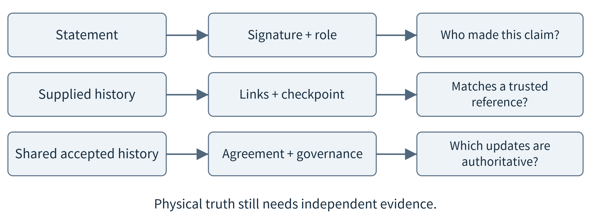
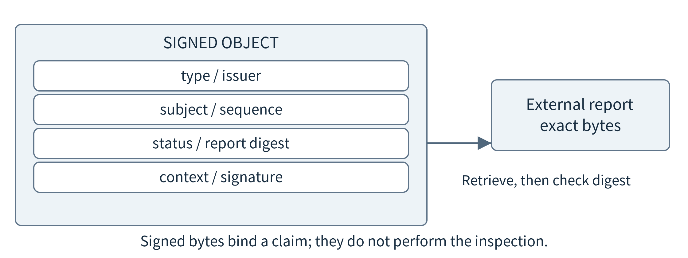
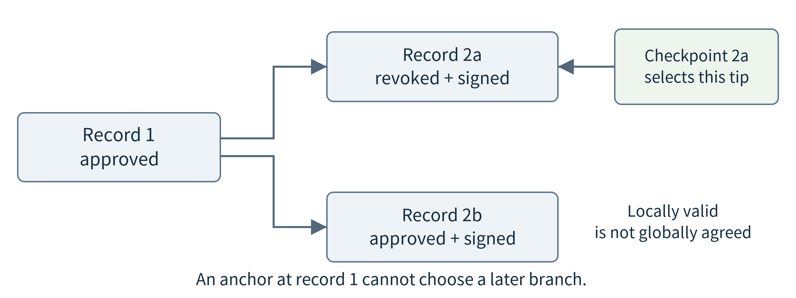
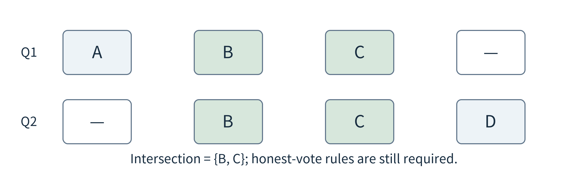
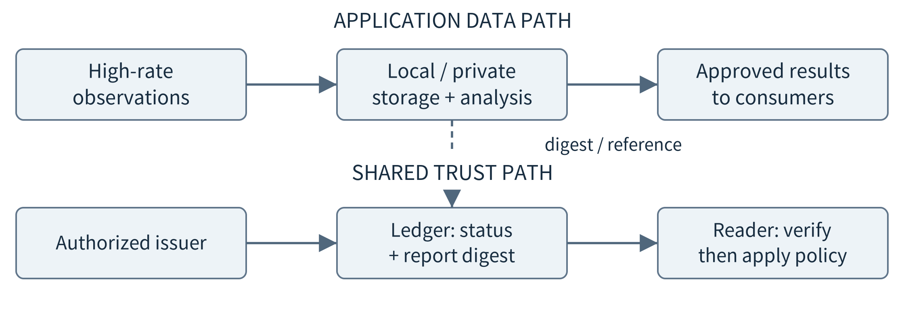
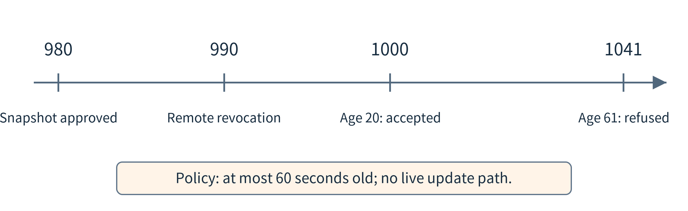

(chapter-14)=

# Chapter 14. Multi-Party Trust, Blockchains, and Distributed Ledgers

The two workshops now share equipment with a testing laboratory and several manufacturers. Before admitting a replacement device, an operator wants to check its model identifier, certification record, and approved software information. The manufacturer publishes a record, the laboratory publishes a test result, and a later correction changes the status. Different participants keep different copies. Which statement is authoritative, and how can a reader tell whether important history was altered or omitted?

This is a record-governance problem before it is a blockchain problem. If every participant accepts one accountable registry operator, an authenticated database with signed statements and independent audit may be sufficient. If participants require several organizations to maintain a common accepted history under shared rules, a permissioned ledger is a candidate. The number of sensors is not what makes the ledger necessary. The decisive questions concern who may make claims, who may change history, and whose decisions others are willing to rely on.

The chapter develops the mechanisms in that order: verify one statement, inspect a history, agree on accepted updates, place data across the continuum, and evaluate a real IoT registry. Bookkeeping here records certifications, versions, provenance and service receipts; it need not involve money or a token. The laboratory implements signatures and local history checks, not a distributed consensus network. Understanding that boundary is part of understanding what a blockchain adds.

(section-14-1)=

## 14.1 Specify the disagreement before selecting a ledger

Write a concrete dispute. Manufacturer M says model A passed an approved procedure; Lab L says the uploaded report was superseded; Operator O has cached the earlier status. A useful design must identify who may publish each statement, whether a correction replaces a claim or appends a new one, and how a reader computes the current effective status. “Everyone can see the data” does not answer who is entitled to update it or which conflicts are legitimate.

Separate three objects. A physical device is one installed unit. A device model describes a class of units. A software release is an artifact or set of artifacts that may run on those units. Certification of a model does not directly establish the current software state or physical condition of every deployed unit. This distinction prevents a registry entry from becoming a universal “trustworthy device” label. Bind each decision to the type of object the evidence actually concerns.

```{list-table}
:header-rows: 1
:class: book-table

 * - **Claim or decision**
   - **Possible authority in the teaching scenario**
   - **What it does not establish**
 * - Model information
   - Manufacturer
   - Independent testing or current device state
 * - Test result
   - Accredited laboratory under the agreed rules
   - Every future reading is correct
 * - Site admission
   - Site operator
   - Permission at every other organization
 * - Common accepted history
   - Chosen registry or validator governance
   - Truth of all external observations
```

Consider the simpler design first. A central registry can authenticate writers, verify their signed statements, enforce update rules, keep backups, and publish checkpoints for independent readers. It is still a central authority for serving and ordering records, and may require external monitoring against omission or inconsistent views. Those may be acceptable responsibilities. Blockchain is not required merely because organizations exchange signatures or keep redundant copies. NIST’s overview is useful precisely because it separates ledger mechanisms from the application assumptions around them. [{ref}`26 <ref-26>`]

(fig-14-1)=

<br>
Figure 14.1. A signature answers who attested to these bytes; a history check answers whether a supplied sequence matches an anchor; agreement determines an accepted sequence under a governance model. None directly measures the physical world.

(section-14-2)=

## 14.2 Build a verifiable statement

A cryptographic hash maps a byte sequence to a fixed-length digest. For a suitable hash function, finding a different input with the same digest should be infeasible under the relevant cryptographic assumptions. A digest is useful when the expected value comes from a trusted source. If an attacker replaces both the file and the unprotected digest beside it, checking the pair only confirms internal consistency. Hashes do not name an issuer, encrypt a document, or prove the document’s assertions. [{ref}`26 <ref-26>`]

A signature adds an authenticated statement under a key. In a registry record, sign the kind of claim, subject, issuer, relevant version or sequence, and the digest of any external report. Readers should not be able to transplant a signature from a test report into a software-deployment instruction. Domain separation and a typed envelope make the intended context explicit. The code uses a fixed application prefix before deterministic encoded bytes, then calls the library’s Ed25519 operation. [{ref}`183 <ref-183>`]

(fig-14-2)=

<br>
Figure 14.2. Bind identity, claim type, subject and content in one signed object. The external report remains separately retrievable and its digest can be checked after retrieval.

Serialization matters because signatures cover bytes, not an abstract drawing of a JSON object. Different whitespace, key order or numeric encodings can change those bytes. A canonicalization scheme defines a shared representation; RFC 8785 provides one such scheme for JSON. The teaching implementation intentionally uses a smaller format: bounded integer values, strings, lists and objects, ASCII field names, deterministic sorting and escaping, and no floating-point values or duplicate keys. It is not advertised as a full RFC 8785 implementation. [{ref}`184 <ref-184>`]

Checking a signature also requires a trusted binding between a key and its permitted role. An authorized manufacturer cannot necessarily publish a laboratory’s approval. Key rotation and revocation complicate historical verification: an old signature may remain mathematically verifiable after a credential expires, while new transactions under that credential are no longer accepted. A production archive needs authenticated membership and policy history, reliable acceptance-time evidence, and a way to identify compromised-key periods. Our local history exercise fixes membership and does not implement those lifecycle guarantees.

Return a precise verification result. “Signature valid under registered key K” is narrower than “the device is healthy.” A source can make a false measurement, a test method can be inadequate, or a document can omit relevant facts while still being signed correctly. This is the same distinction as {ref}`Chapter 13 <chapter-13>`’s authentic false temperature. Provenance helps trace responsibility and investigate claims; it does not replace sensing, independent testing or domain judgment.

(fig-14-3)=

<br>
Figure 14.3. The signed object binds a stated claim and subject; external content and real-world truth need their own checks.

(section-14-3)=

## 14.3 From individual records to a protected history

A hash-linked history makes each new entry depend on the preceding entry. For example, record 2 contains the digest of record 1 along with its own content and signature. Changing record 1 breaks the link expected by record 2. Sequence numbers can expose removal or reordering within the supplied history. The reader must still know which starting state and which later checkpoint to trust; a locally consistent prefix can be old, and a dishonest writer may supply different valid branches to different readers.

(fig-14-4)=

<br>
Figure 14.4. Both branches can contain valid issuer signatures. A previously trusted checkpoint can reject a conflicting or shorter history, but a checkpoint from before the fork cannot choose between later branches.

Work through a two-record example. Record 1 approves a device model; record 2 revokes it. A reader given only record 1 can successfully verify that record’s signature and see an approved status. If the reader already possesses a trusted checkpoint at record 2, the shortened history is detectable. If it has never learned record 2, a signature on record 1 does not reveal the omission. The laboratory executes exactly this contrast. It is a freshness and reference problem, not a weakness in the hash algorithm.

For larger histories, a Merkle tree combines record digests into one root. A reader can verify inclusion of a particular record using a path of sibling hashes rather than downloading every record. An inclusion proof means the record is included under that root; it does not establish that the root is the newest or that an operator showed everyone the same root. Certificate Transparency provides an instructive non-blockchain example of authenticated append-only logs, inclusion and consistency proofs, and monitoring. [{ref}`190 <ref-190>`]

Hash linking, signatures, checkpoints and replicated storage are useful building blocks even when a central database remains appropriate. Do not call every one of them a blockchain. Their properties depend on how roots and keys are trusted, how updates become authoritative, and what independent observers can compare. The next question is how multiple participants decide which proposed updates belong in the common history.

(fig-14-5)=

<br>
Figure 14.5. Integrity, completeness relative to an anchor, and agreement on a branch are different properties.

(section-14-4)=

## 14.4 Understand ledger roles and the path to acceptance

A distributed ledger maintains shared records across participating nodes under rules for updates and agreement. A blockchain is a family of ledger designs that links blocks of records cryptographically. A replicated database is not automatically a blockchain, and a chain of local hashes is not automatically a distributed ledger. The important application properties are the accepted sequence, validation rules, participant authority, and fault assumptions. Financial transfers are only one possible kind of recorded event. [{ref}`26 <ref-26>`]

Keep reading rights separate from writing and validation rights. A ledger may be publicly readable while restricting who can submit particular updates and who can operate validators. Permissionless designs use other admission and resource mechanisms, such as proof-of-work or proof-of-stake, to organize participation. This course focuses on permissioned IoT cooperation: identifiable organizations have explicit roles and governance, and no token is needed merely to teach their shared record problem. Permissioned does not mean every participant is honest or that governance can be omitted.

(fig-14-6)=

<br>
Figure 14.6. Submission, application validation, agreement on order, and local application of a result are distinct responsibilities. Products may distribute these responsibilities differently. A submitted transaction is not yet a committed application effect.

A useful conceptual path has four stages. A writer constructs and signs a proposed update. Authorized components check the writer and application rules. The ledger protocol establishes the accepted order under its assumptions. Replicas apply accepted changes and readers obtain results. A rejected update may still appear in an audit history as rejected, depending on the system. Never infer business success simply from an HTTP response saying that submission was received.

Hyperledger Fabric is a concrete contrast to a monolithic “every node does everything” picture. Its transaction flow separates proposal execution and endorsement from ordering and validation before commitment. An endorsement is not by itself a committed state change. The ordering service’s documentation also distinguishes crash-fault-tolerant and Byzantine-fault-tolerant options, which have different assumptions about faulty nodes. This architecture is a reference case, not a requirement that an IoT application use Fabric. [{ref}`185 <ref-185>`, {ref}`187 <ref-187>`]

Governance supplies rules a protocol cannot invent: who admits validators, how keys and memberships change, which organizations may certify a model, who can correct an erroneous decision, and how software upgrades are authorized. Participants also need a dispute and recovery process. Replicating unclear authority across more nodes does not clarify it. A good design document names the responsible parties as carefully as it names the consensus mechanism.

(section-14-4-1)=

### 14.4.1 Why agreement needs fault assumptions

A crash-fault model considers nodes that stop or become unreachable but do not fabricate conflicting protocol messages. A Byzantine-fault model also considers arbitrary misbehavior, including telling two peers different things. An authenticated message can identify the sender of such a contradiction without preventing the contradiction itself. A majority rule designed only for crash faults cannot be promoted to a Byzantine guarantee just by adding signatures. [{ref}`185 <ref-185>`]

Use four equally weighted validators as a small teaching example. Under a suitable Byzantine protocol that tolerates at most one faulty validator, a commitment may require three compatible votes. Any two sets of three among four overlap in at least two validators. With at most one faulty member, that overlap contains an honest participant. Protocol rules must ensure that honest participants do not authorize conflicting commitments; voting rounds, locking and membership rules are essential parts of that guarantee. The quorum arithmetic alone is not the protocol.

minimum overlap = max(0, 2q − n); n = 4, q = 3 → overlap ≥ 2

(fig-14-7)=

<br>
Figure 14.7. With four equally weighted participants, two three-member quorums overlap in at least two. This illustrates a requirement for agreement; it does not implement a consensus protocol or prove liveness.

One unreachable node can leave three available; two unreachable nodes leave only two, so the stated quorum cannot form. During a two-versus-two partition, keeping each side free to commit conflicting decisions would defeat the common-history requirement. A node may still serve an explicitly stale local snapshot, but it should not claim that new updates have been globally committed. Weighted protocols, changing membership and different failure assumptions need their own rules; “three out of four” is not a universal blockchain setting.

In the companion exercise, a static checker verifies three distinct signatures on the same digest. It deliberately does not enforce voting history. If two overlapping signers are instructed to sign conflicting digests, two certificates can pass that checker. This violates the one-fault assumption in the example and demonstrates the missing protocol, not a break of Byzantine consensus. A teaching program should expose this limitation instead of claiming that counting signatures has implemented consensus.

(section-14-5)=

## 14.5 Place the ledger on the right path of the continuum

A small sensor need not store the full history or validate every transaction. It may produce a signed observation or interact with a gateway that queries a registry on its behalf. More capable nodes can host full replicas or validation services under the organization’s authority. Where a constrained client relies on a gateway’s answer, state that trust explicitly. Receiving a digest from an untrusted relay is not the same as independently verifying the answer against a trusted ledger state.

Keep high-rate telemetry separate from shared trust metadata unless the application has a specific reason to combine them. A certification status may belong on a jointly maintained ledger; raw video and private activity histories usually require different storage and access policies. The application can keep a large report off-chain and record its digest plus an authorized reference on-chain. That commits to selected bytes, not their truth or their future availability. The report still needs storage, access control and retention management.

(fig-14-8)=

<br>
Figure 14.8. The high-rate data path and the shared trust path have different duties. A digest links the two without transferring ownership, confidentiality, or physical truth into the ledger.

Estimate scale before choosing. Suppose 1,000 sensors each produce a 200-byte record once per second. Raw application payload is 17.28 GB per day in decimal units. Four complete copies already represent 69.12 GB of payload storage per day, before indexes, protocol traffic and historical growth. By contrast, one hypothetical 768-byte status record per device per day is 0.768 MB, 22,500 times smaller. The comparison concerns two different information needs, not a compression technique that preserves every original measurement.

Ledger interaction also adds a different latency boundary. An illustrative update might spend 20 ms in communication to a gateway, 15 ms in checks, 40 ms waiting for batching or scheduling, 30 ms in ordering and commitment, and 20 ms returning confirmation: 125 ms altogether. These invented values are not measurements of DCL, Fabric or any network. Their purpose is to show why an application must distinguish local acknowledgment, transaction submission and confirmed state, and why it should not put a ledger round trip in a fast physical-control loop without a justified design.

Off-chain is not synonymous with private, and on-chain hashes are not automatic anonymization. A low-entropy value can be guessed and hashed until it matches a published digest. Even a well-protected document reference can reveal relationships through public metadata. Fabric’s private-data collections provide one concrete architecture in which selected organizations receive private values while hashes are recorded on a channel ledger; the confidentiality and collection policies remain explicit. This is one design, not a guarantee for every ledger. [{ref}`186 <ref-186>`]

(fig-14-9)=

<br>
Figure 14.9. A digest can verify matching content while exposing low-entropy values to guessing; off-chain storage still needs access control.

(section-14-6)=

## 14.6 Use shared rules without pretending to automate the physical world

A smart contract expresses rules for proposed changes to shared application state. In the certification example, it might require an authorized laboratory role, a model identifier already registered by a manufacturer, and a report digest before accepting an approval. The code makes the transition checkable and repeatable for participating components. It does not perform the laboratory test or inspect the actual hardware. Fabric distinguishes smart-contract business logic from the surrounding chaincode and transaction machinery. [{ref}`187 <ref-187>`]

External information still needs an accountable source. A program that releases a maintenance credit after receiving a signed completion statement knows that an authorized signer submitted the statement; it does not know that a technician repaired the pump correctly. An external data bridge, often called an oracle, moves this trust dependency rather than eliminating it. Keep irreversible effects outside the classroom exercise. For a deployed design, specify how disputed claims, corrected evidence and compensation are handled.

Resource sharing provides another edge-specific example. A phone, gateway, or provider node can offer computation under a task contract specifying input digest, model version, budget and result format. The provider signs an execution receipt; the requester can acknowledge receipt or dispute a result. Such records can support accounting for agreed usage, but they do not independently measure energy or prove inference correctness. A time value reported by the provider remains its claim unless the system supplies stronger measurement evidence.

Participation also needs incentives and exit rules. A user may stop sharing a phone’s battery or revoke access to personal observations. A platform may reward contributed work through credits or reciprocal services without introducing a currency. Neither signatures nor consensus forces a device to remain available or makes a reward scheme fair. The scheduling policies of {ref}`Chapter 8 <chapter-8>` must respect these owners and permissions; a technically reachable node is not an unrestricted resource.

An application need not use a ledger for these receipts. If both parties accept one service as the settlement authority, a signed central log may be simpler. A shared ledger is justified only when its joint ordering, audit or governance properties address an actual disagreement requirement. It also brings software maintenance, membership administration and recovery work. Treat these costs as part of the architecture, not as incidental overhead hidden behind the word “decentralized.”

(section-14-7)=

## 14.7 A real IoT case: the Distributed Compliance Ledger

The Connectivity Standards Alliance’s Distributed Compliance Ledger (DCL) is a useful case because its shared object is device-related trust information rather than a stream of all sensor observations. The Alliance describes a distributed, blockchain-based service for information including product provenance, certification status, and information useful during setup and operation. Reading is public, while writing requires an authorized account. This makes “public” and “permissioned” compatible descriptions. [{ref}`27 <ref-27>`]

The official project identifies device-model compliance certification and public-key infrastructure as major use cases. It uses Cosmos SDK application logic and CometBFT-based ledger infrastructure. Its documentation distinguishes validator nodes from nodes that do not participate in consensus, and assigns account roles to authorization policies. These are implementation examples of the roles developed earlier, not details a student must memorize to understand the architecture. Product and repository descriptions here were checked on October 6, 2026. [{ref}`188 <ref-188>`]

(fig-14-10)=

<br>
Figure 14.10. DCL separates authorized publication, replicated validation infrastructure, and public reading. A site uses the returned evidence in its own admission decision; ordinary sensor traffic remains on the application data path. This is a teaching abstraction of the documented roles.

Follow a reader, such as an installation service. It obtains relevant device-model identifiers through an appropriately authenticated setup process, retrieves applicable registry information, and checks the result’s source and freshness under its trust model. It then applies site policy. A simple gateway client may trust an authenticated service endpoint; an independently verifying client needs a supported proof path and a trusted chain state. The project’s reading guide describes access routes, but receiving JSON alone should not be described as independent consensus verification. [{ref}`189 <ref-189>`]

The registry does not replace all onboarding evidence. A model-level record does not establish that the physical unit in front of the installer holds the expected device key, runs an approved firmware image, or currently measures accurately. Device authentication, software verification and local admission policy remain separate. Nor does a registry entry grant a technician access to every installed device. This is how the case connects to {ref}`Chapter 13 <chapter-13>` rather than overriding its boundaries.

An authorized writer follows a different path: it prepares a transaction of an allowed type, signs with its account key, submits it, and checks the accepted outcome. Publication authority follows account roles and governance; it is not acquired by owning a device that happens to use Matter. The running registry and key-governance procedures are maintained infrastructure. Our synthetic registry records are teaching schemas, not valid DCL transactions, and the laboratory does not publish to or modify a real ledger. [{ref}`188 <ref-188>`]

To evaluate this case, map each responsibility back to the book. {ref}`Chapter 5 <chapter-5>` supplies execution and isolation choices for participating services. {ref}`Chapter 6 <chapter-6>` explains replicas and operation, but replicas alone do not establish shared authoritative history. {ref}`Chapter 7 <chapter-7>` explains cached state and synchronization. {ref}`Chapter 8 <chapter-8>` contributes capacity and response budgeting. {ref}`Chapter 9 <chapter-9>` explains platform responsibility. {ref}`Chapter 13 <chapter-13>` supplies identity, authorization and protected software. DCL illustrates their combination around a specific cross-organization record need, rather than a universal replacement for an IoT platform.

(section-14-8)=

## 14.8 Correct records, revoke authority, and handle offline readers

An append-only history still needs correction. Rather than erasing a false certificate silently, append a new authorized event that identifies the subject, effective change, and relationship to previous evidence. Readers compute the current effective state according to application rules. Historical accountability and present validity are different views of the same records. A correction should not be mistaken for proof that every copy of sensitive old content has been removed.

The meaning of a revocation depends on its object. Revoking a device model’s approval is not identical to revoking a compromised publication key or removing one validator. These operations have different authorities, dissemination paths, and effects on historical records. A current policy might refuse a newly submitted statement from a revoked key while preserving an earlier record accepted before compromise. A complete implementation must authenticate that policy history; examining an issuer-supplied timestamp alone cannot establish when a statement was truly accepted.

(fig-14-11)=

<br>
Figure 14.11. A reader may hold an authentic approved snapshot while a newer revocation exists elsewhere. Separate signature validity, snapshot age, and knowledge of the latest committed state.

Offline readers face the same trade-off as offline permissions. Suppose a cached approved status has as\_of=980 on the teaching clock, the reader checks it at 1000, and policy permits at most 60 seconds of age. It passes the age check. A revocation at 990 that never reached the reader is still unknown. At 1041 the cache is 61 seconds old and must be refused under that policy. The first acceptance does not prove there was no revocation; the later refusal only bounds how long cached evidence may be used.

A signed snapshot from a registry reader is that reader’s authenticated assertion. It is not a light-client proof of ledger commitment unless a verified commitment path is actually provided. Applications can deliberately choose such a trusted-reader design, but must state its authority and failure behavior. A history query may be allowed to return an old, labeled record while enrollment of a new device waits for fresher evidence. Separate these operations instead of describing the whole platform as simply “offline capable.”

Privacy constrains what can be retained in a shared history. Keep unnecessary personal or commercially sensitive information out of permanent shared records in the first place. An off-chain deletion policy still has to address backups, authorized copies and published metadata. A ledger’s tamper evidence and an organization’s data-retention goals may pull in different directions; deciding which information belongs there is an application and governance decision, not a problem solved by hashing everything.

(section-14-9)=

## 14.9 Compare architectures and test their limits

A final comparison should start from the participants’ requirements rather than select a universally superior technology. A company’s internal maintenance history may have one accepted administrator. A consortium may demand independent endorsements or shared ordering. A public transparency log may let readers audit a central service without distributing every operational decision. Each choice has a different trusted set, recovery process and cost. More replicas can improve some failure outcomes while increasing storage and management effort.

```{list-table}
:header-rows: 1
:class: book-table

 * - **Design**
   - **What parties accept**
   - **Extra work to justify**
 * - Authenticated central database
   - One authority for ordering and service
   - Availability, access policy, independent audit if required
 * - Signed statements with an audited log
   - Issuers for claims; log operator plus monitors
   - Checkpoints, omission/equivocation monitoring, key history
 * - Permissioned distributed ledger
   - Governed membership and an agreement protocol
   - Validators, fault assumptions, upgrades and recovery
```

(fig-14-12)=

<br>
Figure 14.12. Choose the required authority and verification properties first; a replicated ledger is not the default answer to every dispute.

The laboratory begins with a signed model-approval record and appends a signed revocation under fixed issuer membership. It verifies exact bytes, role, sequence and the previous-record digest, and persists accepted records in SQLite. Reopening the database recovers the history. Editing signed content, reordering records, or substituting an unauthorized issuer is refused. The code is a single-process registry with history auditing, not Fabric, DCL or a home-built production blockchain.

Two negative controls are essential. First, audit the one-record approved prefix without a later checkpoint: it passes. Audit that same prefix with the trusted two-record checkpoint: it fails. Second, let the authorized issuer produce two different second records with valid signatures. Both branches pass a local signature-and-link audit from the first record. A later independently trusted checkpoint can select a branch, but the earlier checkpoint cannot. Do not hide these successful local checks; they show precisely why integrity, freshness, and shared agreement are distinct.

Keep the archive’s limitations explicit. It does not prove when a transaction was accepted by an external system, retrieve a live revocation list, rotate validator membership, or keep a consensus network available under partition. Its fixed historical keys permit signature inspection but do not implement a production compromise-time policy. Public keys and signed fixtures are included; private signing keys are ephemeral. A real deployment requires a maintained protocol implementation and governance process rather than an enlarged version of this exercise.

A useful submission combines a design and evidence. State whether one accepted authority is sufficient, what a reader must verify, which data stays off-chain, and what offline behavior is permitted. Include the altered-record, old-prefix and conflicting-branch outcomes, and distinguish the consequences of each. Evaluate record storage, update confirmation and administrative effort separately from the high-rate sensing path. The right conclusion may be that an ordinary database plus signatures meets the requirement with fewer moving parts.

(chapter-14-14-s-chapter-summary)=

## 14.S Chapter summary

Multi-party trust begins with the meaning and authority of a statement. Hashes, signatures, authenticated logs, replicated ledgers and consensus supply different evidence. Blockchain becomes relevant when its shared-history and governance properties meet a stated need; it does not make sensors truthful, data private, participation permanent, or physical actions safe. Keeping trust metadata distinct from the application data path allows edge devices, local services and cloud resources to participate according to their capabilities and responsibilities.

(chapter-14-14-e-exercises)=

## 14.E Exercises

**14.1** Compare an internal maintenance log with a cross-manufacturer certification registry. State which authority assumptions could justify different architectures.

**14.2** A device file and the digest stored beside it are both changed. Why can a local digest comparison still pass? What additional trusted reference would help?

**14.3** A model-level certificate is valid. List three properties of an individual installed device that still need separate evidence.

**14.4** Explain why an inclusion proof under a Merkle root is not a proof that the root is current or universally shown to all readers.

**14.5** For four equally weighted validators and a quorum of three, calculate the minimum overlap of two quorums. Which behavioral assumption is still required for the usual one-fault argument?

**14.6** A four-validator network splits into two groups of two. Under the stated three-vote rule, distinguish local reading, submitting an update, and confirming a new shared update.

**14.7** Calculate daily payload for 1,000 sensors sending 200 bytes each second and compare it with one 768-byte metadata record per sensor per day. Explain why this is not a lossless compression result.

**14.8** A smart contract receives a signed “inspection passed” statement. Which facts can it check directly, and which still depend on an external authority or physical test?

**14.9** Read the DCL architecture description. Explain how public reading, permissioned writing and validator governance differ. Does a sensor need to be a validator to benefit from registry information?

**14.10** A signed approved snapshot is 20 seconds old and policy allows 60 seconds. Can a reader conclude that no newer revocation exists? Describe an offline admission policy and its trade-off.

**14.11** Run the old-prefix and conflicting-branch negative controls. Explain exactly which extra property a trusted checkpoint adds, and which global property the local lab still does not implement.

**14.12** Design a signed computation receipt for a shared edge worker. Distinguish proof of a provider’s statement, receipt of a result, actual resource use and correctness of the computation.

